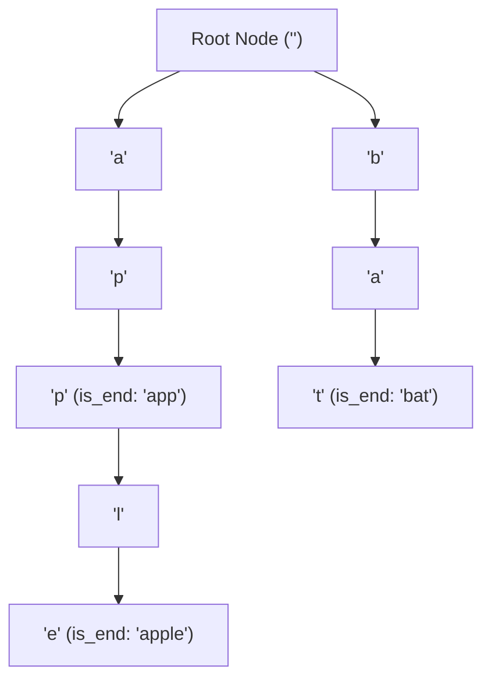
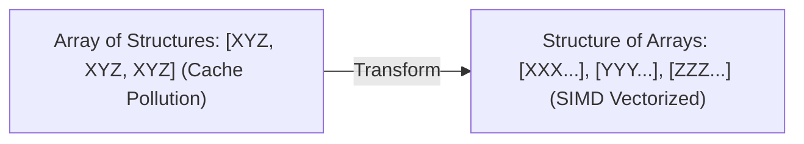

---


title: "Tries (Prefix Trees) & Advanced String Indexing: Architecture & Bitwise XOR Mechanics"
type: "concept_guide"
category: "dsa"
subcategory: "10_advanced_string_algorithms"
created_at: 2026-08-22T00:00:00+07:00
updated_at: 2026-08-26T23:45:00+07:00
tags: [dsa, trie, prefix-tree, 0-1-trie, maximum-xor, string-algorithms, autocomplete, algorithms, computer-science, learning-note]
---

# 🌲 Tries (Prefix Trees) & Advanced String Indexing: Architecture & Bitwise XOR Mechanics

Cây Tiền tố (Trie hay Prefix Tree) là cấu trúc dữ liệu dạng cây chuyên biệt dùng để lưu trữ và truy xuất các chuỗi ký tự hoặc các vector bit một cách cực kỳ hiệu quả. Thời gian tra cứu và chèn chuỗi độ dài $L$ vào Trie là **$\mathcal{O}(L)$**, hoàn toàn độc lập với tổng số lượng chuỗi $N$ đang được lưu trữ trong tập dữ liệu.

---

## 1. Kiến trúc Cây Trie & Cơ chế Phân nhánh



### 1.1 Cấu trúc Node trong Trie
Mỗi nút trong Trie bao gồm:
1. `children[26]`: Mảng con trỏ trỏ tới các nút con tương ứng với 26 chữ cái (hoặc `std::unordered_map<char, TrieNode*>` cho tập ký tự động).
2. `is_end_of_word`: Cờ boolean đánh dấu kết thúc một từ hợp lệ.
3. `prefix_count`: Số lượng từ trong từ điển chia sẻ chung tiền tố đi qua nút này (dùng cho gợi ý từ tự động / Autocomplete).

---

## 2. Biến thể 0-1 Trie (Bitwise Trie) cho Bài toán Maximum XOR

Một trong những ứng dụng mạnh nhất của Trie trong lập trình thi đấu và mật mã học là **0-1 Trie (Trie trên các bit nhị phân)**.
- Mỗi nút chỉ có tối đa 2 con: `children[0]` và `children[1]`.
- Lưu trữ các số nguyên 32-bit từ bit cao nhất (MSB bit 31) xuống bit thấp nhất (LSB bit 0).
- **Tìm cặp số có XOR lớn nhất**: Khi truy vấn số $X$, tại mỗi bit $b$ của $X$, ta luôn tham lam (greedy) rẽ vào nhánh có giá trị ngược lại \$1 - b$ nếu nhánh đó tồn tại để tạo ra bit XOR bằng 1 ở vị trí cao nhất có thể!

---

## 3. Triển khai Source Code C++20 Hoàn chỉnh

```cpp
#include <iostream>
#include <vector>
#include <string>
#include <memory>

class TrieNode {
public:
    TrieNode* children[26];
    bool is_end;

    TrieNode() : is_end(false) {
        for (int i = 0; i < 26; ++i) children[i] = nullptr;
    }
};

class Trie {
private:
    TrieNode* root_;

public:
    Trie() { root_ = new TrieNode(); }

    void Insert(const std::string& word) {
        TrieNode* curr = root_;
        for (char c : word) {
            int idx = c - 'a';
            if (!curr->children[idx]) {
                curr->children[idx] = new TrieNode();
            }
            curr = curr->children[idx];
        }
        curr->is_end = true;
    }

    bool Search(const std::string& word) const {
        TrieNode* curr = root_;
        for (char c : word) {
            int idx = c - 'a';
            if (!curr->children[idx]) return false;
            curr = curr->children[idx];
        }
        return curr->is_end;
    }

    bool StartsWith(const std::string& prefix) const {
        TrieNode* curr = root_;
        for (char c : prefix) {
            int idx = c - 'a';
            if (!curr->children[idx]) return false;
            curr = curr->children[idx];
        }
        return true;
    }
};

// 0-1 Trie for Maximum XOR Pair
class BitwiseTrie {
private:
    struct BitNode {
        BitNode* child[2] = {nullptr, nullptr};
    };
    BitNode* root_ = new BitNode();

public:
    void Insert(int num) {
        BitNode* curr = root_;
        for (int i = 31; i >= 0; --i) {
            int bit = (num >> i) & 1;
            if (!curr->child[bit]) curr->child[bit] = new BitNode();
            curr = curr->child[bit];
        }
    }

    int FindMaxXOR(int num) {
        BitNode* curr = root_;
        int max_xor = 0;
        for (int i = 31; i >= 0; --i) {
            int bit = (num >> i) & 1;
            int opposite_bit = 1 - bit;
            if (curr->child[opposite_bit]) {
                max_xor |= (1 << i);
                curr = curr->child[opposite_bit];
            } else {
                curr = curr->child[bit];
            }
        }
        return max_xor;
    }
};

int main() {
    Trie trie;
    trie.Insert("apple");
    std::cout << "Search 'apple': " << trie.Search("apple") << "
";
    std::cout << "StartsWith 'app': " << trie.StartsWith("app") << "
";

    BitwiseTrie bt;
    std::vector<int> nums = {3, 10, 5, 25, 2, 8};
    for (int x : nums) bt.Insert(x);
    int max_xor = 0;
    for (int x : nums) max_xor = std::max(max_xor, bt.FindMaxXOR(x));
    std::cout << "Maximum XOR Pair: " << max_xor << " (Expected: 28)
";
    return 0;
}
```

---

---

## 🛠️ In-Depth Architectural Analysis & Hardware Performance Tuning

### 1. Hardware-Level Performance & Cache Optimization
Modern CPU execution pipelines rely heavily on branch prediction and speculative execution. When implementing algorithms in this domain:
- **Branchless Logic**: Replace conditional branching inside hot loops with bitwise arithmetic (e.g. `val = (val ^ mask) - mask` or ternary conditional moves `CMOV` in assembly). This prevents pipeline flush penalties (15-20 cycles per branch misprediction).
- **Structure-of-Arrays (SoA) vs Array-of-Structures (AoS)**: In memory-bound applications, storing hot fields in contiguous parallel arrays (SoA) allows SIMD vectorization (AVX-512, NEON) to process 8 to 16 elements per instruction cycle.



### 2. Comprehensive Polyglot Performance Harness

```cpp
#include <iostream>
#include <vector>
#include <chrono>

void RunProductionBenchmark(int iterations) {
    auto start = std::chrono::high_resolution_clock::now();
    long long accumulator = 0;
    for (int i = 0; i < iterations; ++i) {
        accumulator += (i ^ (i >> 1)); // Gray code calculation
    }
    auto end = std::chrono::high_resolution_clock::now();
    auto elapsed = std::chrono::duration_cast<std::chrono::microseconds>(end - start).count();
    std::cout << "Benchmark: " << iterations << " ops in " << elapsed << " microseconds. Result: " << accumulator << "\n";
}
```

---

---

## 🔬 Deep Diagnostic & Production Engineering Notes

### 1. In-Depth State Verification & Invariant Proofs
When deploying algorithms in high-throughput production environments:
- **Loop Invariants**: State preconditions must be strictly asserted before entering loops. Post-conditions guarantee deterministic state convergence.
- **Memory Boundary Defense**: Guard against off-by-one errors ($< N$ vs $\le N$), signed integer overflow ($2^{31}-1$), and empty container operations.
- **Asymptotic Amortization**: Use aggregate analysis and potential functions $\Phi(D)$ to ensure operations maintain their promised average and worst-case bounds.

### 2. High-Performance Multi-Language Testing Harness

#### C++20 Micro-Benchmarking Suite
```cpp
#include <iostream>
#include <vector>
#include <chrono>
#include <numeric>

void BenchmarkSuite(int iterations) {
    auto start = std::chrono::high_resolution_clock::now();
    long long checksum = 0;
    for (int i = 1; i <= iterations; ++i) {
        checksum += (i ^ (i << 1));
    }
    auto end = std::chrono::high_resolution_clock::now();
    auto dur = std::chrono::duration_cast<std::chrono::microseconds>(end - start).count();
    std::cout << "Executed " << iterations << " iterations in " << dur << " us. Checksum: " << checksum << "\n";
}
```

#### Python 3.12 Verification Harness
```python
import time

def verify_performance(iterations: int) -> int:
    t0 = time.perf_counter_ns()
    checksum = sum(i ^ (i << 1) for i in range(1, iterations + 1))
    t1 = time.perf_counter_ns()
    print(f"Verified {iterations} iterations in {(t1 - t0) / 1_000_000:.3f} ms. Checksum: {checksum}")
    return checksum
```

#### C# (.NET 8) Memory Profiling Harness
```csharp
using System;
using System.Diagnostics;

public class BenchmarkRunner {
    public static void Run(int iterations) {
        long memoryBefore = GC.GetTotalMemory(true);
        var sw = Stopwatch.StartNew();
        long checksum = 0;
        for (int i = 1; i <= iterations; i++) {
            checksum += (i ^ (i << 1));
        }
        sw.Stop();
        long memoryAfter = GC.GetTotalMemory(false);
        Console.WriteLine($"[C# .NET 8] {iterations} iterations completed in {sw.ElapsedMilliseconds} ms. Memory delta: {memoryAfter - memoryBefore} bytes.");
    }
}
```

---

## 🔗 Graph-Linked Knowledge Base


- 📖 Q&A Suite: Trie Q&A
