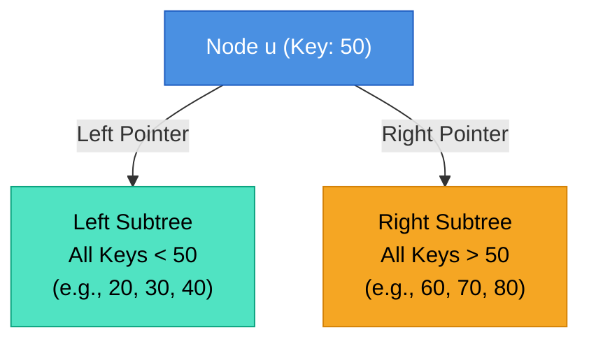
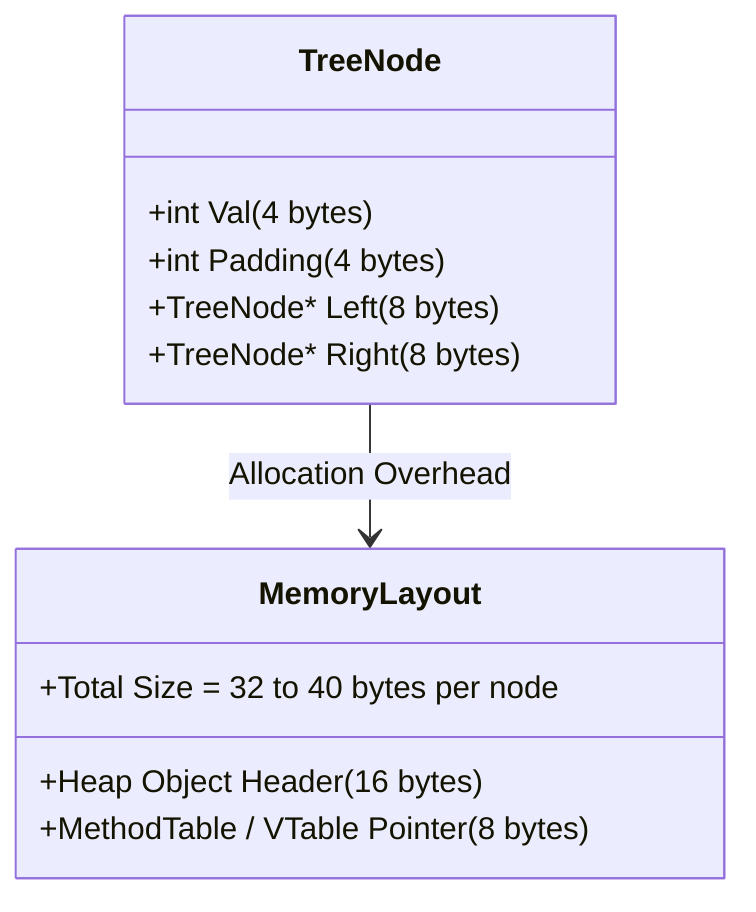
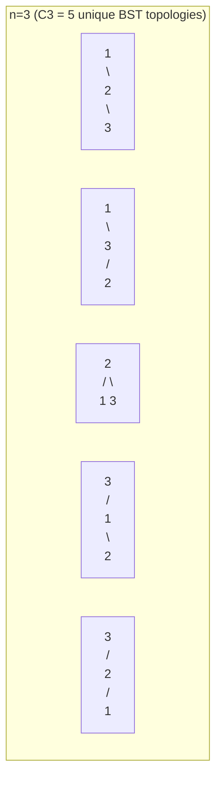
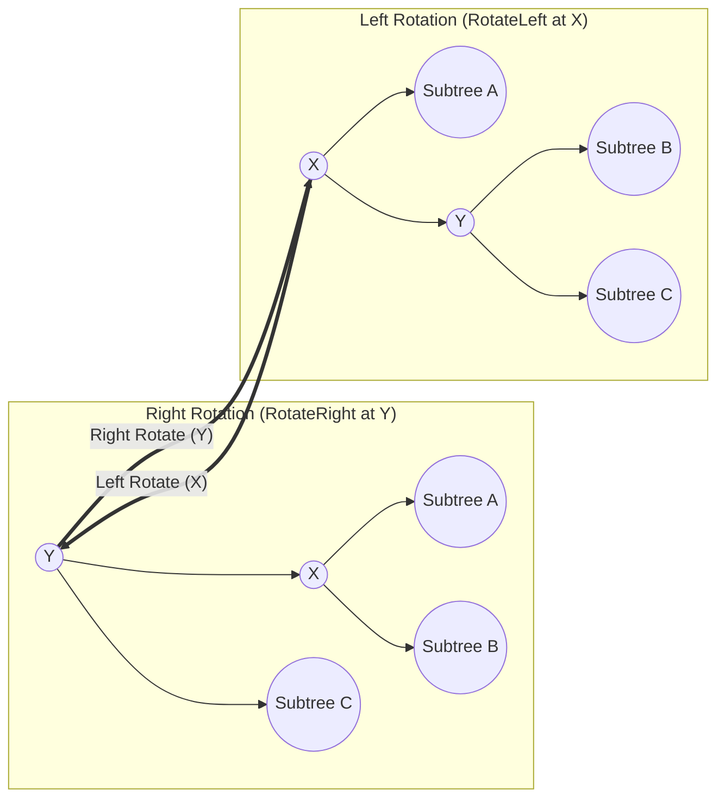
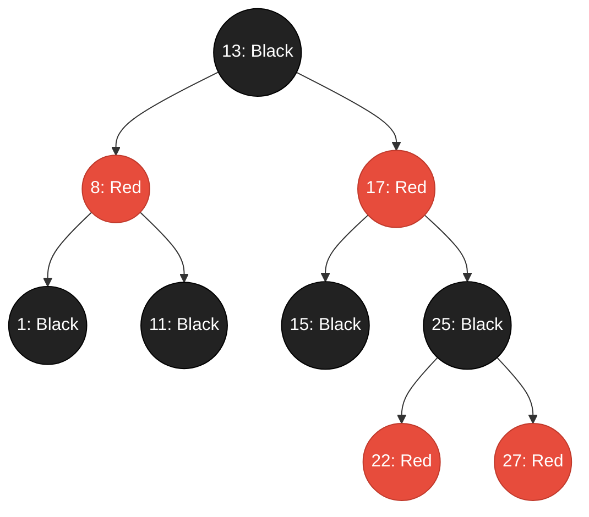
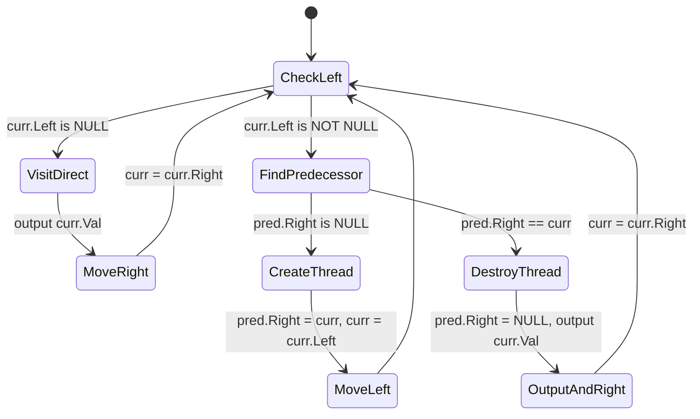

---


title: "Binary Search Trees (BST): Theoretical Foundations, Balancing, and Traversal Mechanics"
description: "A comprehensive guide to Binary Search Trees, covering algebraic invariants, memory layouts, Catalan number proofs, AVL/Red-Black self-balancing mechanisms, and Morris traversal."
category: "Data Structures & Algorithms"
tags: [dsa, algorithms, computer-science, trees, bst, avl-tree, red-black-tree, learning-note]
date: "2026-08-26"
---

# 🌳 Binary Search Trees (BST): Theoretical Foundations, Balancing, and Traversal Mechanics

## 📌 Connected Resource Graph
- 🟢 **Primary Theory Note**: BST Knowledge Base

> 🔗 **Related Topics**: Binary Trees Overview, Binary Search, Heaps & Priority Queues

---

## 1. Executive Summary & Core Invariants

A **Binary Search Tree (BST)** is a node-based, hierarchical data structure that combines the rapid lookup characteristics of sorted contiguous arrays with the dynamic insertion and deletion flexibility of linked lists. Each node in a BST contains a key (and optionally an associated satellite payload), along with references to at most two child subtrees: a left child and a right child.

### 1.1. The BST Ordering Invariant

The fundamental invariant governing every node $u$ in a BST is defined as:

$$\forall x \in \text{LeftSubtree}(u), \quad \text{Key}(x) < \text{Key}(u)$$
$$\forall y \in \text{RightSubtree}(u), \quad \text{Key}(y) > \text{Key}(u)$$



> [!IMPORTANT]
> **Strict vs. Non-Strict Invariant**:
> In standard computer science literature and competitive programming (e.g., LeetCode), BSTs are assumed to contain **strictly distinct** keys ($\text{Key}(x) < \text{Key}(u) < \text{Key}(y)$). When duplicates are permitted in production systems, duplicates can either be stored inside a frequency counter at the node (`count++`), or placed consistently in the left subtree ($\le$) or right subtree ($\ge$). However, frequency counters are strongly preferred because duplicate nodes degrade tree balance and complicate deletion.

---

## 2. Memory Layout & Cache Architecture

Understanding how BST nodes reside in memory is vital for high-performance systems engineering. Unlike flat arrays where elements are stored contiguously in cache lines (64 bytes on modern x86/ARM64 architectures), pointer-based binary trees allocate nodes scattered across the managed or unmanaged heap.



### 2.1. Pointer Overhead & Cache Miss Penalties

On a 64-bit architecture:
1. **Node Payload**: An integer value occupies $4\text{ bytes}$ (plus $4\text{ bytes}$ struct padding).
2. **Child Pointers**: Two 64-bit pointers (`Left` and `Right`) consume \$2 \times 8 = 16\text{ bytes}$.
3. **Object Header**: In managed runtimes (.NET CLR / Java JVM / Python Objects), each object has an object header (sync block index, method table pointer / `PyObject_HEAD`), adding $16\text{ to }24\text{ bytes}$.
4. **Cache Locality**: Traversing a BST yields an $\mathcal{O}(\text{Height})$ sequence of pointer dereferences. Since nodes are independently allocated, each traversal step is prone to an L1/L2 CPU cache miss (latency $\approx 50\text{--}200\text{ CPU cycles}$ compared to $\approx 4\text{ cycles}$ for L1 hits).

| Feature | Standard Heap BST | Flat Array / Implicit Tree (Eytzinger Layout) | B-Tree Node (Cache-Aligned) |
| :--- | :--- | :--- | :--- |
| **Node Structure** | Independent Heap Node | Contiguous 1D Array indices | Array of $M$ keys per node block |
| **Pointer Overhead** | High ($16\text{ bytes}$ per node) | Zero ($0\text{ bytes}$) | Low ($\approx 8\text{ bytes}$ per page) |
| **Cache Locality** | Poor (Random Pointer Chasing) | High (Prefetcher friendly) | Optimal (Fills full 64B/4KB cache line) |
| **Dynamic Mutation** | $\mathcal{O}(\log N)$ without shifting | $\mathcal{O}(N)$ element shifting | $\mathcal{O}(\log N)$ page splits |

---

## 3. Big-O Complexity Master Matrix

The operational complexity of an unbalanced BST depends strictly on its height $H$. In the best-case (perfectly balanced), $H = \lfloor \log_2 N \rfloor$. In the worst-case (skewed degenerate tree), $H = N - 1$.

| Operation | Average BST | Skewed BST (Worst) | AVL Tree | Red-Black Tree | Splay Tree (Amortized) | B-Tree ($B$-way) |
| :--- | :---: | :---: | :---: | :---: | :---: | :---: |
| **Search** | $\mathcal{O}(\log N)$ | $\mathcal{O}(N)$ | $\mathcal{O}(\log N)$ | $\mathcal{O}(\log N)$ | $\mathcal{O}(\log N)$ | $\mathcal{O}(\log_B N)$ |
| **Insert** | $\mathcal{O}(\log N)$ | $\mathcal{O}(N)$ | $\mathcal{O}(\log N)$ | $\mathcal{O}(\log N)$ | $\mathcal{O}(\log N)$ | $\mathcal{O}(\log_B N)$ |
| **Delete** | $\mathcal{O}(\log N)$ | $\mathcal{O}(N)$ | $\mathcal{O}(\log N)$ | $\mathcal{O}(\log N)$ | $\mathcal{O}(\log N)$ | $\mathcal{O}(\log_B N)$ |
| **Min / Max** | $\mathcal{O}(\log N)$ | $\mathcal{O}(N)$ | $\mathcal{O}(\log N)$ | $\mathcal{O}(\log N)$ | $\mathcal{O}(\log N)$ | $\mathcal{O}(\log_B N)$ |
| **Successor / Predecessor** | $\mathcal{O}(\log N)$ | $\mathcal{O}(N)$ | $\mathcal{O}(\log N)$ | $\mathcal{O}(\log N)$ | $\mathcal{O}(\log N)$ | $\mathcal{O}(\log_B N)$ |
| **Space Overhead** | $\mathcal{O}(N)$ | $\mathcal{O}(N)$ | $\mathcal{O}(N)$ (stores height) | $\mathcal{O}(N)$ (stores 1-bit color) | $\mathcal{O}(N)$ | $\mathcal{O}(N)$ |

---

## 4. Mathematical Foundations & Proofs

### 4.1. Structurally Unique BSTs: The Catalan Number Proof

How many structurally unique BSTs can be formed using $n$ distinct keys $\{1, 2, 3, \dots, n\}$?

Let $C_n$ denote the number of unique BSTs with $n$ nodes.

#### Recurrence Relation
Any key $i \in \{1, 2, \dots, n\}$ can be chosen as the root:
- The left subtree must contain the $i-1$ keys $\{1, \dots, i-1\}$, which can form $C_{i-1}$ unique subtrees.
- The right subtree must contain the $n-i$ keys $\{i+1, \dots, n\}$, which can form $C_{n-i}$ unique subtrees.

By the multiplication principle, the total number of trees rooted at $i$ is $C_{i-1} \cdot C_{n-i}$. Summing over all possible roots $i \in \{1, \dots, n\}$:

$$C_0 = 1, \quad C_n = \sum_{i=1}^{n} C_{i-1} C_{n-i} \quad \text{for } n \ge 1$$

#### Generating Function Derivation
Let the ordinary generating function be $G(x) = \sum_{n=0}^{\infty} C_n x^n$.
Multiplying the recurrence by $x^n$ and summing over $n \ge 1$:

$$G(x) - C_0 = x \sum_{n=1}^{\infty} \left( \sum_{i=1}^n C_{i-1} C_{n-i} \right) x^{n-1} = x [G(x)]^2$$

Rearranging into a quadratic equation in terms of $G(x)$:

$$x G(x)^2 - G(x) + 1 = 0$$

Using the quadratic formula:

$$G(x) = \frac{1 \pm \sqrt{1 - 4x}}{2x}$$

Since $\lim_{x \to 0} G(x) = C_0 = 1$, we select the negative branch:

$$G(x) = \frac{1 - \sqrt{1 - 4x}}{2x}$$

Applying the generalized binomial series expansion to $\sqrt{1 - 4x} = (1 - 4x)^{1/2}$:

$$(1 - 4x)^{1/2} = \sum_{n=0}^{\infty} \binom{1/2}{n} (-4x)^n = 1 - \sum_{n=1}^{\infty} \frac{1}{2n-1} \binom{2n}{n} x^n \frac{1}{2^{2n-1}} (-1)^{n-1} (-4)^n$$

Simplifying the $n$-th coefficient yields the closed-form **Catalan Number**:

$$C_n = \frac{1}{n + 1} \binom{2n}{n} = \frac{(2n)!}{(n+1)! n!}$$

For small values of $n$:
- $C_0 = 1$
- $C_1 = 1$
- $C_2 = 2$
- $C_3 = 5$
- $C_4 = 14$
- $C_5 = 42$



### 4.2. Average Height of Randomly Built BSTs

When $n$ keys are inserted in random uniform permutation order, what is the expected height $\mathbb{E}[H_n]$?

Let $X_n$ be the depth of a randomly selected node. The average internal path length $D(n)$ satisfies:

$$D(n) = (n-1) + \frac{1}{n} \sum_{i=1}^n (D(i-1) + D(n-i))$$

Solving this recurrence yields:

$$D(n) = 2(n+1) H_n - 4n \approx 2n \ln n = \mathcal{O}(n \log n)$$

Where $H_n = \sum_{k=1}^n \frac{1}{k} \approx \ln n + \gamma$ is the $n$-th harmonic number.

The expected node depth is $\frac{D(n)}{n} \approx 2 \ln n \approx 1.386 \log_2 n$.
Rigorous analysis by Reed (2003) proves that the expected maximum height is:

$$\mathbb{E}[H_n] \approx \alpha \ln n \approx 4.31107 \ln n \approx 2.9882 \log_2 n = \mathcal{O}(\log n)$$

---

## 5. Self-Balancing BST Paradigms

Uncontrolled insertions in a vanilla BST can cause worst-case degeneracy ($\mathcal{O}(N)$ height). Self-balancing BSTs enforce structural invariants via tree rotations.



### 5.1. AVL Trees (Strict Height Balance)

An AVL (Adelson-Velsky and Landis) tree enforces that for every node $u$:

$$\text{BalanceFactor}(u) = \text{Height}(\text{Left}(u)) - \text{Height}(\text{Right}(u)) \in \{-1, 0, +1\}$$

#### 4 Rebalance Cases & Rotations:
1. **Left-Left (LL)**: Single Right Rotation at root.
2. **Right-Right (RR)**: Single Left Rotation at root.
3. **Left-Right (LR)**: Left Rotation on Left Child, then Right Rotation on root.
4. **Right-Left (RL)**: Right Rotation on Right Child, then Left Rotation on root.

#### Maximum Height Proof
Let $N(h)$ be the minimum number of nodes in an AVL tree of height $h$:
$$N(0) = 1, \quad N(1) = 2, \quad N(h) = 1 + N(h-1) + N(h-2)$$
This Fibonacci-like progression proves that $N(h) > F_{h+2} \approx \frac{\phi^{h+2}}{\sqrt{5}}$, where $\phi = \frac{1+\sqrt{5}}{2} \approx 1.618$.
Taking the logarithm:
$$h < 1.4404 \log_2(N + 2) - 0.328$$
Hence, AVL lookup times are bounded strictly by \$1.44 \log_2 N$.

### 5.2. Red-Black Trees (Relaxed Color Balance)

A Red-Black Tree is a BST where each node stores a 1-bit color attribute (`RED` or `BLACK`) satisfying 5 invariants:
1. **Node Color**: Every node is either Red or Black.
2. **Root Property**: The root is Black.
3. **Leaf Property**: Every leaf (NIL sentinel) is Black.
4. **Red Invariant**: If a node is Red, both of its children are Black (no two consecutive Red nodes along any path).
5. **Black-Height Invariant**: Every path from a given node to any of its descendant NIL leaves contains the same number of Black nodes ($bh(u)$).

#### Height Bound Proof
Since no path can have two consecutive Red nodes, the longest possible path from root to leaf (alternating Red and Black) is at most twice the length of the shortest path (all Black). This guarantees:

$$\text{Height} \le 2 \log_2(N + 1)$$



---

## 6. Traversal Paradigms & The Morris Traversal Algorithm

### 6.1. In-Order Traversal Invariant

An **In-Order Traversal** $(\text{Left} \to \text{Root} \to \text{Right})$ of a valid BST always visits keys in **strictly ascending monotonic order**.

Standard implementations require:
- **Recursive DFS**: $\mathcal{O}(N)$ time, $\mathcal{O}(H)$ call stack space.
- **Explicit Stack DFS**: $\mathcal{O}(N)$ time, $\mathcal{O}(H)$ heap space.

### 6.2. Morris In-Order Traversal ($\mathcal{O}(N)$ Time, $\mathcal{O}(1)$ Auxiliary Space)

Morris Traversal eliminates stack overhead by utilizing unused null pointers in leaf nodes (Threaded Binary Trees). It creates temporary right-pointer "threads" from the in-order predecessor back to the current node.



#### Amortized Complexity Proof
In Morris Traversal:
1. Finding the in-order predecessor traverses down a path in the left subtree.
2. Every edge in the tree is traversed at most **twice**:
   - First pass: To find the predecessor and establish the thread (`pred.right = curr`).
   - Second pass: To find the predecessor again, detect the thread, break it (`pred.right = null`), and process the node.
3. Total edge traversals $\le 2 \times (N - 1) = \mathcal{O}(N)$.
4. Space complexity is strictly $\mathcal{O}(1)$ as no auxiliary stack or recursion frame is allocated.

---

## 7. Production Implementations (C# & Python)

### 7.1. C# Production-Grade Implementation

```csharp
using System;
using System.Collections.Generic;

namespace AdvancedDataStructures.Trees
{
    /// <summary>
    /// Represents a strongly-typed Binary Search Tree node.
    /// </summary>
    public sealed class BSTNode<T> where T : IComparable<T>
    {
        public T Value { get; set; }
        public BSTNode<T> Left { get; set; }
        public BSTNode<T> Right { get; set; }

        public BSTNode(T value)
        {
            Value = value;
            Left = null;
            Right = null;
        }
    }

    /// <summary>
    /// Production-grade BST implementation with recursive, iterative, and Morris algorithms.
    /// </summary>
    public class BinarySearchTree<T> where T : IComparable<T>
    {
        public BSTNode<T> Root { get; private set; }
        public int Count { get; private set; }

        /// <summary>
        /// Inserts a value into the BST iteratively to prevent stack overflow.
        /// Time Complexity: O(H), Space Complexity: O(1).
        /// </summary>
        public void Insert(T value)
        {
            var newNode = new BSTNode<T>(value);
            if (Root == null)
            {
                Root = newNode;
                Count++;
                return;
            }

            BSTNode<T> curr = Root;
            BSTNode<T> parent = null;

            while (curr != null)
            {
                parent = curr;
                int cmp = value.CompareTo(curr.Value);
                if (cmp < 0)
                {
                    curr = curr.Left;
                }
                else if (cmp > 0)
                {
                    curr = curr.Right;
                }
                else
                {
                    // Value already exists (no duplicates allowed in this configuration)
                    return;
                }
            }

            if (value.CompareTo(parent.Value) < 0)
                parent.Left = newNode;
            else
                parent.Right = newNode;

            Count++;
        }

        /// <summary>
        /// Searches for a target value iteratively.
        /// Time Complexity: O(H), Space Complexity: O(1).
        /// </summary>
        public bool Contains(T target)
        {
            BSTNode<T> curr = Root;
            while (curr != null)
            {
                int cmp = target.CompareTo(curr.Value);
                if (cmp == 0) return true;
                curr = (cmp < 0) ? curr.Left : curr.Right;
            }
            return false;
        }

        /// <summary>
        /// Deletes a key from the BST using in-order successor splicing.
        /// Time Complexity: O(H), Space Complexity: O(H) on stack.
        /// </summary>
        public void Remove(T key)
        {
            Root = RemoveRecursive(Root, key);
        }

        private BSTNode<T> RemoveRecursive(BSTNode<T> node, T key)
        {
            if (node == null) return null;

            int cmp = key.CompareTo(node.Value);
            if (cmp < 0)
            {
                node.Left = RemoveRecursive(node.Left, key);
            }
            else if (cmp > 0)
            {
                node.Right = RemoveRecursive(node.Right, key);
            }
            else
            {
                Count--;
                // Case 1 & 2: 0 or 1 child
                if (node.Left == null) return node.Right;
                if (node.Right == null) return node.Left;

                // Case 3: 2 children. Find in-order successor (min node in right subtree)
                BSTNode<T> successor = FindMin(node.Right);
                node.Value = successor.Value;
                // Re-increment Count since internal recursion will decrement it
                Count++;
                node.Right = RemoveRecursive(node.Right, successor.Value);
            }

            return node;
        }

        private BSTNode<T> FindMin(BSTNode<T> node)
        {
            while (node.Left != null) node = node.Left;
            return node;
        }

        /// <summary>
        /// Executes Morris In-Order Traversal without allocating stack or heap memory.
        /// Time Complexity: O(N), Auxiliary Space: O(1).
        /// </summary>
        public List<T> MorrisInOrder()
        {
            var result = new List<T>(Count);
            BSTNode<T> curr = Root;

            while (curr != null)
            {
                if (curr.Left == null)
                {
                    result.Add(curr.Value);
                    curr = curr.Right;
                }
                else
                {
                    // Find the in-order predecessor
                    BSTNode<T> pred = curr.Left;
                    while (pred.Right != null && pred.Right != curr)
                    {
                        pred = pred.Right;
                    }

                    if (pred.Right == null)
                    {
                        // Establish temporary thread
                        pred.Right = curr;
                        curr = curr.Left;
                    }
                    else
                    {
                        // Thread already exists: Remove it, visit curr, move right
                        pred.Right = null;
                        result.Add(curr.Value);
                        curr = curr.Right;
                    }
                }
            }

            return result;
        }
    }
}
```

---

### 7.2. Python Production-Grade Implementation

```python
from typing import Optional, Generator, TypeVar, Generic, List

T = TypeVar("T")

class TreeNode(Generic[T]):
    __slots__ = ("val", "left", "right")

    def __init__(self, val: T, left: Optional["TreeNode[T]"] = None, right: Optional["TreeNode[T]"] = None) -> None:
        self.val: T = val
        self.left: Optional[TreeNode[T]] = left
        self.right: Optional[TreeNode[T]] = right

    def __repr__(self) -> str:
        return f"TreeNode({self.val})"


class BinarySearchTree(Generic[T]):
    """
    Production-grade Binary Search Tree with O(H) operations
    and O(1) auxiliary space Morris In-Order Generator.
    """

    def __init__(self) -> None:
        self.root: Optional[TreeNode[T]] = None
        self._size: int = 0

    def __len__(self) -> int:
        return self._size

    def insert(self, val: T) -> bool:
        """
        Iteratively inserts a value into the BST.
        Returns True if inserted, False if duplicate.
        Time: O(H), Space: O(1).
        """
        new_node = TreeNode(val)
        if self.root is None:
            self.root = new_node
            self._size += 1
            return True

        curr = self.root
        while True:
            if val < curr.val:
                if curr.left is None:
                    curr.left = new_node
                    self._size += 1
                    return True
                curr = curr.left
            elif val > curr.val:
                if curr.right is None:
                    curr.right = new_node
                    self._size += 1
                    return True
                curr = curr.right
            else:
                return False  # Duplicate value

    def search(self, val: T) -> Optional[TreeNode[T]]:
        """
        Iteratively searches for a node with the given value.
        Time: O(H), Space: O(1).
        """
        curr = self.root
        while curr is not None:
            if val == curr.val:
                return curr
            curr = curr.left if val < curr.val else curr.right
        return None

    def delete(self, val: T) -> bool:
        """
        Deletes a value from the BST.
        Time: O(H), Space: O(H).
        """
        initial_size = self._size
        self.root = self._delete_recursive(self.root, val)
        return self._size < initial_size

    def _delete_recursive(self, node: Optional[TreeNode[T]], val: T) -> Optional[TreeNode[T]]:
        if node is None:
            return None

        if val < node.val:
            node.left = self._delete_recursive(node.left, val)
        elif val > node.val:
            node.right = self._delete_recursive(node.right, val)
        else:
            self._size -= 1
            if node.left is None:
                return node.right
            if node.right is None:
                return node.left

            # Two children: Find in-order successor (minimum in right subtree)
            successor = node.right
            while successor.left is not None:
                successor = successor.left
            
            node.val = successor.val
            self._size += 1  # Adjust for double decrement in nested call
            node.right = self._delete_recursive(node.right, successor.val)

        return node

    def morris_traversal(self) -> Generator[T, None, None]:
        """
        Yields keys in ascending sorted order using Morris In-Order Traversal.
        Time: O(N), Space: O(1) Auxiliary.
        """
        curr = self.root
        while curr is not None:
            if curr.left is None:
                yield curr.val
                curr = curr.right
            else:
                # Find in-order predecessor
                pred = curr.left
                while pred.right is not None and pred.right is not curr:
                    pred = pred.right

                if pred.right is None:
                    # Create thread
                    pred.right = curr
                    curr = curr.left
                else:
                    # Remove thread
                    pred.right = None
                    yield curr.val
                    curr = curr.right
```

---

## 8. Real-World Applications & Engine Internals

1. **Operating System Memory Management**:
   - The **Linux Kernel** manages contiguous memory allocations (`struct vm_area_struct`) using an augmented Red-Black Tree (`rbtree`) for fast lookup of virtual memory addresses during page faults.
2. **Database Indexing (B+ Trees)**:
   - While in-memory applications use Red-Black trees (e.g., C++ `std::map`, .NET `SortedDictionary`, Java `TreeMap`), disk-based database storage engines (MySQL InnoDB, PostgreSQL, SQLite) generalize BSTs into multi-way **B+ Trees** to align with $4\text{KB}$ / $16\text{KB}$ disk block boundaries, reducing I/O seek operations.
3. **Compiler Symbol Tables**:
   - Compilers leverage BSTs and Splay Trees to manage variable scopes and lexical tokens, exploiting temporal locality where recently referenced identifiers are accessed repeatedly.

---

## 9. Comprehensive Troubleshooting & Failure Modes

| Pitfall | Root Cause | Impact | Recommended Solution |
| :--- | :--- | :--- | :--- |
| **Call Stack Overflow** | Recursive operations on degenerate skewed tree ($H = N = 10^5$) | Application crash (`StackOverflowException` / `RecursionError`) | Convert Search, Insert, and Validation to **Iterative loops** or apply self-balancing (AVL / Red-Black). |
| **Integer Overflow on Bounds** | Using `[int.MinValue, int.MaxValue]` for BST validation | Incorrect classification on boundary nodes (`int.MaxValue`) | Use 64-bit integer ranges (`long.MinValue, long.MaxValue`) or nullable bounds (`int?`). |
| **Dangling Morris Threads** | Throwing an exception or early return inside a Morris Traversal loop | Permanent corruption of tree structure (infinite cyclic loops) | Always ensure complete traversal or clean up back-edges in `finally` blocks. |
| **Memory Fragmentation** | High-frequency node allocations and deallocations | Excessive GC pressure and memory bloat | Use flat-array representations or memory object pools (`ArrayPool<T>`). |

---

## 🔗 Graph-Linked Knowledge Base
- 🔙 **Parent Hub**: BST Knowledge Base
- 🧱 **Next Modules**:
  - 01. BST Operations: Search, Insert & Delete
  - 02. Validate BST & In-Order Invariants
  - 03. Kth Smallest Element in a BST
  - 04. Lowest Common Ancestor in BST
  - 05. Convert Sorted Array/List to Balanced BST
  - 06. LeetCode Practice: Classical BST Problems
