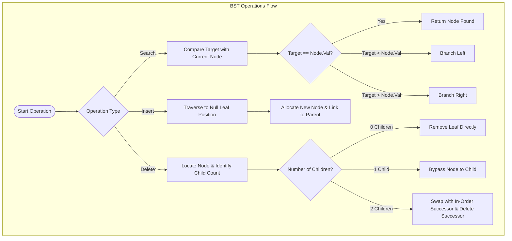
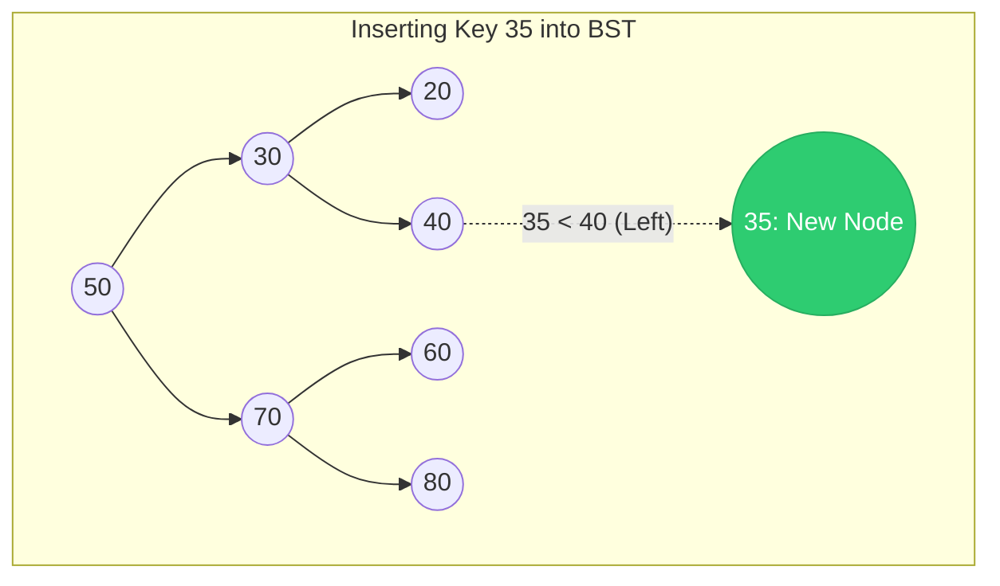
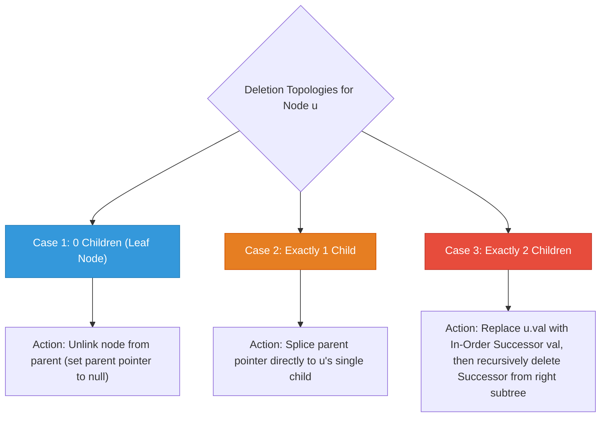
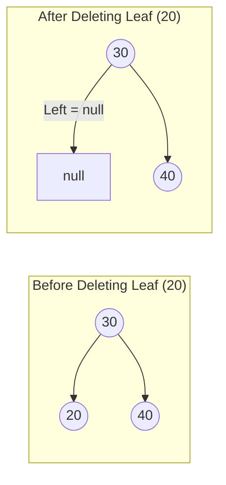
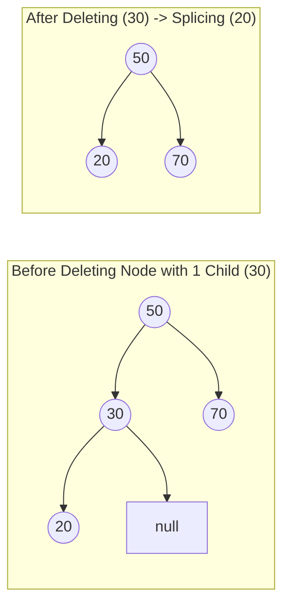
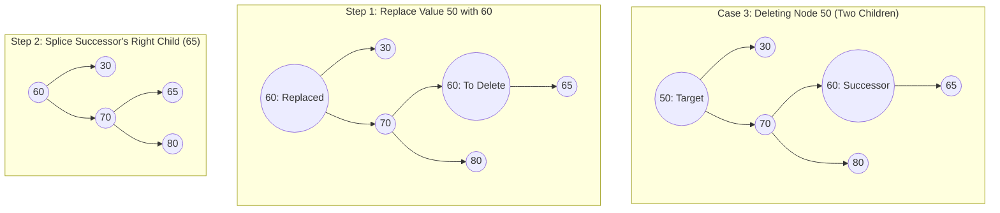
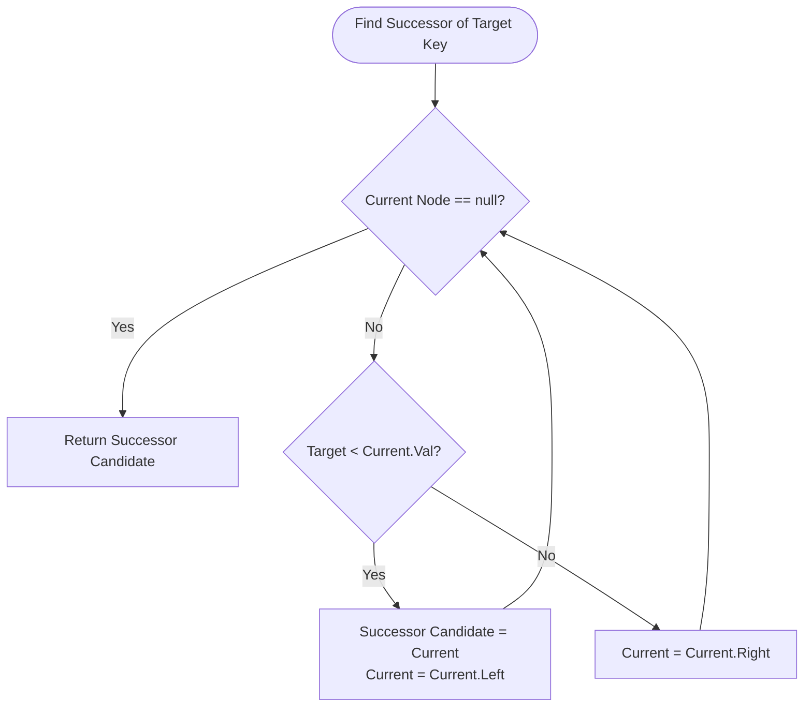

---


title: "Binary Search Tree Operations: Search, Insert & 3-Case Deletion Mechanics"
description: "Master the foundational operations of Binary Search Trees: Search, Insertion, and 3-case Deletion with in-order successor relinking, iterative vs recursive implementations in C# and Python, and rigorous edge-case analysis."
category: "Data Structures & Algorithms"
tags: [dsa, algorithms, computer-science, learning-note]
date: "2026-08-26"
---

# 🌳 Binary Search Tree Operations: Search, Insert & 3-Case Deletion Mechanics

## 📌 Connected Resource Graph
- 🟢 **Primary Theory Note**: [[01_DSA/01_theory_and_patterns/10_Binary_Search_Trees/00_overview_binary_search_trees_bst|00. BST Overview]]

> 🔗 **Related Topics**: [[01_DSA/01_theory_and_patterns/10_Binary_Search_Trees/02_validate_bst_and_inorder_properties|02. Validate BST]], [[01_DSA/01_theory_and_patterns/10_Binary_Search_Trees/06_leetcode_practice_bst_problems|06. LeetCode Practice]]

---

## 1. Introduction & The Fundamental Operations Triad

A **Binary Search Tree (BST)** maintains dynamic ordered data by enforcing the strict ordering rule:
- For any node $u$, every key in the left subtree is strictly smaller than $\text{Key}(u)$.
- Every key in the right subtree is strictly greater than $\text{Key}(u)$.

The three fundamental mutations and queries are:
1. **Search($k$)**: Locate the node containing key $k$ in $\mathcal{O}(H)$ time.
2. **Insert($k$)**: Insert a new leaf node containing key $k$ while preserving tree invariants in $\mathcal{O}(H)$ time.
3. **Delete($k$)**: Remove the node containing key $k$ and reconstruct pointer linkages in $\mathcal{O}(H)$ time.

Where $H$ is the tree height: $\lfloor \log_2 N \rfloor \le H \le N - 1$.



---

## 2. Deep Dive: Search & Insertion Mechanics

### 2.1. Search Algorithm

Searching in a BST mimics binary search over a sorted array. At each node $u$:
- If $\text{Target} = \text{Key}(u)$, lookup succeeds.
- If $\text{Target} < \text{Key}(u)$, search continues in the left child ($\text{Left}(u)$).
- If $\text{Target} > \text{Key}(u)$, search continues in the right child ($\text{Right}(u)$).
- If pointer becomes `null`, target is not present in the tree.

### 2.2. Insertion Algorithm

Insertion always creates a new **leaf node** (in a standard unbalanced BST). We traverse the tree as in `Search` until reaching a `null` reference, keeping track of the parent pointer, and link the new node to the parent's left or right slot.



---

## 3. Deep Dive: The 3 Cases of Node Deletion

Deleting a node from a BST is the most intricate operation because we must preserve the BST invariant across all remaining subtrees without creating disconnected sub-forests.

When the target node $u$ is identified, three structural topologies arise:



---

### 3.1. Case 1: Deleting a Leaf Node (0 Children)

The node has no children (`node.left == null && node.right == null`).
- **Action**: Replace the pointer from parent to $u$ with `null`.
- **Memory**: The node is deallocated or collected by GC.



---

### 3.2. Case 2: Deleting a Node with Exactly 1 Child

The node has either only a left child or only a right child.
- **Action**: Bypass the node $u$. Point $u$'s parent directly to $u$'s unique child.
- **Invariant Preservation**: Since all descendants in $u$'s subtree maintain the ordering relationship relative to $u$'s ancestors, bypassing $u$ preserves the BST invariant.



---

### 3.3. Case 3: Deleting a Node with Exactly 2 Children

When node $u$ has both left and right subtrees:
1. We cannot simply disconnect $u$, as doing so would orphan two separate subtrees.
2. Instead, we must find a node with a key value that can legitimately replace $u$'s position without violating ordering:
   - **In-Order Successor**: The smallest node in $u$'s **right subtree** ($\min(\text{Right}(u))$).
   - *Alternative*: **In-Order Predecessor**: The largest node in $u$'s **left subtree** ($\max(\text{Left}(u))$).
3. Copy the In-Order Successor's value into $u$.
4. Recursively delete the In-Order Successor node from $u$'s right subtree.
   - *Crucial Property*: The In-Order Successor is guaranteed to have at most **one child** (it can never have a left child, because any left child would be smaller, contradicting that it is the minimum). Thus, deleting the successor reduces to Case 1 or Case 2!



---

## 4. In-Order Successor & Predecessor Algorithms

Finding the in-order successor of a node $u$ in a BST is a classic query.

### Formal Rules:
1. **If $u$ has a right subtree**:
   - The successor is the **minimum node** in $u$'s right subtree:
   $$\text{Successor}(u) = \text{FindMin}(u.\text{right})$$
2. **If $u$ has NO right subtree**:
   - The successor is the lowest ancestor of $u$ whose left child is also an ancestor of $u$.
   - Starting from root, whenever we move left towards $u$, the current node is a potential successor candidate.



---

## 5. Complete Implementations: C# & Python

### 5.1. C# Implementation (Iterative & Recursive)

```csharp
using System;
using System.Collections.Generic;

namespace AdvancedBST.Operations
{
    public sealed class TreeNode
    {
        public int Val;
        public TreeNode Left;
        public TreeNode Right;

        public TreeNode(int val = 0, TreeNode left = null, TreeNode right = null)
        {
            Val = val;
            Left = left;
            Right = right;
        }
    }

    public static class BSTService
    {
        #region Search Operations

        /// <summary>
        /// Iterative BST Search.
        /// Time: O(H), Auxiliary Space: O(1).
        /// </summary>
        public static TreeNode SearchIterative(TreeNode root, int target)
        {
            TreeNode curr = root;
            while (curr != null)
            {
                if (curr.Val == target) return curr;
                curr = target < curr.Val ? curr.Left : curr.Right;
            }
            return null;
        }

        #endregion

        #region Insert Operations

        /// <summary>
        /// Recursive BST Insert.
        /// Time: O(H), Space: O(H) on call stack.
        /// </summary>
        public static TreeNode InsertRecursive(TreeNode root, int val)
        {
            if (root == null) return new TreeNode(val);

            if (val < root.Val)
                root.Left = InsertRecursive(root.Left, val);
            else if (val > root.Val)
                root.Right = InsertRecursive(root.Right, val);

            return root;
        }

        /// <summary>
        /// Iterative BST Insert (Zero Call-Stack Overhead).
        /// Time: O(H), Space: O(1).
        /// </summary>
        public static TreeNode InsertIterative(TreeNode root, int val)
        {
            var newNode = new TreeNode(val);
            if (root == null) return newNode;

            TreeNode curr = root;
            TreeNode parent = null;

            while (curr != null)
            {
                parent = curr;
                if (val < curr.Val)
                    curr = curr.Left;
                else if (val > curr.Val)
                    curr = curr.Right;
                else
                    return root; // Duplicate ignored
            }

            if (val < parent.Val)
                parent.Left = newNode;
            else
                parent.Right = newNode;

            return root;
        }

        #endregion

        #region Delete Operations

        /// <summary>
        /// Recursive BST 3-Case Deletion.
        /// Time: O(H), Space: O(H).
        /// </summary>
        public static TreeNode DeleteRecursive(TreeNode root, int key)
        {
            if (root == null) return null;

            if (key < root.Val)
            {
                root.Left = DeleteRecursive(root.Left, key);
            }
            else if (key > root.Val)
            {
                root.Right = DeleteRecursive(root.Right, key);
            }
            else
            {
                // Case 1: Leaf (0 children) & Case 2: 1 child
                if (root.Left == null) return root.Right;
                if (root.Right == null) return root.Left;

                // Case 3: 2 children
                // Find in-order successor (min value in right subtree)
                TreeNode successor = FindMin(root.Right);
                root.Val = successor.Val;
                // Delete successor from right subtree
                root.Right = DeleteRecursive(root.Right, successor.Val);
            }

            return root;
        }

        /// <summary>
        /// Iterative BST Deletion (Zero Call-Stack Allocation).
        /// Time: O(H), Space: O(1).
        /// </summary>
        public static TreeNode DeleteIterative(TreeNode root, int key)
        {
            TreeNode curr = root;
            TreeNode parent = null;

            // Step 1: Locate target node and its parent
            while (curr != null && curr.Val != key)
            {
                parent = curr;
                curr = key < curr.Val ? curr.Left : curr.Right;
            }

            if (curr == null) return root; // Key not found

            // Case 3: Node with two children
            if (curr.Left != null && curr.Right != null)
            {
                TreeNode succParent = curr;
                TreeNode succ = curr.Right;

                while (succ.Left != null)
                {
                    succParent = succ;
                    succ = succ.Left;
                }

                // Replace value
                curr.Val = succ.Val;

                // Now reduce problem to deleting succ (which has at most 1 right child)
                curr = succ;
                parent = succParent;
            }

            // Case 1 & Case 2: Node with at most 1 child
            TreeNode child = (curr.Left != null) ? curr.Left : curr.Right;

            if (parent == null)
            {
                // Deleting root node
                return child;
            }

            if (parent.Left == curr)
                parent.Left = child;
            else
                parent.Right = child;

            return root;
        }

        private static TreeNode FindMin(TreeNode node)
        {
            while (node.Left != null) node = node.Left;
            return node;
        }

        #endregion

        #region In-Order Successor / Predecessor

        /// <summary>
        /// Finds the in-order successor of a given key in O(H) time and O(1) space.
        /// </summary>
        public static TreeNode InOrderSuccessor(TreeNode root, TreeNode p)
        {
            if (p == null) return null;

            // If right subtree exists, find minimum in right subtree
            if (p.Right != null)
                return FindMin(p.Right);

            TreeNode successor = null;
            TreeNode curr = root;

            while (curr != null)
            {
                if (p.Val < curr.Val)
                {
                    successor = curr;
                    curr = curr.Left;
                }
                else if (p.Val > curr.Val)
                {
                    curr = curr.Right;
                }
                else
                {
                    break;
                }
            }

            return successor;
        }

        #endregion
    }
}
```

---

### 5.2. Python Implementation (Iterative & Recursive)

```python
from typing import Optional

class TreeNode:
    __slots__ = ("val", "left", "right")

    def __init__(self, val: int = 0, left: Optional["TreeNode"] = None, right: Optional["TreeNode"] = None) -> None:
        self.val: int = val
        self.left: Optional[TreeNode] = left
        self.right: Optional[TreeNode] = right

    def __repr__(self) -> str:
        return f"TreeNode({self.val})"


class BSTOperations:
    @staticmethod
    def search(root: Optional[TreeNode], target: int) -> Optional[TreeNode]:
        """
        Iterative search for target value.
        Time: O(H), Space: O(1).
        """
        curr = root
        while curr is not None:
            if curr.val == target:
                return curr
            curr = curr.left if target < curr.val else curr.right
        return None

    @staticmethod
    def insert_iterative(root: Optional[TreeNode], val: int) -> TreeNode:
        """
        Iterative insertion of a key.
        Time: O(H), Space: O(1).
        """
        new_node = TreeNode(val)
        if root is None:
            return new_node

        curr = root
        parent: Optional[TreeNode] = None

        while curr is not None:
            parent = curr
            if val < curr.val:
                curr = curr.left
            elif val > curr.val:
                curr = curr.right
            else:
                return root  # Value already exists

        if parent is not None:
            if val < parent.val:
                parent.left = new_node
            else:
                parent.right = new_node

        return root

    @staticmethod
    def delete_recursive(root: Optional[TreeNode], key: int) -> Optional[TreeNode]:
        """
        Recursive 3-case node deletion.
        Time: O(H), Space: O(H).
        """
        if root is None:
            return None

        if key < root.val:
            root.left = BSTOperations.delete_recursive(root.left, key)
        elif key > root.val:
            root.right = BSTOperations.delete_recursive(root.right, key)
        else:
            # Case 1 (0 children) and Case 2 (1 child)
            if root.left is None:
                return root.right
            if root.right is None:
                return root.left

            # Case 3: 2 children. Find in-order successor
            successor = root.right
            while successor.left is not None:
                successor = successor.left

            root.val = successor.val
            root.right = BSTOperations.delete_recursive(root.right, successor.val)

        return root

    @staticmethod
    def delete_iterative(root: Optional[TreeNode], key: int) -> Optional[TreeNode]:
        """
        Iterative 3-case node deletion.
        Time: O(H), Space: O(1).
        """
        curr: Optional[TreeNode] = root
        parent: Optional[TreeNode] = None

        while curr is not None and curr.val != key:
            parent = curr
            curr = curr.left if key < curr.val else curr.right

        if curr is None:
            return root  # Key not found

        # Case 3: 2 children -> Transform to Case 1 or 2
        if curr.left is not None and curr.right is not None:
            succ_parent = curr
            succ = curr.right
            while succ.left is not None:
                succ_parent = succ
                succ = succ.left

            curr.val = succ.val
            curr = succ
            parent = succ_parent

        # Case 1 & 2: At most one child
        child = curr.left if curr.left is not None else curr.right

        if parent is None:
            return child

        if parent.left is curr:
            parent.left = child
        else:
            parent.right = child

        return root

    @staticmethod
    def inorder_successor(root: Optional[TreeNode], p: TreeNode) -> Optional[TreeNode]:
        """
        Finds the in-order successor of node p.
        Time: O(H), Space: O(1).
        """
        if p.right is not None:
            curr = p.right
            while curr.left is not None:
                curr = curr.left
            return curr

        successor: Optional[TreeNode] = None
        curr = root
        while curr is not None:
            if p.val < curr.val:
                successor = curr
                curr = curr.left
            elif p.val > curr.val:
                curr = curr.right
            else:
                break
        return successor
```

---

## 6. Critical Edge Cases & Common Pitfalls

| Edge Case | Description | Mitigation Strategy |
| :--- | :--- | :--- |
| **Deleting Root Node** | The target key is at the root of the tree (`parent == null`). | In iterative delete, return `child` directly when `parent == null`. In recursive delete, the return value updates the caller's root pointer. |
| **Tree of Size 1** | Deleting the single node in the tree. | Handle `root.val == key` returning `null`. |
| **Successor is Immediate Right Child** | In Case 3 deletion, `root.right` has no left children (`succ == root.right`). | Ensure parent pointer handling correctly unlinks `succ` by connecting `root.right = succ.right`. |
| **Deep Call Stack Degeneracy** | Sequential sorted insertions $[1, 2, 3, \dots, N]$ cause $H = N$. | Recursive delete throws `StackOverflowException` for $N \ge 10,000$. Use iterative deletion or self-balancing trees. |
| **Handling Duplicate Keys** | Inserting duplicate values. | Maintain a `count` property within `TreeNode` instead of creating multiple nodes with identical keys. |

---

## 7. Comparative Performance & Complexity Summary

| Algorithm | Best-Case Time | Worst-Case Time | Call-Stack Space | Auxiliary Heap Space |
| :--- | :---: | :---: | :---: | :---: |
| **Recursive Search** | $\mathcal{O}(1)$ | $\mathcal{O}(N)$ | $\mathcal{O}(H)$ | $\mathcal{O}(1)$ |
| **Iterative Search** | $\mathcal{O}(1)$ | $\mathcal{O}(N)$ | $\mathcal{O}(1)$ | $\mathcal{O}(1)$ |
| **Recursive Insert** | $\mathcal{O}(1)$ | $\mathcal{O}(N)$ | $\mathcal{O}(H)$ | $\mathcal{O}(1)$ |
| **Iterative Insert** | $\mathcal{O}(1)$ | $\mathcal{O}(N)$ | $\mathcal{O}(1)$ | $\mathcal{O}(1)$ |
| **Recursive Delete** | $\mathcal{O}(1)$ | $\mathcal{O}(N)$ | $\mathcal{O}(H)$ | $\mathcal{O}(1)$ |
| **Iterative Delete** | $\mathcal{O}(1)$ | $\mathcal{O}(N)$ | $\mathcal{O}(1)$ | $\mathcal{O}(1)$ |

---

## 🔗 Graph-Linked Knowledge Base
- 🔙 **Parent Hub**: [[01_DSA/01_theory_and_patterns/10_Binary_Search_Trees/00_overview_binary_search_trees_bst|00. BST Overview]]
- 🧱 **Next Modules**:
  - [[01_DSA/01_theory_and_patterns/10_Binary_Search_Trees/02_validate_bst_and_inorder_properties|02. Validate BST & In-Order Properties]]
  - [[01_DSA/01_theory_and_patterns/10_Binary_Search_Trees/03_kth_smallest_element_in_bst|03. Kth Smallest Element in BST]]
  - [[01_DSA/01_theory_and_patterns/10_Binary_Search_Trees/04_lowest_common_ancestor_in_bst|04. Lowest Common Ancestor in BST]]
  - [[01_DSA/01_theory_and_patterns/10_Binary_Search_Trees/05_convert_sorted_array_list_to_balanced_bst|05. Convert Sorted Array/List to Balanced BST]]
  - [[01_DSA/01_theory_and_patterns/10_Binary_Search_Trees/06_leetcode_practice_bst_problems|06. LeetCode Practice: Classical BST Problems]]
