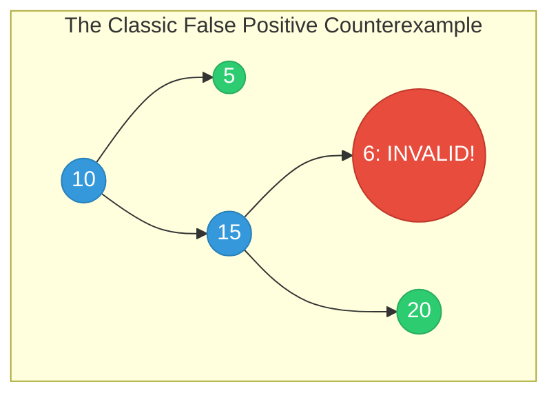
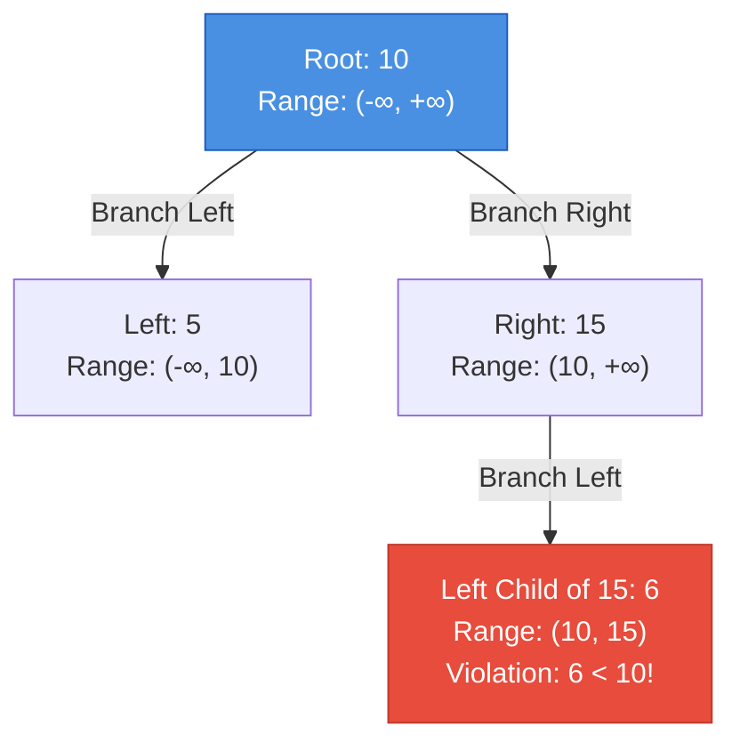
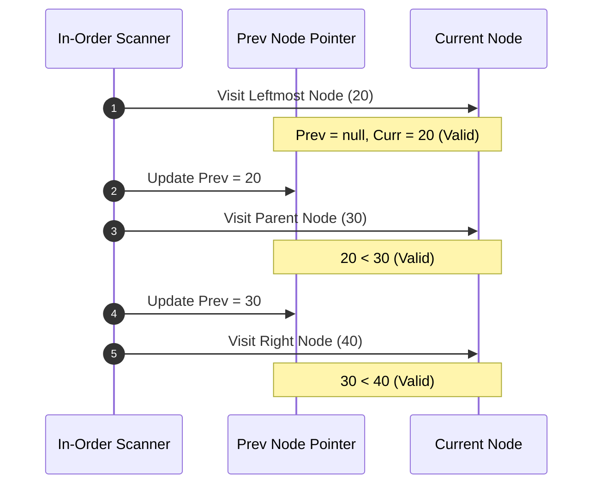

---


title: "Validating Binary Search Trees & In-Order Traversal Invariants"
description: "A deep technical analysis of BST validation algorithms: Min/Max range boundary propagation, monotonic in-order state machines, and O(1) space Morris traversal with integer overflow prevention."
category: "Data Structures & Algorithms"
tags: [dsa, algorithms, computer-science, learning-note]
date: "2026-08-26"
---

# 🔍 Validating Binary Search Trees & In-Order Traversal Invariants

## 📌 Connected Resource Graph
- 🟢 **Primary Theory Note**: [[01_DSA/01_theory_and_patterns/10_Binary_Search_Trees/00_overview_binary_search_trees_bst|00. BST Overview]]

> 🔗 **Related Topics**: [[01_DSA/01_theory_and_patterns/10_Binary_Search_Trees/01_bst_search_insert_delete|01. BST Operations]], [[01_DSA/01_theory_and_patterns/10_Binary_Search_Trees/03_kth_smallest_element_in_bst|03. Kth Smallest Element in BST]]

---

## 1. The Validation Problem & The Local Fallacy

The task of validating whether an arbitrary binary tree is a valid Binary Search Tree (BST) represents one of the most common pitfalls in algorithm design: **The Local Check Fallacy**.

### 1.1. Why Local Checking Fails

A novice intuition suggests checking if every node $u$ satisfies:

$$u.\text{left}.\text{val} < u.\text{val} < u.\text{right}.\text{val}$$

However, this local condition is **necessary but not sufficient**. The global BST invariant requires that **every node in the left subtree** is smaller than $u$, and **every node in the right subtree** is larger than $u$.



In the diagram above:
- Node $15$ locally satisfies \$6 < 15 < 20$.
- Node $10$ locally satisfies \$5 < 10 < 15$.
- **Failure**: Node $6$ resides in the right subtree of Node $10$, violating the global invariant \$6 > 10$. Thus, the tree is **NOT** a valid BST!

---

## 2. Approach 1: Min/Max Range Boundary Propagation

### 2.1. Mathematical Formulation

To validate globally, each node $u$ inherits an allowed open interval $(L, R)$:

$$\forall x \in \text{Subtree}(u), \quad L < \text{Val}(x) < R$$

When branching:
1. **Left Child**: Inherits the interval $(L, \text{Val}(u))$. Every left descendant must remain smaller than $u$ and greater than all previous left-bounding ancestors $L$.
2. **Right Child**: Inherits the interval $(\text{Val}(u), R)$. Every right descendant must remain greater than $u$ and smaller than all previous right-bounding ancestors $R$.



### 2.2. The Integer Overflow Trap

A critical implementation hazard occurs when tree nodes contain extreme integer values, such as:

$$\text{Val} = -2^{31} \ (\text{int.MinValue}) \quad \text{or} \quad \text{Val} = 2^{31} - 1 \ (\text{int.MaxValue})$$

If initial bounds are set to `int.MinValue` and `int.MaxValue`:
- A single-node tree `[2147483647]` checked against `node.val >= max` evaluates to `2147483647 >= 2147483647` $\implies \text{False}$ (incorrectly flagged invalid!).
- **Resolution**:
  1. In C# / C++: Use 64-bit integer ranges (`long min = long.MinValue, long max = long.MaxValue`).
  2. In Python: Native integers have arbitrary precision (`float('-inf'), float('inf')` or `None`).
  3. Strongly-typed / Generic: Use nullable bounds (`int? low, int? high`).

---

## 3. Approach 2: Monotonic In-Order Traversal

### 3.1. Theoretical Invariant

By the structural definition of a BST, an **In-Order Traversal** $(\text{Left} \to \text{Root} \to \text{Right})$ processes nodes in strictly increasing sorted order:

$$v_1 < v_2 < v_3 < \dots < v_n$$

We maintain a state pointer/reference to the `prev` visited node. For every visited node `curr`:
- If $\text{prev} \neq \text{null}$ and $\text{curr}.\text{val} \le \text{prev}.\text{val}$, the tree violates the BST invariant and is immediately rejected.



---

## 4. Approach 3: Morris In-Order Validation ($\mathcal{O}(1)$ Auxiliary Space)

Morris Traversal evaluates the monotonic sequence in $\mathcal{O}(N)$ time without an explicit stack or recursion frames.

### 4.1. The Critical "Early Exit / Tree Damage" Gotcha

In standard Morris Traversal, returning early upon discovering a violation can leave temporary threads (`pred.right = curr`) intact, permanently corrupting the tree structure!

> [!CAUTION]
> **Safety Rule**: When implementing Morris Validation in production or test environments, you must either:
> 1. Set a `bool isValid = true` flag and continue the traversal to ensure all back-edges are dismantled before returning, OR
> 2. Restore modified threads during exception handling / cleanup phase.

---

## 5. Complete Implementations: C# & Python

### 5.1. C# Implementations

```csharp
using System;
using System.Collections.Generic;

namespace AdvancedBST.Validation
{
    public sealed class TreeNode
    {
        public int Val;
        public TreeNode Left;
        public TreeNode Right;
        public TreeNode(int val = 0, TreeNode left = null, TreeNode right = null)
        {
            Val = val;
            Left = left;
            Right = right;
        }
    }

    public static class BSTValidator
    {
        /// <summary>
        /// Approach 1: Min/Max Range Boundary Propagation using 64-bit integers.
        /// Time: O(N), Space: O(H).
        /// </summary>
        public static bool IsValidBSTRange(TreeNode root)
        {
            return ValidateRange(root, long.MinValue, long.MaxValue);
        }

        private static bool ValidateRange(TreeNode node, long min, long max)
        {
            if (node == null) return true;

            if (node.Val <= min || node.Val >= max)
                return false;

            return ValidateRange(node.Left, min, node.Val) &&
                   ValidateRange(node.Right, node.Val, max);
        }

        /// <summary>
        /// Approach 2: Iterative Stack In-Order Traversal.
        /// Time: O(N), Space: O(H).
        /// </summary>
        public static bool IsValidBSTInOrderIterative(TreeNode root)
        {
            var stack = new Stack<TreeNode>();
            TreeNode curr = root;
            TreeNode prev = null;

            while (curr != null || stack.Count > 0)
            {
                while (curr != null)
                {
                    stack.Push(curr);
                    curr = curr.Left;
                }

                curr = stack.Pop();

                // Check strict monotonic increase
                if (prev != null && curr.Val <= prev.Val)
                    return false;

                prev = curr;
                curr = curr.Right;
            }

            return true;
        }

        /// <summary>
        /// Approach 3: Morris In-Order Traversal with Safe Pointer Restoration.
        /// Time: O(N), Auxiliary Space: O(1).
        /// </summary>
        public static bool IsValidBSTMorris(TreeNode root)
        {
            TreeNode curr = root;
            TreeNode prev = null;
            bool isValid = true;

            while (curr != null)
            {
                if (curr.Left == null)
                {
                    if (prev != null && curr.Val <= prev.Val)
                        isValid = false;

                    prev = curr;
                    curr = curr.Right;
                }
                else
                {
                    TreeNode pred = curr.Left;
                    while (pred.Right != null && pred.Right != curr)
                    {
                        pred = pred.Right;
                    }

                    if (pred.Right == null)
                    {
                        // Build thread
                        pred.Right = curr;
                        curr = curr.Left;
                    }
                    else
                    {
                        // Remove thread (Restore tree integrity)
                        pred.Right = null;

                        if (prev != null && curr.Val <= prev.Val)
                            isValid = false;

                        prev = curr;
                        curr = curr.Right;
                    }
                }
            }

            return isValid;
        }
    }
}
```

---

### 5.2. Python Implementations

```python
from typing import Optional

class TreeNode:
    __slots__ = ("val", "left", "right")

    def __init__(self, val: int = 0, left: Optional["TreeNode"] = None, right: Optional["TreeNode"] = None) -> None:
        self.val = val
        self.left = left
        self.right = right


class BSTValidator:
    @staticmethod
    def is_valid_bst_range(root: Optional[TreeNode]) -> bool:
        """
        Approach 1: Range Propagation with Arbitrary Precision Floats.
        Time: O(N), Space: O(H).
        """
        def validate(node: Optional[TreeNode], low: float, high: float) -> bool:
            if node is None:
                return True
            if not (low < node.val < high):
                return False
            return validate(node.left, low, node.val) and validate(node.right, node.val, high)

        return validate(root, float("-inf"), float("inf"))

    @staticmethod
    def is_valid_bst_inorder_iterative(root: Optional[TreeNode]) -> bool:
        """
        Approach 2: Explicit Stack In-Order Traversal.
        Time: O(N), Space: O(H).
        """
        stack = []
        curr = root
        prev_val: Optional[int] = None

        while curr is not None or stack:
            while curr is not None:
                stack.append(curr)
                curr = curr.left

            curr = stack.pop()

            if prev_val is not None and curr.val <= prev_val:
                return False

            prev_val = curr.val
            curr = curr.right

        return True

    @staticmethod
    def is_valid_bst_morris(root: Optional[TreeNode]) -> bool:
        """
        Approach 3: Morris In-Order Traversal with Safe Restoration.
        Time: O(N), Auxiliary Space: O(1).
        """
        curr = root
        prev_val: Optional[int] = None
        is_valid = True

        while curr is not None:
            if curr.left is None:
                if prev_val is not None and curr.val <= prev_val:
                    is_valid = False
                prev_val = curr.val
                curr = curr.right
            else:
                pred = curr.left
                while pred.right is not None and pred.right is not curr:
                    pred = pred.right

                if pred.right is None:
                    # Create thread
                    pred.right = curr
                    curr = curr.left
                else:
                    # Destroy thread
                    pred.right = None
                    if prev_val is not None and curr.val <= prev_val:
                        is_valid = False
                    prev_val = curr.val
                    curr = curr.right

        return is_valid
```

---

## 6. Comparison Matrix & Complexity Analysis

| Algorithm | Time Complexity | Auxiliary Space Complexity | Stack Overflow Risk | Modifies Input Tree |
| :--- | :---: | :---: | :---: | :---: |
| **Recursive Range Check** | $\mathcal{O}(N)$ | $\mathcal{O}(H)$ | High on degenerate trees ($H = N$) | No |
| **Iterative Stack In-Order** | $\mathcal{O}(N)$ | $\mathcal{O}(H)$ | None (Heap-allocated stack) | No |
| **Morris In-Order Traversal** | $\mathcal{O}(N)$ | $\mathcal{O}(1)$ | None | Temporarily during execution |

---

## 7. Edge Cases & Interview Checklist

1. **Duplicate Values**: Nodes with equal values (e.g., `[2, 2, 2]`) violate the strict invariant $u.\text{val} < \text{val} < u.\text{val}$ and must return `false`.
2. **Boundary Values**: Trees containing `int.MinValue` ($-2147483648$) or `int.MaxValue` ($2147483647$).
3. **Empty Tree & Single Node**: An empty tree (`null`) and a 1-node tree are valid BSTs by definition.
4. **Deep Skewed Tree**: \$100,000$ nodes in a single line. Recursive calls will fail with a stack overflow; iterative and Morris solutions execute cleanly.

---

## 🔗 Graph-Linked Knowledge Base
- 🔙 **Parent Hub**: [[01_DSA/01_theory_and_patterns/10_Binary_Search_Trees/00_overview_binary_search_trees_bst|00. BST Overview]]
- 🧱 **Next Modules**:
  - [[01_DSA/01_theory_and_patterns/10_Binary_Search_Trees/01_bst_search_insert_delete|01. BST Operations: Search, Insert & Delete]]
  - [[01_DSA/01_theory_and_patterns/10_Binary_Search_Trees/03_kth_smallest_element_in_bst|03. Kth Smallest Element in BST]]
  - [[01_DSA/01_theory_and_patterns/10_Binary_Search_Trees/04_lowest_common_ancestor_in_bst|04. Lowest Common Ancestor in BST]]
  - [[01_DSA/01_theory_and_patterns/10_Binary_Search_Trees/05_convert_sorted_array_list_to_balanced_bst|05. Convert Sorted Array/List to Balanced BST]]
  - [[01_DSA/01_theory_and_patterns/10_Binary_Search_Trees/06_leetcode_practice_bst_problems|06. LeetCode Practice: Classical BST Problems]]
