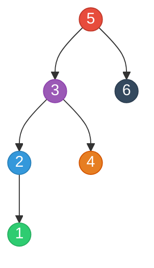
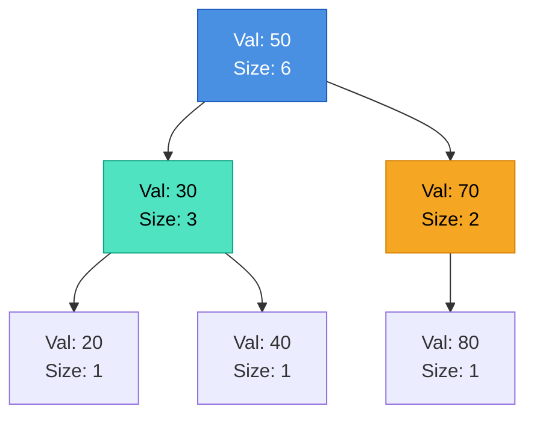

---


title: "Kth Smallest Element in a Binary Search Tree & Order-Statistic Trees"
description: "Master algorithms for finding the Kth smallest element in a BST: Early-stopping iterative stack traversal, O(1) space Morris traversal, and augmented Order-Statistic Trees for O(H) dynamic rank queries."
category: "Data Structures & Algorithms"
tags: [dsa, algorithms, computer-science, learning-note]
date: "2026-08-26"
---

# 🔢 Kth Smallest Element in a Binary Search Tree & Order-Statistic Trees

## 📌 Connected Resource Graph
- 🟢 **Primary Theory Note**: [[01_DSA/01_theory_and_patterns/10_Binary_Search_Trees/00_overview_binary_search_trees_bst|00. BST Overview]]

> 🔗 **Related Topics**: [[01_DSA/01_theory_and_patterns/10_Binary_Search_Trees/02_validate_bst_and_inorder_properties|02. Validate BST]], [[01_DSA/01_theory_and_patterns/10_Binary_Search_Trees/06_leetcode_practice_bst_problems|06. LeetCode Practice]]

---

## 1. Problem Formulation & Theoretical Core

Given the root of a Binary Search Tree (BST) and an integer $k$ (\$1 \le k \le N$), the objective is to return the $k$-th smallest value (1-indexed) stored within the tree.

### 1.1. In-Order Property

By the definition of a BST, an in-order traversal $(\text{Left} \to \text{Root} \to \text{Right})$ generates a sequence of keys sorted in monotonically increasing order:

$$S = \langle v_1, v_2, \dots, v_k, \dots, v_n \rangle \quad \text{where } v_1 < v_2 < \dots < v_n$$

Thus, the $k$-th smallest element is precisely the **$k$-th element visited** during an in-order traversal.



In-Order Visit Sequence for the tree above:
$$\text{Visit 1} \to \mathbf{1}, \quad \text{Visit 2} \to \mathbf{2}, \quad \text{Visit 3} \to \mathbf{3}, \quad \text{Visit 4} \to \mathbf{4}, \quad \text{Visit 5} \to \mathbf{5}, \quad \text{Visit 6} \to \mathbf{6}$$

If $k = 3$, the output is $\mathbf{3}$.

---

## 2. Algorithmic Approaches

### 2.1. Approach 1: Iterative Stack In-Order Traversal with Early Stopping

Instead of collecting all $N$ elements into a list ($\mathcal{O}(N)$ space), we simulate the recursion using an explicit stack and terminate traversal immediately after popping the $k$-th element.

- **Time Complexity**: $\mathcal{O}(H + k)$, where $H$ is the tree height. We traverse down to the leftmost leaf ($\mathcal{O}(H)$), then visit $k$ nodes. On a balanced BST, this is $\mathcal{O}(\log N + k)$.
- **Space Complexity**: $\mathcal{O}(H)$ to store the stack frames.

```mermaid
flowchart TD
    Start([Start: curr = root, stack = empty]) --> LeftLoop{curr != null?}
    LeftLoop -->|Yes| PushStack[stack.Push(curr)<br/>curr = curr.Left]
    PushStack --> LeftLoop
    
    LeftLoop -->|No| CheckStack{stack.Count > 0?}
    CheckStack -->|No| NotFound[Return -1]
    CheckStack -->|Yes| PopNode[curr = stack.Pop()<br/>k = k - 1]
    
    PopNode --> CheckK{k == 0?}
    CheckK -->|Yes| FoundAns([Return curr.Val])
    CheckK -->|No| MoveRight[curr = curr.Right]
    MoveRight --> LeftLoop
```

---

### 2.2. Approach 2: Morris In-Order Traversal ($\mathcal{O}(1)$ Auxiliary Space)

Using threaded binary tree pointers, we achieve $\mathcal{O}(1)$ auxiliary space. However, to avoid leaving dangling threads in the tree upon early termination, we must ensure all threads are dismantled if modifying the original tree is forbidden.

- **Time Complexity**: $\mathcal{O}(N)$ (to guarantee complete restoration) or $\mathcal{O}(H + k)$ if in-place modification during query is permitted.
- **Space Complexity**: $\mathcal{O}(1)$ strictly.

---

### 2.3. Approach 3: Augmented Order-Statistic Tree ($\mathcal{O}(H)$ Queries)

When the system must handle frequent queries alongside dynamic insertions and deletions (e.g., real-time gaming leaderboards, stock order books), standard traversals taking $\mathcal{O}(H + k)$ are insufficient.

We augment each node $u$ with a field:

$$\text{Size}(u) = \text{Count of nodes in subtree rooted at } u$$

$$\text{Size}(u) = \text{Size}(\text{Left}(u)) + \text{Size}(\text{Right}(u)) + 1$$



#### Selection Algorithm by Rank:
Let $L = \text{Size}(\text{Left}(u))$. The relative rank of node $u$ in its own subtree is $L + 1$.
1. **If $k = L + 1$**: Node $u$ is the $k$-th smallest element. Return $\text{Val}(u)$.
2. **If $k \le L$**: The $k$-th smallest element resides in the **left subtree**. Recurse on $\text{Left}(u)$ with the same index $k$.
3. **If $k > L + 1$**: The $k$-th smallest element resides in the **right subtree**. Recurse on $\text{Right}(u)$ with adjusted index:
   $$k' = k - (L + 1)$$

- **Time Complexity**: $\mathcal{O}(H) = \mathcal{O}(\log N)$ on a balanced tree, completely independent of $k$.

---

## 3. Complete Implementations: C# & Python

### 3.1. C# Implementations

```csharp
using System;
using System.Collections.Generic;

namespace AdvancedBST.KthSmallest
{
    public sealed class TreeNode
    {
        public int Val;
        public TreeNode Left;
        public TreeNode Right;
        public TreeNode(int val = 0, TreeNode left = null, TreeNode right = null)
        {
            Val = val;
            Left = left;
            Right = right;
        }
    }

    public static class KthSmallestSolver
    {
        /// <summary>
        /// Approach 1: Early-stopping Iterative Stack In-Order Traversal.
        /// Time: O(H + K), Space: O(H).
        /// </summary>
        public static int KthSmallestStack(TreeNode root, int k)
        {
            var stack = new Stack<TreeNode>();
            TreeNode curr = root;

            while (curr != null || stack.Count > 0)
            {
                while (curr != null)
                {
                    stack.Push(curr);
                    curr = curr.Left;
                }

                curr = stack.Pop();
                k--;
                if (k == 0)
                {
                    return curr.Val;
                }

                curr = curr.Right;
            }

            throw new ArgumentException("K exceeds number of nodes in the tree.");
        }

        /// <summary>
        /// Approach 2: Morris In-Order Traversal with Safe Thread Cleanup.
        /// Time: O(N), Auxiliary Space: O(1).
        /// </summary>
        public static int KthSmallestMorris(TreeNode root, int k)
        {
            TreeNode curr = root;
            int result = -1;
            int count = 0;

            while (curr != null)
            {
                if (curr.Left == null)
                {
                    count++;
                    if (count == k) result = curr.Val;
                    curr = curr.Right;
                }
                else
                {
                    TreeNode pred = curr.Left;
                    while (pred.Right != null && pred.Right != curr)
                    {
                        pred = pred.Right;
                    }

                    if (pred.Right == null)
                    {
                        pred.Right = curr;
                        curr = curr.Left;
                    }
                    else
                    {
                        pred.Right = null;
                        count++;
                        if (count == k) result = curr.Val;
                        curr = curr.Right;
                    }
                }
            }

            return result;
        }
    }

    /// <summary>
    /// Approach 3: Augmented Order-Statistic Tree Node and Implementation.
    /// </summary>
    public sealed class OSTNode
    {
        public int Val;
        public int SubtreeSize;
        public OSTNode Left;
        public OSTNode Right;

        public OSTNode(int val)
        {
            Val = val;
            SubtreeSize = 1;
            Left = null;
            Right = null;
        }
    }

    public class OrderStatisticTree
    {
        public OSTNode Root { get; private set; }

        public void Insert(int val)
        {
            Root = InsertRecursive(Root, val);
        }

        private OSTNode InsertRecursive(OSTNode node, int val)
        {
            if (node == null) return new OSTNode(val);

            if (val < node.Val)
                node.Left = InsertRecursive(node.Left, val);
            else if (val > node.Val)
                node.Right = InsertRecursive(node.Right, val);

            // Update subtree size
            node.SubtreeSize = 1 + GetSize(node.Left) + GetSize(node.Right);
            return node;
        }

        private int GetSize(OSTNode node) => node?.SubtreeSize ?? 0;

        /// <summary>
        /// Queries the K-th smallest element in O(H) time.
        /// </summary>
        public int FindKthSmallest(int k)
        {
            return QueryRank(Root, k);
        }

        private int QueryRank(OSTNode node, int k)
        {
            if (node == null) throw new ArgumentOutOfRangeException(nameof(k));

            int leftSize = GetSize(node.Left);

            if (k == leftSize + 1)
                return node.Val;

            if (k <= leftSize)
                return QueryRank(node.Left, k);

            return QueryRank(node.Right, k - leftSize - 1);
        }
    }
}
```

---

### 3.2. Python Implementations

```python
from typing import Optional

class TreeNode:
    __slots__ = ("val", "left", "right")

    def __init__(self, val: int = 0, left: Optional["TreeNode"] = None, right: Optional["TreeNode"] = None) -> None:
        self.val = val
        self.left = left
        self.right = right


class KthSmallestSolver:
    @staticmethod
    def kth_smallest_stack(root: Optional[TreeNode], k: int) -> int:
        """
        Approach 1: Iterative Stack In-Order Traversal.
        Time: O(H + K), Space: O(H).
        """
        stack = []
        curr = root

        while curr is not None or stack:
            while curr is not None:
                stack.append(curr)
                curr = curr.left

            curr = stack.pop()
            k -= 1
            if k == 0:
                return curr.val

            curr = curr.right

        raise ValueError("k is larger than the number of nodes in the tree")

    @staticmethod
    def kth_smallest_morris(root: Optional[TreeNode], k: int) -> int:
        """
        Approach 2: Morris In-Order Traversal.
        Time: O(N), Space: O(1) Auxiliary.
        """
        curr = root
        count = 0
        ans = -1

        while curr is not None:
            if curr.left is None:
                count += 1
                if count == k:
                    ans = curr.val
                curr = curr.right
            else:
                pred = curr.left
                while pred.right is not None and pred.right is not curr:
                    pred = pred.right

                if pred.right is None:
                    pred.right = curr
                    curr = curr.left
                else:
                    pred.right = None
                    count += 1
                    if count == k:
                        ans = curr.val
                    curr = curr.right

        return ans


class OSTNode:
    __slots__ = ("val", "size", "left", "right")

    def __init__(self, val: int) -> None:
        self.val: int = val
        self.size: int = 1
        self.left: Optional[OSTNode] = None
        self.right: Optional[OSTNode] = None


class OrderStatisticTree:
    """
    Augmented BST maintaining subtree sizes for O(H) dynamic rank queries.
    """

    def __init__(self) -> None:
        self.root: Optional[OSTNode] = None

    def insert(self, val: int) -> None:
        def _insert(node: Optional[OSTNode], v: int) -> OSTNode:
            if node is None:
                return OSTNode(v)
            if v < node.val:
                node.left = _insert(node.left, v)
            elif v > node.val:
                node.right = _insert(node.right, v)
            node.size = 1 + (node.left.size if node.left else 0) + (node.right.size if node.right else 0)
            return node

        self.root = _insert(self.root, val)

    def find_kth(self, k: int) -> int:
        def _query(node: Optional[OSTNode], target_k: int) -> int:
            if node is None:
                raise IndexError("k is out of range")
            left_size = node.left.size if node.left else 0
            if target_k == left_size + 1:
                return node.val
            elif target_k <= left_size:
                return _query(node.left, target_k)
            else:
                return _query(node.right, target_k - left_size - 1)

        return _query(self.root, k)
```

---

## 4. Complexity & Architecture Tradeoffs

| Mechanism | Lookup Time | Insert Time | Delete Time | Space Overhead | Best Use Case |
| :--- | :---: | :---: | :---: | :---: | :--- |
| **Iterative Stack In-Order** | $\mathcal{O}(H + K)$ | $\mathcal{O}(H)$ | $\mathcal{O}(H)$ | $\mathcal{O}(H)$ Stack | Read-heavy static trees, small $k$ |
| **Morris Traversal** | $\mathcal{O}(N)$ | $\mathcal{O}(H)$ | $\mathcal{O}(H)$ | $\mathcal{O}(1)$ strictly | Embedded systems with severe RAM constraints |
| **Order-Statistic Tree** | $\mathcal{O}(H)$ | $\mathcal{O}(H)$ | $\mathcal{O}(H)$ | $\mathcal{O}(N)$ (+4 bytes/node) | High-throughput dynamic rank & percentile systems |

---

## 🔗 Graph-Linked Knowledge Base
- 🔙 **Parent Hub**: [[01_DSA/01_theory_and_patterns/10_Binary_Search_Trees/00_overview_binary_search_trees_bst|00. BST Overview]]
- 🧱 **Next Modules**:
  - [[01_DSA/01_theory_and_patterns/10_Binary_Search_Trees/01_bst_search_insert_delete|01. BST Operations: Search, Insert & Delete]]
  - [[01_DSA/01_theory_and_patterns/10_Binary_Search_Trees/02_validate_bst_and_inorder_properties|02. Validate BST & In-Order Properties]]
  - [[01_DSA/01_theory_and_patterns/10_Binary_Search_Trees/04_lowest_common_ancestor_in_bst|04. Lowest Common Ancestor in BST]]
  - [[01_DSA/01_theory_and_patterns/10_Binary_Search_Trees/05_convert_sorted_array_list_to_balanced_bst|05. Convert Sorted Array/List to Balanced BST]]
  - [[01_DSA/01_theory_and_patterns/10_Binary_Search_Trees/06_leetcode_practice_bst_problems|06. LeetCode Practice: Classical BST Problems]]
