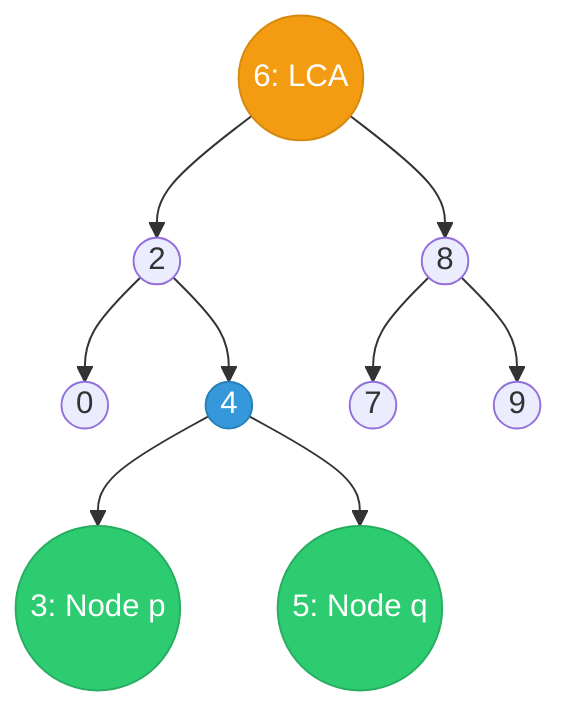
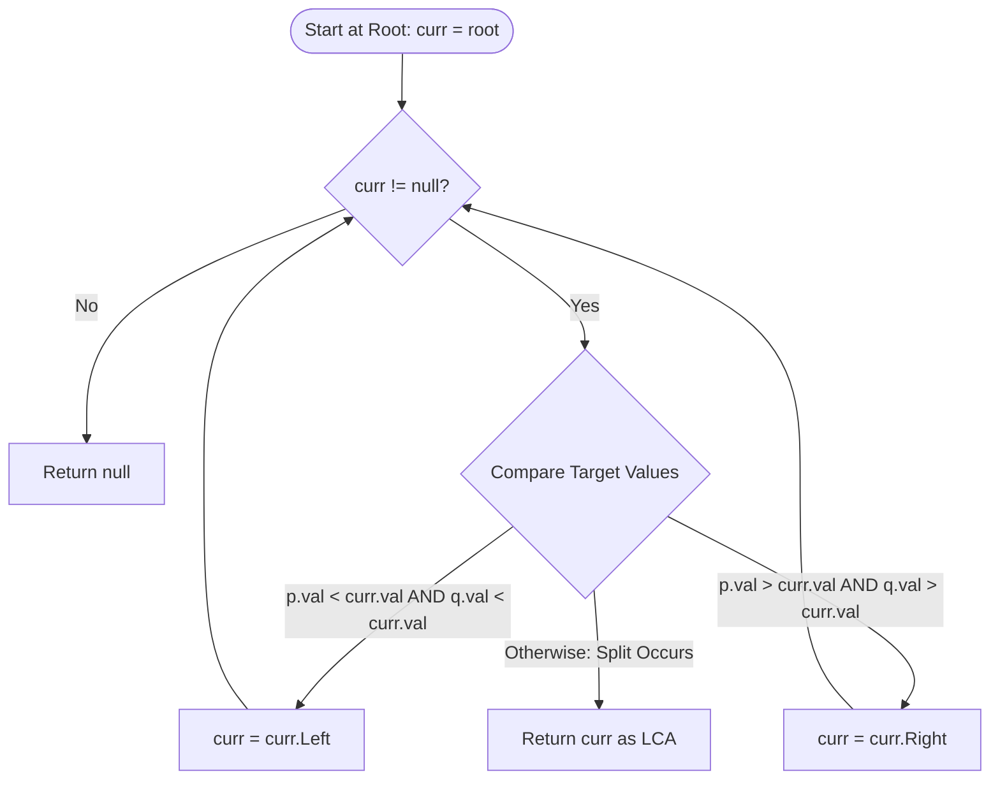
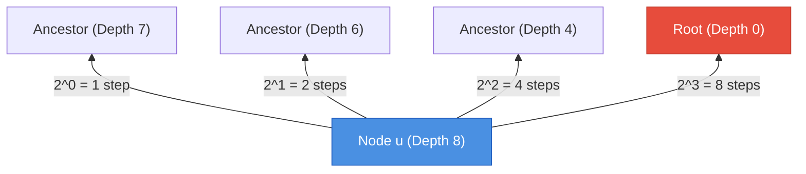

---


title: "Lowest Common Ancestor in a Binary Search Tree & Binary Lifting Mechanics"
description: "Master Lowest Common Ancestor (LCA) algorithms: Value split point invariant in BSTs, O(1) space iterative search, comparison with general binary trees, and binary lifting for O(log N) tree queries."
category: "Data Structures & Algorithms"
tags: [dsa, algorithms, computer-science, learning-note]
date: "2026-08-26"
---

# 🌿 Lowest Common Ancestor in a Binary Search Tree & Binary Lifting Mechanics

## 📌 Connected Resource Graph
- 🟢 **Primary Theory Note**: [[01_DSA/01_theory_and_patterns/10_Binary_Search_Trees/00_overview_binary_search_trees_bst|00. BST Overview]]

> 🔗 **Related Topics**: [[01_DSA/01_theory_and_patterns/09_Binary_Trees/00_overview_binary_trees|Binary Trees Overview]], [[01_DSA/01_theory_and_patterns/10_Binary_Search_Trees/06_leetcode_practice_bst_problems|06. LeetCode Practice]]

---

## 1. Problem Definition & Core Theorems

Given a Binary Search Tree (BST) and two distinct target nodes $p$ and $q$ belonging to the tree, find their **Lowest Common Ancestor (LCA)**.

> **Definition (Lowest Common Ancestor)**:  
> The LCA of two nodes $p$ and $q$ in a rooted tree $T$ is the deepest node $u \in T$ that has both $p$ and $q$ as descendants (where a node is permitted to be a descendant of itself).



In the diagram above:
- If $p = 2$ and $q = 8$, their LCA is node **$6$** (the root).
- If $p = 3$ and $q = 5$, their LCA is node **$4$**.
- If $p = 2$ and $q = 4$, their LCA is node **$2$** (a node can be its own ancestor).

---

## 2. Theoretical Invariant: The "Split Point" Property

In a general binary tree, finding the LCA requires a post-order traversal exploring both subtrees ($\mathcal{O}(N)$ time). In a BST, the key ordering property enables an optimal top-down search in $\mathcal{O}(H)$ time without exploring unnecessary subtrees.

### 2.1. Mathematical Proof of the Split Point Invariant

Let $u$ be the current node being evaluated, with target nodes $p$ and $q$ (assume without loss of generality that $\text{Val}(p) < \text{Val}(q)$).

Three mutually exclusive cases exist:

$$\begin{cases}
\text{Val}(q) < \text{Val}(u) & \implies \text{Both } p \text{ and } q \text{ lie strictly in the LEFT subtree of } u \\
\text{Val}(p) > \text{Val}(u) & \implies \text{Both } p \text{ and } q \text{ lie strictly in the RIGHT subtree of } u \\
\text{Val}(p) \le \text{Val}(u) \le \text{Val}(q) & \implies u \text{ is the UNIQUE Lowest Common Ancestor (The Split Point)}
\end{cases}$$

#### Proof by Contradiction:
Assume $u$ is the first node along the root-to-descendant path where $\text{Val}(p) \le \text{Val}(u) \le \text{Val}(q)$, but $u$ is NOT the LCA.
1. If $\text{Val}(p) < \text{Val}(u) < \text{Val}(q)$, then $p$ must reside in $\text{LeftSubtree}(u)$ and $q$ must reside in $\text{RightSubtree}(u)$.
2. Any proper descendant of $u$ in the left subtree contains keys strictly smaller than $\text{Val}(u)$, hence it cannot be an ancestor of $q$.
3. Any proper descendant of $u$ in the right subtree contains keys strictly greater than $\text{Val}(u)$, hence it cannot be an ancestor of $p$.
4. No deeper node can be an ancestor to both $p$ and $q$. Thus, $u$ is uniquely the Lowest Common Ancestor. $\blacksquare$



---

## 3. Comparative Taxonomy: BST vs General Trees vs DAGs

| Feature | BST LCA | General Binary Tree LCA | Tree with Binary Lifting | Directed Acyclic Graph (DAG) |
| :--- | :--- | :--- | :--- | :--- |
| **Lookup Time** | $\mathcal{O}(H) = \mathcal{O}(\log N)$ | $\mathcal{O}(N)$ | $\mathcal{O}(\log N)$ | $\mathcal{O}(V + E)$ |
| **Auxiliary Space** | $\mathcal{O}(1)$ (Iterative) | $\mathcal{O}(H)$ (Stack) | $\mathcal{O}(N \log N)$ (Jump Table) | $\mathcal{O}(V)$ |
| **Preprocessing** | None ($\mathcal{O}(1)$) | None ($\mathcal{O}(1)$) | $\mathcal{O}(N \log N)$ DFS | Topological Sort / BFS |
| **Core Technique** | Value Split Comparison | Post-Order DFS Return | $2^k$ Binary Exponentiation | Multi-source BFS Reconvergence |

---

## 4. Advanced Topic: Binary Lifting for Static Trees

When queries arrive on general trees (without BST ordering), we precompute binary ancestor jumps using dynamic programming.

### 4.1. Recurrence Relation
Let $up[u][i]$ represent the $2^i$-th ancestor of node $u$:

$$up[u][0] = \text{Parent}(u)$$
$$up[u][i] = up\big[ up[u][i-1] \big][i-1] \quad \text{for } i \ge 1$$

To find $\text{LCA}(u, v)$:
1. Lift the deeper node until $\text{Depth}(u) = \text{Depth}(v)$.
2. If $u == v$, return $u$.
3. Simultaneously lift both $u$ and $v$ in decreasing powers of $2$ ($i = \lfloor \log_2 N \rfloor \dots 0$) whenever $up[u][i] \neq up[v][i]$.
4. The LCA is the direct parent $up[u][0]$.



---

## 5. Complete Implementations: C# & Python

### 5.1. C# Implementations

```csharp
using System;
using System.Collections.Generic;

namespace AdvancedBST.LCA
{
    public sealed class TreeNode
    {
        public int Val;
        public TreeNode Left;
        public TreeNode Right;
        public TreeNode(int val = 0, TreeNode left = null, TreeNode right = null)
        {
            Val = val;
            Left = left;
            Right = right;
        }
    }

    public static class LCASolver
    {
        /// <summary>
        /// Approach 1: Iterative BST LCA Search.
        /// Time Complexity: O(H), Space Complexity: O(1).
        /// </summary>
        public static TreeNode LowestCommonAncestorBSTIterative(TreeNode root, TreeNode p, TreeNode q)
        {
            TreeNode curr = root;

            while (curr != null)
            {
                if (p.Val < curr.Val && q.Val < curr.Val)
                {
                    curr = curr.Left;
                }
                else if (p.Val > curr.Val && q.Val > curr.Val)
                {
                    curr = curr.Right;
                }
                else
                {
                    // Split point found: p and q diverge or one of them equals curr
                    return curr;
                }
            }

            return null;
        }

        /// <summary>
        /// Approach 2: Recursive BST LCA Search.
        /// Time Complexity: O(H), Space Complexity: O(H).
        /// </summary>
        public static TreeNode LowestCommonAncestorBSTRecursive(TreeNode root, TreeNode p, TreeNode q)
        {
            if (root == null) return null;

            if (p.Val < root.Val && q.Val < root.Val)
                return LowestCommonAncestorBSTRecursive(root.Left, p, q);

            if (p.Val > root.Val && q.Val > root.Val)
                return LowestCommonAncestorBSTRecursive(root.Right, p, q);

            return root;
        }
    }

    /// <summary>
    /// Approach 3: Binary Lifting for O(log N) LCA on General Trees.
    /// </summary>
    public class TreeBinaryLifting
    {
        private readonly int _n;
        private readonly int _log;
        private readonly int[][] _up;
        private readonly int[] _depth;
        private readonly List<int>[] _adj;

        public TreeBinaryLifting(int n, List<int>[] adj, int root = 0)
        {
            _n = n;
            _log = (int)Math.Ceiling(Math.Log2(n)) + 1;
            _adj = adj;
            _up = new int[n][];
            for (int i = 0; i < n; i++) _up[i] = new int[_log];
            _depth = new int[n];

            DFS(root, root, 0);
        }

        private void DFS(int u, int p, int d)
        {
            _depth[u] = d;
            _up[u][0] = p;

            for (int i = 1; i < _log; i++)
            {
                _up[u][i] = _up[_up[u][i - 1]][i - 1];
            }

            foreach (var v in _adj[u])
            {
                if (v != p)
                {
                    DFS(v, u, d + 1);
                }
            }
        }

        public int GetLCA(int u, int v)
        {
            if (_depth[u] < _depth[v])
            {
                int temp = u; u = v; v = temp;
            }

            // Step 1: Lift u to same depth as v
            int diff = _depth[u] - _depth[v];
            for (int i = 0; i < _log; i++)
            {
                if (((diff >> i) & 1) == 1)
                {
                    u = _up[u][i];
                }
            }

            if (u == v) return u;

            // Step 2: Lift both simultaneously
            for (int i = _log - 1; i >= 0; i--)
            {
                if (_up[u][i] != _up[v][i])
                {
                    u = _up[u][i];
                    v = _up[v][i];
                }
            }

            return _up[u][0];
        }
    }
}
```

---

### 5.2. Python Implementations

```python
from typing import Optional, List
import math

class TreeNode:
    __slots__ = ("val", "left", "right")

    def __init__(self, val: int = 0, left: Optional["TreeNode"] = None, right: Optional["TreeNode"] = None) -> None:
        self.val = val
        self.left = left
        self.right = right


class LCASolver:
    @staticmethod
    def lowest_common_ancestor_iterative(root: TreeNode, p: TreeNode, q: TreeNode) -> TreeNode:
        """
        Iterative O(1) Space LCA search in a BST.
        Time: O(H), Space: O(1).
        """
        curr: Optional[TreeNode] = root

        while curr is not None:
            if p.val < curr.val and q.val < curr.val:
                curr = curr.left
            elif p.val > curr.val and q.val > curr.val:
                curr = curr.right
            else:
                return curr

        raise ValueError("Nodes p and q must exist within the BST")


class TreeBinaryLifting:
    """
    Binary Lifting LCA for static general trees.
    Preprocessing: O(N log N) time & space.
    Query: O(log N) time.
    """

    def __init__(self, n: int, adj: List[List[int]], root: int = 0) -> None:
        self.n = n
        self.log = math.ceil(math.log2(max(2, n))) + 1
        self.up = [[root] * self.log for _ in range(n)]
        self.depth = [0] * n

        # DFS Precomputation
        stack = [(root, root, 0)]
        visited = [False] * n

        while stack:
            u, parent, d = stack.pop()
            visited[u] = True
            self.depth[u] = d
            self.up[u][0] = parent

            for i in range(1, self.log):
                self.up[u][i] = self.up[self.up[u][i - 1]][i - 1]

            for v in adj[u]:
                if not visited[v]:
                    stack.append((v, u, d + 1))

    def get_lca(self, u: int, v: int) -> int:
        if self.depth[u] < self.depth[v]:
            u, v = v, u

        # Step 1: Align depths
        diff = self.depth[u] - self.depth[v]
        for i in range(self.log):
            if (diff >> i) & 1:
                u = self.up[u][i]

        if u == v:
            return u

        # Step 2: Jump together
        for i in range(self.log - 1, -1, -1):
            if self.up[u][i] != self.up[v][i]:
                u = self.up[u][i]
                v = self.up[v][i]

        return self.up[u][0]
```

---

## 6. Edge Cases & Verification Checklist

1. **One Target is Root**: If $p = \text{root}$, the while-loop immediately terminates and returns `root`.
2. **One Target is Direct Ancestor of the Other**: If $p$ is the parent of $q$, $q$'s value falls on one side while $p$'s value equals `curr.val`, correctly returning $p$.
3. **Nodes in Opposite Subtrees**: $p \in \text{Left}, q \in \text{Right} \implies$ immediately returns current node.

---

## 🔗 Graph-Linked Knowledge Base
- 🔙 **Parent Hub**: [[01_DSA/01_theory_and_patterns/10_Binary_Search_Trees/00_overview_binary_search_trees_bst|00. BST Overview]]
- 🧱 **Next Modules**:
  - [[01_DSA/01_theory_and_patterns/10_Binary_Search_Trees/01_bst_search_insert_delete|01. BST Operations: Search, Insert & Delete]]
  - [[01_DSA/01_theory_and_patterns/10_Binary_Search_Trees/02_validate_bst_and_inorder_properties|02. Validate BST & In-Order Properties]]
  - [[01_DSA/01_theory_and_patterns/10_Binary_Search_Trees/03_kth_smallest_element_in_bst|03. Kth Smallest Element in BST]]
  - [[01_DSA/01_theory_and_patterns/10_Binary_Search_Trees/05_convert_sorted_array_list_to_balanced_bst|05. Convert Sorted Array/List to Balanced BST]]
  - [[01_DSA/01_theory_and_patterns/10_Binary_Search_Trees/06_leetcode_practice_bst_problems|06. LeetCode Practice: Classical BST Problems]]
