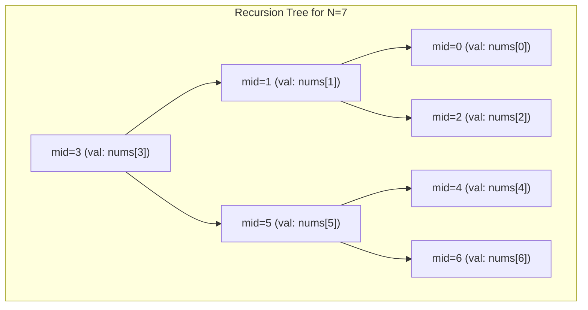
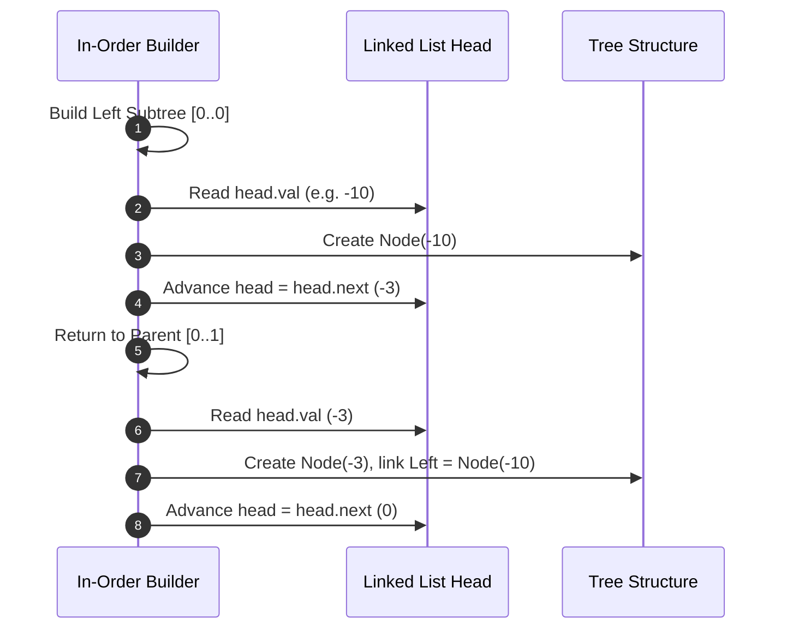

---


title: "Converting Sorted Arrays & Linked Lists to Height-Balanced BSTs"
description: "Master algorithms for constructing height-balanced Binary Search Trees from sorted arrays and linked lists: Divide-and-Conquer vs O(N) In-Order Simulation bottom-up assembly."
category: "Data Structures & Algorithms"
tags: [dsa, algorithms, computer-science, learning-note]
date: "2026-08-26"
---

# ⚖️ Converting Sorted Arrays & Linked Lists to Height-Balanced BSTs

## 📌 Connected Resource Graph
- 🟢 **Primary Theory Note**: [[01_DSA/01_theory_and_patterns/10_Binary_Search_Trees/00_overview_binary_search_trees_bst|00. BST Overview]]

> 🔗 **Related Topics**: [[01_DSA/01_theory_and_patterns/10_Binary_Search_Trees/01_bst_search_insert_delete|01. BST Operations]], [[01_DSA/01_theory_and_patterns/10_Binary_Search_Trees/06_leetcode_practice_bst_problems|06. LeetCode Practice]]

---

## 1. Problem Formulation & Height-Balance Definition

Given a sequence of values sorted in strictly ascending order, construct a **Height-Balanced Binary Search Tree (BST)**.

> **Definition (Height-Balanced BST)**:  
> A binary tree in which the depth of the two subtrees of every node never differs by more than $1$:
> 
> $$\forall u \in T, \quad |\text{Height}(\text{Left}(u)) - \text{Height}(\text{Right}(u))| \le 1$$

We examine two distinct input structures:
1. **Sorted Contiguous Array** (Random Access available in $\mathcal{O}(1)$ time).
2. **Sorted Singly Linked List** (Sequential Access only, indexing takes $\mathcal{O}(K)$ time).

```mermaid
flowchart TD
    subgraph "Array / List Input: [-10, -3, 0, 5, 9]"
        A["[-10, -3, 0, 5, 9]"]
    end
    
    subgraph "Balanced BST Output"
        R0((0)) --> RN3((-3))
        R0 --> R9((9))
        RN3 --> RN10((-10))
        RN3 --> Null1[null]
        R9 --> R5((5))
        R9 --> Null2[null]
    end
    
    A ==> R0
    style R0 fill:#4a90e2,stroke:#1d5bbf,color:#fff
```

---

## 2. Part 1: Sorted Array to Height-Balanced BST

### 2.1. Divide-and-Conquer Algorithm

With an array, random access allows us to select the exact median element as the root of the tree in $\mathcal{O}(1)$ time:

$$\text{mid} = \text{left} + \left\lfloor \frac{\text{right} - \text{left}}{2} \right\rfloor$$

1. Set $\text{nums}[\text{mid}]$ as the root of the current subtree.
2. Recursively build the left subtree using the subarray $\text{nums}[\text{left} \dots \text{mid} - 1]$.
3. Recursively build the right subtree using the subarray $\text{nums}[\text{mid} + 1 \dots \text{right}]$.



### 2.2. Mathematical Complexity Proof

The recurrence relation governing the construction is:

$$T(N) = 2 T\left(\frac{N}{2}\right) + \mathcal{O}(1)$$

Applying the **Master Theorem** ($a = 2, b = 2, f(N) = \mathcal{O}(1) = \mathcal{O}(N^{\log_2 2 - \epsilon})$):

$$T(N) = \Theta(N)$$

- **Time Complexity**: $\mathcal{O}(N)$ because each element is visited and instantiated as a `TreeNode` exactly once.
- **Space Complexity**: $\mathcal{O}(\log N)$ call-stack memory corresponding to the tree height $H = \lceil \log_2(N + 1) \rceil$.

---

## 3. Part 2: Sorted Linked List to Height-Balanced BST

Converting a singly linked list introduces a fundamental challenge: locating the middle node via standard pointer chasing takes $\mathcal{O}(K)$ time.

### 3.1. The Naive Slow/Fast Pointer Approach ($\mathcal{O}(N \log N)$)

Using the classic **Tortoise and Hare** algorithm, we find the middle node of the current sublist in $\mathcal{O}(K)$ time, disconnect the left half, and recurse.

#### Recurrence Analysis:
$$T(N) = 2 T\left(\frac{N}{2}\right) + \mathcal{O}(N)$$

By the Master Theorem (Case 2 where $f(N) = \Theta(N)$):

$$T(N) = \mathcal{O}(N \log N)$$

While correct, this approach repeatedly rescans the linked list, making it suboptimal for large lists.

---

### 3.2. Optimal Approach: Bottom-Up In-Order Simulation ($\mathcal{O}(N)$ Time)

We can achieve optimal $\mathcal{O}(N)$ time and $\mathcal{O}(\log N)$ stack space by simulating the **In-Order Traversal** $(\text{Left} \to \text{Root} \to \text{Right})$.

#### Core Mechanism:
1. First, measure the length $N$ of the linked list in $\mathcal{O}(N)$ time.
2. Maintain a global or member pointer `head` referencing the current linked list node to be consumed.
3. To construct a subtree of size $K$ on range $[\text{left}, \text{right}]$:
   - Recursively construct the **Left Subtree** of size $\lfloor K/2 \rfloor$.
   - The current `head` node is now positioned at the exact value that belongs at the **Root** of this subtree! Allocate `root = new TreeNode(head.val)`.
   - Advance `head = head.next`.
   - Recursively construct the **Right Subtree** of size $K - \lfloor K/2 \rfloor - 1$.
   - Link `root.left` and `root.right`, and return `root`.



#### Invariance Proof of $\mathcal{O}(N)$ Time:
Each step of the in-order simulation:
- Makes 1 recursive call per left child.
- Performs 1 read and 1 pointer advance on `head`.
- Makes 1 recursive call per right child.
Since each node in the linked list is dereferenced exactly once, the total time is strictly linear:

$$T(N) = 2 T\left(\frac{N}{2}\right) + \mathcal{O}(1) \implies \mathcal{O}(N)$$

---

## 4. Complete Implementations: C# & Python

### 4.1. C# Implementations

```csharp
using System;

namespace AdvancedBST.Conversion
{
    public sealed class ListNode
    {
        public int val;
        public ListNode next;
        public ListNode(int val = 0, ListNode next = null)
        {
            this.val = val;
            this.next = next;
        }
    }

    public sealed class TreeNode
    {
        public int val;
        public TreeNode left;
        public TreeNode right;
        public TreeNode(int val = 0, TreeNode left = null, TreeNode right = null)
        {
            this.val = val;
            this.left = left;
            this.right = right;
        }
    }

    public static class BSTConverter
    {
        #region Array to BST (O(N) Time, O(log N) Space)

        /// <summary>
        /// Converts a sorted array into a height-balanced BST.
        /// </summary>
        public static TreeNode SortedArrayToBST(int[] nums)
        {
            if (nums == null || nums.Length == 0) return null;
            return BuildArrayBST(nums, 0, nums.Length - 1);
        }

        private static TreeNode BuildArrayBST(int[] nums, int left, int right)
        {
            if (left > right) return null;

            int mid = left + (right - left) / 2;
            var node = new TreeNode(nums[mid]);

            node.left = BuildArrayBST(nums, left, mid - 1);
            node.right = BuildArrayBST(nums, mid + 1, right);

            return node;
        }

        #endregion

        #region Linked List to BST (O(N) Time, O(log N) Space Bottom-Up)

        private static ListNode _currListHead;

        /// <summary>
        /// Converts a sorted linked list into a height-balanced BST in O(N) time.
        /// </summary>
        public static TreeNode SortedListToBST(ListNode head)
        {
            if (head == null) return null;

            // Step 1: Compute total length
            int length = 0;
            ListNode curr = head;
            while (curr != null)
            {
                length++;
                curr = curr.next;
            }

            _currListHead = head;
            return BuildListBSTInOrder(0, length - 1);
        }

        private static TreeNode BuildListBSTInOrder(int left, int right)
        {
            if (left > right) return null;

            int mid = left + (right - left) / 2;

            // Step 1: Recursively construct left subtree
            TreeNode leftChild = BuildListBSTInOrder(left, mid - 1);

            // Step 2: Process root node using current list pointer
            var root = new TreeNode(_currListHead.val);
            root.left = leftChild;

            // Advance list pointer
            _currListHead = _currListHead.next;

            // Step 3: Recursively construct right subtree
            root.right = BuildListBSTInOrder(mid + 1, right);

            return root;
        }

        #endregion
    }
}
```

---

### 4.2. Python Implementations

```python
from typing import Optional, List

class ListNode:
    __slots__ = ("val", "next")

    def __init__(self, val: int = 0, next: Optional["ListNode"] = None) -> None:
        self.val = val
        self.next = next


class TreeNode:
    __slots__ = ("val", "left", "right")

    def __init__(self, val: int = 0, left: Optional["TreeNode"] = None, right: Optional["TreeNode"] = None) -> None:
        self.val = val
        self.left = left
        self.right = right


class BSTConverter:
    @staticmethod
    def sorted_array_to_bst(nums: List[int]) -> Optional[TreeNode]:
        """
        Converts sorted array to balanced BST using Divide and Conquer.
        Time: O(N), Space: O(log N).
        """
        def build(left: int, right: int) -> Optional[TreeNode]:
            if left > right:
                return None
            mid = left + (right - left) // 2
            root = TreeNode(nums[mid])
            root.left = build(left, mid - 1)
            root.right = build(mid + 1, right)
            return root

        return build(0, len(nums) - 1)

    @classmethod
    def sorted_list_to_bst(cls, head: Optional[ListNode]) -> Optional[TreeNode]:
        """
        Converts sorted singly linked list to balanced BST in O(N) time
        using In-Order Bottom-Up simulation.
        Time: O(N), Space: O(log N).
        """
        if not head:
            return None

        # Step 1: Count length
        length = 0
        curr = head
        while curr:
            length += 1
            curr = curr.next

        cls._curr = head

        def build_inorder(left: int, right: int) -> Optional[TreeNode]:
            if left > right:
                return None

            mid = left + (right - left) // 2

            # Left child construction
            left_child = build_inorder(left, mid - 1)

            # Root allocation and link advance
            root = TreeNode(cls._curr.val)
            root.left = left_child
            cls._curr = cls._curr.next

            # Right child construction
            root.right = build_inorder(mid + 1, right)

            return root

        return build_inorder(0, length - 1)
```

---

## 5. Comparative Tradeoff Matrix

| Algorithm | Input Structure | Time Complexity | Auxiliary Stack Space | Modifies Input Data |
| :--- | :--- | :---: | :---: | :---: |
| **Array Mid-Point D&C** | Sorted Array | $\mathcal{O}(N)$ | $\mathcal{O}(\log N)$ | No |
| **List Slow/Fast Pointer** | Singly Linked List | $\mathcal{O}(N \log N)$ | $\mathcal{O}(\log N)$ | Yes (splits links) |
| **List In-Order Simulation** | Singly Linked List | $\mathcal{O}(N)$ | $\mathcal{O}(\log N)$ | No |

---

## 6. Edge Cases & Interview Traps

1. **Even vs. Odd Length Arrays**:
   - For an array of size $4$ (`[1, 2, 3, 4]`), integer division `(0 + 3) / 2 = 1` picks $2$ as root, while `(0 + 3 + 1) / 2 = 2` picks $3$. Both yield valid balanced BSTs of height $3$.
2. **Single Element**:
   - `nums = [0]` immediately returns `TreeNode(0)`.
3. **Empty Collection**:
   - Returns `null` / `None` safely without null reference exceptions.

---

## 🔗 Graph-Linked Knowledge Base
- 🔙 **Parent Hub**: [[01_DSA/01_theory_and_patterns/10_Binary_Search_Trees/00_overview_binary_search_trees_bst|00. BST Overview]]
- 🧱 **Next Modules**:
  - [[01_DSA/01_theory_and_patterns/10_Binary_Search_Trees/01_bst_search_insert_delete|01. BST Operations: Search, Insert & Delete]]
  - [[01_DSA/01_theory_and_patterns/10_Binary_Search_Trees/02_validate_bst_and_inorder_properties|02. Validate BST & In-Order Properties]]
  - [[01_DSA/01_theory_and_patterns/10_Binary_Search_Trees/03_kth_smallest_element_in_bst|03. Kth Smallest Element in BST]]
  - [[01_DSA/01_theory_and_patterns/10_Binary_Search_Trees/04_lowest_common_ancestor_in_bst|04. Lowest Common Ancestor in BST]]
  - [[01_DSA/01_theory_and_patterns/10_Binary_Search_Trees/06_leetcode_practice_bst_problems|06. LeetCode Practice: Classical BST Problems]]
