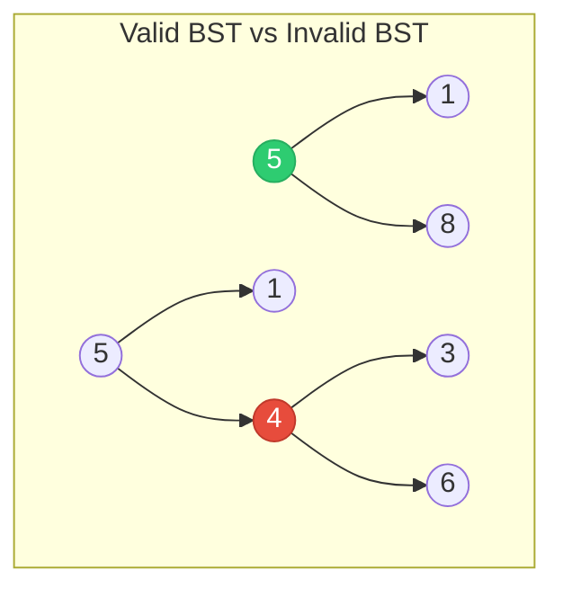
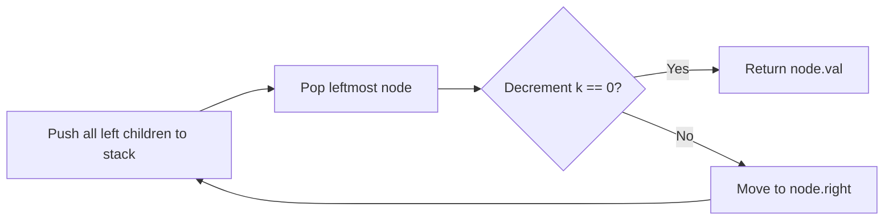
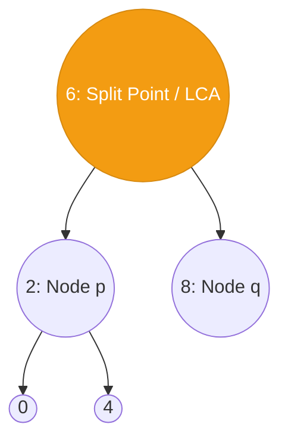
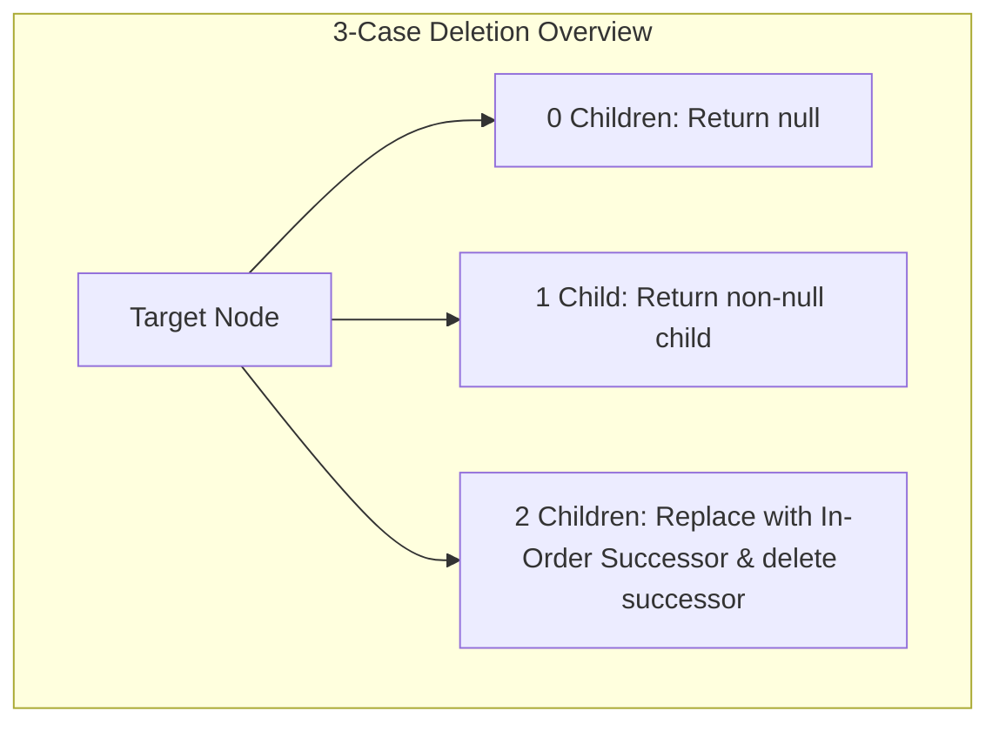
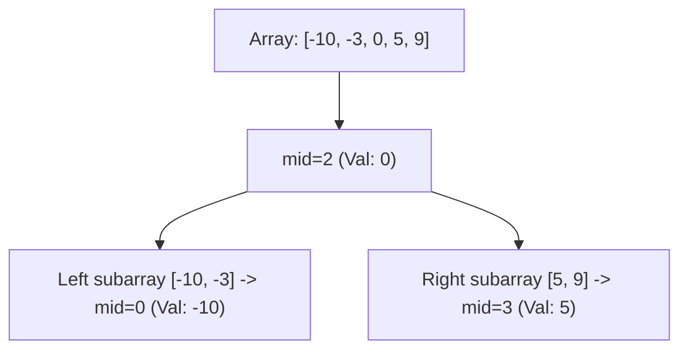
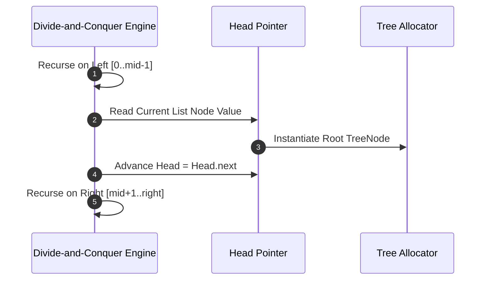
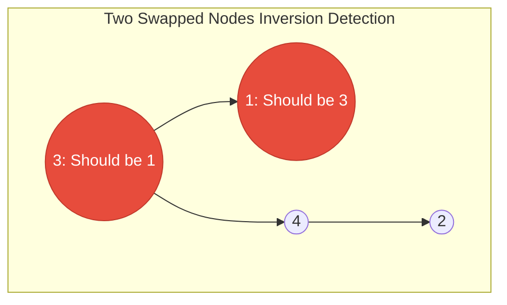

---


title: "LeetCode Practice: Classical Binary Search Tree Problems Deep Dive"
description: "Comprehensive breakdowns, optimal C# and Python solutions, Mermaid diagrams, and complexity proofs for LeetCode 98, 230, 235, 450, 108, 109, and 99."
category: "Data Structures & Algorithms"
tags: [dsa, algorithms, computer-science, learning-note]
date: "2026-08-26"
---

# 🧩 LeetCode Practice: Classical Binary Search Tree Problems Deep Dive

## 📌 Connected Resource Graph
- 🟢 **Primary Theory Note**: [[01_DSA/01_theory_and_patterns/10_Binary_Search_Trees/00_overview_binary_search_trees_bst|00. BST Overview]]

> 🔗 **Related Topics**: [[01_DSA/01_theory_and_patterns/10_Binary_Search_Trees/01_bst_search_insert_delete|01. BST Operations]], [[01_DSA/01_theory_and_patterns/10_Binary_Search_Trees/02_validate_bst_and_inorder_properties|02. Validate BST]], [[01_DSA/01_theory_and_patterns/10_Binary_Search_Trees/03_kth_smallest_element_in_bst|03. Kth Smallest Element in BST]], [[01_DSA/01_theory_and_patterns/10_Binary_Search_Trees/04_lowest_common_ancestor_in_bst|04. Lowest Common Ancestor in BST]], [[01_DSA/01_theory_and_patterns/10_Binary_Search_Trees/05_convert_sorted_array_list_to_balanced_bst|05. Convert Sorted Array/List to Balanced BST]]

---

## 📌 Master BST LeetCode Solutions Table

| Problem | Title | Difficulty | Optimal Time | Auxiliary Space | Core Paradigm |
| :--- | :--- | :---: | :---: | :---: | :--- |
| **LC 98** | Validate Binary Search Tree | Medium | $\mathcal{O}(N)$ | $\mathcal{O}(H)$ / $\mathcal{O}(1)$ | Min/Max Range Bounds / Morris Traversal |
| **LC 230** | Kth Smallest Element in a BST | Medium | $\mathcal{O}(H + K)$ | $\mathcal{O}(H)$ | Early-Stopping Iterative In-Order Stack |
| **LC 235** | Lowest Common Ancestor of a BST | Medium | $\mathcal{O}(H)$ | $\mathcal{O}(1)$ | Value Split Pointer Iteration |
| **LC 450** | Delete Node in a BST | Medium | $\mathcal{O}(H)$ | $\mathcal{O}(H)$ / $\mathcal{O}(1)$ | 3-Case Splicing & In-Order Successor |
| **LC 108** | Convert Sorted Array to Balanced BST | Easy | $\mathcal{O}(N)$ | $\mathcal{O}(\log N)$ | Mid-Point Divide & Conquer |
| **LC 109** | Convert Sorted List to Balanced BST | Medium | $\mathcal{O}(N)$ | $\mathcal{O}(\log N)$ | Bottom-Up In-Order List Simulation |
| **LC 99** | Recover Binary Search Tree | Medium/Hard | $\mathcal{O}(N)$ | $\mathcal{O}(1)$ | Swapped Node Inversion / Morris Traversal |

---

## 1. LeetCode 98: Validate Binary Search Tree

### 1.1. Problem Statement & Constraints
Given the root of a binary tree, determine if it is a valid Binary Search Tree (BST).
- The left subtree of a node contains only nodes with keys strictly less than the node's key.
- The right subtree of a node contains only nodes with keys strictly greater than the node's key.
- Both the left and right subtrees must also be binary search trees.
- Constraints: Number of nodes $\in [1, 10^4]$, $-2^{31} \le \text{Node.val} \le 2^{31} - 1$.



### 1.2. Algorithmic Strategy: Range Boundary Propagation
Propagate an open valid interval $(min, max)$ downward:
- For left child: $(min, \text{node.val})$
- For right child: $(\text{node.val}, max)$
- Avoid integer overflow bugs by using 64-bit integers (`long` in C#) or `float('-inf')` / `None` in Python.

### 1.3. Production Implementations

#### C# Solution:
```csharp
public class LC98_ValidateBST
{
    public bool IsValidBST(TreeNode root)
    {
        return Validate(root, long.MinValue, long.MaxValue);
    }

    private bool Validate(TreeNode node, long min, long max)
    {
        if (node == null) return true;
        if (node.val <= min || node.val >= max) return false;

        return Validate(node.left, min, node.val) &&
               Validate(node.right, node.val, max);
    }
}
```

#### Python Solution:
```python
class SolutionLC98:
    def isValidBST(self, root: Optional[TreeNode]) -> bool:
        def validate(node: Optional[TreeNode], low: float, high: float) -> bool:
            if not node:
                return True
            if not (low < node.val < high):
                return False
            return validate(node.left, low, node.val) and validate(node.right, node.val, high)

        return validate(root, float("-inf"), float("inf"))
```

---

## 2. LeetCode 230: Kth Smallest Element in a BST

### 2.1. Problem Statement & Constraints
Given the root of a binary search tree, and an integer $k$, return the $k$-th smallest value (1-indexed) of all the values of the nodes in the tree.
- Constraints: $N \in [1, 10^4]$, \$1 \le k \le N$, \$0 \le \text{Node.val} \le 10^4$.



### 2.2. Production Implementations

#### C# Solution:
```csharp
using System.Collections.Generic;

public class LC230_KthSmallest
{
    public int KthSmallest(TreeNode root, int k)
    {
        var stack = new Stack<TreeNode>();
        TreeNode curr = root;

        while (curr != null || stack.Count > 0)
        {
            while (curr != null)
            {
                stack.Push(curr);
                curr = curr.left;
            }

            curr = stack.Pop();
            if (--k == 0) return curr.val;

            curr = curr.right;
        }

        return -1;
    }
}
```

#### Python Solution:
```python
class SolutionLC230:
    def kthSmallest(self, root: Optional[TreeNode], k: int) -> int:
        stack = []
        curr = root

        while curr or stack:
            while curr:
                stack.append(curr)
                curr = curr.left

            curr = stack.pop()
            k -= 1
            if k == 0:
                return curr.val

            curr = curr.right

        return -1
```

---

## 3. LeetCode 235: Lowest Common Ancestor of a Binary Search Tree

### 3.1. Problem Statement & Constraints
Given a binary search tree (BST), find the lowest common ancestor (LCA) node of two given nodes in the BST.
- Constraints: $N \in [2, 10^5]$, $-10^9 \le \text{Node.val} \le 10^9$, all keys are unique, $p \neq q$, both $p$ and $q$ exist in the BST.



### 3.2. Algorithmic Strategy: Value Split Point
Since keys are sorted:
- If both $p.\text{val} < \text{curr}.\text{val}$ and $q.\text{val} < \text{curr}.\text{val} \implies$ LCA lies in `curr.left`.
- If both $p.\text{val} > \text{curr}.\text{val}$ and $q.\text{val} > \text{curr}.\text{val} \implies$ LCA lies in `curr.right`.
- Otherwise, `curr` is the split point where paths diverge.

### 3.3. Production Implementations

#### C# Solution:
```csharp
public class LC235_LCA_BST
{
    public TreeNode LowestCommonAncestor(TreeNode root, TreeNode p, TreeNode q)
    {
        TreeNode curr = root;

        while (curr != null)
        {
            if (p.val < curr.val && q.val < curr.val)
            {
                curr = curr.left;
            }
            else if (p.val > curr.val && q.val > curr.val)
            {
                curr = curr.right;
            }
            else
            {
                return curr; // Found LCA split point
            }
        }

        return null;
    }
}
```

#### Python Solution:
```python
class SolutionLC235:
    def lowestCommonAncestor(self, root: TreeNode, p: TreeNode, q: TreeNode) -> TreeNode:
        curr = root
        while curr:
            if p.val < curr.val and q.val < curr.val:
                curr = curr.left
            elif p.val > curr.val and q.val > curr.val:
                curr = curr.right
            else:
                return curr
        return root
```

---

## 4. LeetCode 450: Delete Node in a BST

### 4.1. Problem Statement & Constraints
Given a root node reference of a BST and a key, delete the node with the given key in the BST. Return the root node reference (possibly updated) of the BST.
- Constraints: $N \in [0, 10^4]$, $-10^5 \le \text{Node.val}, \text{key} \le 10^5$, all keys are unique.



### 4.2. Production Implementations

#### C# Solution:
```csharp
public class LC450_DeleteNodeBST
{
    public TreeNode DeleteNode(TreeNode root, int key)
    {
        if (root == null) return null;

        if (key < root.val)
        {
            root.left = DeleteNode(root.left, key);
        }
        else if (key > root.val)
        {
            root.right = DeleteNode(root.right, key);
        }
        else
        {
            // Case 1 & Case 2: 0 or 1 child
            if (root.left == null) return root.right;
            if (root.right == null) return root.left;

            // Case 3: 2 children. Find in-order successor
            TreeNode successor = FindMin(root.right);
            root.val = successor.val;
            root.right = DeleteNode(root.right, successor.val);
        }

        return root;
    }

    private TreeNode FindMin(TreeNode node)
    {
        while (node.left != null) node = node.left;
        return node;
    }
}
```

#### Python Solution:
```python
class SolutionLC450:
    def deleteNode(self, root: Optional[TreeNode], key: int) -> Optional[TreeNode]:
        if not root:
            return None

        if key < root.val:
            root.left = self.deleteNode(root.left, key)
        elif key > root.val:
            root.right = self.deleteNode(root.right, key)
        else:
            if not root.left:
                return root.right
            if not root.right:
                return root.left

            # 2 children: Find in-order successor
            succ = root.right
            while succ.left:
                succ = succ.left

            root.val = succ.val
            root.right = self.deleteNode(root.right, succ.val)

        return root
```

---

## 5. LeetCode 108: Convert Sorted Array to Binary Search Tree

### 5.1. Problem Statement & Constraints
Given an integer array `nums` where the elements are sorted in ascending order, convert it to a height-balanced binary search tree.
- Constraints: $N \in [1, 10^4]$, $-10^4 \le \text{nums}[i] \le 10^4$, `nums` is strictly sorted.



### 5.2. Production Implementations

#### C# Solution:
```csharp
public class LC108_SortedArrayToBST
{
    public TreeNode SortedArrayToBST(int[] nums)
    {
        return Build(nums, 0, nums.Length - 1);
    }

    private TreeNode Build(int[] nums, int left, int right)
    {
        if (left > right) return null;

        int mid = left + (right - left) / 2;
        var root = new TreeNode(nums[mid]);

        root.left = Build(nums, left, mid - 1);
        root.right = Build(nums, mid + 1, right);

        return root;
    }
}
```

#### Python Solution:
```python
class SolutionLC108:
    def sortedArrayToBST(self, nums: List[int]) -> Optional[TreeNode]:
        def build(left: int, right: int) -> Optional[TreeNode]:
            if left > right:
                return None
            mid = left + (right - left) // 2
            root = TreeNode(nums[mid])
            root.left = build(left, mid - 1)
            root.right = build(mid + 1, right)
            return root

        return build(0, len(nums) - 1)
```

---

## 6. LeetCode 109: Convert Sorted List to Binary Search Tree

### 6.1. Problem Statement & Constraints
Given the `head` of a singly linked list where elements are sorted in ascending order, convert it to a height-balanced BST.
- Constraints: $N \in [0, 2 \times 10^4]$, $-10^5 \le \text{Node.val} \le 10^5$.



### 6.2. Production Implementations: Optimal $\mathcal{O}(N)$ In-Order Simulation

#### C# Solution:
```csharp
public class LC109_SortedListToBST
{
    private ListNode _curr;

    public TreeNode SortedListToBST(ListNode head)
    {
        if (head == null) return null;

        int count = 0;
        ListNode p = head;
        while (p != null)
        {
            count++;
            p = p.next;
        }

        _curr = head;
        return BuildInOrder(0, count - 1);
    }

    private TreeNode BuildInOrder(int left, int right)
    {
        if (left > right) return null;

        int mid = left + (right - left) / 2;

        TreeNode leftChild = BuildInOrder(left, mid - 1);

        var root = new TreeNode(_curr.val);
        root.left = leftChild;
        _curr = _curr.next;

        root.right = BuildInOrder(mid + 1, right);

        return root;
    }
}
```

#### Python Solution:
```python
class SolutionLC109:
    def sortedListToBST(self, head: Optional[ListNode]) -> Optional[TreeNode]:
        if not head:
            return None

        length = 0
        curr = head
        while curr:
            length += 1
            curr = curr.next

        self._curr = head

        def build(left: int, right: int) -> Optional[TreeNode]:
            if left > right:
                return None

            mid = left + (right - left) // 2

            left_child = build(left, mid - 1)

            root = TreeNode(self._curr.val)
            root.left = left_child
            self._curr = self._curr.next

            root.right = build(mid + 1, right)

            return root

        return build(0, length - 1)
```

---

## 7. LeetCode 99: Recover Binary Search Tree

### 7.1. Problem Statement & Constraints
You are given the root of a binary search tree (BST), where the values of **exactly two nodes** of the tree were swapped by mistake. Recover the tree without changing its structure.
- Follow up: Can you devise an $\mathcal{O}(1)$ auxiliary space solution?
- Constraints: Number of nodes $\in [2, 1000]$, $-2^{31} \le \text{Node.val} \le 2^{31} - 1$.



### 7.2. Algorithmic Invariant: Identifying the Swapped Nodes
In an in-order traversal of a valid BST, the array of values is strictly increasing: $[1, 2, 3, 4, 5]$.
When two values are swapped:
1. **Non-Adjacent Swap** (e.g., $1$ and $5$ swapped $\implies [5, 2, 3, 4, 1]$):
   - Two inversions occur where $\text{prev}.\text{val} > \text{curr}.\text{val}$:
     - First inversion: $\text{prev} = 5, \text{curr} = 2 \implies \text{First} = 5$.
     - Second inversion: $\text{prev} = 4, \text{curr} = 1 \implies \text{Second} = 1$.
2. **Adjacent Swap** (e.g., $2$ and $3$ swapped $\implies [1, 3, 2, 4, 5]$):
   - Only one inversion occurs:
     - First inversion: $\text{prev} = 3, \text{curr} = 2 \implies \text{First} = 3, \text{Second} = 2$.

By using **Morris In-Order Traversal**, we locate `first` and `second` in $\mathcal{O}(N)$ time and $\mathcal{O}(1)$ space, then swap their values!

### 7.3. Production Implementations ($\mathcal{O}(1)$ Auxiliary Space Morris Traversal)

#### C# Solution:
```csharp
public class LC99_RecoverBST
{
    public void RecoverTree(TreeNode root)
    {
        TreeNode first = null;
        TreeNode second = null;
        TreeNode prev = null;
        TreeNode curr = root;

        // Morris In-Order Traversal
        while (curr != null)
        {
            if (curr.left == null)
            {
                // Inversion Check
                if (prev != null && prev.val > curr.val)
                {
                    if (first == null) first = prev;
                    second = curr;
                }
                prev = curr;
                curr = curr.right;
            }
            else
            {
                TreeNode pred = curr.left;
                while (pred.right != null && pred.right != curr)
                {
                    pred = pred.right;
                }

                if (pred.right == null)
                {
                    pred.right = curr;
                    curr = curr.left;
                }
                else
                {
                    pred.right = null;
                    // Inversion Check
                    if (prev != null && prev.val > curr.val)
                    {
                        if (first == null) first = prev;
                        second = curr;
                    }
                    prev = curr;
                    curr = curr.right;
                }
            }
        }

        // Swap the corrupted values
        if (first != null && second != null)
        {
            int temp = first.val;
            first.val = second.val;
            second.val = temp;
        }
    }
}
```

#### Python Solution:
```python
class SolutionLC99:
    def recoverTree(self, root: Optional[TreeNode]) -> None:
        """
        Do not return anything, modify root in-place instead.
        Morris Traversal for O(1) Auxiliary Space.
        """
        first: Optional[TreeNode] = None
        second: Optional[TreeNode] = None
        prev: Optional[TreeNode] = None
        curr: Optional[TreeNode] = root

        while curr:
            if not curr.left:
                if prev and prev.val > curr.val:
                    if not first:
                        first = prev
                    second = curr
                prev = curr
                curr = curr.right
            else:
                pred = curr.left
                while pred.right and pred.right is not curr:
                    pred = pred.right

                if not pred.right:
                    pred.right = curr
                    curr = curr.left
                else:
                    pred.right = None
                    if prev and prev.val > curr.val:
                        if not first:
                            first = prev
                        second = curr
                    prev = curr
                    curr = curr.right

        if first and second:
            first.val, second.val = second.val, first.val
```

---

## 8. Master Strategy & Interview Cheat Sheet

```mermaid
flowchart TD
    Q[BST Interview Problem] --> C1{Validating Integrity?}
    Q --> C2{Finding Element by Rank/LCA?}
    Q --> C3{Constructing / Converting?}
    Q --> C4{Modifying / Deleting?}
    
    C1 -->|Validation| A1[Min/Max Bounds (LC 98) or Inversion Scan (LC 99)]
    C2 -->|Rank| A2[Iterative Stack Early Stop (LC 230)]
    C2 -->|LCA| A3[Value Split Comparison (LC 235)]
    C3 -->|Array Input| A4[Mid-Point D&C (LC 108)]
    C3 -->|List Input| A5[In-Order Bottom-Up Simulation (LC 109)]
    C4 -->|Deletion| A6[3-Case Splicing & Successor (LC 450)]
```

---

## 🔗 Graph-Linked Knowledge Base
- 🔙 **Parent Hub**: [[01_DSA/01_theory_and_patterns/10_Binary_Search_Trees/00_overview_binary_search_trees_bst|00. BST Overview]]
- 🧱 **Module Reference Files**:
  - [[01_DSA/01_theory_and_patterns/10_Binary_Search_Trees/01_bst_search_insert_delete|01. BST Operations: Search, Insert & Delete]]
  - [[01_DSA/01_theory_and_patterns/10_Binary_Search_Trees/02_validate_bst_and_inorder_properties|02. Validate BST & In-Order Properties]]
  - [[01_DSA/01_theory_and_patterns/10_Binary_Search_Trees/03_kth_smallest_element_in_bst|03. Kth Smallest Element in BST]]
  - [[01_DSA/01_theory_and_patterns/10_Binary_Search_Trees/04_lowest_common_ancestor_in_bst|04. Lowest Common Ancestor in BST]]
  - [[01_DSA/01_theory_and_patterns/10_Binary_Search_Trees/05_convert_sorted_array_list_to_balanced_bst|05. Convert Sorted Array/List to Balanced BST]]
