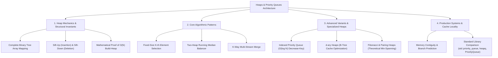
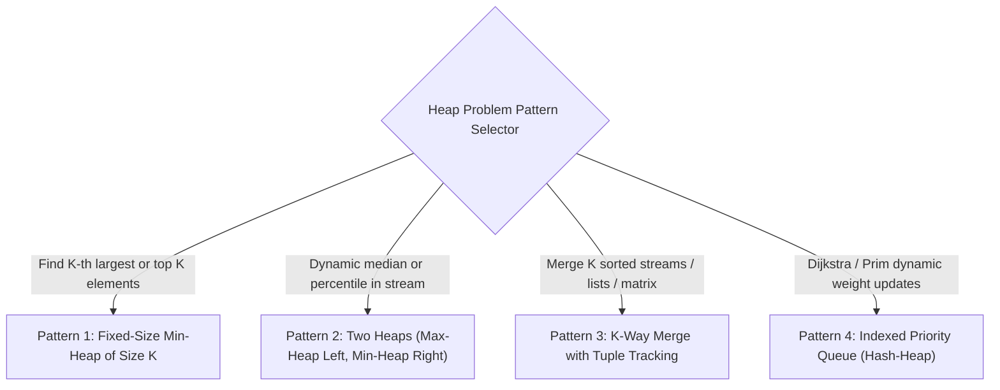

---


title: "Heaps & Priority Queues - Master Module Overview"
type: "module_overview"
category: "dsa"
subcategory: "11_heaps_priority_queue"
tags: [dsa, heaps, min-heap, max-heap, priority-queue, median-stream, kth-largest, k-way-merge, indexed-priority-queue, overview, roadmap, algorithms, computer-science, learning-note]
---

# 📚 11 Heaps & Priority Queues — Master Module Overview

## 📌 Connected Resource Graph
- 🌲 **Binary Trees**: Array Memory Representations
- 🚀 **Dijkstra's Algorithm**: Dijkstra's Shortest Path
- 🕸️ **Minimum Spanning Tree**: Prim's Algorithm via Min-Heap
- 🧩 **Advanced DP Overview**: Advanced Dynamic Programming Overview
- 🎯 **Advanced Patterns**: 05 Advanced DSA Patterns Overview

> 🔙 **Parent Roadmap**: DSA Master Roadmap  
> ⚓ **Prerequisites**: Time & Space Complexity, Arrays & Dynamic Arrays

---

## 🎯 1. Module Objective & Engineering Vision

A **Heap** is a specialized tree-based data structure that enforces the **Heap Invariant** (partial ordering) while maintaining the structural shape of a **Complete Binary Tree**. Heaps serve as the primary algorithmic engine powering **Priority Queues**, real-time task schedulers (e.g., Linux CFS timer heaps), graph optimization algorithms (Dijkstra, Prim), dynamic median finders, and external sorting merge trees.

This master module provides end-to-end coverage of heap mathematics, cache-friendly array representations, $O(N)$ linear build-heap derivations, core algorithmic patterns, and production-grade polyglot implementations:



---

## 🧭 2. Sub-Module & Artifact Navigation

### 📖 Deep-Dive Topic Guides
- 🌲 **Min-Heap & Max-Heap Complete Mechanics**: Min-Heap & Max-Heap Fundamentals
- ⚡ **Priority Queue Abstractions**: Priority Queue Engineering
- 🎯 **K-th Largest / Smallest Elements**: K-th Element Patterns
- 🔀 **Merge K Sorted Lists**: Merge K Sorted Lists
- 📊 **Top K Frequent Elements**: Top K Elements Problems
- ⚖️ **Dynamic Median in a Data Stream**: Median in Data Stream
- 💡 **Complete LeetCode Solutions**: Detailed LeetCode Solutions

### 📦 Standard Artifact Suite
1. 📝 **Exam & Assessment**: 07 Heaps Exam Suite
2. 🧩 **Problem Set Walkthroughs**: 07 Heaps Problem Set
3. 💬 **Interview Q&A**: 07 Heaps Interview Q&A
4. 📊 **Cheat Sheet & Reference**: 07 Heaps Resource Sheet

---

## 🔬 3. Theoretical Foundations & Structural Invariants

### 3.1 Complete Binary Tree & Array Memory Mapping
A binary tree is **complete** if every level (except possibly the last) is completely filled, and all leaf nodes on the last level reside as far left as possible.

Because of this rigid structural constraint, heaps require **zero pointers** (saving 16 bytes per node in 64-bit systems) and are represented as contiguous 0-indexed flat arrays:

```
                  [0] (Val: 2)
                 /           \
          [1] (Val: 5)     [2] (Val: 3)
          /         \       /
    [3] (9)    [4] (7)  [5] (8)

Array: [2, 5, 3, 9, 7, 8]
```

- **Parent Index**: $\lfloor (i - 1) / 2 \rfloor$
- **Left Child Index**: \$2i + 1$
- **Right Child Index**: \$2i + 2$
- **First Leaf Node Index**: $\lfloor N / 2 \rfloor$ (Nodes from $\lfloor N / 2 \rfloor$ to $N - 1$ are all leaves)

---

### 3.2 Heap Invariants & Restoration Mechanics
1. **Min-Heap Property**: $A[\text{parent}(i)] \le A[i]$ for all $i > 0$. The minimum element is guaranteed at root $A[0]$.
2. **Max-Heap Property**: $A[\text{parent}(i)] \ge A[i]$ for all $i > 0$. The maximum element is guaranteed at root $A[0]$.

#### Sift-Up ($\text{Bubble-Up}$): Insertion Invariant
- Append element to array end ($A[N]$).
- While $A[i] < A[\text{parent}(i)]$, swap with parent.
- **Worst-case Time**: $O(\log N)$ (Tree height $H = \lfloor \log_2 N \rfloor$).

#### Sift-Down ($\text{Bubble-Down}$): Deletion Invariant
- Overwrite root $A[0]$ with last element $A[N-1]$ and decrement size.
- While $A[i] > \min(A[\text{left}(i)], A[\text{right}(i)])$, swap with the smaller child.
- **Worst-case Time**: $O(\log N)$.

---

### 3.3 Mathematical Proof: Why $\text{Build-Heap}$ is $O(N)$, Not $O(N \log N)$
Constructing a heap from an arbitrary array of size $N$ can be performed in two ways:
- **Naive Insertion**: Repeatedly call `insert()` $\implies \sum_{i=1}^N \log i = \log(N!) = O(N \log N)$.
- **Bottom-Up Heapify (Floyd's Algorithm)**: Start from the first non-leaf node $\lfloor N/2 \rfloor - 1$ down to $0$, calling `sift_down(i)`:

$$\text{Total Work } W(N) = \sum_{h=0}^{\lfloor \log_2 N \rfloor} (\text{Number of nodes at height } h) \times O(h)$$

Since the number of nodes at height $h$ is at most $\lceil N / 2^{h+1} \rceil$:

$$W(N) \le \sum_{h=0}^{\infty} \frac{N}{2^{h+1}} \cdot h = \frac{N}{2} \sum_{h=0}^{\infty} \frac{h}{2^h}$$

Let $S = \sum_{h=0}^{\infty} \frac{h}{2^h} = \frac{1}{2} + \frac{2}{4} + \frac{3}{8} + \frac{4}{16} + \dots$  
Then $\frac{1}{2}S = \frac{1}{4} + \frac{2}{8} + \frac{3}{16} + \dots$  
Subtracting: $S - \frac{1}{2}S = \frac{1}{2} + \frac{1}{4} + \frac{1}{8} + \dots = 1 \implies S = 2$.

Substituting back:
$$W(N) \le \frac{N}{2} \cdot 2 = \mathbf{O(N)}$$
$\blacksquare$

---

## ⚡ 4. Master Complexity & Structural Trade-Off Table

| Data Structure / Variant | Peek | Push | Pop | Build Heap | Decrease-Key | Cache Performance |
| :--- | :---: | :---: | :---: | :---: | :---: | :--- |
| **Binary Heap (Array)** | $O(1)$ | $O(\log N)$ | $O(\log N)$ | $O(N)$ | $O(N)$ (Search) | Excellent (Contiguous) |
| **Indexed Binary Heap** | $O(1)$ | $O(\log N)$ | $O(\log N)$ | $O(N)$ | $O(\log N)$ | Excellent |
| **d-ary Heap ($d = 4$ or $8$)**| $O(1)$ | $O(\log_d N)$ | $O(d \log_d N)$ | $O(N)$ | $O(\log_d N)$ | Outstanding (SIMD friendly) |
| **Binomial Heap** | $O(\log N)$ | $O(1)$ amort. | $O(\log N)$ | $O(N)$ | $O(\log N)$ | Moderate (Pointer-based) |
| **Fibonacci Heap** | $O(1)$ | $O(1)$ | $O(\log N)$ amort. | $O(N)$ | $O(1)$ amort. | Poor (Heavy pointer overhead) |
| **Pairing Heap** | $O(1)$ | $O(1)$ | $O(\log N)$ amort. | $O(N)$ | $O(\log \log N)$ | Good in practice |

---

## 🎯 5. The 4 Canonical Algorithmic Patterns



### Pattern 1: Fixed-Size Min-Heap for $K$-th Largest Element
- Maintain a **Min-Heap** of size $K$.
- For every incoming number $x$:
  - If heap size $< K$: `push(x)`
  - Else if $x > \text{heap.peek()}$: `pop()`, `push(x)`
- The root `heap.peek()` is always the $K$-th largest element.
- **Time Complexity**: $O(N \log K)$ vs $O(N \log N)$ full sorting. **Space**: $O(K)$.

### Pattern 2: Two Heaps for Dynamic Median
- Maintain **Max-Heap `small`** for the lower half of values and **Min-Heap `large`** for the upper half.
- Invariants:
  1. $\max(\text{small}) \le \min(\text{large})$
  2. $\text{size}(\text{small}) \ge \text{size}(\text{large})$ and $\text{size}(\text{small}) - \text{size}(\text{large}) \le 1$.
- **Median Query**: If $\text{size}(\text{small}) > \text{size}(\text{large})$, return $\text{small.peek()}$, else $(\text{small.peek()} + \text{large.peek()}) / 2.0$.

### Pattern 3: K-Way Merge
- Insert the head element of each of the $K$ sorted collections into a Min-Heap: `(val, list_index, element_index)`.
- Repeatedly extract the minimum, append to result, and insert the next element from the same list into the heap.
- **Time Complexity**: $O(N \log K)$ where $N$ is total elements across all $K$ lists.

### Pattern 4: Indexed Priority Queue (Decrease-Key in $O(\log N)$)
- Maintain two auxiliary maps alongside the heap array:
  - `pos[id]`: Maps element ID to its current index in the heap array.
  - `inv[i]`: Maps heap array index back to element ID.
- Whenever two elements are swapped during sift-up/down, update `pos` accordingly.
- Enables arbitrary element deletion and value updates in strict **$O(\log N)$**.

---

## 💻 6. Polyglot Reference Implementations

### 6.1 Complete Generic Min-Heap from Scratch

#### C++20 Implementation
```cpp
#include <vector>
#include <stdexcept>
#include <utility>
#include <iostream>

template <typename T>
class MinHeap {
private:
    std::vector<T> data;

    void sift_up(int i) {
        while (i > 0) {
            int parent = (i - 1) / 2;
            if (data[i] < data[parent]) {
                std::swap(data[i], data[parent]);
                i = parent;
            } else {
                break;
            }
        }
    }

    void sift_down(int i) {
        int n = data.size();
        while (2 * i + 1 < n) {
            int left = 2 * i + 1;
            int right = 2 * i + 2;
            int smallest = i;

            if (data[left] < data[smallest]) smallest = left;
            if (right < n && data[right] < data[smallest]) smallest = right;

            if (smallest != i) {
                std::swap(data[i], data[smallest]);
                i = smallest;
            } else {
                break;
            }
        }
    }

public:
    MinHeap() = default;

    // Linear O(N) Bottom-Up Heapify
    explicit MinHeap(std::vector<T> arr) : data(std::move(arr)) {
        for (int i = static_cast<int>(data.size()) / 2 - 1; i >= 0; --i) {
            sift_down(i);
        }
    }

    void push(const T& val) {
        data.push_back(val);
        sift_up(data.size() - 1);
    }

    T pop() {
        if (empty()) throw std::runtime_error("Heap is empty");
        T root = data[0];
        data[0] = data.back();
        data.pop_back();
        if (!data.empty()) sift_down(0);
        return root;
    }

    const T& peek() const {
        if (empty()) throw std::runtime_error("Heap is empty");
        return data[0];
    }

    bool empty() const { return data.empty(); }
    size_t size() const { return data.size(); }
};
```

#### Python 3 Implementation
```python
from typing import List, Generic, TypeVar

T = TypeVar('T')

class MinHeap(Generic[T]):
    """
    Complete Generic Min-Heap with O(N) Heapify and O(log N) Push/Pop.
    """
    def __init__(self, arr: List[T] = None):
        self.data: List[T] = arr[:] if arr else []
        if self.data:
            self._heapify()

    def _heapify(self) -> None:
        for i in range(len(self.data) // 2 - 1, -1, -1):
            self._sift_down(i)

    def _sift_up(self, i: int) -> None:
        while i > 0:
            parent = (i - 1) // 2
            if self.data[i] < self.data[parent]:
                self.data[i], self.data[parent] = self.data[parent], self.data[i]
                i = parent
            else:
                break

    def _sift_down(self, i: int) -> None:
        n = len(self.data)
        while 2 * i + 1 < n:
            left = 2 * i + 1
            right = 2 * i + 2
            smallest = i

            if self.data[left] < self.data[smallest]:
                smallest = left
            if right < n and self.data[right] < self.data[smallest]:
                smallest = right

            if smallest != i:
                self.data[i], self.data[smallest] = self.data[smallest], self.data[i]
                i = smallest
            else:
                break

    def push(self, val: T) -> None:
        self.data.append(val)
        self._sift_up(len(self.data) - 1)

    def pop(self) -> T:
        if not self.data:
            raise IndexError("pop from empty heap")
        root = self.data[0]
        last_val = self.data.pop()
        if self.data:
            self.data[0] = last_val
            self._sift_down(0)
        return root

    def peek(self) -> T:
        if not self.data:
            raise IndexError("peek from empty heap")
        return self.data[0]

    def __len__(self) -> int:
        return len(self.data)
```

---

### 6.2 Running Dynamic Median Engine (Two Heaps)

#### C# Implementation
```csharp
using System;
using System.Collections.Generic;

public class MedianFinder {
    private readonly PriorityQueue<int, int> small; // Max-Heap (stores smaller half)
    private readonly PriorityQueue<int, int> large; // Min-Heap (stores larger half)

    public MedianFinder() {
        // PriorityQueue in C# is min-heap by default; custom comparer reverses for max-heap
        small = new PriorityQueue<int, int>(Comparer<int>.Create((a, b) => b.CompareTo(a)));
        large = new PriorityQueue<int, int>();
    }

    public void AddNum(int num) {
        // 1. Add to small (max-heap)
        small.Enqueue(num, num);

        // 2. Balance property: max(small) <= min(large)
        int maxSmall = small.Dequeue();
        large.Enqueue(maxSmall, maxSmall);

        // 3. Maintain size invariant: size(small) >= size(large)
        if (large.Count > small.Count) {
            int minLarge = large.Dequeue();
            small.Enqueue(minLarge, minLarge);
        }
    }

    public double FindMedian() {
        if (small.Count > large.Count) {
            return small.Peek();
        }
        return (small.Peek() + large.Peek()) / 2.0;
    }
}
```

---

## ⚠️ 7. Common Pitfalls & High-Frequency Interview Traps

1. **Min-Heap vs Max-Heap Confusion in K-th Largest**:
   - Counter-intuitively, finding the $K$-th **largest** element requires a **Min-Heap** of size $K$ (so the smallest among the top $K$ is at the top). Using a Max-Heap requires inserting all $N$ elements ($O(N \log N)$ space and time).
2. **Floyd Heapify Loop Range Off-by-One**:
   - Leaf nodes start at index $\lfloor N / 2 \rfloor$. Calling `sift_down` on leaves does nothing. The first node requiring sift-down is strictly $\lfloor N / 2 \rfloor - 1$ down to index $0$.
3. **Object Reference Equality in Python `heapq`**:
   - When pushing tuples `(priority, item)` into Python's `heapq`, if two items have identical `priority`, Python compares `item`. If `item` does not define `__lt__`, Python raises a runtime `TypeError`. Always insert a tie-breaker counter `(priority, count, item)`.
4. **Non-Trivial Decrease-Key in Standard Library**:
   - Neither `std::priority_queue` (C++) nor `heapq` (Python) nor `PriorityQueue` (C# / Java) supports $O(\log N)$ decrease-key or arbitrary removal. Attempting to search for an item in the underlying array takes $O(N)$. Use an **Indexed Priority Queue** or **Lazy Deletion** (`visited` set filter).

---

