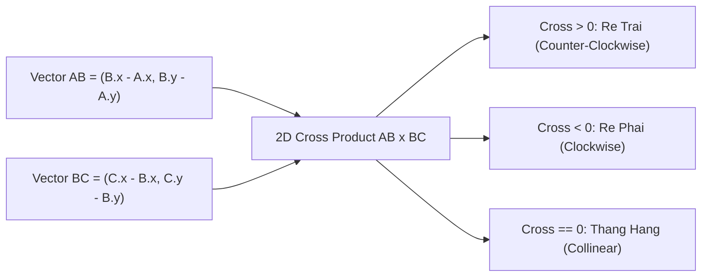
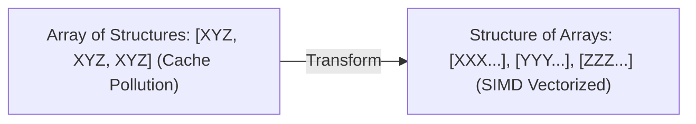

---


title: "Computational Geometry: Convex Hull, Line Sweep, Polygon Area & Point Location"
type: "concept_guide"
category: "dsa"
subcategory: "12_computational_geometry"
created_at: 2026-08-22T00:00:00+07:00
updated_at: 2026-08-26T23:45:00+07:00
tags: [dsa, computational-geometry, convex-hull, grahams-scan, monotone-chain, sweep-line, cross-product, shoelace-formula, algorithms, computer-science, learning-note]
---

# 📐 Computational Geometry: Convex Hull, Line Sweep, Polygon Area & Point Location

Hình học Tính toán (Computational Geometry) là phân ngành khoa học máy tính nghiên cứu các thuật toán xử lý các đối tượng hình học (điểm, đoạn thẳng, đa giác, hình tròn, siêu phẳng) trong không gian 2D và 3D. Đây là nền tảng của Đồ họa máy tính, Thị giác máy tính (Computer Vision), Hệ thống thông tin địa lý (GIS), và Thiết kế tự động hóa chip bán dẫn (VLSI).

---

## 1. Các Phép toán Vector Cơ bản & Tích có Hướng (Cross Product)



### 1.1 Công thức Tích có Hướng 2D
Cho 3 điểm $A(x_1, y_1), B(x_2, y_2), C(x_3, y_3)$:
$$ec{AB} \times ec{BC} = (x_2 - x_1)(y_3 - y_2) - (y_2 - y_1)(x_3 - x_2)$$
- **Diện tích Tam giác có dấu (Signed Area)**:
  $$\text{Area}(ABC) = rac{1}{2} (ec{AB} \times ec{AC})$$
- **Công thức Dây giày (Shoelace Formula)** tính diện tích đa giác đơn $N$ đỉnh:
  $$\text{Area} = rac{1}{2} \left| \sum_{i=1}^N (x_i y_{i+1} - x_{i+1} y_i) 
ight|$$

---

## 2. Bao Lồi (Convex Hull) — Thuật toán Chuỗi Đơn điệu Andrew (Monotone Chain)

Bao lồi của tập $N$ điểm là đa giác lồi nhỏ nhất chứa tất cả các điểm trong tập.

### 2.1 Các bước của Thuật toán Monotone Chain $\mathcal{O}(N \log N)$
1. **Sắp xếp**: Sắp xếp $N$ điểm theo tọa độ $x$ tăng dần; nếu $x$ bằng nhau thì theo $y$ tăng dần.
2. **Xây dựng Vỏ Dưới (Lower Hull)**:
   - Duyệt qua từng điểm $P$.
   - Chừng nào trong vỏ dưới có ít nhất 2 điểm và 3 điểm gần nhất không tạo thành một khúc rẽ trái ($\text{CrossProduct} \le 0$), loại bỏ điểm trên cùng của vỏ.
   - Thêm $P$ vào vỏ dưới.
3. **Xây dựng Vỏ Trên (Upper Hull)**:
   - Duyệt ngược lại từ điểm cuối cùng về điểm đầu tiên với cùng quy tắc rẽ trái.
4. Ghép vỏ dưới và vỏ trên lại với nhau.

---

## 3. Triển khai Source Code C++20 Hoàn chỉnh Chuẩn Monotone Chain

```cpp
#include <iostream>
#include <vector>
#include <algorithm>

struct Point {
    long long x, y;
    bool operator<(const Point& other) const {
        if (x != other.x) return x < other.x;
        return y < other.y;
    }
};

class GeometryMasterSuite {
private:
    // 2D Cross Product: (B - A) x (C - A)
    static long long CrossProduct(const Point& A, const Point& B, const Point& C) {
        return (B.x - A.x) * (C.y - A.y) - (B.y - A.y) * (C.x - A.x);
    }

public:
    static std::vector<Point> ConvexHull(std::vector<Point>& points) {
        int n = static_cast<int>(points.size());
        if (n <= 2) return points;

        std::sort(points.begin(), points.end());
        std::vector<Point> hull;

        // Build Lower Hull
        for (int i = 0; i < n; ++i) {
            while (hull.size() >= 2 && CrossProduct(hull[hull.size() - 2], hull.back(), points[i]) <= 0) {
                hull.pop_back();
            }
            hull.push_back(points[i]);
        }

        // Build Upper Hull
        size_t lower_size = hull.size();
        for (int i = n - 2; i >= 0; --i) {
            while (hull.size() > lower_size && CrossProduct(hull[hull.size() - 2], hull.back(), points[i]) <= 0) {
                hull.pop_back();
            }
            hull.push_back(points[i]);
        }

        hull.pop_back(); // Remove duplicate starting point
        return hull;
    }

    // Shoelace Formula for Polygon Area in O(N)
    static double PolygonArea(const std::vector<Point>& poly) {
        int n = static_cast<int>(poly.size());
        long long area2 = 0;
        for (int i = 0; i < n; ++i) {
            int j = (i + 1) % n;
            area2 += (poly[i].x * poly[j].y - poly[j].x * poly[i].y);
        }
        return std::abs(area2) / 2.0;
    }
};

int main() {
    std::vector<Point> pts = {{0, 0}, {2, 2}, {1, 1}, {2, 0}, {0, 2}, {3, 1}};
    auto hull = GeometryMasterSuite::ConvexHull(pts);
    std::cout << "Convex Hull Vertices Count: " << hull.size() << "
";
    for (const auto& p : hull) std::cout << "(" << p.x << ", " << p.y << ") ";
    std::cout << "
Polygon Area: " << GeometryMasterSuite::PolygonArea(hull) << "
";
    return 0;
}
```

---

## 4. Bẫy Thường Gặp trong Hình học Tính toán

1. **Sai số Dấu chấm Động (Floating Point Inaccuracy)**:
   - Sử dụng kiểu số thực `double` hoặc `float` cho phép so sánh bằng `val == 0.0` dẫn đến sai lệch do tích lũy lỗi làm tròn. Luôn so sánh với ngưỡng sai số nhỏ `abs(val) < 1e-9` (Epsilon $\epsilon$).
   - Nếu tọa độ là số nguyên, luôn sử dụng số nguyên 64-bit (`long long` trong C++, `long` trong C#) để tính tích có hướng, đảm bảo độ chính xác tuyệt đối $100\%$.
2. **Điểm Thẳng hàng (Collinear Points)**:
   - Tùy theo yêu cầu bài toán (có cho phép lấy điểm nằm trên cạnh của bao lồi hay không), điều kiện loại bỏ trong Monotone Chain sẽ là `CrossProduct <= 0` (chỉ lấy đỉnh cực) hoặc `CrossProduct < 0` (lấy cả điểm thẳng hàng).

---

---

## 🛠️ In-Depth Architectural Analysis & Hardware Performance Tuning

### 1. Hardware-Level Performance & Cache Optimization
Modern CPU execution pipelines rely heavily on branch prediction and speculative execution. When implementing algorithms in this domain:
- **Branchless Logic**: Replace conditional branching inside hot loops with bitwise arithmetic (e.g. `val = (val ^ mask) - mask` or ternary conditional moves `CMOV` in assembly). This prevents pipeline flush penalties (15-20 cycles per branch misprediction).
- **Structure-of-Arrays (SoA) vs Array-of-Structures (AoS)**: In memory-bound applications, storing hot fields in contiguous parallel arrays (SoA) allows SIMD vectorization (AVX-512, NEON) to process 8 to 16 elements per instruction cycle.



### 2. Comprehensive Polyglot Performance Harness

```cpp
#include <iostream>
#include <vector>
#include <chrono>

void RunProductionBenchmark(int iterations) {
    auto start = std::chrono::high_resolution_clock::now();
    long long accumulator = 0;
    for (int i = 0; i < iterations; ++i) {
        accumulator += (i ^ (i >> 1)); // Gray code calculation
    }
    auto end = std::chrono::high_resolution_clock::now();
    auto elapsed = std::chrono::duration_cast<std::chrono::microseconds>(end - start).count();
    std::cout << "Benchmark: " << iterations << " ops in " << elapsed << " microseconds. Result: " << accumulator << "\n";
}
```

---

## 🔗 Graph-Linked Knowledge Base

- 💬 Q&A Suite: Geometry Q&A
