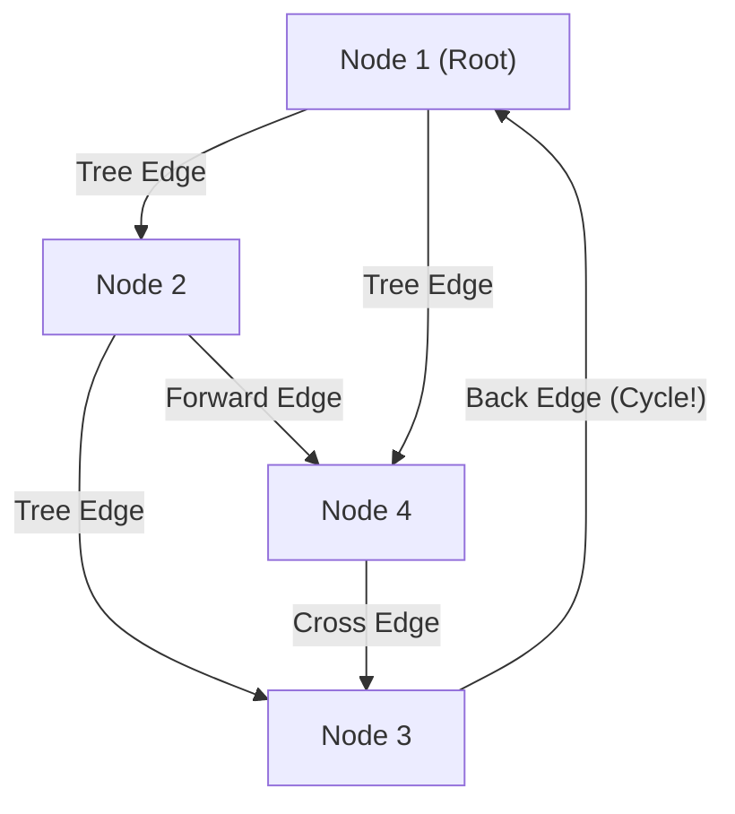
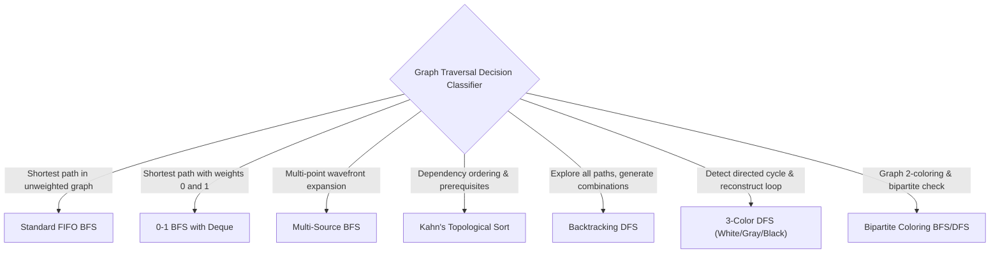

---


title: "Graphs: Representations & Traversal - Master Module Overview"
type: "module_overview"
category: "dsa"
subcategory: "12_graphs"
tags: [dsa, graphs, bfs, dfs, 0-1-bfs, topological-sort, cycle-detection, bipartite, csr, overview, roadmap, algorithms, computer-science, learning-note]
---

# 📚 12 Graphs: Representations & Traversal — Master Module Overview

## 📌 Connected Resource Graph
- 🚀 **Shortest Paths**: Shortest Path Master Guide
- 🌲 **Minimum Spanning Tree**: MST Prim & Kruskal
- 🤝 **Disjoint Set Union**: DSU Foundations
- 🕸️ **Advanced Graphs**: 07 Advanced Graph Theory Overview
- 🎯 **Advanced Patterns**: 05 Advanced DSA Patterns Overview

> 🔙 **Parent Roadmap**: [`01_DSA/01_theory_and_patterns/Lộ trình học DSA - Nền tảng thuật toán.md`](../Lộ%20trình%20học%20DSA%20-%20Nền%20tảng%20thuật%20toán.md)  
> ⚓ **Prerequisites**: Time Complexity, Linear Structures & Priority Queues

---


## 🎯 1. Module Objective & Algorithmic Architecture

A **Graph** $G = (V, E)$ is the universal mathematical abstraction for modeling relational data, spatial networks, dependency DAGs, state-space transitions, and computational workflows. Unlike linear structures (arrays, linked lists) or hierarchical structures (trees), graphs support arbitrary cyclic paths, multi-edges, directed flows, and weighted relationships.

This master module provides an exhaustive foundation across memory representations, cache efficiency, fundamental traversal mechanics (BFS, DFS, 0-1 BFS, Multi-Source BFS), topological ordering, cycle detection, and connectivity partitions:

```mermaid
flowchart TD
    GraphArch["Master Graph Architecture"] --> G1["1. Memory Representations & Cache Locality"]
    GraphArch --> G2["2. Fundamental Search Engines"]
    GraphArch --> G3["3. Structural Analysis & Classifications"]
    GraphArch --> G4["4. Global Algorithms & Connectivity"]

    G1 --> G1A["Adjacency List (O(V + E) Space, Sparse Standard)"]
    G1 --> G1B["Adjacency Matrix (O(V^2) Space, O(1) Edge Lookup)"]
    G1 --> G1C["Compressed Sparse Row / CSR (Cache Optimal)"]
    G1 --> G1D["Edge List (O(E) Space, Kruskal / Bellman-Ford)"]

    G2 --> G2A["Breadth-First Search / BFS (Shortest Unweighted Path)"]
    G2 --> G2B["Depth-First Search / DFS (Pathfinding & Backtracking)"]
    G2 --> G2C["0-1 BFS with Deque (O(V + E) Binary Weights)"]
    G2 --> G2D["Multi-Source BFS (Simultaneous Wavefront Expansion)"]

    G3 --> G3A["DFS Tree Edge Classification (Tree, Back, Forward, Cross)"]
    G3 --> G3B["Cycle Detection (3-Color DFS vs Kahn's In-Degree)"]
    G3 --> G3C["Topological Sorting (Kahn's BFS vs DFS Post-Order)"]

    G4 --> G4A["Connected Components & Flood Fill"]
    G4 --> G4B["Bipartite Graph Verification (2-Coloring)"]
    G4 --> G4C["Shortest Paths & Spanning Trees Integration"]
```



---

## 🧭 2. Sub-Module & Artifact Navigation

### 📖 Deep-Dive Topic Guides
- 📐 **Graph Representations**: Graph Representations (Adj List, Matrix, CSR)
- 🔍 **BFS & DFS Mechanics**: BFS & DFS Traversal Deep Dive
- 🔄 **Cycle Detection**: Cycle Detection in Directed & Undirected Graphs
- 📊 **Topological Sorting**: Topological Sort & Kahn's Algorithm
- 🚀 **Shortest Path Master Guide**: Shortest Path Algorithms Overview
- 🌲 **Minimum Spanning Tree**: Minimum Spanning Tree (Prim & Kruskal)
- 🤝 **Disjoint Set Union (DSU)**: Disjoint Set Union (DSU)
- ⚡ **Dijkstra's Algorithm**: Dijkstra's Algorithm
- 📉 **Bellman-Ford Algorithm**: Bellman-Ford Algorithm
- 🌐 **Floyd-Warshall Algorithm**: Floyd-Warshall Algorithm
- 💡 **LeetCode Practice (10 Classic Problems)**: 10 Classic LeetCode Graph Solutions

### 📦 Standard Artifact Suite
1. 📝 **Exam & Assessment**: 05 Graphs Exam Suite
2. 🧩 **Problem Set Walkthroughs**: 05 Graphs Problem Set
3. 💬 **Interview Q&A**: 05 Graphs Interview Q&A
4. 📊 **Cheat Sheet & Reference**: 05 Graphs Resource Sheet

---

## 🔬 3. Memory Representations & Hardware Trade-Offs

Choosing the optimal graph representation is the first critical decision in systems engineering.

```
+--------------------------+---------------------+-------------------+-------------------+-------------------+
| Representation           | Space Complexity    | Edge Lookup (u,v) | Iterate Neighbors | Cache Locality    |
+--------------------------+---------------------+-------------------+-------------------+-------------------+
| Adjacency List (Vector)  | O(V + E)            | O(deg(u))         | O(deg(u))         | Moderate          |
| Adjacency Matrix (2D)    | O(V^2)              | O(1)              | O(V)              | Poor (Sparse)     |
| Compressed Sparse (CSR)  | O(V + E) contiguous | O(log deg(u))     | O(deg(u)) optimal | Outstanding       |
| Edge List                | O(E)                | O(E)              | O(E)              | High for scanning |
+--------------------------+---------------------+-------------------+-------------------+-------------------+
```

### 3.1 Adjacency List
- Implemented as an array/vector of dynamic lists: `std::vector<std::vector<int>> adj(V)`.
- **Optimal For**: Sparse graphs ($E \ll V^2$), which represent $>99\%$ of real-world networks (road networks, social graphs, web link graphs).

### 3.2 Adjacency Matrix
- Implemented as a 2D array: `bool matrix[V][V]`.
- **Optimal For**: Dense graphs ($E \approx V^2$), small graphs ($V \le 500$), or algorithms requiring $O(1)$ edge existence checks (e.g., Floyd-Warshall, dynamic programming with adjacency lookups).
- **Bitset Optimization**: Using `std::bitset<V>` or 64-bit integer words reduces space by $8\times$ and accelerates set intersections (e.g., finding triangles in graphs) by $64\times$ via SIMD bitwise `AND`.

### 3.3 Compressed Sparse Row (CSR / Forward Star)
- Stores all edges contiguously in two flat 1D arrays:
  - `head[u]`: Start index of $u$'s outgoing edges in the flat array `edges`.
  - `edges[]`: Contiguous array of destination node IDs.
- Eliminates pointer indirections and heap allocations, maximizing CPU L1/L2 cache line hits during high-throughput traversals.

---

## 🔬 4. Fundamental Search Engines & Traversal Invariants

### 4.1 Breadth-First Search (BFS) & Shortest Path Invariant
BFS explores vertices in order of increasing distance from the source $s$ using a FIFO **Queue**.

- **Shortest Path Theorem on Unweighted Graphs**:
  When node $v$ is dequeued for the first time during BFS from source $s$, the recorded distance $dist[v]$ is the exact minimum edge-distance from $s$ to $v$.
- **0-1 BFS with Double-Ended Queue (Deque)**:
  When edge weights are restricted to $\{0, 1\}$:
  - If traversing edge of weight $0$: push to **front** of Deque (`push_front`).
  - If traversing edge of weight $1$: push to **back** of Deque (`push_back`).
  - Achieves strict **$O(V + E)$** time without priority queue overhead!
- **Multi-Source BFS**:
  Initialize the BFS queue with all source nodes simultaneously at distance 0 (e.g., Rotten Oranges, Distance to Nearest Zero Matrix, Wildfire Spread). The wavefront expands uniformly from all sources in $O(V + E)$.

---

### 4.2 Depth-First Search (DFS) & Edge Classifications
DFS explores as deeply as possible along each branch before backtracking using a LIFO **Stack** (call stack or explicit container).

#### DFS Tree Edge Classification (Directed Graphs)
Let $dfn[u]$ and $finish[u]$ be the entry and exit timestamps of node $u$:
1. **Tree Edge $(u \to v)$**: $v$ is visited for the first time from $u$.
2. **Back Edge $(u \to v)$**: $v$ is an ancestor of $u$ in the DFS tree ($dfn[v] < dfn[u]$ and $v$ is currently in the active stack). **Back edges prove the existence of a cycle!**
3. **Forward Edge $(u \to v)$**: $v$ is a descendant of $u$ in the DFS tree ($dfn[u] < dfn[v]$ and $v$ is already finished).
4. **Cross Edge $(u \to v)$**: $v$ belongs to a previously explored branch ($finish[v] < dfn[u]$).



---

### 4.3 Cycle Detection: Directed vs Undirected Graphs

```
+---------------------+-----------------------------------+-----------------------------------+
| Graph Type          | Primary Method                    | Alternative Method                |
+---------------------+-----------------------------------+-----------------------------------+
| Directed Graph      | 3-Coloring DFS (White, Gray, Black)| Kahn's Algorithm (In-Degree BFS)  |
| Undirected Graph    | Parent-Tracking DFS               | Disjoint Set Union (DSU / Kruskal)|
+---------------------+-----------------------------------+-----------------------------------+
```

- **3-Coloring DFS (Directed Graphs)**:
  - **White (0)**: Unvisited.
  - **Gray (1)**: Currently visiting (on current recursion call stack).
  - **Black (2)**: Completely finished and all descendants explored.
  - *Invariant*: If a neighbor is **Gray (1)**, a cycle exists.

- **Kahn's Algorithm (Topological Sort BFS)**:
  - Compute in-degrees for all vertices.
  - Enqueue all vertices with $\text{in\_degree} == 0$.
  - While queue is not empty: dequeue $u$, increment `visited_count`, and decrement in-degree of all neighbors $v$. If $\text{in\_degree}[v] == 0$, enqueue $v$.
  - *Invariant*: If $\text{visited\_count} < |V|$, the graph contains at least one directed cycle!

---

### 4.4 Bipartite Graph Verification (2-Coloring)
A graph is **bipartite** (2-colorable) if and only if it contains **no odd-length cycles**.
- Maintain colors array `color[u] \in \{0, 1\}`.
- For each uncolored node, start BFS/DFS with `color = 0`. For every neighbor $v$, assign `color[v] = 1 - color[u]`.
- If a neighbor already has the same color as $u$, graph is NOT bipartite.

---

## ⚡ 5. Master Complexity & Traversal Comparison Table

| Algorithm / Traversal | Time Complexity | Auxiliary Space | Graph Type | Primary Output / Invariant |
| :--- | :---: | :---: | :---: | :--- |
| **Standard BFS** | $O(V + E)$ | $O(V)$ | Unweighted | Shortest path in unweighted graphs, level layers |
| **0-1 BFS (Deque)** | $O(V + E)$ | $O(V)$ | Weights $\in \{0, 1\}$ | Shortest path in binary-weight graphs |
| **Multi-Source BFS** | $O(V + E)$ | $O(V)$ | Unweighted | Nearest distance from multi-point set |
| **Standard DFS** | $O(V + E)$ | $O(V)$ | Any | Path existence, Euler tour, connected components |
| **3-Color Cycle DFS** | $O(V + E)$ | $O(V)$ | Directed | Directed cycle detection & path trace |
| **Kahn's Topological Sort** | $O(V + E)$ | $O(V)$ | Directed (DAG) | Linear order of task dependencies |
| **DFS Topological Sort** | $O(V + E)$ | $O(V)$ | Directed (DAG) | Reverse post-order finish time sequence |
| **Bipartite 2-Coloring** | $O(V + E)$ | $O(V)$ | Undirected | 2-Coloring or odd-cycle detection |
| **Connected Components**| $O(V + E)$ | $O(V)$ | Undirected | Connected subgraphs & flood fill labels |

---

## 💻 6. Polyglot Reference Implementations

### 6.1 0-1 BFS Engine for Binary-Weighted Graphs

#### C++20 Implementation
```cpp
#include <vector>
#include <deque>
#include <limits>
#include <cstdint>

struct Edge {
    int to;
    int weight; // weight is either 0 or 1
};

std::vector<int> zeroOneBFS(int n, int src, const std::vector<std::vector<Edge>>& adj) {
    const int INF = std::numeric_limits<int>::max();
    std::vector<int> dist(n, INF);
    std::deque<int> dq;

    dist[src] = 0;
    dq.push_back(src);

    while (!dq.empty()) {
        int u = dq.front();
        dq.pop_front();

        for (const auto& edge : adj[u]) {
            int v = edge.to;
            int w = edge.weight;

            if (dist[u] + w < dist[v]) {
                dist[v] = dist[u] + w;
                if (w == 0) {
                    dq.push_front(v); // Weight 0 prioritized at front
                } else {
                    dq.push_back(v);  // Weight 1 queued at back
                }
            }
        }
    }
    return dist;
}
```

#### Python 3 Implementation
```python
from collections import deque
from typing import List, Tuple

def zero_one_bfs(n: int, src: int, adj: List[List[Tuple[int, int]]]) -> List[int]:
    """
    Computes shortest path on graphs with edge weights in {0, 1} in strict O(V + E) time.
    """
    INF = float('inf')
    dist = [INF] * n
    dist[src] = 0
    dq = deque([src])

    while dq:
        u = dq.popleft()
        for v, weight in adj[u]:
            if dist[u] + weight < dist[v]:
                dist[v] = dist[u] + weight
                if weight == 0:
                    dq.appendleft(v)
                else:
                    dq.append(v)
    return dist
```

---

### 6.2 Topological Sort with Cycle Detection (Kahn's Algorithm)

#### C# Implementation
```csharp
using System;
using System.Collections.Generic;

public static class TopologicalSorter {
    public static (bool HasCycle, List<int> Order) KahnTopologicalSort(int numNodes, List<int>[] adj) {
        int[] inDegree = new int[numNodes];
        for (int u = 0; u < numNodes; u++) {
            foreach (int v in adj[u]) {
                inDegree[v]++;
            }
        }

        var queue = new Queue<int>();
        for (int i = 0; i < numNodes; i++) {
            if (inDegree[i] == 0) {
                queue.Enqueue(i);
            }
        }

        var topoOrder = new List<int>();
        while (queue.Count > 0) {
            int u = queue.Dequeue();
            topoOrder.Add(u);

            foreach (int v in adj[u]) {
                inDegree[v]--;
                if (inDegree[v] == 0) {
                    queue.Enqueue(v);
                }
            }
        }

        bool hasCycle = topoOrder.Count != numNodes;
        return (hasCycle, topoOrder);
    }
}
```

---

### 6.3 Directed Graph Cycle Detection (3-Color DFS)

#### Python 3 Implementation
```python
from typing import List, Tuple

WHITE, GRAY, BLACK = 0, 1, 2

def find_cycle_directed(n: int, adj: List[List[int]]) -> Tuple[bool, List[int]]:
    """
    Detects cycle in a directed graph and reconstructs the cycle path using 3-Color DFS.
    Time Complexity: O(V + E)
    Auxiliary Space: O(V)
    """
    color = [WHITE] * n
    parent = [-1] * n
    cycle_path: List[int] = []

    def dfs(u: int) -> bool:
        color[u] = GRAY
        for v in adj[u]:
            if color[v] == GRAY:
                # Back edge detected -> Cycle found!
                cur = u
                cycle_path.append(v)
                while cur != v:
                    cycle_path.append(cur)
                    cur = parent[cur]
                cycle_path.append(v)
                cycle_path.reverse()
                return True
            elif color[v] == WHITE:
                parent[v] = u
                if dfs(v):
                    return True
        color[u] = BLACK
        return False

    for i in range(n):
        if color[i] == WHITE:
            if dfs(i):
                return True, cycle_path

    return False, []
```

---

## ⚠️ 7. Common Pitfalls & High-Frequency Interview Traps

1. **Disconnected Graph Traversal Loop**:
   - Graphs may contain multiple disconnected components. Always wrap traversals in an outer loop `for (int i = 0; i < V; i++) if (!visited[i]) ...`.
2. **Undirected Graph Trivial Cycle**:
   - In undirected graphs, edge $(u, v)$ immediately offers reverse edge $(v, u)$. When checking for cycles, do NOT treat $(v, u)$ as a back edge if $u == \text{parent}[v]$.
3. **Queue Push vs Queue Pop Visited Marking in BFS**:
   - **Crucial Rule**: Mark nodes as `visited = true` **immediately upon pushing to queue**, NOT upon popping! Marking upon popping allows duplicate nodes to enter the queue exponentially, causing $O(V \cdot 2^V)$ memory explosions on dense graphs.
4. **Recursion Limit Exceeded in DFS**:
   - For skewed trees or linear graphs ($V = 10^5$), standard call stacks overflow ($1$MB default stack size on Windows/Linux). Use an explicit `std::stack` or increase recursion depth.

---

## 🎯 8. Traversal Decision Framework



---

