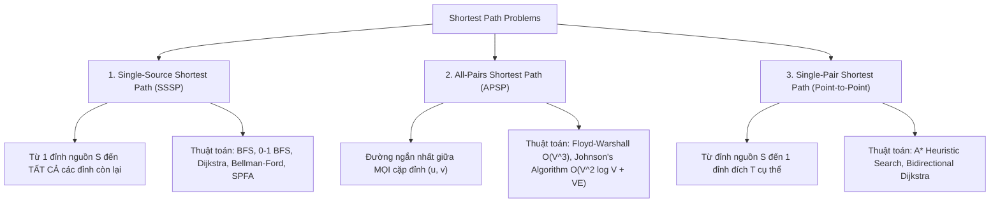
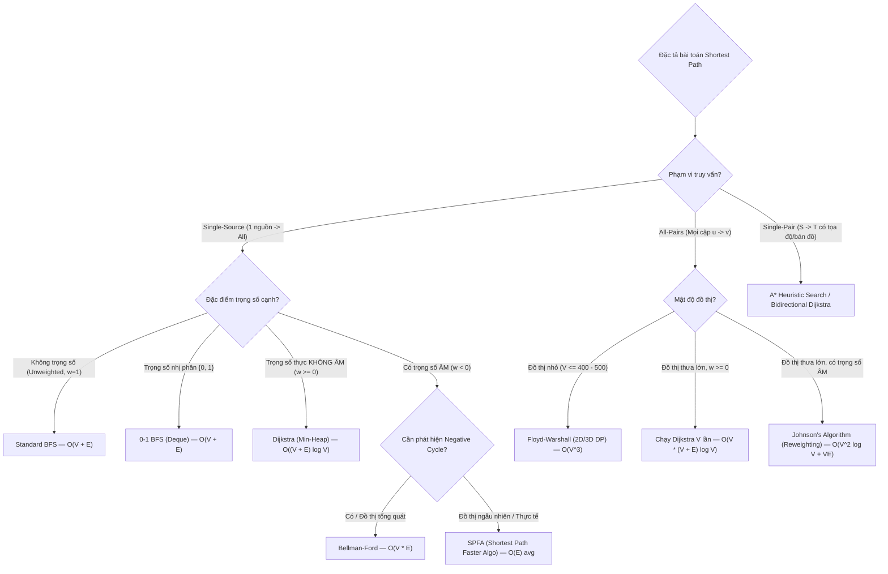

---


title: "Shortest Path Algorithms: Comprehensive Master Guide — Tổng Quan Thuật Toán Đường Đi Ngắn Nhất"
type: "technical_guide"
category: "dsa"
subcategory: "12_graphs"
tags: [dsa, graphs, shortest-path, bfs, 0-1-bfs, dijkstra, bellman-ford, floyd-warshall, johnsons-algorithm, a-star, spfa, relaxation, algorithms, computer-science, learning-note]
---

# 🚀 Shortest Path Algorithms: Comprehensive Master Guide

## 📌 Connected Resource Graph
- 🟢 **Primary Theory Note**: [[01_DSA/01_theory_and_patterns/12_Graphs/00_overview_graphs_representations_traversal|Graphs: Representations & Traversal]]
## Tổng Quan Toàn Diện Thuật Toán Tìm Đường Đi Ngắn Nhất

> ⚓ **Related Implementations**: [[01_DSA/01_theory_and_patterns/12_Graphs/08_dijkstras_algorithm|Dijkstra's Algorithm]], [[01_DSA/01_theory_and_patterns/12_Graphs/09_bellman_ford_algorithm|Bellman-Ford Algorithm]], [[01_DSA/01_theory_and_patterns/12_Graphs/10_floyd_warshall_algorithm|Floyd-Warshall Algorithm]]

---

## 🎯 1. Phân Loại Bài Toán & Khái Niệm Cốt Lõi

Bài toán tìm đường đi ngắn nhất (Shortest Path Problem) là một trong những bài toán nền tảng nhất của khoa học máy tính và kỹ thuật hệ thống (định tuyến gói tin OSPF/BGP, Google Maps navigation, chuỗi cung ứng logistics, mạng lưới tài chính arbitrage).

### 1.1 Phân Loại 3 Dạng Bài Toán Chính



---

## 🔬 2. Nguyên Lý Nền Tảng: Relaxation & Bất Đẳng Thức Tam Giác

Mọi thuật toán tìm đường đi ngắn nhất trên đồ thị có trọng số đều vận hành dựa trên nguyên lý **Relaxation (Nới lỏng giới hạn trên)**.

### 2.1 Bản Chất Toán Học của Relaxation
Cho hàm khoảng cách tạm thời $d(v)$ biểu diễn chặn trên (upper bound) của khoảng cách ngắn nhất từ nguồn $s$ đến $v$. Khi xét một cạnh có hướng $(u, v)$ với trọng số $w(u, v)$:

$$\text{Relax}(u, v, w): \quad \text{if } d(u) + w(u, v) < d(v) \implies \begin{cases} d(v) \leftarrow d(u) + w(u, v) \\ \pi(v) \leftarrow u \end{cases}$$

```
                (u) d[u] = 5
                 \
                  \  w(u,v) = 3
                   \
                    v
                   (v) Ban đầu: d[v] = 10
                       Sau Relax: d[v] = min(10, 5 + 3) = 8 !
```

### 2.2 Bất Đẳng Thức Tam Giác (Triangle Inequality)
Tại trạng thái hội tụ tối ưu, khoảng cách thực sự $\delta(s, v)$ thỏa mãn:

$$\delta(s, v) \le \delta(s, u) + w(u, v) \quad \forall (u, v) \in E$$

- Nếu đồ thị **không có chu trình âm (negative cycle)**, mọi thuật toán chính xác đều hội tụ về giá trị $\delta(s, v)$ sau một số hữu hạn bước nới lỏng.
- Nếu đồ thị **có chu trình âm mà từ $s$ đến được**, khoảng cách $\delta(s, v) = -\infty$ đối với mọi đỉnh $v$ nằm trên hoặc sau chu trình âm đó.

---

## 🧭 3. Sơ Đồ Cây Quyết Định Chọn Thuật Toán (Algorithm Decision Tree)



---

## ⚡ 4. Bảng So Sánh Toàn Diện Các Thuật Toán

| Thuật Toán | Loại | Trọng Số Âm? | Time Complexity | Auxiliary Space | Cấu Trúc Dữ Liệu | Trường Hợp Tối Ưu |
| :--- | :---: | :---: | :---: | :---: | :---: | :--- |
| **Standard BFS** | SSSP | ❌ | $O(V + E)$ | $O(V)$ | Queue (FIFO) | Đồ thị unweighted, lưới ma trận bước nhảy bằng 1 |
| **0-1 BFS** | SSSP | ❌ | $O(V + E)$ | $O(V)$ | Deque | Đồ thị có chi phí chuyển đổi trạng thái $\{0, 1\}$ |
| **Dijkstra (Array)** | SSSP | ❌ | $O(V^2)$ | $O(V)$ | Flat Array | Đồ thị siêu dày ($E \approx V^2$) |
| **Dijkstra (Min-Heap)** | SSSP | ❌ | $O((V + E) \log V)$ | $O(V)$ | Priority Queue | Đồ thị thưa tiêu chuẩn trong hệ thống thực tế |
| **Dijkstra (Fibonacci)** | SSSP | ❌ | $O(E + V \log V)$ | $O(V)$ | Fibonacci Heap | Cực hạn lý thuyết (ít dùng thực tế do hằng số lớn) |
| **Bellman-Ford** | SSSP | ✅ | $O(V \cdot E)$ | $O(V)$ | Edge List | Đồ thị có trọng số âm, phát hiện Arbitrage tiền tệ |
| **SPFA** | SSSP | ✅ | $O(E)$ avg, $O(VE)$ worst | $O(V)$ | Queue + InQueue bool | Đồ thị thực nghiệm có trọng số âm thưa |
| **Floyd-Warshall** | APSP | ✅ | $O(V^3)$ | $O(V^2)$ | 2D Adjacency Matrix | Tìm đường mọi cặp đỉnh trên đồ thị nhỏ ($V \le 400$) |
| **Johnson's Algorithm** | APSP | ✅ | $O(V^2 \log V + VE)$ | $O(V^2 + E)$ | Potentials + Min-Heap | APSP trên đồ thị thưa có trọng số âm |
| **A\* Search** | Point-to-Point | ❌ | $O(E)$ best, $O(V \log V)$ worst | $O(V)$ | Priority Queue + Heuristic | Bản đồ game 2D/3D, GPS dẫn đường có tọa độ Euclid |

---

## 🔬 5. Phân Tích Cơ Chế Chi Tiết Từng Thuật Toán

### 5.1 Dijkstra's Algorithm (Trọng số không âm $w \ge 0$)
- **Tư tưởng Tham lam (Greedy Strategy)**:
  Luôn chọn đỉnh $u$ chưa chốt có $dist[u]$ nhỏ nhất từ hàng đợi ưu tiên. Tại thời điểm $u$ được lấy ra từ Min-Heap, khoảng cách $dist[u]$ được **đảm bảo là tối ưu tuyệt đối** (không thể có đường đi nào khác vòng qua các đỉnh chưa thăm mà cho tổng trọng số nhỏ hơn vì mọi cạnh $w \ge 0$).
- **Tại sao Dijkstra THẤT BẠI khi có cạnh âm?**
  Nếu tồn tại cạnh âm, một đỉnh $v$ đã được "chốt" có thể được nới lỏng tiếp thông qua một cạnh âm xuất hiện sau đó, vi phạm tính chất Greedy bất biến của Dijkstra.

---

### 5.2 Bellman-Ford Algorithm (Trọng số âm & Phát hiện Chu trình âm)
- **Tư tưởng Quy hoạch động (DP)**:
  Một đường đi đơn ngắn nhất trên đồ thị $V$ đỉnh chứa tối đa $V - 1$ cạnh.
  - Vòng lặp chính: Nới lỏng **toàn bộ $|E|$ cạnh** đúng $V - 1$ lần.
  - Vòng lặp thứ $V$ (Kiểm tra chu trình âm): Nếu sau $V-1$ lần, vẫn còn cạnh $(u, v)$ nào có thể nới lỏng tiếp ($dist[u] + w < dist[v]$), thì đồ thị **chắc chắn chứa chu trình âm**.

$$\text{DP State}: \quad dp[k][v] = \min(dp[k-1][v], \min_{(u, v) \in E} \{ dp[k-1][u] + w(u, v) \})$$

---

### 5.3 Floyd-Warshall Algorithm (All-Pairs Shortest Path)
- **Tư tưởng Chèn đỉnh trung gian**:
  Gọi $dp[k][i][j]$ là độ dài đường đi ngắn nhất từ $i$ đến $j$, chỉ được phép dùng tập đỉnh trung gian $\{1, 2, \dots, k\}$.
- **Hệ thức truy hồi (Recurrence Relation)**:
  $$dp[k][i][j] = \min(dp[k-1][i][j], dp[k-1][i][k] + dp[k-1][k][j])$$
- **Tối ưu bộ nhớ**: Chiều $k$ có thể bỏ qua trực tiếp trên ma trận 2D $dp[i][j]$:
  ```cpp
  for (int k = 0; k < n; ++k)
      for (int i = 0; i < n; ++i)
          for (int j = 0; j < n; ++j)
              if (dp[i][k] < INF && dp[k][j] < INF)
                  dp[i][j] = std::min(dp[i][j], dp[i][k] + dp[k][j]);
  ```

---

### 5.4 Johnson's Algorithm (APSP trên Đồ thị Thưa có Trọng số Âm)
Chạy Dijkstra $V$ lần trên đồ thị có trọng số âm sẽ sai. Thuật toán Johnson giải quyết bằng kỹ thuật **Reweighting (Đổi trọng số)** để chuyển toàn bộ trọng số thành không âm mà vẫn bảo toàn đường đi ngắn nhất:

1. Thêm đỉnh ảo $q$ nối tới mọi đỉnh $v \in V$ với trọng số 0.
2. Chạy **Bellman-Ford** từ $q$ để tính thế năng $h(u) = \text{dist}(q, u)$.
3. Đổi trọng số mỗi cạnh: $\hat{w}(u, v) = w(u, v) + h(u) - h(v) \ge 0$.
4. Chạy **Dijkstra $V$ lần** trên đồ thị mới với $\hat{w} \ge 0$.
5. Khôi phục khoảng cách thực: $dist(u, v) = \widehat{dist}(u, v) - h(u) + h(v)$.

---

## 💻 6. Polyglot Reference Implementations

### 6.1 Dijkstra với Min-Heap & Truy Vết Đường Đi (Path Reconstruction)

#### C++20 Implementation
```cpp
#include <vector>
#include <queue>
#include <limits>
#include <algorithm>

struct Edge {
    int to;
    int64_t weight;
};

struct DijkstraResult {
    std::vector<int64_t> dist;
    std::vector<int> parent;

    std::vector<int> reconstructPath(int target) const {
        if (dist[target] == std::numeric_limits<int64_t>::max()) return {};
        std::vector<int> path;
        for (int cur = target; cur != -1; cur = parent[cur]) {
            path.push_back(cur);
        }
        std::reverse(path.begin(), path.end());
        return path;
    }
};

DijkstraResult dijkstra(int n, int src, const std::vector<std::vector<Edge>>& adj) {
    const int64_t INF = std::numeric_limits<int64_t>::max();
    std::vector<int64_t> dist(n, INF);
    std::vector<int> parent(n, -1);
    
    // min-heap storing {distance, node}
    using Element = std::pair<int64_t, int>;
    std::priority_queue<Element, std::vector<Element>, std::greater<Element>> pq;

    dist[src] = 0;
    pq.push({0, src});

    while (!pq.empty()) {
        auto [d, u] = pq.top();
        pq.pop();

        if (d > dist[u]) continue; // Stale priority queue entry check

        for (const auto& edge : adj[u]) {
            int v = edge.to;
            int64_t w = edge.weight;

            if (dist[u] + w < dist[v]) {
                dist[v] = dist[u] + w;
                parent[v] = u;
                pq.push({dist[v], v});
            }
        }
    }

    return {dist, parent};
}
```

#### Python 3 Implementation
```python
import heapq
from typing import List, Tuple, Optional

def dijkstra(n: int, src: int, adj: List[List[Tuple[int, int]]]) -> Tuple[List[float], List[int]]:
    """
    Dijkstra Shortest Path with path reconstruction array.
    Time Complexity: O((V + E) log V)
    """
    INF = float('inf')
    dist = [INF] * n
    parent = [-1] * n

    dist[src] = 0
    pq = [(0, src)] # (distance, node)

    while pq:
        d, u = heapq.heappop(pq)

        if d > dist[u]:
            continue

        for v, weight in adj[u]:
            if dist[u] + weight < dist[v]:
                dist[v] = dist[u] + weight
                parent[v] = u
                heapq.heappush(pq, (dist[v], v))

    return dist, parent

def reconstruct_path(target: int, parent: List[int]) -> List[int]:
    path = []
    curr = target
    while curr != -1:
        path.append(curr)
        curr = parent[curr]
    path.reverse()
    return path
```

#### C# Implementation
```csharp
using System;
using System.Collections.Generic;

public class DijkstraSolver {
    public struct Edge {
        public int To;
        public long Weight;
        public Edge(int to, long weight) { To = to; Weight = weight; }
    }

    public static (long[] Dist, int[] Parent) Solve(int n, int src, List<Edge>[] adj) {
        long[] dist = new long[n];
        int[] parent = new int[n];
        Array.Fill(dist, long.MaxValue);
        Array.Fill(parent, -1);

        var pq = new PriorityQueue<int, long>();
        dist[src] = 0;
        pq.Enqueue(src, 0);

        while (pq.Count > 0) {
            pq.TryDequeue(out int u, out long d);

            if (d > dist[u]) continue;

            foreach (var edge in adj[u]) {
                int v = edge.To;
                long w = edge.Weight;

                if (dist[u] + w < dist[v]) {
                    dist[v] = dist[u] + w;
                    parent[v] = u;
                    pq.Enqueue(v, dist[v]);
                }
            }
        }

        return (dist, parent);
    }
}
```

---

### 6.2 Bellman-Ford với Phát Hiện Chu Trình Âm (Negative Cycle Detection)

#### C++20 Implementation
```cpp
#include <vector>
#include <limits>
#include <iostream>

struct DirectedEdge {
    int from;
    int to;
    int64_t weight;
};

struct BellmanFordResult {
    bool has_negative_cycle;
    std::vector<int64_t> dist;
    std::vector<int> cycle_nodes;
};

BellmanFordResult bellmanFord(int n, int src, const std::vector<DirectedEdge>& edges) {
    const int64_t INF = (int64_t)1e18;
    std::vector<int64_t> dist(n, INF);
    std::vector<int> parent(n, -1);
    dist[src] = 0;

    int last_relaxed_node = -1;

    for (int iter = 0; iter < n; ++iter) {
        last_relaxed_node = -1;
        for (const auto& edge : edges) {
            if (dist[edge.from] < INF && dist[edge.from] + edge.weight < dist[edge.to]) {
                dist[edge.to] = std::max(-INF, dist[edge.from] + edge.weight);
                parent[edge.to] = edge.from;
                last_relaxed_node = edge.to;
            }
        }
    }

    if (last_relaxed_node == -1) {
        return {false, dist, {}};
    }

    // Negative cycle exists; trace back n steps to ensure landing inside the cycle
    int cycle_entry = last_relaxed_node;
    for (int i = 0; i < n; ++i) {
        cycle_entry = parent[cycle_entry];
    }

    std::vector<int> cycle;
    for (int cur = cycle_entry; ; cur = parent[cur]) {
        cycle.push_back(cur);
        if (cur == cycle_entry && cycle.size() > 1) break;
    }
    std::reverse(cycle.begin(), cycle.end());

    return {true, dist, cycle};
}
```

---

## ⚠️ 7. Các Lỗi Thường Gặp & Bẫy Phỏng Vấn (Engineering Traps)

1. **Tràn Số Integer (Overflow with Infinity)**:
   - Khi khởi tạo `dist[v] = INT_MAX`, biểu thức `dist[u] + weight` sẽ gây tràn số nguyên thành giá trị âm nếu không kiểm tra `dist[u] != INT_MAX` trước khi cộng. Luôn dùng kiểu `int64_t` / `long` với giá trị vô cực $10^{18}$.
2. **Quên Kiểm Tra Stale Entry trong Dijkstra**:
   - Do C++ `std::priority_queue` và Python `heapq` không hỗ trợ Decrease-Key native, một đỉnh có thể được đẩy vào hàng đợi nhiều lần. Bỏ qua bước kiểm tra `if (d > dist[u]) continue;` làm tăng số lần duyệt cạnh không cần thiết, làm chậm thuật toán $3-5\times$.
3. **Thứ Tự Vòng Lặp trong Floyd-Warshall**:
   - Vòng lặp đỉnh trung gian `k` **BẮT BUỘC phải là vòng lặp ngoài cùng**. Nếu đặt `k` ở vòng trong cùng, bạn chỉ tính đường đi có tối đa 1 đỉnh trung gian, làm sai toàn bộ kết quả.

---

## 🎯 8. Bảng Tổng Hợp Tiêu Chí Lựa Chọn

```
+------------------------------------+----------------------------------------+
| Tình Huống Thực Tế                 | Thuật Toán Lựa Chọn Phù Hợp Nhất       |
+------------------------------------+----------------------------------------+
| Maze / Ma trận 0-1 bước nhảy ngắn  | BFS hoặc 0-1 BFS                       |
| Mạng lưới giao thông bản đồ thực   | Dijkstra (với Spatial A* Heuristic)    |
| Arbitrage tỷ giá ngoại hối (FX)    | Bellman-Ford (Logarithm đổi trọng số)  |
| Kiểm tra kết nối mọi cặp V <= 300  | Floyd-Warshall                         |
| Mạng lớn có trọng số âm thưa       | Johnson's Algorithm                    |
+------------------------------------+----------------------------------------+
```

---

## 🔗 9. Liên Kết Chéo & Obsidian Backlinks

- 🌐 **Tổng Quan Graphs**: [[01_DSA/01_theory_and_patterns/12_Graphs/00_overview_graphs_representations_traversal|Graphs Representations & Traversal]]
- ⚡ **Dijkstra Chi Tiết**: [[01_DSA/01_theory_and_patterns/12_Graphs/08_dijkstras_algorithm|Dijkstra's Algorithm Deep Dive]]
- 📉 **Bellman-Ford Chi Tiết**: [[01_DSA/01_theory_and_patterns/12_Graphs/09_bellman_ford_algorithm|Bellman-Ford Algorithm Deep Dive]]
- 🌐 **Floyd-Warshall Chi Tiết**: [[01_DSA/01_theory_and_patterns/12_Graphs/10_floyd_warshall_algorithm|Floyd-Warshall Algorithm Deep Dive]]
- 🕸️ **Advanced Graphs**: [[01_DSA/01_theory_and_patterns/07_Advanced_Graph_Theory/00_overview_07_advanced_graph_theory|07 Advanced Graph Theory Overview]]
