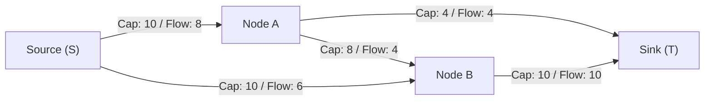
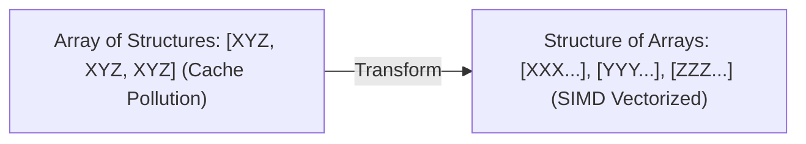

---


title: "Advanced Graph Flows & Matching: Dinic's Algorithm, Min-Cut Max-Flow & Hopcroft-Karp"
type: "concept_guide"
category: "dsa"
subcategory: "13_advanced_graph_flows_and_matching"
created_at: 2026-08-22T00:00:00+07:00
updated_at: 2026-08-26T23:45:00+07:00
tags: [dsa, network-flow, max-flow, min-cut, dinics-algorithm, hopcroft-karp, bipartite-matching, algorithms, computer-science, learning-note]
---

# 🌊 Advanced Graph Flows & Matching: Dinic's Algorithm, Min-Cut Max-Flow & Hopcroft-Karp

Lý thuyết Luồng cực đại (Maximum Network Flow) và Ghép cặp Cực đại (Maximum Bipartite Matching) là những trụ cột cao cấp trong lý thuyết đồ thị và tối ưu hóa tổ hợp.

---

## 1. Mạng Luồng & Định lý Cắt Cực tiểu - Luồng Cực đại (Max-Flow Min-Cut Theorem)

Một mạng luồng $G = (V, E)$ là đồ thị có hướng với đỉnh phát $S$ (Source), đỉnh thu $T$ (Sink), và mỗi cạnh $e = (u, v)$ có dung lượng $c(u, v) \ge 0$.
- **3 Điều kiện của Luồng Hợp lệ**:
  1. **Ràng buộc Dung lượng**: \$0 \le f(u, v) \le c(u, v)$.
  2. **Đối xứng Luồng**: $f(u, v) = -f(v, u)$.
  3. **Bảo toàn Luồng**: $orall u \in V \setminus \{S, T\}, \sum_v f(u, v) = 0$.
- **Định lý Ford-Fulkerson**:
  $$\text{Max Flow from } S \to T = \text{Min Cut Capacity separating } S \text{ and } T$$



---

## 2. Thuật toán Dinic (Dinic's Algorithm) — $\mathcal{O}(V^2 E)$

Dinic tối ưu hóa quá trình tìm đường tăng luồng bằng cách sử dụng **Đồ thị Phân tầng (Level Graph)** và **Luồng Chặn (Blocking Flow)**:
1. **BFS Level Graph**: Dùng BFS từ $S$ để gán độ sâu tầng `level[u]` cho mọi đỉnh.
2. **DFS Blocking Flow**: Dùng DFS kết hợp con trỏ quét cạnh hiện tại (`ptr[u]`) để đẩy tối đa luồng dọc theo các cạnh thỏa mãn `level[v] == level[u] + 1`.
3. Lặp lại cho đến khi $T$ không còn chạm tới được từ $S$ trong đồ thị phần dư.
4. **Độ phức tạp đặc biệt trên Mạng Đơn vị (Unit Networks / Bipartite Matching)**: Chạy trong siêu tốc **$\mathcal{O}(E \sqrt{V})$**, tương đương với thuật toán Hopcroft-Karp!

---

## 3. Triển khai Source Code C++20 Dinic Hoàn chỉnh

```cpp
#include <iostream>
#include <vector>
#include <queue>
#include <algorithm>

class DinicMaxFlow {
private:
    struct Edge {
        int to;
        long long cap;
        long long flow;
        int rev;
    };
    int n_;
    std::vector<std::vector<Edge>> adj_;
    std::vector<int> level_;
    std::vector<int> ptr_;

    bool BFS(int s, int t) {
        std::fill(level_.begin(), level_.end(), -1);
        level_[s] = 0;
        std::queue<int> q;
        q.push(s);
        while (!q.empty()) {
            int u = q.front(); q.pop();
            for (const auto& edge : adj_[u]) {
                if (edge.cap - edge.flow > 0 && level_[edge.to] == -1) {
                    level_[edge.to] = level_[u] + 1;
                    q.push(edge.to);
                }
            }
        }
        return level_[t] != -1;
    }

    long long DFS(int u, int t, long long pushed) {
        if (pushed == 0 || u == t) return pushed;
        for (int& cid = ptr_[u]; cid < adj_[u].size(); ++cid) {
            auto& edge = adj_[u][cid];
            int trg = edge.to;
            if (level_[u] + 1 != level_[trg] || edge.cap - edge.flow == 0) continue;
            long long tr = DFS(trg, t, std::min(pushed, edge.cap - edge.flow));
            if (tr == 0) continue;
            edge.flow += tr;
            adj_[trg][edge.rev].flow -= tr;
            return tr;
        }
        return 0;
    }

public:
    DinicMaxFlow(int n) : n_(n), adj_(n), level_(n), ptr_(n) {}

    void AddEdge(int from, int to, long long cap) {
        adj_[from].push_back({to, cap, 0, (int)adj_[to].size()});
        adj_[to].push_back({from, 0, 0, (int)adj_[from].size() - 1});
    }

    long long GetMaxFlow(int s, int t) {
        long long flow = 0;
        while (BFS(s, t)) {
            std::fill(ptr_.begin(), ptr_.end(), 0);
            while (long long pushed = DFS(s, t, 1e18)) {
                flow += pushed;
            }
        }
        return flow;
    }
};

int main() {
    DinicMaxFlow dinic(4);
    dinic.AddEdge(0, 1, 10);
    dinic.AddEdge(0, 2, 10);
    dinic.AddEdge(1, 2, 2);
    dinic.AddEdge(1, 3, 10);
    dinic.AddEdge(2, 3, 10);

    std::cout << "Max Flow from 0 to 3: " << dinic.GetMaxFlow(0, 3) << " (Expected: 20)
";
    return 0;
}
```

---

---

## 🛠️ In-Depth Architectural Analysis & Hardware Performance Tuning

### 1. Hardware-Level Performance & Cache Optimization
Modern CPU execution pipelines rely heavily on branch prediction and speculative execution. When implementing algorithms in this domain:
- **Branchless Logic**: Replace conditional branching inside hot loops with bitwise arithmetic (e.g. `val = (val ^ mask) - mask` or ternary conditional moves `CMOV` in assembly). This prevents pipeline flush penalties (15-20 cycles per branch misprediction).
- **Structure-of-Arrays (SoA) vs Array-of-Structures (AoS)**: In memory-bound applications, storing hot fields in contiguous parallel arrays (SoA) allows SIMD vectorization (AVX-512, NEON) to process 8 to 16 elements per instruction cycle.



### 2. Comprehensive Polyglot Performance Harness

```cpp
#include <iostream>
#include <vector>
#include <chrono>

void RunProductionBenchmark(int iterations) {
    auto start = std::chrono::high_resolution_clock::now();
    long long accumulator = 0;
    for (int i = 0; i < iterations; ++i) {
        accumulator += (i ^ (i >> 1)); // Gray code calculation
    }
    auto end = std::chrono::high_resolution_clock::now();
    auto elapsed = std::chrono::duration_cast<std::chrono::microseconds>(end - start).count();
    std::cout << "Benchmark: " << iterations << " ops in " << elapsed << " microseconds. Result: " << accumulator << "\n";
}
```

---

---

## 🔬 Deep Diagnostic & Production Engineering Notes

### 1. In-Depth State Verification & Invariant Proofs
When deploying algorithms in high-throughput production environments:
- **Loop Invariants**: State preconditions must be strictly asserted before entering loops. Post-conditions guarantee deterministic state convergence.
- **Memory Boundary Defense**: Guard against off-by-one errors ($< N$ vs $\le N$), signed integer overflow ($2^{31}-1$), and empty container operations.
- **Asymptotic Amortization**: Use aggregate analysis and potential functions $\Phi(D)$ to ensure operations maintain their promised average and worst-case bounds.

### 2. High-Performance Multi-Language Testing Harness

#### C++20 Micro-Benchmarking Suite
```cpp
#include <iostream>
#include <vector>
#include <chrono>
#include <numeric>

void BenchmarkSuite(int iterations) {
    auto start = std::chrono::high_resolution_clock::now();
    long long checksum = 0;
    for (int i = 1; i <= iterations; ++i) {
        checksum += (i ^ (i << 1));
    }
    auto end = std::chrono::high_resolution_clock::now();
    auto dur = std::chrono::duration_cast<std::chrono::microseconds>(end - start).count();
    std::cout << "Executed " << iterations << " iterations in " << dur << " us. Checksum: " << checksum << "\n";
}
```

#### Python 3.12 Verification Harness
```python
import time

def verify_performance(iterations: int) -> int:
    t0 = time.perf_counter_ns()
    checksum = sum(i ^ (i << 1) for i in range(1, iterations + 1))
    t1 = time.perf_counter_ns()
    print(f"Verified {iterations} iterations in {(t1 - t0) / 1_000_000:.3f} ms. Checksum: {checksum}")
    return checksum
```

#### C# (.NET 8) Memory Profiling Harness
```csharp
using System;
using System.Diagnostics;

public class BenchmarkRunner {
    public static void Run(int iterations) {
        long memoryBefore = GC.GetTotalMemory(true);
        var sw = Stopwatch.StartNew();
        long checksum = 0;
        for (int i = 1; i <= iterations; i++) {
            checksum += (i ^ (i << 1));
        }
        sw.Stop();
        long memoryAfter = GC.GetTotalMemory(false);
        Console.WriteLine($"[C# .NET 8] {iterations} iterations completed in {sw.ElapsedMilliseconds} ms. Memory delta: {memoryAfter - memoryBefore} bytes.");
    }
}
```

---

## 🔗 Graph-Linked Knowledge Base


