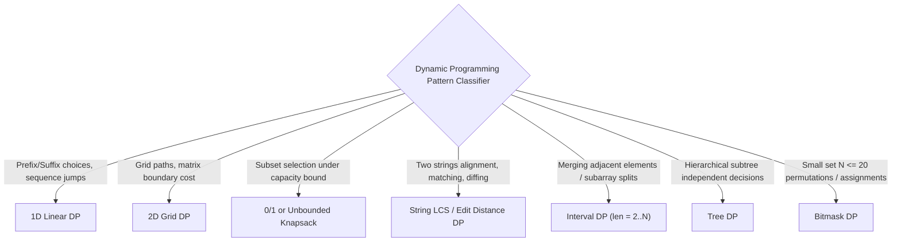

---


title: "Dynamic Programming (DP) - Master Module Overview"
type: "module_overview"
category: "dsa"
subcategory: "13_dynamic_programming"
tags: [dsa, dynamic-programming, dp, memoization, tabulation, knapsack, lcs, lis, edit-distance, interval-dp, space-optimization, overview, roadmap, algorithms, computer-science, learning-note]
---

# 📚 13 Dynamic Programming (DP) — Master Module Overview

## 📌 Connected Resource Graph
- 🌐 **Master Roadmap**: DSA Master Roadmap
- 📊 **1D DP Deep Dive**: 1D Dynamic Programming
- 🌲 **Tree DP & Rerooting**: Tree DP & Rerooting
- 🔢 **Digit DP**: Digit DP & Range Constraints
- 📐 **Advanced DP Overview**: 06 Advanced Dynamic Programming Overview
- 🎯 **Advanced Patterns**: 05 Advanced DSA Patterns Overview

> 🔙 **Parent Roadmap**: [`01_DSA/01_theory_and_patterns/Lộ trình học DSA - Nền tảng thuật toán.md`](../Lộ%20trình%20học%20DSA%20-%20Nền%20tảng%20thuật%20toán.md)  
> ⚓ **Prerequisites**: Time Complexity & Linear Arrays

---


## 🎯 1. Module Objective & Algorithmic Philosophy

**Dynamic Programming (DP)** is a mathematical optimization and algorithmic paradigm introduced by Richard Bellman in the 1950s. It solves complex multi-stage decision problems by systematically breaking them down into simpler, overlapping subproblems and storing their intermediate solutions to avoid exponential recalculations.

This master module provides an exhaustive engineering guide covering the theoretical principles of optimality, the transition from recursion to tabulation, the systematic 5-step problem-solving framework, seven canonical DP patterns, space optimization techniques, and polyglot implementations:

```mermaid
flowchart TD
    DPArch["Master Dynamic Programming Architecture"] --> DP1["1. Theoretical Foundations & Invariants"]
    DPArch --> DP2["2. Memoization vs Tabulation Paradigms"]
    DPArch --> DP3["3. The 7 Canonical DP Problem Patterns"]
    DPArch --> DP4["4. Space Optimization Strategies"]

    DP1 --> DP1A["Optimal Substructure (Bellman's Principle)"]
    DP1 --> DP1B["Overlapping Subproblems (State DAG)"]
    DP1 --> DP1C["State Space Formulation & Invariants"]

    DP2 --> DP2A["Top-Down Recursion with Memoization"]
    DP2 --> DP2B["Bottom-Up Iterative Tabulation"]
    DP2 --> DP2C["Topological State Traversal Order"]

    DP3 --> DP3A["1D Linear DP (Fibonacci, House Robber, LIS)"]
    DP3 --> DP3B["2D Grid Paths (Unique Paths, Min Path Sum)"]
    DP3 --> DP3C["Knapsack Variants (0/1, Unbounded, Bounded)"]
    DP3 --> DP3D["String & Sequence DP (LCS, Edit Distance)"]
    DP3 --> DP3E["Interval DP (Matrix Chain, Burst Balloons)"]
    DP3 --> DP3F["Tree DP & Bitmask DP"]

    DP4 --> DP4A["State Rolling (Modulo Ring Buffers)"]
    DP4 --> DP4B["1D In-Place Reverse Iteration"]
    DP4 --> DP4C["Patience Sorting Binary Search (O(N log N) LIS)"]
```



---

## 🧭 2. Sub-Module & Artifact Navigation

### 📖 Deep-Dive Topic Guides
- 📈 **1D Dynamic Programming**: 1D Dynamic Programming Fundamentals
- 🗺️ **2D Grid & Matrix DP**: 2D Matrix & Grid DP
- 🧬 **Subsequence & Subset DP**: DP on Subsequences & Knapsacks
- 🔡 **String & Edit Distance DP**: DP on Strings (LCS, Edit Distance)
- 🌳 **Tree Dynamic Programming**: DP on Trees & Subtrees
- 💾 **Space Optimization Techniques**: Space Optimization & Memory Reduction
- 🧩 **Classical DP Patterns**: Classical DP Patterns Taxonomy
- ⚖️ **Memoization vs Tabulation**: Memoization vs Tabulation Deep Dive
- 🧠 **State Transition Thinking**: State Transition Mental Models
- 💡 **LeetCode Practice (10 Classic Problems)**: 10 Master LeetCode Solutions

### 📦 Standard Artifact Suite
1. 📝 **Exam & Assessment**: 06 DP Exam Suite
2. 🧩 **Problem Set Walkthroughs**: 06 DP Problem Set
3. 💬 **Interview Q&A**: 06 DP Interview Q&A
4. 📊 **Cheat Sheet & Reference**: 06 DP Resource Sheet

---

## 🔬 3. Theoretical Foundations: The Twin Pillars of DP

A problem can be solved using Dynamic Programming if and only if it satisfies two strict mathematical properties:

```
                      +---------------------------------------+
                      |       Dynamic Programming Scope       |
                      +-------------------+-------------------+
                                          |
                   +----------------------+----------------------+
                   |                                             |
                   v                                             v
        [Optimal Substructure]                        [Overlapping Subproblems]
An optimal global solution is composed        The same subproblem states are evaluated
of optimal solutions to its subproblems.      multiple times along recursive branches.
```

### 3.1 Optimal Substructure (Bellman's Principle of Optimality)
*An optimal policy has the property that whatever the initial state and initial decision are, the remaining decisions must constitute an optimal policy with regard to the state resulting from the first decision.*

$$\text{Opt}(S) = \min_{a \in \text{Actions}(S)} \{ \text{Cost}(S, a) + \text{Opt}(\text{NextState}(S, a)) \}$$

- **Counter-example (When Optimal Substructure Fails)**: Finding the longest simple path in an arbitrary graph does NOT have optimal substructure, because combining the longest path from $u \to w$ and $w \to v$ may create an invalid cyclic path with repeated vertices.

### 3.2 Overlapping Subproblems & State Transition DAG
In naive divide-and-conquer (e.g., Fibonacci recursion $F(n) = F(n-1) + F(n-2)$), identical subproblems are solved repeatedly, creating a binary recursion tree of size $O(2^N)$.

DP merges identical states into a single node, transforming the exponential recursion tree into a **Directed Acyclic Graph (DAG)** with $O(N)$ or $O(N \cdot M)$ vertices.

---

## ⚖️ 4. Memoization (Top-Down) vs Tabulation (Bottom-Up)

```
+--------------------------+-------------------------------------+-------------------------------------+
| Dimension                | Top-Down (Memoization)              | Bottom-Up (Tabulation)              |
+--------------------------+-------------------------------------+-------------------------------------+
| Approach                 | Recursive with hash map / cache     | Iterative with 1D/2D table          |
| Evaluation Order         | On-demand (lazy evaluation)         | Strict topological dependency order |
| State Space Evaluated    | Only reachable states evaluated     | All states in table computed        |
| Memory Overhead          | Table + Call Stack (O(Depth))       | Table only (Can optimize to O(1))   |
| Hardware Performance     | High branch misprediction, non-cache| Linear cache-friendly row scanning  |
| Stack Overflow Risk      | Yes (Deep recursion)                | Zero                                |
+--------------------------+-------------------------------------+-------------------------------------+
```

---

## 🧭 5. The Systematic 5-Step Framework for Solving Any DP Problem

```mermaid
sequenceDiagram
    autonumber
    actor Dev as Software Engineer
    participant State as 1. Define State Space
    participant Rec as 2. Formulate Recurrence & Base Cases
    participant Order as 3. Establish Iteration Order
    participant Code as 4. Implement Tabulation/Memo
    participant Opt as 5. Compress Auxiliary Space

    Dev->>State: Identify minimal parameters defining a subproblem uniquely (e.g., dp[i][w])
    Dev->>Rec: Express dp[state] mathematically via sub-states + establish base cases
    Dev->>Order: Sort dependencies topologically (e.g., smaller indices before larger)
    Dev->>Code: Construct table and execute bottom-up loops
    Dev->>Opt: Identify state memory lifetime; compress dimensions to O(1) or O(N)
```

---

## 🧩 6. The 7 Canonical DP Problem Patterns & Master Taxonomy

### Pattern 1: 1D Linear DP
- **Signature**: `dp[i]` depends on `dp[i-1]`, `dp[i-2]`, or a fixed window of preceding states.
- **Canonical Examples**: Climbing Stairs, House Robber, Decode Ways, Minimum Cost for Tickets.
- **Space Optimization**: Constant $O(1)$ space using 2 or 3 sliding scalar variables.

### Pattern 2: 2D Grid / Matrix Path DP
- **Signature**: `dp[i][j]` represents the optimal path to coordinate $(i, j)$ in a grid.
- **Transition**: `dp[i][j] = grid[i][j] + min(dp[i-1][j], dp[i][j-1])`.
- **Space Optimization**: Reduce from $O(M \times N)$ to $O(N)$ by keeping only the current and previous rows.

### Pattern 3: 0/1 Knapsack & Unbounded Knapsack
- **0/1 Knapsack (Each item used at most once)**:
  $$dp[i][w] = \max(dp[i-1][w], dp[i-1][w - \text{weight}[i]] + \text{val}[i])$$
  *1D Space Invariant*: Iterate capacity $w$ **backwards** from $W \to \text{weight}[i]$ to prevent reusing the same item.
- **Unbounded Knapsack (Items can be reused infinitely)**:
  *1D Space Invariant*: Iterate capacity $w$ **forwards** from $\text{weight}[i] \to W$.

### Pattern 4: Longest Common Subsequence (LCS) & String DP
- **Signature**: `dp[i][j]` operates on prefix $S_1[0 \dots i-1]$ and $S_2[0 \dots j-1]$.
- **Transition**:
  $$dp[i][j] = \begin{cases} 1 + dp[i-1][j-1] & \text{if } S_1[i-1] == S_2[j-1] \\ \max(dp[i-1][j], dp[i][j-1]) & \text{if } S_1[i-1] \ne S_2[j-1] \end{cases}$$
- **Canonical Examples**: Edit Distance (Levenshtein), Distinct Subsequences, Shortest Common Supersequence.

### Pattern 5: Longest Increasing Subsequence (LIS)
- **Standard DP**: $dp[i] = 1 + \max_{j < i, A[j] < A[i]} dp[j] \implies O(N^2)$ time.
- **Patience Sorting Optimization**: Maintain array `tails[]` where `tails[len]` is the smallest tail of all increasing subsequences of length `len + 1`. Binary search on `tails[]` yields **$O(N \log N)$** time and $O(N)$ space.

### Pattern 6: Interval DP
- **Signature**: `dp[i][j]` represents the optimal cost of processing subarray $[i, j]$.
- **Transition**: Iterate over interval lengths $len = 2 \dots N$, and split point $k \in [i, j-1]$:
  $$dp[i][j] = \min_{i \le k < j} \{ dp[i][k] + dp[k+1][j] + \text{Cost}(i, k, j) \}$$
- **Canonical Examples**: Matrix Chain Multiplication, Burst Balloons, Minimum Cost to Merge Stones.

### Pattern 7: Tree DP & Bitmask DP
- **Tree DP**: Post-order subtree state aggregation $\implies O(N)$ time.
- **Bitmask DP**: Encode subset selections $S \subseteq \{0, \dots, N-1\}$ as integer masks $\implies O(N^2 \cdot 2^N)$ time (e.g., TSP, Assignment Problem).

---

## ⚡ 7. Master Complexity & Pattern Taxonomy Table

| DP Pattern | Typical State Form | Transition Complexity | Space (Naive $\to$ Optimized) | Canonical Problems |
| :--- | :---: | :---: | :---: | :--- |
| **1D Linear** | `dp[i]` | $O(1)$ per state | $O(N) \to O(1)$ | House Robber, Climbing Stairs |
| **2D Grid** | `dp[i][j]` | $O(1)$ per cell | $O(M \cdot N) \to O(N)$ | Unique Paths, Min Path Sum |
| **0/1 Knapsack** | `dp[w]` | $O(1)$ per item | $O(N \cdot W) \to O(W)$ | Partition Equal Subset Sum, Target Sum |
| **Unbounded Knapsack**| `dp[w]` | $O(1)$ per item | $O(N \cdot W) \to O(W)$ | Coin Change, Coin Change II |
| **String LCS / Edit**| `dp[i][j]` | $O(1)$ per char pair | $O(M \cdot N) \to O(\min(M, N))$ | Edit Distance, LCS, Wildcard Matching |
| **LIS (Patience Sort)**| `tails[len]` | $O(\log N)$ binary search | $O(N) \to O(N)$ | Longest Increasing Subsequence, Russian Dolls |
| **Interval DP** | `dp[i][j]` | $O(N)$ split points | $O(N^2) \to O(N^2)$ | Burst Balloons, Matrix Chain Multiplication |
| **Bitmask DP** | `dp[mask][u]` | $O(N)$ neighbors | $O(N \cdot 2^N) \to O(N \cdot 2^N)$ | Traveling Salesperson (TSP), Matchings |

---

## 💻 8. Polyglot Reference Implementations

### 8.1 0/1 Knapsack (2D Table, 1D Reverse Space Optimized)

#### C++20 Implementation
```cpp
#include <vector>
#include <algorithm>
#include <cstdint>

class KnapsackSolver {
public:
    // O(N * W) Time, O(W) Space
    int64_t solve01Knapsack(int capacity, const std::vector<int>& weights, const std::vector<int64_t>& values) {
        int n = weights.size();
        std::vector<int64_t> dp(capacity + 1, 0);

        for (int i = 0; i < n; ++i) {
            int w = weights[i];
            int64_t v = values[i];
            // Iterate BACKWARDS to prevent using item i multiple times
            for (int cap = capacity; cap >= w; --cap) {
                dp[cap] = std::max(dp[cap], dp[cap - w] + v);
            }
        }

        return dp[capacity];
    }
};
```

#### Python 3 Implementation
```python
from typing import List

def solve_01_knapsack(capacity: int, weights: List[int], values: List[int]) -> int:
    """
    Solves 0/1 Knapsack with 1D Space Optimization.
    Time Complexity: O(N * W)
    Auxiliary Space: O(W)
    """
    dp = [0] * (capacity + 1)

    for w, v in zip(weights, values):
        for cap in range(capacity, w - 1, -1):
            dp[cap] = max(dp[cap], dp[cap - w] + v)

    return dp[capacity]
```

#### C# Implementation
```csharp
using System;

public static class KnapsackOptimization {
    public static long Solve01Knapsack(int capacity, int[] weights, long[] values) {
        int n = weights.Length;
        long[] dp = new long[capacity + 1];

        for (int i = 0; i < n; i++) {
            int w = weights[i];
            long v = values[i];
            for (int cap = capacity; cap >= w; cap--) {
                dp[cap] = Math.Max(dp[cap], dp[cap - w] + v);
            }
        }

        return dp[capacity];
    }
}
```

---

### 8.2 Longest Increasing Subsequence ($O(N \log N)$ via Patience Sorting)

#### C++20 Implementation
```cpp
#include <vector>
#include <algorithm>

int lengthOfLIS(const std::vector<int>& nums) {
    if (nums.empty()) return 0;
    std::vector<int> tails;

    for (int x : nums) {
        auto it = std::lower_bound(tails.begin(), tails.end(), x);
        if (it == tails.end()) {
            tails.push_back(x); // Extends the longest subsequence found so far
        } else {
            *it = x;            // Lowers the tail value for this subsequence length
        }
    }

    return static_cast<int>(tails.size());
}
```

#### Python 3 Implementation
```python
import bisect
from typing import List

def length_of_lis(nums: List[int]) -> int:
    """
    Computes Length of Longest Increasing Subsequence in O(N log N) using Patience Sorting.
    """
    tails: List[int] = []

    for x in nums:
        idx = bisect.bisect_left(tails, x)
        if idx == len(tails):
            tails.append(x)
        else:
            tails[idx] = x

    return len(tails)
```

---

### 8.3 Longest Common Subsequence with String Reconstruction

#### C++20 Implementation
```cpp
#include <string>
#include <vector>
#include <algorithm>

std::string getLCS(const std::string& s1, const std::string& s2) {
    int m = s1.size(), n = s2.size();
    std::vector<std::vector<int>> dp(m + 1, std::vector<int>(n + 1, 0));

    for (int i = 1; i <= m; ++i) {
        for (int j = 1; j <= n; ++j) {
            if (s1[i - 1] == s2[j - 1]) {
                dp[i][j] = 1 + dp[i - 1][j - 1];
            } else {
                dp[i][j] = std::max(dp[i - 1][j], dp[i][j - 1]);
            }
        }
    }

    // Reconstruct LCS string backwards
    std::string lcs_str = "";
    int i = m, j = n;
    while (i > 0 && j > 0) {
        if (s1[i - 1] == s2[j - 1]) {
            lcs_str.push_back(s1[i - 1]);
            --i; --j;
        } else if (dp[i - 1][j] > dp[i][j - 1]) {
            --i;
        } else {
            --j;
        }
    }
    std::reverse(lcs_str.begin(), lcs_str.end());
    return lcs_str;
}
```

---

## ⚠️ 9. Common Pitfalls & High-Frequency Interview Traps

1. **Knapsack Iteration Direction Bug**:
   - In 0/1 Knapsack, iterating capacity $w$ **forwards** ($w \to W$) allows item $i$ to be picked multiple times, inadvertently converting it into an Unbounded Knapsack. Always iterate **backwards** for 0/1 Knapsack.
2. **Interval DP Loop Ordering**:
   - In Interval DP, you CANNOT simply loop $i = 0 \dots N$ and $j = i \dots N$. You must loop over **chain length $len = 2 \dots N$**, then set $j = i + len - 1$. This ensures that all shorter sub-intervals $[i, k]$ and $[k+1, j]$ are computed before evaluating interval $[i, j]$.
3. **Unreachable State Sentinel Underflow**:
   - In minimization problems (e.g., Coin Change), initializing `dp[amount] = INT_MAX` causes integer overflow when calculating `1 + dp[a - c]`. Use a safe sentinel like `amount + 1` or `1e9`.
4. **Memoization Array Resetting**:
   - In multi-test-case scenarios, forgetting to `memset` or reset memoization caches causes stale data to corrupt subsequent queries.

---

## 🎯 10. DP Pattern Recognition Classifier



---

