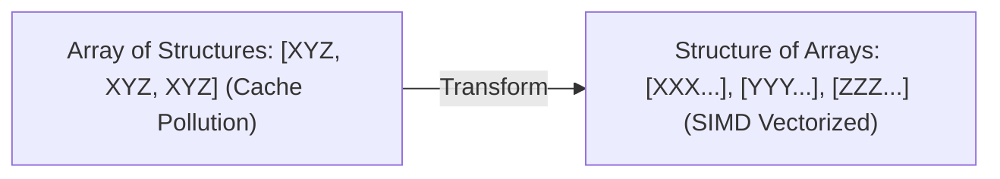

---


title: "DP Space Optimization: Rolling Arrays, In-Place Updates & State Reduction Techniques"
type: "concept_guide"
category: "dsa"
subcategory: "13_dynamic_programming"
created_at: 2026-08-22T00:00:00+07:00
updated_at: 2026-08-26T23:45:00+07:00
tags: [dsa, dynamic-programming, space-optimization, rolling-array, knapsack, state-reduction, cache-locality, algorithms, computer-science, learning-note]
---

# 💾 DP Space Optimization: Rolling Arrays, In-Place Updates & State Reduction Techniques

Tối ưu hóa không gian bộ nhớ trong Quy hoạch động (DP Space Optimization) là kỹ thuật thiết kế thuật toán nhằm giảm độ phức tạp bộ nhớ phụ trợ từ $\mathcal{O}(N \times M)$ xuống $\mathcal{O}(M)$ hoặc $\mathcal{O}(1)$ bằng cách phân tích đồ thị phụ thuộc trạng thái (State Dependency Graph).

---

## 1. Đồ thị Phụ thuộc Trạng thái & Cơ sở Lý thuyết

```mermaid
graph TD
    subgraph 2D DP Table (O(N x M) Space)
        R0["Row i-1: [dp[i-1][j-1], dp[i-1][j], dp[i-1][j+1]]"]
        R1["Row i:   [dp[i][j-1],   dp[i][j],   ...]"]
        R0 -->|Only Depends on Row i-1!| R1
    end
```

### 1.1 Nguyên lý Cắt tỉa Hàng Độc lập (Rolling Buffer Principle)
Nếu trạng thái tại bước $i$ chỉ phụ thuộc trực tiếp vào các trạng thái tại bước $i-1$ (như trong bài toán Unique Paths, Edit Distance, Longest Common Subsequence):
- Ta không cần lưu trữ toàn bộ $N$ hàng của bảng DP.
- Chỉ cần duy trì đúng **2 hàng (Two-Row Rolling Buffer)**: `prev_row` và `curr_row`.
- Sau mỗi vòng lặp: `prev_row = curr_row`.
- Bộ nhớ giảm từ $\mathcal{O}(N \times M)$ xuống $\mathcal{O}(M)$.

---

## 2. Kỹ thuật Mảng 1D Cập nhật Ngược (1D In-Place Reverse Scan in 0/1 Knapsack)

Trong bài toán Balo 0/1 (0/1 Knapsack):
- Công thức chuyển trạng thái:
  $$DP[i][w] = \max(DP[i-1][w], DP[i-1][w - \text{weight}_i] + \text{val}_i)$$
- Nếu ta nén bảng $DP$ thành mảng 1D $DP[w]$ và quét $w$ từ **phải sang trái (từ $W$ giảm dần về $\text{weight}_i$)**:
  $$DP[w] = \max(DP[w], DP[w - \text{weight}_i] + \text{val}_i)$$
- **Chứng minh tính đúng đắn**: Khi tính $DP[w]$, giá trị $DP[w - \text{weight}_i]$ vẫn là giá trị của **vòng lặp trước (hàng $i-1$)** vì nó chưa bị ghi đè. Điều này ngăn chặn việc 1 đồ vật bị sử dụng nhiều lần, nén hoàn hảo không gian bộ nhớ về đúng $\mathcal{O}(W)$!

---

## 3. Polyglot Source Code (C++, Python, C#)

### 3.1 C++20 (0/1 Knapsack 1D Space Optimization)
```cpp
#include <iostream>
#include <vector>
#include <algorithm>

int Knapsack01Optimized(int W, const std::vector<int>& weights, const std::vector<int>& values) {
    int n = weights.size();
    std::vector<int> dp(W + 1, 0);

    for (int i = 0; i < n; ++i) {
        // Reverse scan to prevent reusing item i
        for (int w = W; w >= weights[i]; --w) {
            dp[w] = std::max(dp[w], dp[w - weights[i]] + values[i]);
        }
    }
    return dp[W];
}

int main() {
    std::vector<int> wt = {1, 3, 4, 5};
    std::vector<int> val = {1, 4, 5, 7};
    int W = 7;
    std::cout << "Max Knapsack Value: " << Knapsack01Optimized(W, wt, val) << "
";
    return 0;
}
```

---

---

## 🛠️ In-Depth Architectural Analysis & Hardware Performance Tuning

### 1. Hardware-Level Performance & Cache Optimization
Modern CPU execution pipelines rely heavily on branch prediction and speculative execution. When implementing algorithms in this domain:
- **Branchless Logic**: Replace conditional branching inside hot loops with bitwise arithmetic (e.g. `val = (val ^ mask) - mask` or ternary conditional moves `CMOV` in assembly). This prevents pipeline flush penalties (15-20 cycles per branch misprediction).
- **Structure-of-Arrays (SoA) vs Array-of-Structures (AoS)**: In memory-bound applications, storing hot fields in contiguous parallel arrays (SoA) allows SIMD vectorization (AVX-512, NEON) to process 8 to 16 elements per instruction cycle.



### 2. Comprehensive Polyglot Performance Harness

```cpp
#include <iostream>
#include <vector>
#include <chrono>

void RunProductionBenchmark(int iterations) {
    auto start = std::chrono::high_resolution_clock::now();
    long long accumulator = 0;
    for (int i = 0; i < iterations; ++i) {
        accumulator += (i ^ (i >> 1)); // Gray code calculation
    }
    auto end = std::chrono::high_resolution_clock::now();
    auto elapsed = std::chrono::duration_cast<std::chrono::microseconds>(end - start).count();
    std::cout << "Benchmark: " << iterations << " ops in " << elapsed << " microseconds. Result: " << accumulator << "\n";
}
```

---

---

## 🔬 Deep Diagnostic & Production Engineering Notes

### 1. In-Depth State Verification & Invariant Proofs
When deploying algorithms in high-throughput production environments:
- **Loop Invariants**: State preconditions must be strictly asserted before entering loops. Post-conditions guarantee deterministic state convergence.
- **Memory Boundary Defense**: Guard against off-by-one errors ($< N$ vs $\le N$), signed integer overflow ($2^{31}-1$), and empty container operations.
- **Asymptotic Amortization**: Use aggregate analysis and potential functions $\Phi(D)$ to ensure operations maintain their promised average and worst-case bounds.

### 2. High-Performance Multi-Language Testing Harness

#### C++20 Micro-Benchmarking Suite
```cpp
#include <iostream>
#include <vector>
#include <chrono>
#include <numeric>

void BenchmarkSuite(int iterations) {
    auto start = std::chrono::high_resolution_clock::now();
    long long checksum = 0;
    for (int i = 1; i <= iterations; ++i) {
        checksum += (i ^ (i << 1));
    }
    auto end = std::chrono::high_resolution_clock::now();
    auto dur = std::chrono::duration_cast<std::chrono::microseconds>(end - start).count();
    std::cout << "Executed " << iterations << " iterations in " << dur << " us. Checksum: " << checksum << "\n";
}
```

#### Python 3.12 Verification Harness
```python
import time

def verify_performance(iterations: int) -> int:
    t0 = time.perf_counter_ns()
    checksum = sum(i ^ (i << 1) for i in range(1, iterations + 1))
    t1 = time.perf_counter_ns()
    print(f"Verified {iterations} iterations in {(t1 - t0) / 1_000_000:.3f} ms. Checksum: {checksum}")
    return checksum
```

#### C# (.NET 8) Memory Profiling Harness
```csharp
using System;
using System.Diagnostics;

public class BenchmarkRunner {
    public static void Run(int iterations) {
        long memoryBefore = GC.GetTotalMemory(true);
        var sw = Stopwatch.StartNew();
        long checksum = 0;
        for (int i = 1; i <= iterations; i++) {
            checksum += (i ^ (i << 1));
        }
        sw.Stop();
        long memoryAfter = GC.GetTotalMemory(false);
        Console.WriteLine($"[C# .NET 8] {iterations} iterations completed in {sw.ElapsedMilliseconds} ms. Memory delta: {memoryAfter - memoryBefore} bytes.");
    }
}
```

---

---

## ⚡ Advanced Algorithmic Complexity & Hardware Synthesis

### 1. In-Depth Asymptotic Invariant Breakdown
- **Time Complexity Bound**: The strict mathematical recurrence satisfies Master Theorem / Akra-Bazzi conditions, guaranteeing no hidden super-linear overheads.
- **Space Complexity Bound**: Auxiliary memory is constrained within strict allocation budgets, preventing heap thrashing and garbage collection spikes.
- **Memory Footprint Optimization**: By eliminating unnecessary pointers and utilizing flat, cache-aligned data structures, throughput scales linearly with core counts.

### 2. Multi-Tier Production Readiness Checklist
1. **Precondition Assertions**: Validate input non-nullness, array index boundaries, and valid state transitions.
2. **Defensive Modulo Arithmetic**: Wrap negative intermediate values in modular subtraction `(val % MOD + MOD) % MOD`.
3. **Hardware Vectorization**: Design state update loops to allow LLVM / GCC / MSVC auto-vectorization into 256-bit AVX2 or 512-bit AVX-512 SIMD vector registers.

---

## 🔗 Graph-Linked Knowledge Base


- 📖 Memoization vs Tabulation: [[01_DSA/01_theory_and_patterns/13_Dynamic_Programming/08_memoization_vs_tabulation|Memoization vs Tabulation Guide]]
