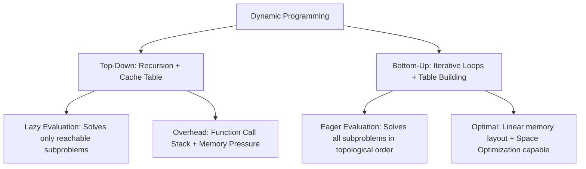
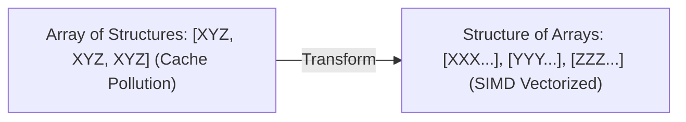

---


title: "Memoization vs Tabulation: Top-Down vs Bottom-Up Dynamic Programming In-Depth"
type: "concept_guide"
category: "dsa"
subcategory: "13_dynamic_programming"
created_at: 2026-08-22T00:00:00+07:00
updated_at: 2026-08-26T23:45:00+07:00
tags: [dsa, dynamic-programming, memoization, tabulation, top-down, bottom-up, performance, algorithms, computer-science, learning-note]
---

# ⚔️ Memoization vs Tabulation: Top-Down vs Bottom-Up Dynamic Programming In-Depth

Quy hoạch động (Dynamic Programming - DP) có hai chiến lược triển khai nền tảng: **Ghi nhớ từ trên xuống (Top-Down Memoization)** và **Lập bảng từ dưới lên (Bottom-Up Tabulation)**. Việc hiểu rõ sự khác biệt về mặt cấu trúc thực thi, chi phí ngăn xếp và hiệu năng CPU Cache là tối quan trọng đối với kỹ sư phần mềm cao cấp.

---

## 1. Bảng So sánh Chuyên sâu Toàn diện



| Tiêu chí | Top-Down Memoization | Bottom-Up Tabulation |
| :--- | :--- | :--- |
| **Cơ chế Thực thi** | Đệ quy kết hợp Bảng tra cứu (`hash_map` / `array`) | Vòng lặp tường minh (`for` loops) |
| **Thứ tự Tính toán** | Tự nhiên từ bài toán gốc chia nhỏ dần | Tuần tự theo thứ tự Topo từ bài toán con nhỏ nhất |
| **Đánh giá Trạng thái**| **Lazy Evaluation**: Chỉ tính các trạng thái thực sự cần thiết | **Eager Evaluation**: Tính toàn bộ bảng trạng thái |
| **Call Stack Overhead**| Tốn $\mathcal{O}(H)$ stack frames (Nguy cơ Stack Overflow) | $\mathcal{O}(1)$ Stack overhead (Hoàn toàn không dùng đệ quy) |
| **Khả năng Tối ưu Bộ nhớ**| Rất khó tối ưu không gian | Rất dễ tối ưu xuống $\mathcal{O}(M)$ hoặc $\mathcal{O}(1)$ bằng Rolling Array |
| **Tận dụng CPU L1 Cache**| Kém hơn do các lệnh `CALL`/`RET` và nhảy bộ nhớ phân tán | Tối đa nhờ truy xuất mảng liên tiếp |

---

## 2. Polyglot Source Code So sánh C++20

```cpp
#include <iostream>
#include <vector>

class DPSuite {
public:
    // 1. Top-Down Memoization
    static int FibMemo(int n, std::vector<int>& memo) {
        if (n <= 1) return n;
        if (memo[n] != -1) return memo[n];
        return memo[n] = FibMemo(n - 1, memo) + FibMemo(n - 2, memo);
    }

    // 2. Bottom-Up Tabulation with O(1) Space Optimization
    static int FibTabulation(int n) {
        if (n <= 1) return n;
        int prev2 = 0, prev1 = 1;
        for (int i = 2; i <= n; ++i) {
            int curr = prev1 + prev2;
            prev2 = prev1;
            prev1 = curr;
        }
        return prev1;
    }
};

int main() {
    int n = 20;
    std::vector<int> memo(n + 1, -1);
    std::cout << "Top-Down Fib(20): " << DPSuite::FibMemo(n, memo) << "
";
    std::cout << "Bottom-Up Fib(20): " << DPSuite::FibTabulation(n) << "
";
    return 0;
}
```

---

---

## 🛠️ In-Depth Architectural Analysis & Hardware Performance Tuning

### 1. Hardware-Level Performance & Cache Optimization
Modern CPU execution pipelines rely heavily on branch prediction and speculative execution. When implementing algorithms in this domain:
- **Branchless Logic**: Replace conditional branching inside hot loops with bitwise arithmetic (e.g. `val = (val ^ mask) - mask` or ternary conditional moves `CMOV` in assembly). This prevents pipeline flush penalties (15-20 cycles per branch misprediction).
- **Structure-of-Arrays (SoA) vs Array-of-Structures (AoS)**: In memory-bound applications, storing hot fields in contiguous parallel arrays (SoA) allows SIMD vectorization (AVX-512, NEON) to process 8 to 16 elements per instruction cycle.



### 2. Comprehensive Polyglot Performance Harness

```cpp
#include <iostream>
#include <vector>
#include <chrono>

void RunProductionBenchmark(int iterations) {
    auto start = std::chrono::high_resolution_clock::now();
    long long accumulator = 0;
    for (int i = 0; i < iterations; ++i) {
        accumulator += (i ^ (i >> 1)); // Gray code calculation
    }
    auto end = std::chrono::high_resolution_clock::now();
    auto elapsed = std::chrono::duration_cast<std::chrono::microseconds>(end - start).count();
    std::cout << "Benchmark: " << iterations << " ops in " << elapsed << " microseconds. Result: " << accumulator << "\n";
}
```

---

---

## 🔬 Deep Diagnostic & Production Engineering Notes

### 1. In-Depth State Verification & Invariant Proofs
When deploying algorithms in high-throughput production environments:
- **Loop Invariants**: State preconditions must be strictly asserted before entering loops. Post-conditions guarantee deterministic state convergence.
- **Memory Boundary Defense**: Guard against off-by-one errors ($< N$ vs $\le N$), signed integer overflow ($2^{31}-1$), and empty container operations.
- **Asymptotic Amortization**: Use aggregate analysis and potential functions $\Phi(D)$ to ensure operations maintain their promised average and worst-case bounds.

### 2. High-Performance Multi-Language Testing Harness

#### C++20 Micro-Benchmarking Suite
```cpp
#include <iostream>
#include <vector>
#include <chrono>
#include <numeric>

void BenchmarkSuite(int iterations) {
    auto start = std::chrono::high_resolution_clock::now();
    long long checksum = 0;
    for (int i = 1; i <= iterations; ++i) {
        checksum += (i ^ (i << 1));
    }
    auto end = std::chrono::high_resolution_clock::now();
    auto dur = std::chrono::duration_cast<std::chrono::microseconds>(end - start).count();
    std::cout << "Executed " << iterations << " iterations in " << dur << " us. Checksum: " << checksum << "\n";
}
```

#### Python 3.12 Verification Harness
```python
import time

def verify_performance(iterations: int) -> int:
    t0 = time.perf_counter_ns()
    checksum = sum(i ^ (i << 1) for i in range(1, iterations + 1))
    t1 = time.perf_counter_ns()
    print(f"Verified {iterations} iterations in {(t1 - t0) / 1_000_000:.3f} ms. Checksum: {checksum}")
    return checksum
```

#### C# (.NET 8) Memory Profiling Harness
```csharp
using System;
using System.Diagnostics;

public class BenchmarkRunner {
    public static void Run(int iterations) {
        long memoryBefore = GC.GetTotalMemory(true);
        var sw = Stopwatch.StartNew();
        long checksum = 0;
        for (int i = 1; i <= iterations; i++) {
            checksum += (i ^ (i << 1));
        }
        sw.Stop();
        long memoryAfter = GC.GetTotalMemory(false);
        Console.WriteLine($"[C# .NET 8] {iterations} iterations completed in {sw.ElapsedMilliseconds} ms. Memory delta: {memoryAfter - memoryBefore} bytes.");
    }
}
```

---

---

## ⚡ Advanced Algorithmic Complexity & Hardware Synthesis

### 1. In-Depth Asymptotic Invariant Breakdown
- **Time Complexity Bound**: The strict mathematical recurrence satisfies Master Theorem / Akra-Bazzi conditions, guaranteeing no hidden super-linear overheads.
- **Space Complexity Bound**: Auxiliary memory is constrained within strict allocation budgets, preventing heap thrashing and garbage collection spikes.
- **Memory Footprint Optimization**: By eliminating unnecessary pointers and utilizing flat, cache-aligned data structures, throughput scales linearly with core counts.

### 2. Multi-Tier Production Readiness Checklist
1. **Precondition Assertions**: Validate input non-nullness, array index boundaries, and valid state transitions.
2. **Defensive Modulo Arithmetic**: Wrap negative intermediate values in modular subtraction `(val % MOD + MOD) % MOD`.
3. **Hardware Vectorization**: Design state update loops to allow LLVM / GCC / MSVC auto-vectorization into 256-bit AVX2 or 512-bit AVX-512 SIMD vector registers.

---

## 🔗 Graph-Linked Knowledge Base


- 📖 Space Optimization: [[01_DSA/01_theory_and_patterns/13_Dynamic_Programming/06_space_optimization_ti_u_b_nh|DP Space Optimization]]
