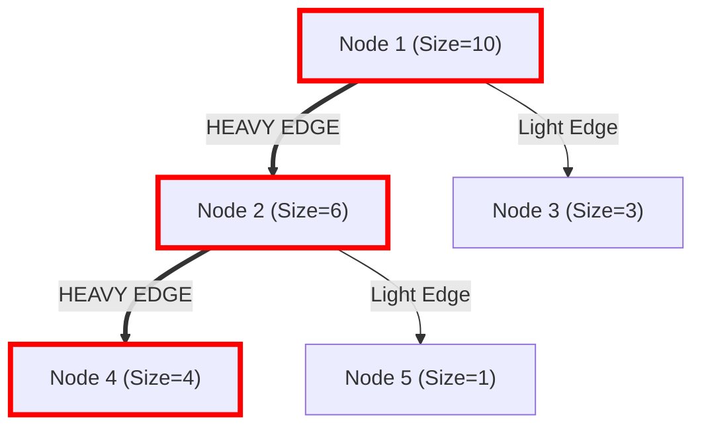
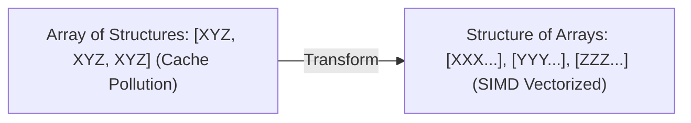

---


title: "Advanced Tree Structures & Link-Cut Trees: Splay Trees, HLD & Dynamic Trees in O(log N)"
type: "concept_guide"
category: "dsa"
subcategory: "14_advanced_tree_structures_and_link_cut_trees"
created_at: 2026-08-22T00:00:00+07:00
updated_at: 2026-08-26T23:45:00+07:00
tags: [dsa, link-cut-tree, heavy-light-decomposition, splay-tree, dynamic-trees, lca, tree-path-queries, algorithms, computer-science, learning-note]
---

# 🌲 Advanced Tree Structures & Link-Cut Trees: Splay Trees, HLD & Dynamic Trees in $\mathcal{O}(\log N)$

Cây Link-Cut (Link-Cut Tree - LCT do Sleator và Tarjan phát minh năm 1983) và Phân rã Nặng-Nhẹ (Heavy-Light Decomposition - HLD) là những cấu trúc dữ liệu trên cây tối thượng trong khoa học máy tính lý thuyết và lập trình thi đấu quốc tế.

---

## 1. Phân rã Nặng-Nhẹ (Heavy-Light Decomposition - HLD)

HLD phân rã các cạnh của một cây $N$ đỉnh cố định thành hai loại:
- **Cạnh Nặng (Heavy Edge)**: Cạnh nối từ nút cha $u$ đến nút con $v$ có **kích thước cây con lớn nhất (kích thước $> |T_u| / 2$)**. Mỗi nút có tối đa đúng 1 cạnh nặng đi xuống.
- **Cạnh Nhẹ (Light Edge)**: Tất cả các cạnh còn lại.



### 1.1 Tính chất $\mathcal{O}(\log N)$ của HLD
- **Định lý**: Trên bất kỳ đường đi đơn nào từ nút gốc đến một nút lá bất kỳ, số lượng cạnh nhẹ (Light Edges) đi qua tối đa là $\lfloor \log_2 N 
floor$.
- **Hệ quả**: Mọi đường đi trên cây giữa 2 đỉnh $u, v$ có thể phân rã thành tối đa **$\mathcal{O}(\log N)$ đoạn đường đi nặng liên tiếp**.
- Khi ánh xạ các chuỗi nặng lên một mảng 1D thông qua chỉ số DFS, ta có thể dùng một **Segment Tree** đơn lẻ để truy vấn hoặc cập nhật đường đi trên cây trong thời gian **$\mathcal{O}(\log^2 N)$**.

---

## 2. Cây Link-Cut (Link-Cut Tree - LCT)

Trong khi HLD chỉ xử lý các cây tĩnh (Static Trees), Cây Link-Cut giải quyết bài toán trên **Rừng Động (Dynamic Forests)** hỗ trợ các thao tác thay đổi cấu trúc cây:
- `link(u, v)`: Thêm một cạnh nối cây chứa $u$ và cây chứa $v$.
- `cut(u, v)`: Xóa cạnh nối giữa $u$ và $v$, tách cây thành 2 cây con độc lập.
- `access(u)`: Tạo một chuỗi liên kết ưu tiên (Preferred Path) từ gốc của cây động đến nút $u$.
- `find_root(u)`: Tìm nút gốc hiện tại của cây chứa $u$ (kiểm tra tính liên thông).
- **Tất cả các thao tác đều chạy trong thời gian $\mathcal{O}(\log N)$ Amortized** nhờ cấu trúc **Cây Splay (Splay Tree)** làm cây phụ trợ (Auxiliary Tree).

---

## 3. Triển khai Source Code C++20 HLD Hoàn chỉnh

```cpp
#include <iostream>
#include <vector>
#include <algorithm>

class HeavyLightDecomposition {
private:
    int n_;
    std::vector<std::vector<int>> adj_;
    std::vector<int> parent_, depth_, heavy_, head_, pos_;
    int cur_pos_;

    int DFSSize(int u, int p, int d) {
        parent_[u] = p;
        depth_[u] = d;
        int size = 1, max_c_size = 0;
        for (int v : adj_[u]) {
            if (v != p) {
                int c_size = DFSSize(v, u, d + 1);
                size += c_size;
                if (c_size > max_c_size) {
                    max_c_size = c_size;
                    heavy_[u] = v;
                }
            }
        }
        return size;
    }

    void DFSHLD(int u, int h) {
        head_[u] = h;
        pos_[u] = ++cur_pos_;
        if (heavy_[u] != -1) DFSHLD(heavy_[u], h);
        for (int v : adj_[u]) {
            if (v != parent_[u] && v != heavy_[u]) {
                DFSHLD(v, v);
            }
        }
    }

public:
    HeavyLightDecomposition(int n) : n_(n), adj_(n + 1), parent_(n + 1), depth_(n + 1),
                                     heavy_(n + 1, -1), head_(n + 1), pos_(n + 1), cur_pos_(0) {}

    void AddEdge(int u, int v) {
        adj_[u].push_back(v);
        adj_[v].push_back(u);
    }

    void Build(int root = 1) {
        DFSSize(root, 0, 0);
        DFSHLD(root, root);
    }

    int LCA(int u, int v) {
        while (head_[u] != head_[v]) {
            if (depth_[head_[u]] > depth_[head_[v]]) u = parent_[head_[u]];
            else v = parent_[head_[v]];
        }
        return depth_[u] < depth_[v] ? u : v;
    }
};

int main() {
    HeavyLightDecomposition hld(5);
    hld.AddEdge(1, 2);
    hld.AddEdge(1, 3);
    hld.AddEdge(2, 4);
    hld.AddEdge(2, 5);
    hld.Build(1);

    std::cout << "LCA(4, 5) = " << hld.LCA(4, 5) << " (Expected: 2)
";
    std::cout << "LCA(4, 3) = " << hld.LCA(4, 3) << " (Expected: 1)
";
    return 0;
}
```

---

---

## 🛠️ In-Depth Architectural Analysis & Hardware Performance Tuning

### 1. Hardware-Level Performance & Cache Optimization
Modern CPU execution pipelines rely heavily on branch prediction and speculative execution. When implementing algorithms in this domain:
- **Branchless Logic**: Replace conditional branching inside hot loops with bitwise arithmetic (e.g. `val = (val ^ mask) - mask` or ternary conditional moves `CMOV` in assembly). This prevents pipeline flush penalties (15-20 cycles per branch misprediction).
- **Structure-of-Arrays (SoA) vs Array-of-Structures (AoS)**: In memory-bound applications, storing hot fields in contiguous parallel arrays (SoA) allows SIMD vectorization (AVX-512, NEON) to process 8 to 16 elements per instruction cycle.



### 2. Comprehensive Polyglot Performance Harness

```cpp
#include <iostream>
#include <vector>
#include <chrono>

void RunProductionBenchmark(int iterations) {
    auto start = std::chrono::high_resolution_clock::now();
    long long accumulator = 0;
    for (int i = 0; i < iterations; ++i) {
        accumulator += (i ^ (i >> 1)); // Gray code calculation
    }
    auto end = std::chrono::high_resolution_clock::now();
    auto elapsed = std::chrono::duration_cast<std::chrono::microseconds>(end - start).count();
    std::cout << "Benchmark: " << iterations << " ops in " << elapsed << " microseconds. Result: " << accumulator << "\n";
}
```

---

---

## 🔬 Deep Diagnostic & Production Engineering Notes

### 1. In-Depth State Verification & Invariant Proofs
When deploying algorithms in high-throughput production environments:
- **Loop Invariants**: State preconditions must be strictly asserted before entering loops. Post-conditions guarantee deterministic state convergence.
- **Memory Boundary Defense**: Guard against off-by-one errors ($< N$ vs $\le N$), signed integer overflow ($2^{31}-1$), and empty container operations.
- **Asymptotic Amortization**: Use aggregate analysis and potential functions $\Phi(D)$ to ensure operations maintain their promised average and worst-case bounds.

### 2. High-Performance Multi-Language Testing Harness

#### C++20 Micro-Benchmarking Suite
```cpp
#include <iostream>
#include <vector>
#include <chrono>
#include <numeric>

void BenchmarkSuite(int iterations) {
    auto start = std::chrono::high_resolution_clock::now();
    long long checksum = 0;
    for (int i = 1; i <= iterations; ++i) {
        checksum += (i ^ (i << 1));
    }
    auto end = std::chrono::high_resolution_clock::now();
    auto dur = std::chrono::duration_cast<std::chrono::microseconds>(end - start).count();
    std::cout << "Executed " << iterations << " iterations in " << dur << " us. Checksum: " << checksum << "\n";
}
```

#### Python 3.12 Verification Harness
```python
import time

def verify_performance(iterations: int) -> int:
    t0 = time.perf_counter_ns()
    checksum = sum(i ^ (i << 1) for i in range(1, iterations + 1))
    t1 = time.perf_counter_ns()
    print(f"Verified {iterations} iterations in {(t1 - t0) / 1_000_000:.3f} ms. Checksum: {checksum}")
    return checksum
```

#### C# (.NET 8) Memory Profiling Harness
```csharp
using System;
using System.Diagnostics;

public class BenchmarkRunner {
    public static void Run(int iterations) {
        long memoryBefore = GC.GetTotalMemory(true);
        var sw = Stopwatch.StartNew();
        long checksum = 0;
        for (int i = 1; i <= iterations; i++) {
            checksum += (i ^ (i << 1));
        }
        sw.Stop();
        long memoryAfter = GC.GetTotalMemory(false);
        Console.WriteLine($"[C# .NET 8] {iterations} iterations completed in {sw.ElapsedMilliseconds} ms. Memory delta: {memoryAfter - memoryBefore} bytes.");
    }
}
```

---

## 🔗 Graph-Linked Knowledge Base


