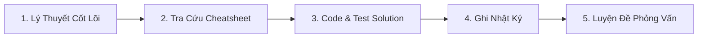

---

title: "🗺️ Master DSA Study Roadmap & Comprehensive Learning Guide"
tags: [dsa, algorithms, computer-science, learning-note]
aliases:
  - Lộ trình học DSA - Nền tảng thuật toán
---

# 📌 🗺️ Master DSA Study Roadmap & Comprehensive Learning Guide
> **Cấu trúc dữ liệu & Giải thuật: Từ Nền tảng tới Chuyên sâu & Phỏng vấn Big Tech**

Bộ tài liệu được thiết kế theo lộ trình 5 khối kiến thức cốt lõi, giúp làm chủ DSA một cách hệ thống trên Obsidian.

---

## 📱 1. Hướng dẫn cấu hình Obsidian

| Môi trường | 💻 Desktop Obsidian (`Ctrl + G`) | 📱 Mobile Obsidian (iOS / Android) |
| :--- | :--- | :--- |
| **Giao diện** | Global Graph + Local Graph bên phải | File Explorer + Backlinks dưới bài viết |
| **Local Graph Depth** | `Depth: 2` (Xem liên kết 2 chiều) | `Depth: 1` (Tối ưu RAM & PIN) |
| **Cấu hình** | Repel force: `13.50`, Center force: `0.55`, Node scale: `0.65` | `hideUnresolved: true`, `showOrphans: false` |

---

## 🔁 2. Quy trình học 5 bước chuẩn hóa (Daily Study Loop)

1. **Bước 1: Học Lý thuyết theo Lộ trình**: Đọc các bài học tương ứng trong từng thư mục học phần (từ `01_Basics` tới `14_Advanced_Tree_Structures_and_Link_Cut_Trees`).
2. **Bước 2: Sử dụng Tài nguyên Bổ trợ**:
   - Tra cứu bảng độ phức tạp $O(N)$ và mẫu thuật toán tại [`dsa_cheatsheets/`](dsa_cheatsheets/).
   - Mở các file HTML tương tác tại [`interview_cake_html/`](interview_cake_html/) để xem trực quan từng bước chạy thuật toán.
3. **Bước 3: Thực hành Viết Code & Test Runtime**:
   - Viết bài tập trong `learning-projects-code/04_dsa_solutions/`.
   - Kiểm tra runtime bằng terminal: `dotnet run --project 08_projects_code/...`.
4. **Bước 4: Ghi Nhật Ký Học Tập**: Phân tích bài toán, độ phức tạp $O(1)$/$O(N)$ vào `00_Meta/02_daily/dsa/`.
5. **Bước 5: Luyện Đề Phỏng Vấn Nâng Cao**: Thực hành lộ trình 75 tuần tại [`75_week_curriculum_interview_cake/`](75_week_curriculum_interview_cake/).

---

## 📚 3. Danh sách các Học phần Cốt lõi & Tài nguyên Bổ trợ

### 🟩 Khối 1: Nền tảng & Cấu trúc Tuyến tính (Foundations & Linear Structures)
- [`01_Basics/`](01_Basics/) — Big-O Notation, Độ phức tạp $O(N)$, Math basics, Bitwise & XOR tricks.
- [`02_Arrays_Strings/`](02_Arrays_Strings/) — Mảng, Chuỗi, Two Pointers, Sliding Window, Prefix Sum, Kadane & Dutch National Flag.
- [`03_Searching_Sorting/`](03_Searching_Sorting/) — Basic Sorting, Binary Search, Search on Answer, Merge/Quick/Heap Sort.
- [`05_Hashing/`](05_Hashing/) — Hash Maps, Frequency Counting, Subarray/Substring problems, Prefix Hashing.
- [`06_Linked_List/`](06_Linked_List/) — Singly/Doubly Linked List, Fast & Slow Pointers, LRU Cache Design.
- [`07_Stack_Queue/`](07_Stack_Queue/) — Stack, Queue, Deque, Monotonic Stack, Expression Evaluation.

### 🟦 Khối 2: Đệ quy, Cây & Heap (Trees, Recursion & Heaps)
- [`04_Recursion_Backtracking/`](04_Recursion_Backtracking/) — Recursion, Subsets, Permutations, Combination Sum, Palindrome Partitioning.
- [`09_Binary_Trees/`](09_Binary_Trees/) — Tree Traversals, Height/Depth, Diameter, Serialization & Path Sums.
- [`10_Binary_Search_Trees/`](10_Binary_Search_Trees/) — BST Search/Insert/Delete, Validation, K-th Smallest, LCA, Order-Statistic Trees.
- [`11_Heaps_Priority_Queue/`](11_Heaps_Priority_Queue/) — Min/Max Heap, Top-K elements, Dynamic Median Stream.

### 🟪 Khối 3: Đồ thị, Tham lam & Quy hoạch động (Graphs, Greedy & DP)
- [`08_Greedy/`](08_Greedy/) — Activity Selection, Huffman Coding, Fractional Knapsack, Jump Game, Task Scheduler.
- [`12_Graphs/`](12_Graphs/) — Graph Representation, BFS/DFS, Shortest Paths (Dijkstra, Bellman-Ford, Floyd-Warshall), Topological Sort.
- [`13_Dynamic_Programming/`](13_Dynamic_Programming/) — 1D/2D DP, Knapsack, LCS, LIS, Interval DP, Tree DP, State Optimization.

### 🟨 Khối 4: Thuật toán Nâng cao & Thi đấu (Advanced & Competitive DSA)
- [`05_Advanced_DSA_Patterns/`](05_Advanced_DSA_Patterns/) — Segment Tree, Fenwick Tree (BIT), Monotonic Deque, Aho-Corasick, Tarjan SCC.
- [`06_Advanced_Dynamic_Programming/`](06_Advanced_Dynamic_Programming/) — Digit DP, Convex Hull Trick, Li Chao Tree, Divide & Conquer DP, Tree Rerooting.
- [`07_Advanced_Graph_Theory/`](07_Advanced_Graph_Theory/) — Dinic Max-Flow, Heavy-Light Decomposition (HLD), Min-Cost Max-Flow, Hopcroft-Karp.
- [`08_Advanced_Data_Structures/`](08_Advanced_Data_Structures/) — Persistent Segment Trees, Centroid Decomposition, Rollback DSU, Suffix Automaton.
- [`09_Advanced_Math_and_Geometry/`](09_Advanced_Math_and_Geometry/) — FFT/NTT, Matrix Exponentiation, Möbius Inversion, Inclusion-Exclusion.
- [`10_Advanced_String_Algorithms/`](10_Advanced_String_Algorithms/) — Suffix Array & Kasai LCP, Manacher Algorithm, Z-Algorithm.
- [`11_Advanced_Game_Theory_and_Combinatorics/`](11_Advanced_Game_Theory_and_Combinatorics/) — Nim Game, Sprague-Grundy Theorem, Burnside's Lemma, HyperLogLog.
- [`12_Computational_Geometry/`](12_Computational_Geometry/) — Convex Hull (Graham/Jarvis), Sweep Line, Point in Polygon.
- [`13_Advanced_Graph_Flows_and_Matching/`](13_Advanced_Graph_Flows_and_Matching/) — Hungarian Algorithm, Hopcroft-Karp, Circulation with Demands.
- [`14_Advanced_Tree_Structures_and_Link_Cut_Trees/`](14_Advanced_Tree_Structures_and_Link_Cut_Trees/) — Link-Cut Trees, Splay Trees.

### 🟥 Khối 5: Bộ tài nguyên Thực hành & Ôn luyện Phỏng vấn
- 🎓 **Lộ trình Phỏng vấn 75 Tuần**: [`75_week_curriculum_interview_cake/`](75_week_curriculum_interview_cake/)
- 📊 **Bảng Tra Cứu Nhanh**: [`dsa_cheatsheets/`](dsa_cheatsheets/)
- 🎨 **Mô Phỏng Trực Quan HTML**: [`interview_cake_html/`](interview_cake_html/)
- 📘 **Giáo Trình & Bài Tập Udacity**: [`udacity_dsa/`](udacity_dsa/)

---

## 📌 4. Nguyên tắc Vàng khi luyện tập

1. **Hiểu bản chất trước khi Code**: Vẽ sơ đồ tư duy hoặc sơ đồ Mermaid trước khi tiến hành code solution.
2. **Tối ưu theo từng cấp độ**: Brute Force $\rightarrow$ Two Pointers / Hash Map $\rightarrow$ $O(N)$ hoặc $O(\log N)$.
3. **Quản lý Tri thức bằng Obsidian**: Sử dụng cú pháp wiki-link `[[Tên_bài_viết]]` để tạo liên kết 2 chiều giữa các bài học.

