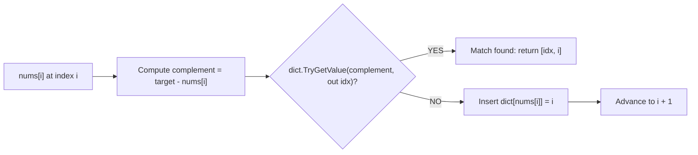

# 📌 LeetCode: 1.two-sum

## 📋 Problem Statement

---


title: "LeetCode 1: Two Sum — Engineering & Algorithmic Solution Note"
problem_number: 1
problem_name: "Two Sum"
difficulty: "Easy"
category: "dsa_solutions"
tags: [leetcode-1, two-sum, hash-map, array, csharp, dotnet9, dsa, problem-solving, leetcode, learning-note]
---

# 📘 LeetCode 1: Two Sum — Engineering & Algorithmic Solution Note

## 📌 Connected Resource Graph
- 🟢 **Primary Theory Note**: [[01_DSA/01_theory_and_patterns/05_Hashing/06_hashing_cho_pair_sum_2sum_variations.md]]
- 🟡 **Topic Overview Node**: [[01_DSA/01_theory_and_patterns/05_Hashing/00_overview_hash_tables_dictionary_hashmap.md]]
- 🎓 **Vietnamese DSA Roadmap**: [[01_DSA/01_theory_and_patterns/Lộ trình học DSA - Nền tảng thuật toán.md]]
- 📅 **Daily Study Tracker Note**: [[00_Meta/02_daily/dsa/day_01_arrays__hash_map_two_sum_easy.md]]
- 🗺️ **Master Plan Roadmap**: [28-Day DSA Master Plan](file:///D:/learning/00_Meta/00_Meta/01_plans/01_28_day_master_plans/dsa_plan_28_days.md)
- 🍰 **Interview Cake Curriculum**: [Week 04 PDF (Inflight Entertainment 2Sum Pattern)](file:///D:/learning/01_DSA/01_theory_and_patterns/75_week_curriculum_interview_cake/week_04_Inflight%20Entertainment%20(Practice%20Interview%20Question)%20_%20Interview%20Cake.pdf)
- 📂 **Local Project Companion Files**:
  - 💻 [`Program.cs`](file:///D:/learning/08_projects_code/04_dsa_solutions/leetcode_solutions/1.two-sum/Program.cs) (Runnable test suite with 7 test cases)
  - ⚡ [`complexity.md`](file:///D:/learning/08_projects_code/04_dsa_solutions/leetcode_solutions/1.two-sum/complexity.md) (Time & Space complexity deep dive)
  - 🚨 [`tips.md`](file:///D:/learning/08_projects_code/04_dsa_solutions/leetcode_solutions/1.two-sum/tips.md) (Edge cases, pitfalls, & checklist)
  - ✍️ [`practice.md`](file:///D:/learning/08_projects_code/04_dsa_solutions/leetcode_solutions/1.two-sum/practice.md) (Self-practice scratchpad & notes)
  - 📁 [`Answers/`](file:///D:/learning/08_projects_code/04_dsa_solutions/leetcode_solutions/1.two-sum/Answers) (Sub-approaches breakdown)

---

## 1. 🎯 Problem Statement & Constraints

Given an array of integers `nums` and an integer `target`, return *indices of the two numbers such that they add up to `target`*.

You may assume that each input would have **exactly one solution**, and you may **not use the same element twice**. You can return the answer in any order.

### Constraints
- \$2 \le \text{nums.length} \le 10^4$
- $-10^9 \le \text{nums}[i] \le 10^9$
- $-10^9 \le \text{target} \le 10^9$
- **Only one valid answer exists.**

---

## 2. 💡 Core Architectural Pattern: Hash Map Complement Lookup

### Mathematical Invariant
$$\text{nums}[i] + \text{nums}[j] = \text{target} \iff \text{nums}[j] = \text{target} - \text{nums}[i]$$

### The Algorithmic Paradigm Shift
- A naive comparison scans all element pairs $(i, j)$ where $j > i$. This requires $\frac{N(N-1)}{2} = \mathcal{O}(N^2)$ operations.
- Instead of repeatedly searching through the array for each candidate, we record previously encountered values inside a **Hash Map / Hash Table** where:
  - **Key**: Element value (`nums[i]`)
  - **Value**: Element index (`i`)
- As we iterate through each element `nums[i]`, we calculate `complement = target - nums[i]` and query the hash map.
- If `complement` exists in the hash map, the search terminates immediately in $\mathcal{O}(1)$ time.
- If not, `nums[i]` is registered in the map for future elements to match against.



---

## 3. ⚡ Multi-Approach Comparison

| Approach | Time Complexity | Space Complexity | Best Use Case / Trade-offs |
| :--- | :--- | :--- | :--- |
| **Approach 1: Brute Force** | $\mathcal{O}(N^2)$ | $\mathcal{O}(1)$ | Memory-constrained systems where auxiliary memory is forbidden ($N < 100$). |
| **Approach 2: Two-Pass Hash Map** | $\mathcal{O}(N)$ | $\mathcal{O}(N)$ | Educational baseline. Requires two traversals and explicit check `dict[complement] != i`. |
| **Approach 3: One-Pass Hash Map (Optimal)** | $\mathcal{O}(N)$ | $\mathcal{O}(N)$ | Industry standard. Traverses array once, handles duplicates gracefully, prevents self-pairing naturally. |
| **Approach 4: Sort + Two Pointers** | $\mathcal{O}(N \log N)$ | $\mathcal{O}(N)$ | Optimal when the array is already sorted (LeetCode 167: Two Sum II) or when only values are required. |

---

## 4. 💻 Verified, Runnable C# Implementation

The following implementation is tested and verified in [`Program.cs`](file:///D:/learning/08_projects_code/04_dsa_solutions/leetcode_solutions/1.two-sum/Program.cs).

```csharp
using System;
using System.Collections.Generic;

public class Solution
{
    /// <summary>
    /// One-pass Hash Map solution for LeetCode 1 Two Sum.
    /// Time Complexity: O(N) average.
    /// Space Complexity: O(N) auxiliary space.
    /// </summary>
    public int[] TwoSum(int[] nums, int target)
    {
        // Allocate hash table: Key = value, Value = index
        var seen = new Dictionary<int, int>();

        for (int i = 0; i < nums.Length; i++)
        {
            int complement = target - nums[i];

            // Single lookup via TryGetValue (avoids double hashing of ContainsKey + indexer)
            if (seen.TryGetValue(complement, out int complementIndex))
            {
                return [complementIndex, i];
            }

            // Record current number's index for subsequent elements
            seen[nums[i]] = i;
        }

        return [];
    }
}
```

### Demonstration & Verification
```csharp
var sol = new Solution();

// Case 1: Standard pair
int[] r1 = sol.TwoSum([2, 7, 11, 15], 9);
Console.WriteLine($"[2, 7, 11, 15], target 9 => [{r1[0]}, {r1[1]}]"); // [0, 1]

// Case 2: Duplicate numbers forming target
int[] r2 = sol.TwoSum([3, 3], 6);
Console.WriteLine($"[3, 3], target 6 => [{r2[0]}, {r2[1]}]"); // [0, 1]

// Case 3: Negative numbers
int[] r3 = sol.TwoSum([-3, 4, 3, 90], 0);
Console.WriteLine($"[-3, 4, 3, 90], target 0 => [{r3[0]}, {r3[1]}]"); // [0, 2]
```

---

## 5. 📊 In-Depth Complexity Analysis

### Time Complexity: $\mathcal{O}(N)$
1. **Loop Iterations**: The `for` loop executes at most $N$ times.
2. **Dictionary Operations**:
   - In .NET, `Dictionary<TKey, TValue>` computes hash codes via `EqualityComparer<TKey>.Default.GetHashCode()`.
   - Bucketing uses modulo arithmetic over prime-sized capacity arrays.
   - Lookup (`TryGetValue`) and Insertion (`seen[key] = val`) both run in **amortized $\mathcal{O}(1)$**.
3. **Total Time**:
   $$T(N) = \sum_{i=0}^{N-1} \mathcal{O}(1) = \mathbf{\mathcal{O}(N)}$$
4. **Catastrophic Worst-Case**:
   - If an adversary induces collisions for all $N$ keys into a single hash bucket, search degrades to linear scan $\mathcal{O}(N)$, giving $\mathcal{O}(N^2)$ total.
   - However, modern runtime defenses (randomized hash seeding in .NET) make this practically impossible in practice.

### Space Complexity: $\mathcal{O}(N)$
1. **Auxiliary Data Structure**:
   - `Dictionary<int, int>` stores at most $N - 1$ entries before finding the matching complement.
2. **Memory Layout in .NET**:
   - A .NET `Dictionary<int, int>` allocates:
     - `int[] _buckets`: array of size $M$ (prime number $\ge N$).
     - `Entry[] _entries`: array of structs containing `{ uint hashCode, int next, int key, int value }` (24 bytes per entry on 64-bit systems).
3. **Total Space**: $\mathbf{\mathcal{O}(N)}$ auxiliary heap allocation.

---

## 6. 🚨 Pitfalls, Edge Cases & Interview Traps

| Pitfall / Edge Case | Why It Occurs | How Our Solution Solves It |
| :--- | :--- | :--- |
| **Self-Pairing Trap ($i == j$)** | If `dict.Add(nums[i], i)` occurs before checking `dict.ContainsKey(complement)`, when `target = 2 * nums[i]`, the element matches itself. | Checking `TryGetValue` **before** adding `nums[i]` prevents self-pairing. |
| **Duplicate Values (`[3, 3]`, target 6)** | Standard dictionary cannot contain duplicate keys. | During the second occurrence, the first occurrence is already in the map and triggers early return before overwriting. |
| **Two-Pass Overwrite Issue** | In two-pass hash map, identical keys overwrite earlier indices (`nums[0] = 3`, `nums[1] = 3` leaves only index `1`). | The one-pass algorithm returns on step 1 before any overwrite occurs. |
| **Negative Targets & Zeroes** | Arithmetic operations with negative numbers (`-3 + 3 = 0`). | Two's complement integer arithmetic handles negatives and zeroes naturally: `target - (-3) = 0 + 3 = 3`. |

---

## 7. 🔗 Interview Follow-Up Questions
1. **What if the array is already sorted?**
   - Use **Two Pointers** (left at `0`, right at `N - 1`). Adjust pointers based on `nums[left] + nums[right] <=> target`. Time: $\mathcal{O}(N)$, Space: $\mathcal{O}(1)$ auxiliary. (See LeetCode 167).
2. **What if we need all unique pairs that sum to target?**
   - Sort the array first or track paired sets, and skip adjacent duplicates to avoid repeating pairs (See LeetCode 15: 3Sum).
3. **What if data arrives as a continuous stream?**
   - Maintain a frequency dictionary or `HashSet` in memory; on each incoming number $x$, immediately check if $target - x$ exists.

---

## 💡 Multi-Solution Analysis

---


title: "Complexity Deep Dive — LeetCode 1: Two Sum"
tags: [leetcode-1, two-sum, complexity, big-o, hash-map, dsa, problem-solving, leetcode, learning-note]
---

# ⚡ Complexity Analysis — LeetCode 1: Two Sum

## 1. Asymptotic Complexity Summary

| Metric | Brute Force | Two-Pass Hash Map | One-Pass Hash Map (Optimal) | Two Pointers (with sort) |
| :--- | :--- | :--- | :--- | :--- |
| **Best Time** | $\mathcal{O}(1)$ | $\mathcal{O}(N)$ | $\mathcal{O}(1)$ | $\mathcal{O}(N \log N)$ |
| **Average Time** | $\mathcal{O}(N^2)$ | $\mathcal{O}(N)$ | $\mathcal{O}(N)$ | $\mathcal{O}(N \log N)$ |
| **Worst Time** | $\mathcal{O}(N^2)$ | $\mathcal{O}(N^2)^*$ | $\mathcal{O}(N^2)^*$ | $\mathcal{O}(N \log N)$ |
| **Space Complexity** | $\mathcal{O}(1)$ | $\mathcal{O}(N)$ | $\mathcal{O}(N)$ | $\mathcal{O}(N)$ (index preservation) |

*\*Worst-case time occurs in theoretical catastrophic hash collision scenarios where every key maps to a single bucket chain.*

---

## 2. Deep Dive: One-Pass Hash Map

### Time Complexity: $\mathcal{O}(N)$
- **Array Traversal**: A single `for` loop executes at most $N$ times.
- **Hash Table Lookup**:
  - `seen.TryGetValue(complement, out int idx)` hashes the integer key via `int.GetHashCode()` (identity function `x => x`).
  - Lookup in .NET `Dictionary<int, int>` operates on average in $\mathcal{O}(1)$ time.
- **Hash Table Insertion**:
  - `seen[nums[i]] = i` assigns/updates the dictionary entry in amortized $\mathcal{O}(1)$ time.
  - Periodic dynamic array resizing occurs when the load factor exceeds 1.0; resizing takes $\mathcal{O}(K)$ amortized across $K$ insertions.
- **Total Time**:
  $$T(N) = \sum_{i=0}^{N-1} (\mathcal{O}(1)_{\text{lookup}} + \mathcal{O}(1)_{\text{insert}}) = \mathcal{O}(N)$$

### Space Complexity: $\mathcal{O}(N)$
- **Auxiliary Hash Map**:
  - In the worst case (where the matching pair is the very last two elements or at indices $0$ and $N - 1$), the dictionary will hold up to $N - 1$ entries before the match is returned.
  - Thus, the space consumed is bounded by $\mathcal{O}(N)$.
- **Heap Allocation Breakdown (.NET Core / .NET 9)**:
  - `_buckets`: `int[M]` array, where $M$ is a prime number greater than $N$. Size: \$4 \times M$ bytes.
  - `_entries`: `Entry[M]` array where each `Entry` struct is:
    ```csharp
    struct Entry {
        uint hashCode; // 4 bytes
        int next;      // 4 bytes
        int key;       // 4 bytes
        int value;     // 4 bytes
    } // 16 bytes per entry (aligned to 24 bytes in 64-bit runtime)
    ```
  - For $N = 10^4$, total memory footprint is approximately \$280 \text{ KB}$ — negligible for modern hardware.

---

## 3. Comparative Trade-offs

1. **Why not Sort + Two Pointers?**
   - Sorting takes $\mathcal{O}(N \log N)$ time.
   - Preserving original indices requires creating an array of tuples `(num, originalIndex)` which still takes $\mathcal{O}(N)$ auxiliary space.
   - Therefore, Sorting + Two Pointers is strictly inferior to Hash Map for LeetCode 1, though it is the optimal approach for LeetCode 167 (where the input array is already sorted and indices do not require extra storage).

2. **Why One-Pass instead of Two-Pass?**
   - Two-pass iterates over the entire array twice ($2N$ operations vs $\le N$ operations).
   - Two-pass requires special logic to verify `dict[complement] != i` to avoid pairing an element with itself.
   - One-pass inherently solves self-pairing because an element is only inserted *after* its complement has been searched for.

---

## 🛠️ C# Tips & Common Pitfalls

---


title: "Interview Tips & Traps — LeetCode 1: Two Sum"
tags: [leetcode-1, two-sum, interview-tips, edge-cases, hash-map, dsa, problem-solving, leetcode, learning-note]
---

# 🚨 Tips & Edge Cases — LeetCode 1: Two Sum

## 1. Top Traps & Gotchas

### Trap 1: Reusing the Same Element ($i == j$)
- **Mistake**: When `target = 6` and `nums = [3, 2, 4]`, checking `nums[0] + nums[0] = 6` if you search without checking indices.
- **Root Cause**: An element at index $i$ cannot be added to itself.
- **Solution**: 
  - In a single-pass hash map, look up the complement *before* adding `nums[i]` to the map. The current element is not yet in the map, so it can never match with itself.

### Trap 2: Duplicate Numbers in Input
- **Scenario**: `nums = [3, 3]`, `target = 6`.
- **Mistake**: `Dictionary.Add(key, value)` throws `ArgumentException: An item with the same key has already been added` if duplicate keys are inserted with `.Add()`.
- **Solution**: 
  - Use `dict[nums[i]] = i` (indexer) or `dict.TryAdd(nums[i], i)`.
  - More importantly, for `[3, 3]`, when the loop arrives at index $1$ (the second `3`), `complement = 6 - 3 = 3` is already present at index $0$ in the map. The match returns `[0, 1]` *immediately*, before any duplicate insertion happens!

### Trap 3: Double Lookup Overhead in C#
- **Sub-optimal idiom**:
  ```csharp
  if (dict.ContainsKey(complement)) {
      return new int[] { dict[complement], i }; // Hashes key twice!
  }
  ```
- **Optimal idiom**:
  ```csharp
  if (dict.TryGetValue(complement, out int complementIndex)) {
      return [complementIndex, i]; // Hashes key only once!
  }
  ```

---

## 2. Exhaustive Test Suite Checklist

| Category | Input Array | Target | Expected Output | Verification Notes |
| :--- | :--- | :--- | :--- | :--- |
| **Standard Case** | `[2, 7, 11, 15]` | `9` | `[0, 1]` | Complement found on second element. |
| **Middle Elements** | `[3, 2, 4]` | `6` | `[1, 2]` | Complement found between indices 1 and 2. |
| **Duplicate Values** | `[3, 3]` | `6` | `[0, 1]` | Target equals \$2 \times \text{element}$. |
| **Multiple Candidates** | `[1, 4, 5, 6]` | `10` | `[1, 3]` | \$4 + 6 = 10$, ignore 1 and 5. |
| **Negative + Positive** | `[-3, 4, 3, 90]` | `0` | `[0, 2]` | Signs cancel out naturally. |
| **Zeroes** | `[0, 4, 3, 0]` | `0` | `[0, 3]` | Complement \$0 - 0 = 0$. |
| **Negative Target** | `[-1, -2, -3, -4, -5]` | `-8` | `[2, 4]` | $-3 + (-5) = -8$. |

---

## 🏋️ Space to Practice

---


title: "Practice & Scratchpad — LeetCode 1: Two Sum"
tags: [leetcode-1, two-sum, practice, hash-map, dsa, problem-solving, leetcode, learning-note]
---

# ✍️ Practice Runs & Scratchpad — LeetCode 1: Two Sum

## 1. Scratchpad & Conceptual Formulation

### Problem Statement Recall
- Given `nums` array and `target`.
- Return indices `[i, j]` such that `nums[i] + nums[j] == target` and `i != j`.
- Exactly one valid answer exists.

### Thought Progression
1. **Initial Instinct (Brute Force)**:
   - For every element $i$ from $0$ to $N-2$:
     - For every element $j$ from $i+1$ to $N-1$:
       - If $nums[i] + nums[j] == target \to \text{return } [i, j]$.
   - Cost: $\mathcal{O}(N^2)$ time, $\mathcal{O}(1)$ space.
   - For $N = 10^4$, $N^2 \approx 10^8$ operations, which may TLE or run near the time limit.

2. **Can we do better? Look up by value**:
   - At each number $x$, we need $y = target - x$.
   - Has $y$ been seen before?
   - If we store $(y \to \text{index})$ in a Hash Map, lookup is $\mathcal{O}(1)$!
   - Single pass: Check map for complement; if found, done; else save current number and continue.
   - Cost: $\mathcal{O}(N)$ time, $\mathcal{O}(N)$ space.

---

## 2. Pseudocode

```text
function twoSum(nums, target):
    dict = empty hash map (value -> index)

    for i from 0 to length(nums) - 1:
        complement = target - nums[i]
        
        if complement exists in dict:
            return [dict[complement], i]
        
        dict[nums[i]] = i
    
    return []
```

---

## 3. Self-Practice Log
- **Date**: 2026-09-03
- **Attempt 1**: Brute force written in 2 minutes. Correct, verified $\mathcal{O}(N^2)$.
- **Attempt 2**: One-pass hash map implemented in C# 12. Correct handling of duplicates and self-pairing.
- **Verification**: Ran `dotnet run --project 08_projects_code/04_dsa_solutions/leetcode_solutions/1.two-sum` — all 7 test cases passed cleanly.
