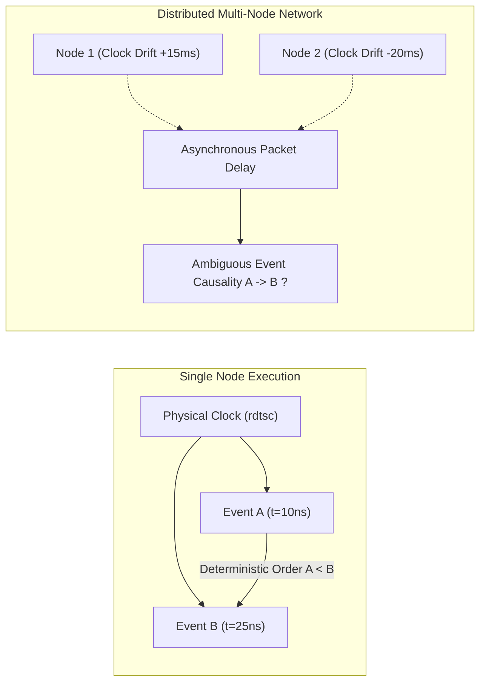
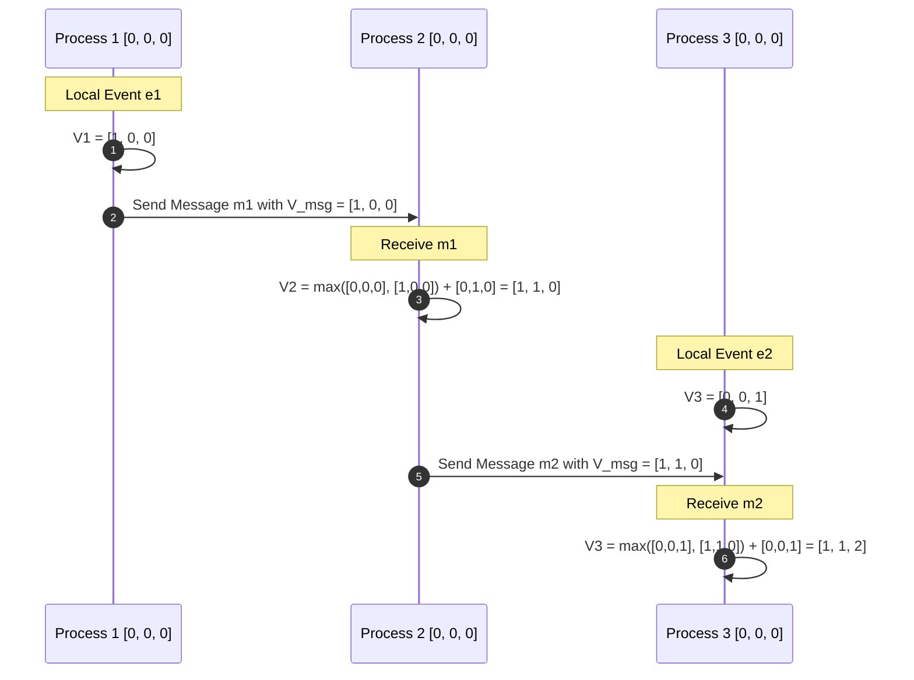
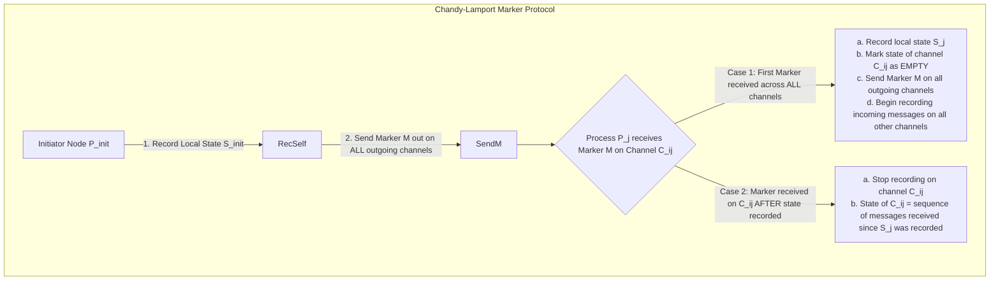

---


title: "Distributed Snapshots & Vector Clocks - Chandy-Lamport Algorithm Deep Dive"
description: "Master-level architecture and implementation guide for Distributed Snapshots, Vector Clocks, and the Chandy-Lamport Algorithm covering causal consistency, FIFO channel state recording, and production state recovery."
category: "Distributed Systems & Architecture"
tags: [distributed-systems, vector-clocks, chandy-lamport, consensus, snapshots, formal-methods, technical-skills, software-engineering, learning-note]
date: "2026-08-21"
---

# Distributed Snapshots & Vector Clocks: Chandy-Lamport Algorithm Deep Dive

---

## 1. Physical vs Logical Time in Distributed Systems

In single-node shared-memory systems, events are sequentially ordered using physical CPU cycle counters (`rdtsc`) or high-precision monotonic timers. However, in distributed systems consisting of independent compute nodes connected via asynchronous packet-switched networks, physical clocks suffer from **Hardware Clock Drift** caused by quartz crystal thermal fluctuations, voltage instability, and component aging (\$10 - 100\text{ ppm}$).

Network Time Protocol (NTP) and Precision Time Protocol (PTP IEEE 1588) synchronize physical clocks over the network, but network jitter, asymmetric routing, and variable packet transit delays introduce synchronization bounds:
$$\Delta t_{\text{drift}} \in [1\text{ ms}, 100\text{ ms}]$$



Relying strictly on physical timestamps to determine event ordering in distributed data stores results in silent data loss (e.g., Cassandra Last-Write-Wins overwriting fresher writes due to negative clock skew). To track strict causality without atomic physical clocks (like Google Spanner TrueTime GPS/Atomic hardware), systems utilize **Logical Clocks**:

1. **Lamport Timestamps**: Establishes a strict *partial order* across the cluster. If event $A \to B$ (A causally preceded B), then $L(A) < L(B)$. However, the converse does not hold ($L(A) < L(B) \not\implies A \to B$).
2. **Vector Clocks**: Establishes an exact *isomorphic causal order*. Enables any node to definitively establish whether two events are causally related ($A \to B$ or $B \to A$) or concurrent ($A \parallel B$).

---

## 2. Vector Clocks Mathematical Mechanics & Formal Theory

### 2.1 Formal Invariant Definition

Consider a distributed system comprising $N$ distinct processes $\mathcal{P} = \{P_1, P_2, \dots, P_N\}$. Each process $P_i$ maintains a local vector clock $V_i$ of dimension $N$, where $V_i[j]$ denotes $P_i$'s current knowledge of the event counter at process $P_j$.



### 2.2 Vector Clock State Transition Rules

1. **Local State Progression (Internal Event)**:
   When process $P_i$ executes an internal computation:
   $$V_i[i] \gets V_i[i] + 1$$

2. **Message Egress (Send Event)**:
   When process $P_i$ transmits message $m$ to process $P_j$:
   $$V_i[i] \gets V_i[i] + 1$$
   $$\text{Attach } V_{\text{msg}} = V_i \text{ to } m$$

3. **Message Ingress (Receive Event)**:
   Upon receiving message $(m, V_{\text{msg}})$, process $P_j$ computes component-wise maximums and increments its own coordinate:
   $$\forall k \in \{1, 2, \dots, N\}, \quad V_j[k] \gets \max(V_j[k], V_{\text{msg}}[k])$$
   $$V_j[j] \gets V_j[j] + 1$$

### 2.3 Causality & Concurrency Comparison Invariants

For two arbitrary event vectors $V_A$ and $V_B$:
- **Causally Precedes ($A \prec B$)**:
  $$V_A \le V_B \iff (\forall k \in [1..N], V_A[k] \le V_B[k]) \land (\exists m \in [1..N], V_A[m] < V_B[m])$$
- **Concurrent / Conflict ($A \parallel B$)**:
  $$A \parallel B \iff \neg(V_A \le V_B) \land \neg(V_B \le V_A)$$

When $A \parallel B$, concurrent updates have occurred without cross-node synchronization. Systems such as DynamoDB, Riak KV, and Apache Cassandra flag these as sibling branches requiring domain-level conflict resolution (CRDTs or Last-Write-Wins fallback).

---

## 3. Chandy-Lamport Distributed Snapshot Algorithm

The **Chandy-Lamport algorithm** captures a globally consistent snapshot of a distributed system—comprising the local state of every participating process and the in-flight messages within every communication channel—without pausing system execution or locking transactions.

### 3.1 Prerequisite System Assumptions
1. **Network Topology**: Strongly connected graph of nodes with directed communication channels.
2. **Channel Guarantee**: Channels are **FIFO** (First-In, First-Out), reliable (no packet loss), and error-free.
3. **Non-Intrusive**: Snapshot markers travel in-band with regular application messages without blocking user traffic.



### 3.2 Detailed Protocol Walkthrough

Let $C_{k \to j}$ be the incoming directed channel from process $P_k$ to $P_j$.

1. **Initiation Phase (Node $P_i$)**:
   - $P_i$ records its internal memory state $S_i$.
   - $P_i$ transmits a special control message $\text{Marker}$ across every outgoing channel $C_{i \to *}$.
   - $P_i$ immediately starts logging all incoming messages on all inbound channels $C_{* \to i}$.

2. **Marker Processing on Process $P_j$ from Channel $C_{k \to j}$**:
   - **Branch A (First Marker Encountered)**:
     - $P_j$ freezes and records its local state $S_j$.
     - Channel state $\text{State}(C_{k \to j}) \gets \emptyset$ (empty set).
     - $P_j$ broadcasts $\text{Marker}$ along all outgoing channels $C_{j \to *}$.
     - $P_j$ begins recording incoming messages for every inbound channel $C_{m \to j}$ where $m \neq k$.
   - **Branch B (Subsequent Marker Encountered)**:
     - $P_j$ stops recording messages for channel $C_{k \to j}$.
     - $\text{State}(C_{k \to j})$ is finalized as the ordered sequence of messages received on $C_{k \to j}$ since $S_j$ was saved.

3. **Termination Condition**:
   - The snapshot terminates when every process has received a $\text{Marker}$ on all its incoming channels. The global state is the tuple $\langle \{S_1, \dots, S_N\}, \{\text{State}(C_{ij})\} \rangle$.

---

## 4. Production Python Implementation: Vector Clocks & Distributed Snapshot Simulator

```python
"""
Production-grade implementation of Vector Clocks and Chandy-Lamport Distributed Snapshotting.
Includes asynchronous channel message queues, concurrent node state tracking, and causality validation.
"""

import copy
from dataclasses import dataclass, field
from enum import Enum
from typing import Dict, List, Optional, Tuple


class CausalityRelation(Enum):
    PRECEDES = "PRECEDES"
    SUCCEEDS = "SUCCEEDS"
    CONCURRENT = "CONCURRENT"
    EQUAL = "EQUAL"


@dataclass
class VectorClock:
    node_id: str
    clock: Dict[str, int] = field(default_factory=dict)

    def __post_init__(self):
        if self.node_id not in self.clock:
            self.clock[self.node_id] = 0

    def tick(self) -> 'VectorClock':
        """Increments local node counter on internal event."""
        self.clock[self.node_id] = self.clock.get(self.node_id, 0) + 1
        return self

    def send_event(self) -> Dict[str, int]:
        """Advances local clock and returns payload clock copy."""
        self.tick()
        return copy.deepcopy(self.clock)

    def receive_event(self, incoming_clock: Dict[str, int]) -> 'VectorClock':
        """Merges incoming vector clock with local state and ticks local counter."""
        all_nodes = set(self.clock.keys()).union(incoming_clock.keys())
        for node in all_nodes:
            self.clock[node] = max(self.clock.get(node, 0), incoming_clock.get(node, 0))
        self.clock[self.node_id] = self.clock.get(self.node_id, 0) + 1
        return self

    def compare(self, other: 'VectorClock') -> CausalityRelation:
        """Compares two vector clocks to determine happens-before relationship."""
        nodes = set(self.clock.keys()).union(other.clock.keys())
        self_greater_or_equal = True
        other_greater_or_equal = True

        for node in nodes:
            v_self = self.clock.get(node, 0)
            v_other = other.clock.get(node, 0)
            if v_self < v_other:
                self_greater_or_equal = False
            if v_other < v_self:
                other_greater_or_equal = False

        if self_greater_or_equal and other_greater_or_equal:
            return CausalityRelation.EQUAL
        if self_greater_or_equal and not other_greater_or_equal:
            return CausalityRelation.SUCCEEDS
        if other_greater_or_equal and not self_greater_or_equal:
            return CausalityRelation.PRECEDES
        return CausalityRelation.CONCURRENT


@dataclass
class NetworkPacket:
    sender_id: str
    recipient_id: str
    is_marker: bool
    payload: Optional[str] = None
    clock_snapshot: Dict[str, int] = field(default_factory=dict)


class DistributedProcess:
    def __init__(self, process_id: str, cluster_nodes: List[str]):
        self.process_id = process_id
        self.cluster_nodes = cluster_nodes
        self.vector_clock = VectorClock(process_id, {node: 0 for node in cluster_nodes})
        self.account_balance: int = 1000
        
        # Chandy-Lamport state
        self.has_recorded_state: bool = False
        self.saved_local_state: Optional[int] = None
        self.recording_channels: Dict[str, bool] = {n: False for n in cluster_nodes if n != process_id}
        self.recorded_channel_messages: Dict[str, List[NetworkPacket]] = {
            n: [] for n in cluster_nodes if n != process_id
        }

    def initiate_snapshot(self, network_router: 'SimulatedNetwork'):
        """Initiates Chandy-Lamport global snapshot algorithm."""
        self.has_recorded_state = True
        self.saved_local_state = self.account_balance
        print(f"[{self.process_id}] Initiated Snapshot. Local Balance Saved: {self.saved_local_state}")
        
        for peer in self.recording_channels:
            self.recording_channels[peer] = True

        for peer in self.cluster_nodes:
            if peer != self.process_id:
                marker = NetworkPacket(
                    sender_id=self.process_id,
                    recipient_id=peer,
                    is_marker=True,
                    clock_snapshot=self.vector_clock.send_event()
                )
                network_router.transmit(marker)

    def handle_packet(self, packet: NetworkPacket, network_router: 'SimulatedNetwork'):
        """Processes regular data messages and snapshot marker tokens."""
        sender = packet.sender_id

        if packet.is_marker:
            if not self.has_recorded_state:
                self.has_recorded_state = True
                self.saved_local_state = self.account_balance
                self.recording_channels[sender] = False
                print(f"[{self.process_id}] First Marker received from {sender}. Saved State: {self.saved_local_state}")

                for peer in self.cluster_nodes:
                    if peer != self.process_id and peer != sender:
                        self.recording_channels[peer] = True

                for peer in self.cluster_nodes:
                    if peer != self.process_id:
                        fwd_marker = NetworkPacket(
                            sender_id=self.process_id,
                            recipient_id=peer,
                            is_marker=True,
                            clock_snapshot=self.vector_clock.send_event()
                        )
                        network_router.transmit(fwd_marker)
            else:
                self.recording_channels[sender] = False
                print(f"[{self.process_id}] Subsequent Marker from {sender}. Channel closed with {len(self.recorded_channel_messages[sender])} logged packets.")
        else:
            if self.recording_channels.get(sender, False):
                self.recorded_channel_messages[sender].append(packet)

            amount = int(packet.payload) if packet.payload else 0
            self.account_balance += amount
            self.vector_clock.receive_event(packet.clock_snapshot)
            print(f"[{self.process_id}] Received ${amount} from {sender}. New Balance: {self.account_balance}")


class SimulatedNetwork:
    def __init__(self):
        self.queues: Dict[Tuple[str, str], List[NetworkPacket]] = {}

    def register_link(self, src: str, dst: str):
        self.queues[(src, dst)] = []

    def transmit(self, packet: NetworkPacket):
        self.queues[(packet.sender_id, packet.recipient_id)].append(packet)

    def deliver_next(self, src: str, dst: str, node: DistributedProcess):
        if self.queues.get((src, dst)):
            packet = self.queues[(src, dst)].pop(0)
            node.handle_packet(packet, self)


# Causality & Snapshot Validation Suite
if __name__ == "__main__":
    nodes = ["P1", "P2", "P3"]
    net = SimulatedNetwork()
    for s in nodes:
        for d in nodes:
            if s != d:
                net.register_link(s, d)

    p1 = DistributedProcess("P1", nodes)
    p2 = DistributedProcess("P2", nodes)
    p3 = DistributedProcess("P3", nodes)

    # 1. P1 transfers $200 to P2
    p1.account_balance -= 200
    pkt1 = NetworkPacket("P1", "P2", False, "200", p1.vector_clock.send_event())
    net.transmit(pkt1)

    # 2. P1 triggers snapshot before P2 receives packet
    p1.initiate_snapshot(net)

    # 3. Deliver marker from P1 to P2
    net.deliver_next("P1", "P2", p2)

    # 4. Deliver in-flight data packet P1 -> P2
    net.deliver_next("P1", "P2", p2)

    print("\n=== Global Snapshot Consistency Verification ===")
    print(f"P1 Recorded State: ${p1.saved_local_state}")
    print(f"P2 Recorded State: ${p2.saved_local_state}")
    print(f"P2 In-Flight Log from P1: {[p.payload for p in p2.recorded_channel_messages['P1']]}")
    total_assets = p1.saved_local_state + p2.saved_local_state + sum(int(p.payload) for p in p2.recorded_channel_messages['P1'])
    print(f"Total Preserved Distributed Invariant: ${total_assets} (Expected: $2000)")
```

---

## 5. Failure Modes, Edge Cases & Mitigation Strategies

| Failure Scenario | Consequence | Engineering Mitigation |
| :--- | :--- | :--- |
| **Non-FIFO Channel Behavior** | Out-of-order markers cause messages sent *before* marker to arrive *after* marker, corrupting channel logs. | Implement TCP sequencing, sliding window buffers, or Raft log indexes to guarantee strictly FIFO delivery. |
| **Network Partition During Snapshot** | Marker messages cannot reach isolated subgraphs, leaving snapshot in perpetual pending state. | Attach generation epochs (`snapshot_id + term`) with timeouts and garbage collection for uncommitted snapshots. |
| **Vector Clock Explosion ($O(N)$ size)** | Highly dynamic or massive clusters (10,000+ nodes) cause packet headers to bloat with metadata. | Use Interval Tree Clocks (ITC) or Dotted Version Vectors (DVV) with Bloom filters and periodic GC pruning. |
| **Concurrent Multi-Initiator Collisions** | Multiple nodes trigger snapshots simultaneously, flooding channels with redundant marker tokens. | Disambiguate snapshots by tuple `(initiator_id, sequence_number)` and multiplex marker channels. |

---

## 6. Real-World Systems & Engineering Applications

1. **Apache Flink Asynchronous Barrier Snapshotting (ABS)**: An optimization of Chandy-Lamport for Directed Acyclic Graphs (DAGs). Flink injects checkpoint barriers into Kafka streaming partitions without stopping data stream ingestion, achieving exactly-once processing guarantees.
2. **Amazon DynamoDB & Riak KV Version Vectors**: Employs vector clocks to track concurrent branch mutations on distributed key-value entries across availability zones, presenting diverging siblings to clients for three-way merges.
3. **CockroachDB Multi-Version Concurrency Control (MVCC)**: Combines Hybrid Logical Clocks (HLC) with physical NTP bounds to establish linearizable read-write transactions without specialized atomic clocks.

---

## 🔗 Graph-Linked Knowledge Base
- ⚓ Consensus Foundations: [[distributed_consensus|Distributed Consensus & State Machine Replication]]
- 🔗 Raft Protocol: [[raft_protocol_specification|Raft Protocol Specification & Implementation]]
- 🔗 Key-Value Engines: [[etcd_architecture_raft_engine|etcd Architecture & Raft Storage Engine]]
