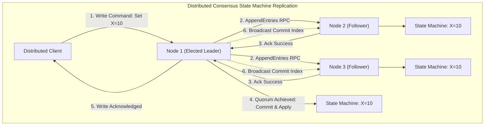
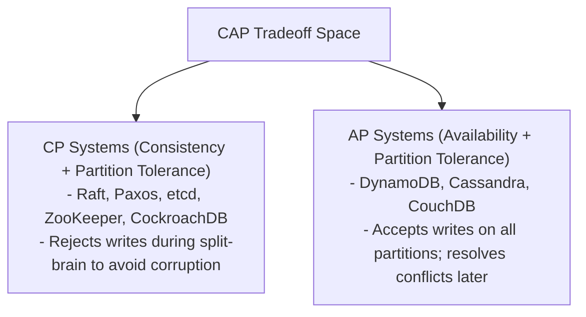
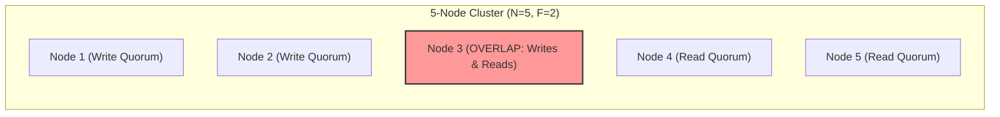

---


title: "Distributed Consensus: Fundamental Theory, CAP Theorem & State Machine Replication"
description: "Master-level architecture and implementation guide for Distributed Consensus, CAP/PACELC theorems, FLP Impossibility, Quorum Intersection Mathematics, and State Machine Replication."
category: "Distributed Systems & Architecture"
tags: [distributed-consensus, cap-theorem, pacelc, flp-impossibility, smr, quorum, technical-skills, software-engineering, learning-note]
date: "2026-08-21"
---

# Distributed Consensus: Fundamental Theory & SMR Mechanics

---

## 1. Executive Summary & Under-the-Hood Mechanics

**Distributed Consensus** is the fundamental problem of coordinating a group of independent compute nodes over an unreliable network to agree upon a shared sequence of state machine transitions or data values. It serves as the bedrock for modern distributed systems, including cloud-native orchestration engines (Kubernetes/etcd), distributed SQL databases (Google Spanner, CockroachDB, TiDB), and distributed message brokers (Apache Kafka KRaft).

Consensus ensures that despite arbitrary node crashes, network partitions, message reordering, or asymmetric latencies, all non-faulty nodes execute the identical state transitions in the exact same sequence.



---

## 2. Theoretical Foundations: FLP, CAP, & PACELC

### 2.1 FLP Impossibility Theorem (Fischer, Lynch, Paterson 1985)

The **FLP Theorem** mathematically proves that in a purely **asynchronous network model**, no deterministic consensus algorithm can guarantee both **Liveness** (progress) and **Safety** (correctness) in the presence of even a *single unannounced fail-stop crash*.

$$\text{Async Network} + \text{Fail-Stop Node Crash} \implies \neg(\text{Deterministic Consensus with 100\% Liveness})$$

#### Engineering Workaround: Partial Synchrony
Production protocols (Paxos, Raft, Zab, Viewstamped Replication) bypass FLP impossibility by assuming **Partial Synchrony**:
- The network behaves asynchronously during transient partitions and bursts.
- There exists an unknown Global Stabilization Time ($GST$) after which network packet transit delays are bounded by $\Delta$:
  $$\forall t > GST, \quad \text{Latency}(packet) \le \Delta$$
- **Safety is never sacrificed** during asynchronous periods (no split-brain or stale writes), but **Liveness is temporarily suspended** until network stabilization.

---

### 2.2 CAP Theorem vs PACELC Model

The classic **CAP Theorem** (Brewer, Gilbert & Lynch) states that during a network partition ($P$), a distributed system must choose between:
1. **Consistency ($C$)**: Every read receives the most recent write or an error.
2. **Availability ($A$)**: Every non-failing node returns a non-error response without guarantee of recent write visibility.



#### PACELC Theorem (Daniel Abadi)
The CAP theorem only analyzes system behavior **during network partitions**. PACELC provides the full lifecycle classification:

$$\mathbf{P} \implies [\mathbf{A} \lor \mathbf{C}] \quad \mathbf{E} \implies [\mathbf{L} \lor \mathbf{C}]$$

*If there is a **Partition (P)**, how does the system trade off **Availability (A)** and **Consistency (C)**? **Else (E)**, when running normally, how does the system trade off **Latency (L)** and **Consistency (C)**?*

| System | PACELC Classification | Normal Operation Behavior | Partition Behavior |
| :--- | :--- | :--- | :--- |
| **etcd / ZooKeeper** | **PC/EC** | Replicates to majority quorum before ACK (Higher Latency for Strict Consistency) | Rejects writes in minority partition (CP) |
| **Apache Cassandra** | **PA/EL** | Async background replication (Low Latency, Weak Consistency) | Accepts writes on any live node (AP) |
| **MongoDB (Default)** | **PA/EC** | Primary read/write with secondary async replication | Re-elects primary; stale reads allowed |
| **Google Spanner** | **PC/EC** | TrueTime atomic clock commit wait | Fails writes on minority partitions |

---

## 3. Mathematical Mechanics: Quorum Intersection

For a distributed cluster of $N$ nodes to tolerate up to $F$ arbitrary fail-stop crashes without losing linearizability, the minimum required cluster size is:

$$N \ge 2F + 1$$

$$\text{Quorum Size } Q = \left\lfloor \frac{N}{2} \right\rfloor + 1$$

### Quorum Overlap Invariant (Pigeonhole Principle)
Let $Q_w$ be the size of the write quorum and $Q_r$ be the size of the read quorum. Linearizability requires that the intersection of any write quorum and any read quorum contains at least one common non-faulty node:

$$Q_w + Q_r > N$$

$$|Q_w \cap Q_r| \ge 1$$



When $N=5$, $F=2$, $Q_w=3$, $Q_r=3$:
$$Q_w + Q_r = 3 + 3 = 6 > 5 \implies |Q_w \cap Q_r| \ge 1$$
Because at least one node in $Q_r$ was part of the previous successful $Q_w$, it possesses the highest version number/term, guaranteeing read consistency.

---

## 4. State Machine Replication (SMR) Formalism

A deterministic state machine consists of:
- A set of states $\mathcal{S}$.
- A set of commands/inputs $\mathcal{C}$.
- A deterministic transition function $f: \mathcal{S} \times \mathcal{C} \to \mathcal{S}$.

### SMR Invariants
1. **Initial State Invariant**: All replicas start in identical state $S_0$.
2. **Deterministic Execution Invariant**:
   $$\forall i, \quad S_t^{(i)} = f(S_{t-1}^{(i)}, c_t)$$
3. **Identical Log Order**: If node $A$ applies command $c_k$ at index $k$, no other node $B$ may apply a different command $c'_k \neq c_k$ at index $k$.

---

## 5. Production Python SMR Consensus Engine Simulator

```python
"""
Production-grade State Machine Replication (SMR) consensus simulator with quorum tracking,
leader leases, log compaction, and deterministic state transitions.
"""

import time
from dataclasses import dataclass, field
from typing import Any, Dict, List, Optional, Set


@dataclass
class LogEntry:
    index: int
    term: int
    command: str
    key: str
    value: Any


class ConsensusNode:
    def __init__(self, node_id: str, cluster_peers: List[str]):
        self.node_id = node_id
        self.cluster_peers = cluster_peers
        self.current_term: int = 0
        self.voted_for: Optional[str] = None
        self.log: List[LogEntry] = []
        self.commit_index: int = 0
        self.last_applied: int = 0
        self.state_machine: Dict[str, Any] = {}
        self.is_leader: bool = False

    @property
    def quorum_size(self) -> int:
        total_nodes = len(self.cluster_peers) + 1
        return (total_nodes // 2) + 1

    def propose_command(self, key: str, value: Any, network: 'ConsensusNetwork') -> bool:
        """Proposes a new write command via the leader node."""
        if not self.is_leader:
            raise RuntimeError(f"Node {self.node_id} is not the cluster leader.")

        new_index = len(self.log) + 1
        entry = LogEntry(index=new_index, term=self.current_term, command="SET", key=key, value=value)
        self.log.append(entry)
        print(f"[Leader {self.node_id}] Logged Entry Index={new_index}, Term={self.current_term}: {key}={value}")

        # Replicate to peers
        ack_nodes: Set[str] = {self.node_id}
        for peer_id in self.cluster_peers:
            success = network.send_append_entries(self.node_id, peer_id, self.current_term, entry)
            if success:
                ack_nodes.add(peer_id)

        # Quorum validation
        if len(ack_nodes) >= self.quorum_size:
            self.commit_index = new_index
            self.apply_to_state_machine()
            print(f"[Leader {self.node_id}] Quorum reached ({len(ack_nodes)}/{len(self.cluster_peers)+1}). Committed index {new_index}")
            
            # Broadcast commit to followers
            for peer_id in self.cluster_peers:
                network.send_commit(self.node_id, peer_id, self.commit_index)
            return True
        else:
            print(f"[Leader {self.node_id}] Quorum FAILED ({len(ack_nodes)}/{self.quorum_size}). Write aborted.")
            return False

    def handle_append_entry(self, term: int, entry: LogEntry) -> bool:
        """Follower receives and stores log entry."""
        if term < self.current_term:
            return False
        self.current_term = term
        self.log.append(entry)
        return True

    def handle_commit(self, commit_index: int):
        """Follower applies committed logs up to commit_index."""
        self.commit_index = commit_index
        self.apply_to_state_machine()

    def apply_to_state_machine(self):
        """Deterministically applies committed log entries to internal memory store."""
        while self.last_applied < self.commit_index:
            entry = self.log[self.last_applied]
            if entry.command == "SET":
                self.state_machine[entry.key] = entry.value
            self.last_applied += 1
            print(f"[Node {self.node_id}] Applied Index={entry.index} to State Machine: {entry.key}={entry.value}")


class ConsensusNetwork:
    def __init__(self):
        self.nodes: Dict[str, ConsensusNode] = {}
        self.isolated_nodes: Set[str] = set()

    def register_node(self, node: ConsensusNode):
        self.nodes[node.node_id] = node

    def partition_node(self, node_id: str):
        self.isolated_nodes.add(node_id)
        print(f"!!! NETWORK PARTITION: Node {node_id} isolated from cluster !!!")

    def heal_partition(self):
        self.isolated_nodes.clear()
        print(">>> NETWORK HEALED: All node communication links restored <<<")

    def send_append_entries(self, src: str, dst: str, term: int, entry: LogEntry) -> bool:
        if src in self.isolated_nodes or dst in self.isolated_nodes:
            return False
        return self.nodes[dst].handle_append_entry(term, entry)

    def send_commit(self, src: str, dst: str, commit_index: int):
        if src in self.isolated_nodes or dst in self.isolated_nodes:
            return
        self.nodes[dst].handle_commit(commit_index)


if __name__ == "__main__":
    cluster_ids = ["Node-1", "Node-2", "Node-3", "Node-4", "Node-5"]
    net = ConsensusNetwork()

    nodes = []
    for nid in cluster_ids:
        peers = [p for p in cluster_ids if p != nid]
        node = ConsensusNode(nid, peers)
        net.register_node(node)
        nodes.append(node)

    # Designate Node-1 as leader
    leader = nodes[0]
    leader.is_leader = True
    leader.current_term = 1

    print("=== Phase 1: Normal Quorum Write ===")
    success = leader.propose_command("user_1001", {"name": "Alice", "role": "Admin"}, net)
    assert success is True
    assert nodes[1].state_machine["user_1001"]["name"] == "Alice"

    print("\n=== Phase 2: Partition 2 Nodes (Cluster Still Has Quorum 3/5) ===")
    net.partition_node("Node-4")
    net.partition_node("Node-5")
    success2 = leader.propose_command("user_1002", {"name": "Bob", "role": "Engineer"}, net)
    assert success2 is True
    print(f"Quorum write succeeded despite 2 node failures!")

    print("\n=== Phase 3: Partition 3 Nodes (Minority: Loss of Quorum 2/5) ===")
    net.partition_node("Node-3")
    success3 = leader.propose_command("user_1003", {"name": "Charlie", "role": "DevOps"}, net)
    assert success3 is False
    print("Safety Invariant Preserved: Write rejected without quorum!")
```

---

## 6. Comparative Consensus Protocols Matrix

| Dimension | Paxos (Multi-Paxos) | Raft | Zab (ZooKeeper) | Viewstamped Replication |
| :--- | :--- | :--- | :--- | :--- |
| **Leader Model** | Weak (Can have concurrent proposers via Multi-Paxos) | Strong (Strict leader leases, log flows one-way only) | Primary-Backup (Strict epoch-based proposal) | Primary-Backup (View change protocol) |
| **Understandability** | Low (Complex phase interactions) | High (Decomposed into Election, Replication, Safety) | Medium (Zab state machine coupling) | Medium |
| **Log Gaps** | Allowed in Basic Paxos (Requires phase repair) | Disallowed (Strict contiguous prefix invariant) | Disallowed (Strict 64-bit zxid sequencing) | Disallowed |
| **Membership Changes** | Complex consensus on configuration | Joint Consensus / Single-server transitions | Dynamic reconfig via ZK quorum | Reconfiguration transactions |
| **Industry Adoption** | Google Spanner, Chubby | Kubernetes/etcd, CockroachDB, TiKV, Kafka KRaft | Apache ZooKeeper, Apache Pulsar | Early academic systems |

---

## 🔗 Graph-Linked Knowledge Base
- ⚓ Next Protocol: [[raft_protocol_specification|Raft Protocol Specification & Architecture]]
- ⚓ Classical Protocol: [[paxos_algorithm_mechanics|Paxos Algorithm Mechanics: Single-Decree & Multi-Paxos]]
- 🔗 Cloud Native Core: [[etcd_architecture_raft_engine|etcd Architecture & Raft Storage Engine]]
