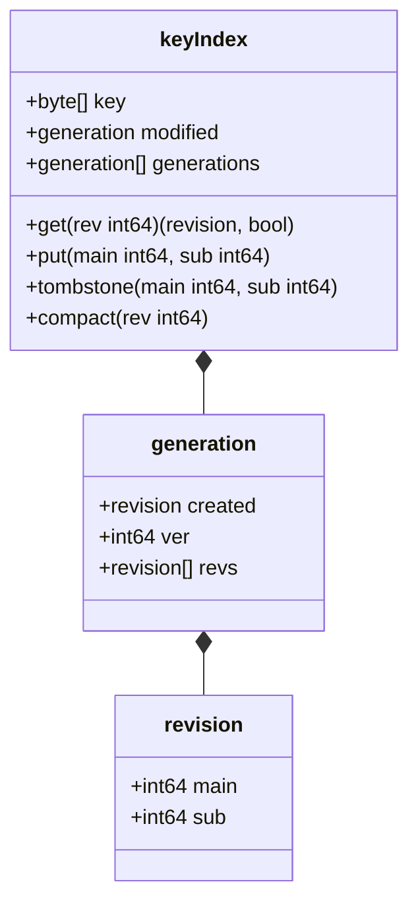
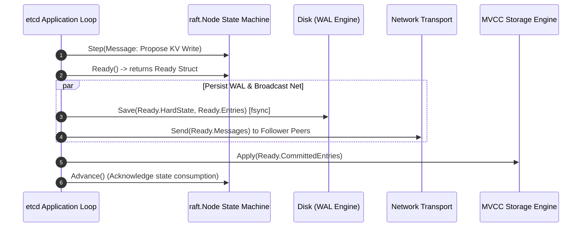

---


title: "etcd Architecture & Raft Engine Deep Dive"
description: "Master-level architecture and implementation guide for etcd, covering the etcd/raft engine, MVCC storage mechanics, bbolt B+Tree indexing, Watch streams, and Kubernetes control-plane integration."
category: "Distributed Systems & Architecture"
tags: [etcd, raft, bbolt, mvcc, kubernetes, distributed-storage, go, technical-skills, software-engineering, learning-note]
date: "2026-08-21"
---

# etcd Architecture & Raft Engine Deep Dive

---

## 1. Executive Summary & Under-the-Hood Mechanics

**etcd** is a strongly consistent, distributed key-value store engineered in Go, serving as the canonical source-of-truth metadata backbone for Kubernetes clusters, Cloud Foundry, and large-scale service mesh deployments.

etcd achieves linearizable read-write operations, high availability, and historical point-in-time time-travel queries through a modular decoupled design:
1. **Consensus Core (`etcd/raft`)**: A pure, non-blocking state machine implementing the Raft protocol without network or disk I/O side effects.
2. **Multi-Version Concurrency Control (MVCC)**: An in-memory B-Tree index (`treeIndex`) mapping user keys to revision metadata tuples.
3. **Persistent Storage Engine (`bbolt`)**: A memory-mapped (`mmap`) copy-on-write B+Tree database storing immutable raw key-value revisions on disk.
4. **gRPC & Watch Subsystem**: HTTP/2 multiplexed, streaming event delivery engine notifying clients of real-time cluster state modifications.

```mermaid
flowchart TB
    subgraph ClientLayer["Client Interaction"]
        K8s["Kubernetes API Server / Client"] -->|gRPC Request (v3 API)| gRPC["etcd gRPC Server & Interceptors"]
    end

    subgraph ConsensusLayer["Consensus & Replication Core"]
        gRPC --> RaftNode["raft.Node (Consensus State Machine)"]
        RaftNode -->|Ready Channel| ReadyLoop["Application Event Loop"]
        ReadyLoop -->|1. Persist Entries & HardState| WAL["Write-Ahead Log (WAL - Disk fsync)"]
        ReadyLoop -->|2. Send Messages over HTTP/2| Net["Peer Transport (Raft HTTP)"]
        ReadyLoop -->|3. Apply Committed Entries| MVCC["MVCC Layer"]
    end

    subgraph StorageLayer["MVCC Storage & Indexing Engine"]
        MVCC -->|In-Memory Revision Index| InMemTree["treeIndex (Google B-Tree in RAM)"]
        MVCC -->|Batch Commit Buffer| Backend["Backend Worker Thread"]
        Backend -->|mmap Flush| BBolt["bbolt (On-Disk B+Tree DB)"]
    end
```

---

## 2. etcd Layered Architecture & Component Breakdown

### 2.1 MVCC Data Model: Revisions, Generations & Keys

Unlike flat key-value databases that overwrite values in place, etcd treats all write operations as **globally monotonic revision increments**. A revision is a 64-bit integer tracking the total number of committed mutations across the cluster since inception.

```
etcd Key Structure:
+-------------------------------------------------------------------------------+
| User Key: /registry/pods/default/nginx                                        |
+-------------------------------------------------------------------------------+
| Generation 0:                                                                 |
|   - Created: Revision 100                                                     |
|   - Revisions: [100 (v1), 105 (v2), 120 (v3)]                                 |
|   - Deleted: Revision 150 (Tombstone)                                         |
| Generation 1 (Re-created):                                                    |
|   - Created: Revision 200                                                     |
|   - Revisions: [200 (v1), 215 (v2)]                                           |
+-------------------------------------------------------------------------------+
```

- **`main`**: The global cluster revision when the mutation was committed.
- **`sub`**: The sub-index disambiguating individual operations within a single multi-operation transaction.
- **`version`**: Monotonically increments for each modification within a single generation of a key (reset to 1 upon deletion and re-creation).



### 2.2 Storage Engine: `treeIndex` vs `bbolt`

| Metric / Dimension | `treeIndex` (In-Memory RAM) | `bbolt` (Persistent Disk) |
| :--- | :--- | :--- |
| **Data Structure** | Concurrent B-Tree (Memory) | Copy-on-Write B+Tree (`mmap`) |
| **Key Type** | User Key (`string` / `[]byte`) | Revision Tuple `(revision.main, revision.sub)` |
| **Value Type** | Pointer to `keyIndex` metadata | Serialized `mvccpb.KeyValue` Protobuf |
| **Purpose** | Instant revision lookups & range scans | Persistent point-in-time state & crash recovery |
| **Memory Footprint** | Proportional to total active keys | Zero-copy OS page cache (`mmap`) |

---

## 3. The `etcd/raft` State Machine Pipeline

The `etcd/raft` module is deliberately designed without network, timer, or disk dependencies. It is driven via the `Ready()` struct pattern:



### Ready Struct Definition (Go Internals)
```go
type Ready struct {
    // Current soft state (leader ID, node role)
    *SoftState

    // HardState to be saved to WAL before sending messages (Term, Vote, Commit)
    pb.HardState

    // Read states for linearizable read-index evaluations
    ReadStates []ReadState

    // Entries to be written to WAL BEFORE messages are sent
    Entries []pb.Entry

    // Snapshot to be saved to disk
    Snapshot pb.Snapshot

    // Entries to be applied to the MVCC state machine
    CommittedEntries []pb.Entry

    // Messages to be transmitted over network to peers AFTER Entries saved
    Messages []pb.Message
}
```

---

## 4. Production Go Simulation: etcd MVCC treeIndex & bbolt Pipeline

```go
package main

import (
	"bytes"
	"encoding/binary"
	"fmt"
	"sync"
)

// Revision represents a unique point-in-time version in etcd
type Revision struct {
	Main int64
	Sub  int64
}

func (r Revision) Bytes() []byte {
	buf := new(bytes.Buffer)
	_ = binary.Write(buf, binary.BigEndian, r.Main)
	_ = binary.Write(buf, binary.BigEndian, r.Sub)
	return buf.Bytes()
}

// Generation tracks revisions of a key during its lifespan between creations/deletions
type Generation struct {
	Created   Revision
	Ver       int64
	Revisions []Revision
}

// KeyIndex manages multiple generations of a key in the memory treeIndex
type KeyIndex struct {
	Key         []byte
	Generations []Generation
}

func NewKeyIndex(key []byte) *KeyIndex {
	return &KeyIndex{
		Key:         key,
		Generations: []Generation{{}},
	}
}

func (ki *KeyIndex) Put(main, sub int64) {
	rev := Revision{Main: main, Sub: sub}
	gen := &ki.Generations[len(ki.Generations)-1]
	if len(gen.Revisions) == 0 {
		gen.Created = rev
	}
	gen.Ver++
	gen.Revisions = append(gen.Revisions, rev)
}

func (ki *KeyIndex) Tombstone(main, sub int64) {
	ki.Put(main, sub)
	// Terminate current generation and create an empty next generation
	ki.Generations = append(ki.Generations, Generation{})
}

func (ki *KeyIndex) FindRevision(targetMain int64) (Revision, bool) {
	for i := len(ki.Generations) - 1; i >= 0; i-- {
		gen := ki.Generations[i]
		for j := len(gen.Revisions) - 1; j >= 0; j-- {
			rev := gen.Revisions[j]
			if rev.Main <= targetMain {
				return rev, true
			}
		}
	}
	return Revision{}, false
}

// MVCCStore simulates the two-tier storage architecture of etcd
type MVCCStore struct {
	mu           sync.RWMutex
	currentRev   int64
	treeIndex    map[string]*KeyIndex // In-memory index
	bboltBackend map[string][]byte    // Simulated disk B+Tree (Revision -> Value)
}

func NewMVCCStore() *MVCCStore {
	return &MVCCStore{
		currentRev:   1,
		treeIndex:    make(map[string]*KeyIndex),
		bboltBackend: make(map[string][]byte),
	}
}

func (s *MVCCStore) Put(key string, val []byte) int64 {
	s.mu.Lock()
	defer s.mu.Unlock()

	s.currentRev++
	rev := Revision{Main: s.currentRev, Sub: 0}

	// 1. Update In-Memory Tree Index
	ki, exists := s.treeIndex[key]
	if !exists {
		ki = NewKeyIndex([]byte(key))
		s.treeIndex[key] = ki
	}
	ki.Put(rev.Main, rev.Sub)

	// 2. Persist to Backend Storage (bbolt KV)
	s.bboltBackend[string(rev.Bytes())] = val
	fmt.Printf("[MVCC Put] Key: %s | Rev: %d | Val: %s
", key, s.currentRev, string(val))
	return s.currentRev
}

func (s *MVCCStore) Get(key string, targetRev int64) ([]byte, bool) {
	s.mu.RLock()
	defer s.mu.RUnlock()

	ki, exists := s.treeIndex[key]
	if !exists {
		return nil, false
	}

	rev, found := ki.FindRevision(targetRev)
	if !found {
		return nil, false
	}

	val, ok := s.bboltBackend[string(rev.Bytes())]
	return val, ok
}

func main() {
	store := NewMVCCStore()

	// 1. Initial creation
	rev1 := store.Put("/k8s/pods/nginx", []byte("nginx:1.20"))

	// 2. Update pod image
	rev2 := store.Put("/k8s/pods/nginx", []byte("nginx:1.24"))

	// 3. Time-travel query: Read at Revision 2
	valAtRev1, _ := store.Get("/k8s/pods/nginx", rev1)
	valAtRev2, _ := store.Get("/k8s/pods/nginx", rev2)

	fmt.Println("
=== Point-in-Time History Inspection ===")
	fmt.Printf("Query @ Revision %d: %s
", rev1, string(valAtRev1))
	fmt.Printf("Query @ Revision %d: %s
", rev2, string(valAtRev2))
}
```

---

## 5. Production Tuning, Health Metrics & Failure Modes

### 5.1 Storage Compaction & Defragmentation Runbook
etcd accumulates dead revisions on disk. Without automated compaction and defragmentation, `bbolt` db size expands until hitting `--quota-backend-bytes` (default 2GB; maximum recommended 8GB), triggering the cluster-wide alarm `NOSPACE` which turns all writes read-only.

```bash
# 1. Compact revisions older than 1 hour (Revision 250000)
ETCDCTL_API=3 etcdctl compact 250000

# 2. Defragment disk space (reclaims sparse bbolt pages back to OS)
ETCDCTL_API=3 etcdctl defrag --endpoints=https://127.0.0.1:2379

# 3. Disarm cluster alarm once space is freed
ETCDCTL_API=3 etcdctl alarm disarm
```

### 5.2 Critical Prometheus Telemetry Metrics

```prometheus
# Raft consensus health
etcd_server_has_leader == 1
etcd_server_leader_changes_seen_total > 3

# Disk latency: WAL fsync must be < 10ms (p99) to prevent leader election flapping
histogram_quantile(0.99, rate(etcd_disk_wal_fsync_duration_seconds_bucket[5m])) < 0.010

# Backend commit latency
histogram_quantile(0.99, rate(etcd_disk_backend_commit_duration_seconds_bucket[5m])) < 0.025

# DB Quota usage ratio
(etcd_mvcc_db_total_size_in_bytes / etcd_server_quota_backend_bytes) < 0.80
```

---

## 🔗 Graph-Linked Knowledge Base
- ⚓ Protocol Specification: [[raft_protocol_specification|Raft Protocol Specification & Implementation]]
- ⚓ Snapshot Algorithms: [[chandy_lamport_snapshot_algorithm_vector_clocks|Chandy-Lamport Distributed Snapshots & Vector Clocks]]
- 🔗 Cloud Native Runtime: [[02_Technical_Skills/01_theory_and_concepts/18_Docker_and_Kubernetes_Containers/kubernetes_architecture_control_plane_kubelet_etcd|Kubernetes Control Plane Architecture]]
