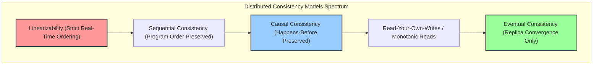
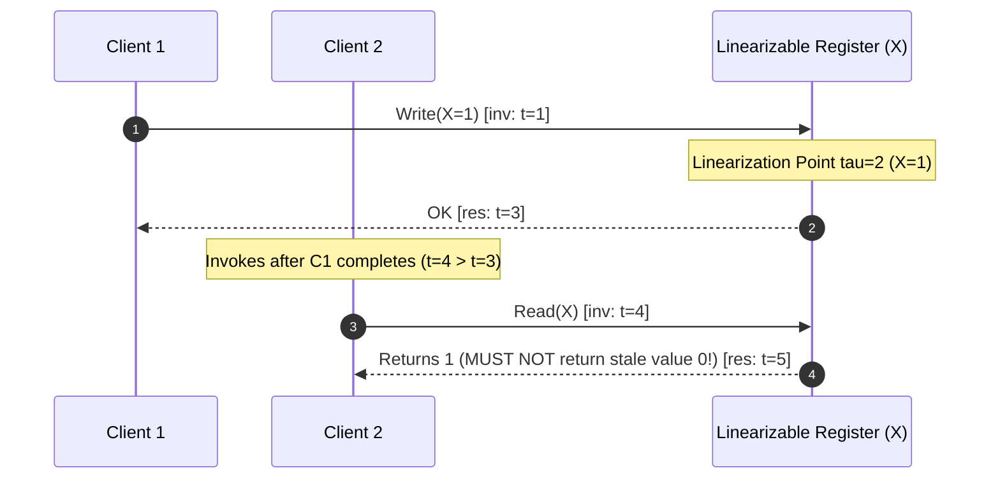
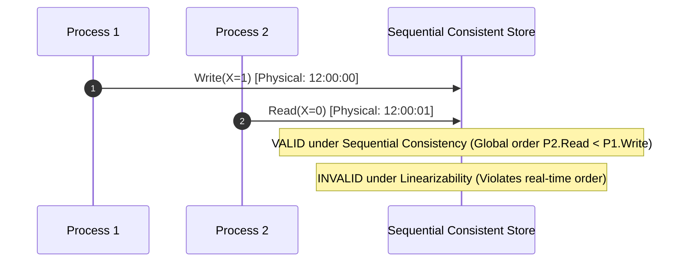
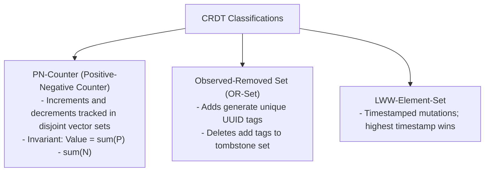

---


title: "Linearizability vs Eventual Consistency: Distributed Consistency Models Deep Dive"
description: "Master-level architecture and implementation guide for Linearizability, Sequential Consistency, Causal Consistency, and Eventual Consistency with formal execution traces, Jepsen testing, and CRDTs."
category: "Distributed Systems & Architecture"
tags: [linearizability, eventual-consistency, consistency-models, distributed-systems, jepsen, crdt, technical-skills, software-engineering, learning-note]
date: "2026-08-21"
---

# Linearizability vs Eventual Consistency: Consistency Models Deep Dive

---

## 1. Executive Summary & Under-the-Hood Mechanics

In distributed systems, the **Consistency Model** defines the contract between a data storage system and its clients regarding the visibility, ordering, and timing of read and write operations across concurrent nodes.

The spectrum ranges from **Linearizability** (the strongest single-object consistency model, guaranteeing real-time atomic execution) to **Eventual Consistency** (the weakest guarantee, ensuring only that replicas converge once writes cease).



---

## 2. Mathematical Formalisms & Consistency Hierarchy

### 2.1 Linearizability (Herlihy & Wing 1990)

An execution history $\mathcal{H}$ is **Linearizable** if every operation appears to take effect instantaneously at a linearization point $\tau_{\text{lin}}$ between its invocation time $\text{inv}(op)$ and response time $\text{res}(op)$ on a global real-time clock.

$$\forall op, \quad \text{inv}(op) < \tau_{\text{lin}}(op) < \text{res}(op)$$



**Non-Negotiable Linearizability Invariant**: If operation $B$ is invoked *after* operation $A$ has completed ($\text{inv}(B) > \text{res}(A)$), then $B$ must observe the state left by $A$ or a strictly newer mutation.

---

### 2.2 Sequential Consistency (Lamport 1979)

**Sequential Consistency** relaxes real-time constraints. It requires that all operations execute in some global sequential order that is consistent with the program order of every individual process, but that global sequence does not need to match physical real-time.



---

### 2.3 Causal Consistency & Happens-Before Relation

Operations that are **causally related** via Lamport's happens-before relation ($A \to B$) must be observed by all nodes in the identical order. Concurrent operations ($A \parallel B$) may be observed in different orders by different nodes.

$$A \to B \iff (A \text{ precedes } B \text{ on same thread}) \lor (B \text{ reads value written by } A) \lor (\exists C, A \to C \land C \to B)$$

---

### 2.4 Eventual Consistency & Convergence Invariant

Replicas may drift arbitrarily during concurrent execution. The system guarantees only that given a quiescent state where no further writes are introduced, all replicas will eventually evaluate to mathematically identical state:

$$\lim_{t \to \infty} \text{State}(Node_i, t) = \text{State}(Node_j, t) \quad \forall i, j$$

---

## 3. Detailed Architectural Comparison Matrix

| Dimension | Linearizability | Sequential Consistency | Causal Consistency | Eventual Consistency |
| :--- | :--- | :--- | :--- | :--- |
| **Real-Time Clock Bound** | Yes (Physical real-time order) | No (Global logical sequence) | No (Partial causal order) | None |
| **Network Partition Impact** | CP (Rejects writes to minority) | CP (Blocks non-quorum nodes) | AP (Available under partitions) | AP (Fully available everywhere) |
| **Coordination Overhead** | Quorum consensus / TrueTime | Central sequencer / Barrier | Vector Clocks / Causal graphs | Async gossip / Anti-entropy |
| **Read Latency** | Higher ($p99 > 15\text{ms}$) | Medium | Low ($< 2\text{ms}$) | Sub-millisecond local read |
| **Conflict Resolution** | None (Single monotonic history) | None | Branch tracking / Siblings | LWW, CRDTs, Vector Clocks |
| **Canonical Systems** | etcd, Spanner, CockroachDB | Apache ZooKeeper (Sync writes) | MongoDB (Causal Sessions), Riak | Cassandra, DynamoDB, CouchDB |

---

## 4. Production Python Implementation: Linearizable vs Eventual KV Stores

```python
"""
Dual implementation demonstrating Linearizable vs Eventually Consistent Key-Value Stores.
Includes quorum consensus engine, gossip anti-entropy, and causal state inspection.
"""

import copy
import random
import time
from typing import Any, Dict, List, Optional, Set, Tuple


class LinearizableKVStore:
    """Simulates a CP Linearizable Key-Value store with Majority Quorum consensus."""
    def __init__(self, node_ids: List[str]):
        self.nodes = node_ids
        self.storage: Dict[str, Dict[str, Tuple[Any, int]]] = {
            n: {} for n in node_ids
        }  # node -> key -> (val, version)
        self.global_version = 0

    @property
    def quorum(self) -> int:
        return (len(self.nodes) // 2) + 1

    def write(self, key: str, value: Any, active_nodes: Set[str]) -> bool:
        """Writes value to a majority quorum before acknowledging client."""
        if len(active_nodes) < self.quorum:
            print(f"[Linearizable Write FAILED] Active nodes {len(active_nodes)} < Quorum {self.quorum}")
            return False

        self.global_version += 1
        written_count = 0
        for node in active_nodes:
            self.storage[node][key] = (value, self.global_version)
            written_count += 1
            if written_count >= self.quorum:
                break

        print(f"[Linearizable Write OK] Key={key}, Val={value}, Version={self.global_version}")
        return True

    def read(self, key: str, active_nodes: Set[str]) -> Optional[Any]:
        """Reads from a quorum to guarantee encountering the latest linearizable write."""
        if len(active_nodes) < self.quorum:
            raise RuntimeError("Linearizable Read Failed: Quorum unavailable.")

        highest_version = -1
        latest_val = None
        read_nodes = list(active_nodes)[:self.quorum]

        for node in read_nodes:
            if key in self.storage[node]:
                val, ver = self.storage[node][key]
                if ver > highest_version:
                    highest_version = ver
                    latest_val = val

        return latest_val


class EventualKVStore:
    """Simulates an AP Eventual Consistency store with Last-Write-Wins (LWW) and Gossip."""
    def __init__(self, node_ids: List[str]):
        self.nodes = node_ids
        self.storage: Dict[str, Dict[str, Tuple[Any, float]]] = {
            n: {} for n in node_ids
        }  # node -> key -> (val, timestamp)

    def write_local(self, node_id: str, key: str, value: Any):
        """Writes immediately to local node without blocking on peers."""
        ts = time.time()
        self.storage[node_id][key] = (value, ts)
        print(f"[Eventual Write Local] Node {node_id} wrote {key}={value} at ts={ts:.4f}")

    def gossip_sync(self, src_node: str, dst_node: str):
        """Asynchronously merges updates between two nodes using Last-Write-Wins."""
        for key, (src_val, src_ts) in self.storage[src_node].items():
            if key not in self.storage[dst_node]:
                self.storage[dst_node][key] = (src_val, src_ts)
            else:
                dst_val, dst_ts = self.storage[dst_node][key]
                if src_ts > dst_ts:
                    self.storage[dst_node][key] = (src_val, src_ts)

    def is_converged(self, key: str) -> bool:
        """Validates whether all nodes possess identical state for given key."""
        first_val = self.storage[self.nodes[0]].get(key)
        return all(self.storage[n].get(key) == first_val for n in self.nodes)


if __name__ == "__main__":
    cluster = ["N1", "N2", "N3", "N4", "N5"]

    print("=== 1. Testing Linearizable CP Store ===")
    lin_store = LinearizableKVStore(cluster)
    active = {"N1", "N2", "N3"}
    lin_store.write("balance", 5000, active)
    val = lin_store.read("balance", active)
    print(f"Read Linearizable Value: {val}")

    print("\n=== 2. Testing Eventual AP Store with Divergence & Gossip ===")
    ev_store = EventualKVStore(cluster)
    # Concurrent partition writes
    ev_store.write_local("N1", "item_count", 42)
    ev_store.write_local("N5", "item_count", 99)

    print(f"Is Converged before gossip? {ev_store.is_converged('item_count')}")
    print(f"N1 Value: {ev_store.storage['N1']['item_count'][0]}")
    print(f"N5 Value: {ev_store.storage['N5']['item_count'][0]}")

    # Gossip anti-entropy protocol execution
    print("Running background Gossip sync...")
    for n in cluster:
        for m in cluster:
            if n != m:
                ev_store.gossip_sync(n, m)

    print(f"Is Converged after gossip? {ev_store.is_converged('item_count')}")
    print(f"All nodes converged to: {ev_store.storage['N1']['item_count'][0]}")
```

---

## 5. Conflict-Free Replicated Data Types (CRDTs)

In AP eventually consistent systems, reconciling divergent states without data loss is achieved through **CRDTs**:



Mathematical Requirements for State-based CRDT (CvRDT) Merge Function $\sqcup$:
1. **Commutativity**: $A \sqcup B = B \sqcup A$
2. **Associativity**: $(A \sqcup B) \sqcup C = A \sqcup (B \sqcup C)$
3. **Idempotence**: $A \sqcup A = A$

---

## 🔗 Graph-Linked Knowledge Base
- ⚓ Theoretical Base: [[distributed_consensus|Distributed Consensus & CAP Theorem]]
- ⚓ Logical Time: [[chandy_lamport_snapshot_algorithm_vector_clocks|Distributed Snapshots & Vector Clocks]]
- 🔗 Caching Topologies: [[02_Technical_Skills/01_theory_and_concepts/07_Backend_Caching_and_Redis/caching_fundamentals|Caching Fundamentals & Consistency]]
