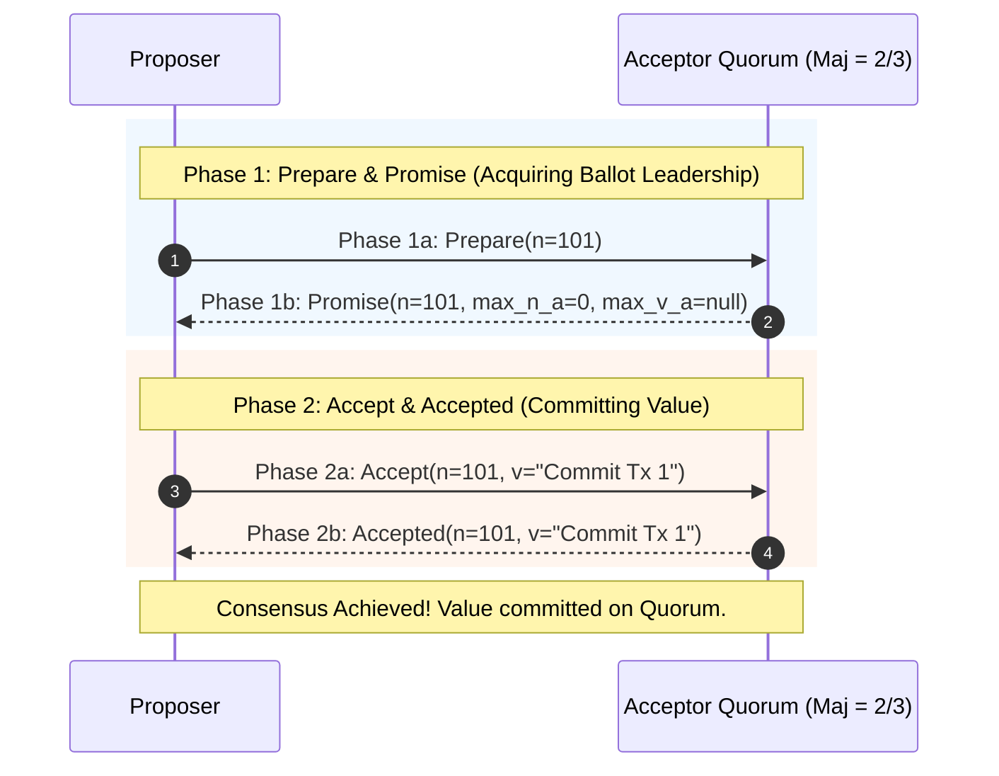
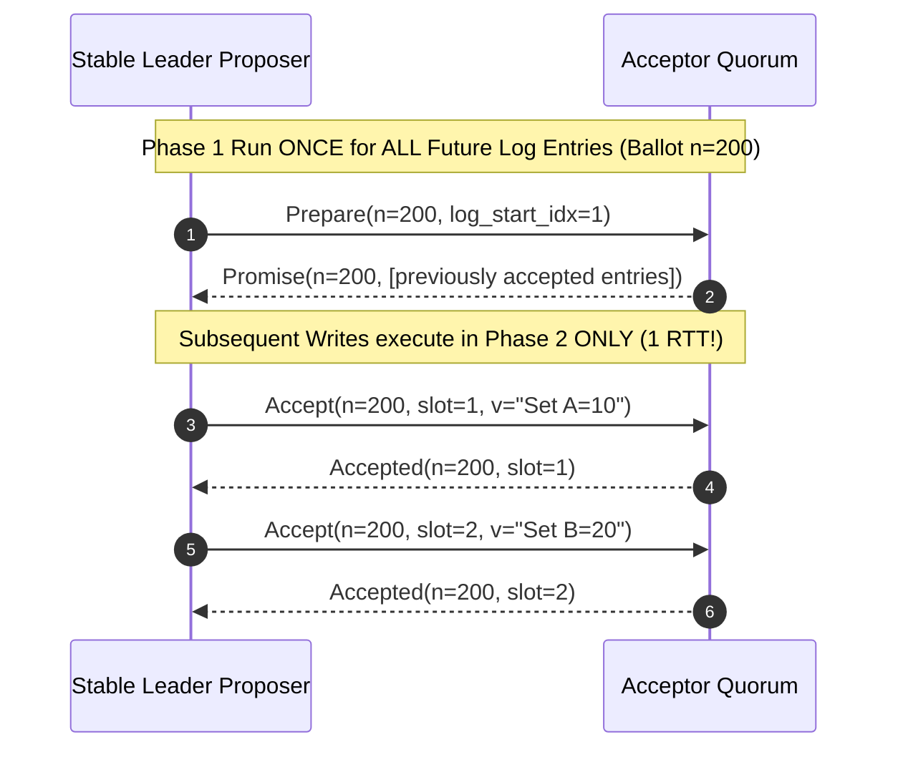
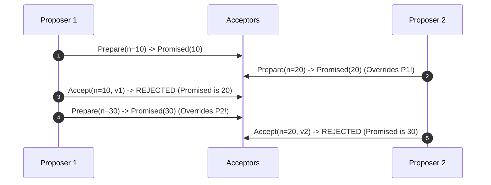

---


title: "Paxos Algorithm Mechanics: Single-Decree & Multi-Paxos Architecture"
description: "Master-level architecture and implementation guide for Paxos consensus, covering Single-Decree Paxos, Multi-Paxos leader election, Phase 1/2 message sequences, ballot numbers, and dual-proposer livelock mitigation."
category: "Distributed Systems & Architecture"
tags: [paxos, multi-paxos, distributed-consensus, smr, formal-methods, technical-skills, software-engineering, learning-note]
date: "2026-08-21"
---

# Paxos Algorithm Mechanics: Single-Decree & Multi-Paxos Architecture

---

## 1. Executive Summary & Under-the-Hood Mechanics

**Paxos** is the seminal distributed consensus protocol formulated by Leslie Lamport in 1989. It establishes provably safe agreement among a network of untrusted, asynchronous nodes communicating over an unreliable network prone to packet drops, duplicates, and arbitrary transit delays.

Paxos decouples the consensus problem into two standard tiers:
1. **Single-Decree Paxos (Synod)**: Reaches agreement on exactly one immutable decision or value.
2. **Multi-Paxos**: Extends the Synod protocol into a continuous stream of decisions, forming a distributed replicated commit log by amortizing Phase 1 rounds across multiple log entries.

```mermaid
flowchart TD
    subgraph PaxosCluster["Paxos Protocol Roles & Topology"]
        Client["Client Proposer"] --> P1["Proposer (Coordinates Proposals)"]
        P1 -->|Phase 1a: Prepare(n)| A1["Acceptor 1 (Voter & State Guard)"]
        P1 -->|Phase 1a: Prepare(n)| A2["Acceptor 2 (Voter & State Guard)"]
        P1 -->|Phase 1a: Prepare(n)| A3["Acceptor 3 (Voter & State Guard)"]
        A1 -->|Phase 1b: Promise(n)| P1
        A2 -->|Phase 1b: Promise(n)| P1
        P1 -->|Phase 2a: Accept(n, v)| A1
        P1 -->|Phase 2a: Accept(n, v)| A2
        A1 -->|Phase 2b: Accepted| L["Learners (State Machine Application)"]
        A2 -->|Phase 2b: Accepted| L
    end
```

---

## 2. Single-Decree Paxos Protocol Specification

### 2.1 Role Definitions
- **Proposers**: Advocate client values by issuing proposal numbers $n \in \mathbb{N}$.
- **Acceptors**: Form the memory and voting quorum of the cluster. They store the highest promised proposal number ($n_p$), and the highest accepted proposal number ($n_a$) with its value ($v_a$).
- **Learners**: Passively observe consensus decisions and apply them to local state machines.

### 2.2 Proposal Number Invariant
Every proposal number $n = \langle \text{seq}, \text{node\_id} \rangle$ is strictly unique and globally ordered:
$$\langle \text{seq}_1, \text{node}_1 \rangle > \langle \text{seq}_2, \text{node}_2 \rangle \iff (\text{seq}_1 > \text{seq}_2) \lor (\text{seq}_1 == \text{seq}_2 \land \text{node}_1 > \text{node}_2)$$

---

### 2.3 Protocol Two-Phase Execution



#### Phase 1: Prepare & Promise
1. **Phase 1a (Prepare)**: Proposer selects a unique proposal number $n$ and broadcasts $\text{Prepare}(n)$ to a majority quorum of Acceptors.
2. **Phase 1b (Promise)**: If $n > n_p$ (where $n_p$ is the highest proposal number the acceptor has ever seen):
   - The Acceptor updates $n_p \gets n$.
   - The Acceptor returns $\text{Promise}(n, n_a, v_a)$ guaranteeing never to accept any future proposals numbered less than $n$.
   - If $n \le n_p$, the Acceptor rejects or ignores the prepare request.

#### Phase 2: Accept & Accepted
1. **Phase 2a (Accept)**: Once the Proposer receives promises from a majority quorum:
   - If any Acceptor returned a previously accepted value $v_a$, the Proposer **must** set its proposal value $v$ to the $v_a$ associated with the highest $n_a$.
   - If no Acceptor had previously accepted a value, the Proposer is free to propose its own desired client value $v$.
   - The Proposer broadcasts $\text{Accept}(n, v)$ to the Acceptor quorum.
2. **Phase 2b (Accepted)**: If $n \ge n_p$, the Acceptor accepts the proposal, setting $n_a \gets n$ and $v_a \gets v$, and notifies the Proposer and Learners.

---

## 3. Multi-Paxos: Log Replication & Phase 1 Amortization

Running two complete network round-trips (Phase 1 + Phase 2) for every individual log entry results in poor throughput. **Multi-Paxos** optimizes this by electing a Stable Leader.



---

## 4. Production Python Single-Decree Paxos Simulator

```python
"""
Production-grade Single-Decree Paxos implementation featuring Acceptor quorums,
Proposer ballot election, concurrent proposer conflict resolution, and safety validation.
"""

from dataclasses import dataclass
from typing import Any, Dict, List, Optional, Set, Tuple


@dataclass
class Promise:
    accepted: bool
    highest_promised_n: int
    last_accepted_n: Optional[int] = None
    last_accepted_val: Optional[Any] = None


class Acceptor:
    def __init__(self, acceptor_id: str):
        self.acceptor_id = acceptor_id
        self.promised_n: int = 0
        self.accepted_n: Optional[int] = None
        self.accepted_val: Optional[Any] = None

    def receive_prepare(self, n: int) -> Promise:
        """Phase 1b: Evaluate prepare proposal number against promise invariant."""
        if n > self.promised_n:
            self.promised_n = n
            return Promise(
                accepted=True,
                highest_promised_n=n,
                last_accepted_n=self.accepted_n,
                last_accepted_val=self.accepted_val
            )
        return Promise(accepted=False, highest_promised_n=self.promised_n)

    def receive_accept(self, n: int, val: Any) -> bool:
        """Phase 2b: Accept value if no higher proposal has been promised."""
        if n >= self.promised_n:
            self.promised_n = n
            self.accepted_n = n
            self.accepted_val = val
            print(f"[Acceptor {self.acceptor_id}] ACCEPTED n={n}, val='{val}'")
            return True
        print(f"[Acceptor {self.acceptor_id}] REJECTED Accept n={n} (Promised n={self.promised_n})")
        return False


class Proposer:
    def __init__(self, proposer_id: int, total_proposers: int, acceptors: List[Acceptor]):
        self.proposer_id = proposer_id
        self.total_proposers = total_proposers
        self.acceptors = acceptors
        self.sequence_num = 0

    @property
    def quorum_size(self) -> int:
        return (len(self.acceptors) // 2) + 1

    def _generate_proposal_number(self) -> int:
        self.sequence_num += 1
        return self.sequence_num * self.total_proposers + self.proposer_id

    def propose(self, desired_value: Any) -> Tuple[bool, Optional[Any]]:
        """Executes full Paxos two-phase consensus round."""
        n = self._generate_proposal_number()
        print(f"\n--- Proposer {self.proposer_id} Initiating Phase 1 with Ballot n={n} ---")

        # Phase 1: Prepare
        promises: List[Promise] = []
        for acceptor in self.acceptors:
            resp = acceptor.receive_prepare(n)
            if resp.accepted:
                promises.append(resp)

        if len(promises) < self.quorum_size:
            print(f"[Proposer {self.proposer_id}] Phase 1 FAILED: Got {len(promises)}/{self.quorum_size} promises.")
            return False, None

        # Value selection rule: pick value with highest accepted proposal number
        chosen_value = desired_value
        highest_accepted_n = -1
        for p in promises:
            if p.last_accepted_n is not None and p.last_accepted_n > highest_accepted_n:
                highest_accepted_n = p.last_accepted_n
                chosen_value = p.last_accepted_val

        print(f"[Proposer {self.proposer_id}] Phase 1 SUCCESS. Proposing Value: '{chosen_value}' in Phase 2")

        # Phase 2: Accept
        accept_acks = 0
        for acceptor in self.acceptors:
            if acceptor.receive_accept(n, chosen_value):
                accept_acks += 1

        if accept_acks >= self.quorum_size:
            print(f"*** CONSENSUS REACHED: Value '{chosen_value}' committed with Quorum {accept_acks}/{len(self.acceptors)} ***")
            return True, chosen_value

        return False, None


if __name__ == "__main__":
    acceptors_pool = [Acceptor("A1"), Acceptor("A2"), Acceptor("A3")]
    p1 = Proposer(proposer_id=1, total_proposers=2, acceptors=acceptors_pool)
    p2 = Proposer(proposer_id=2, total_proposers=2, acceptors=acceptors_pool)

    # 1. Proposer 1 achieves consensus
    success, val = p1.propose("Transaction A")
    assert success is True
    assert val == "Transaction A"

    # 2. Proposer 2 proposes a different value later -> MUST adopt previously committed value!
    success2, val2 = p2.propose("Transaction B")
    assert success2 is True
    assert val2 == "Transaction A"
    print(f"\nSafety Invariant Verified: Proposer 2 safely converged to '{val2}'!")
```

---

## 5. Paxos Livelock & Dueling Proposers Problem

In basic Paxos without a dedicated leader, two concurrent proposers can livelock by perpetually overriding each other's Phase 1 ballots before either can complete Phase 2:



### Mitigation Strategies
1. **Randomized Exponential Backoff**: Proposers wait for randomized backoff intervals before retrying higher proposal numbers (similar to Ethernet CSMA/CD).
2. **Master Lease / Leader Election**: Designate a single Proposer as the designated Leader using pre-election heartbeats (standard in Multi-Paxos and Raft).

---

## 🔗 Graph-Linked Knowledge Base
- ⚓ Modern Alternative: [[raft_protocol_specification|Raft Protocol Specification & Architecture]]
- ⚓ Core Foundations: [[distributed_consensus|Distributed Consensus & State Machine Replication]]
- 🔗 Cloud Native Core: [[etcd_architecture_raft_engine|etcd Architecture & Raft Storage Engine]]
