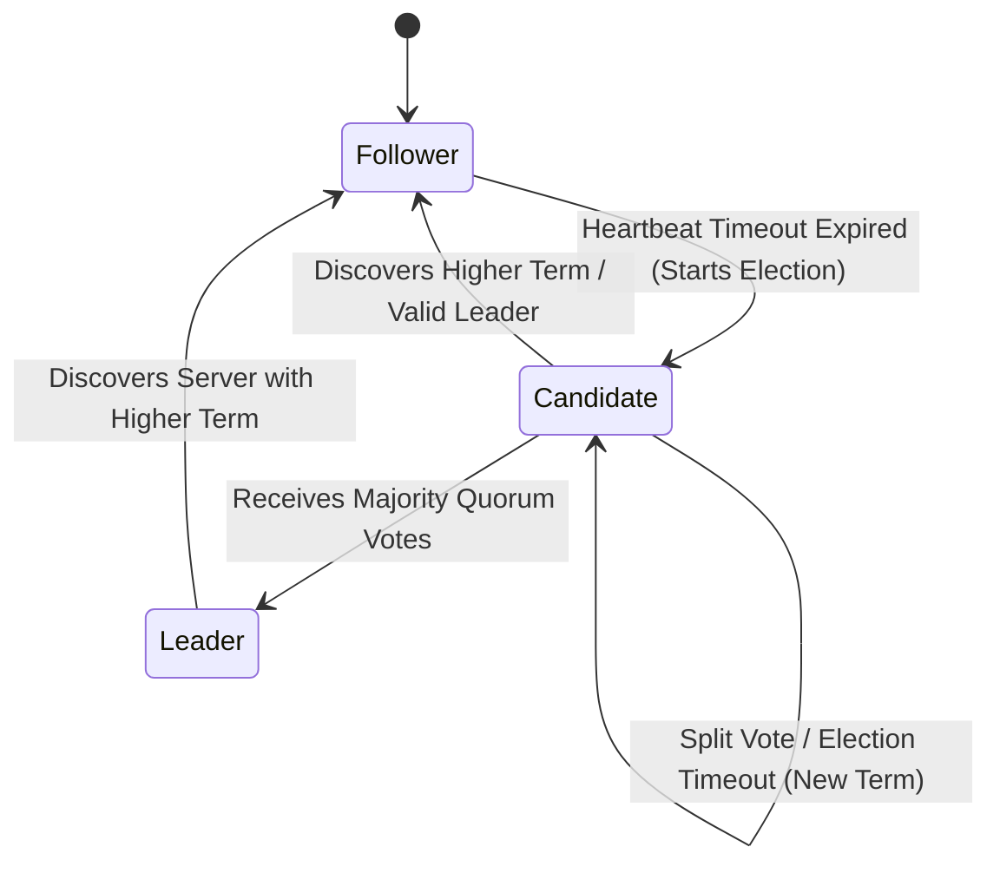
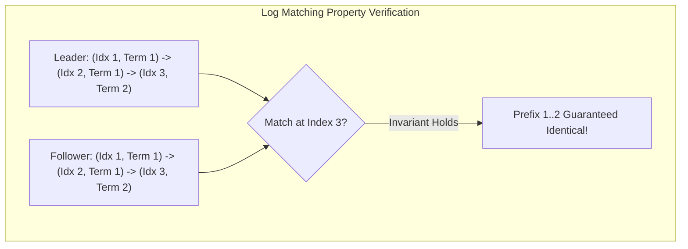
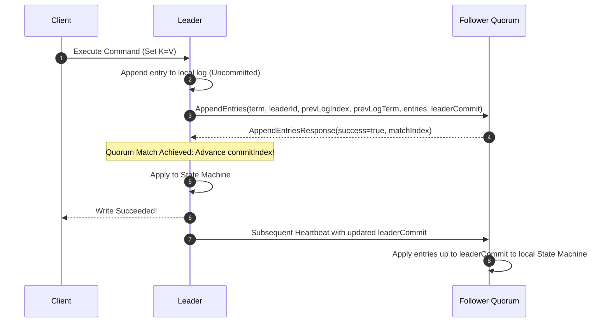

---


title: "Raft Protocol Specification & Implementation Architecture"
description: "Master-level architecture and implementation guide for Raft consensus, covering Leader Election, Log Replication, Safety Properties, Joint Consensus Membership Changes, and Log Compaction."
category: "Distributed Systems & Architecture"
tags: [raft, distributed-consensus, smr, leader-election, log-replication, technical-skills, software-engineering, learning-note]
date: "2026-08-21"
---

# Raft Protocol Specification & Implementation Architecture

---

## 1. Executive Summary & Under-the-Hood Mechanics

**Raft** is a distributed consensus algorithm designed by Diego Ongaro and John Ousterhout (Stanford University) as an understandable alternative to Paxos. It provides full State Machine Replication (SMR) fault tolerance equivalent to Multi-Paxos under the same operational conditions ($N \ge 2F+1$).

Raft decomposes the consensus problem into three strictly independent sub-problems:
1. **Leader Election**: Automated heartbeat-driven election protocol with randomized election timers.
2. **Log Replication**: One-way append-only log synchronization from Leader to Followers.
3. **Safety Invariants**: Formal election and commit constraints guaranteeing no two nodes ever commit conflicting log entries at the same index.



---

## 2. Formal Protocol Invariants & Safety Theorems

Raft guarantees the following mathematical safety properties at all times:

| Safety Property | Formal Invariant Definition |
| :--- | :--- |
| **Election Safety** | At most one leader can be elected in a given term: $\|\text{Leaders}(\text{term})\| \le 1$. |
| **Leader Append-Only** | A leader never overwrites or truncates its own log entries; it only appends new entries. |
| **Log Matching Property** | If two logs contain an entry with the same index and term, then they are identical in all entries up through the given index. |
| **Leader Completeness** | If a log entry is committed in a given term, then that entry will be present in the logs of the leaders for all higher-numbered terms. |
| **State Machine Safety** | If a server has applied a log entry at a given index to its state machine, no other server will ever apply a different log entry for the same index. |



---

## 3. Detailed Sub-Protocol Mechanics

### 3.1 Leader Election Sub-Protocol
1. Nodes start as **Followers**. If a follower receives no heartbeat within its randomized election timeout ($150\text{ ms} - 300\text{ ms}$), it transitions to **Candidate**.
2. Candidate increments `currentTerm`, votes for itself, and broadcasts `RequestVote(term, candidateId, lastLogIndex, lastLogTerm)`.
3. **Vote Granting Invariant**: A node grants its vote if and only if:
   - `term >= currentTerm` and (`votedFor == null` or `votedFor == candidateId`).
   - **Candidate Log Up-To-Date Rule**:
     $$(\text{lastLogTerm}_{\text{cand}} > \text{lastLogTerm}_{\text{voter}}) \lor (\text{lastLogTerm}_{\text{cand}} == \text{lastLogTerm}_{\text{voter}} \land \text{lastLogIndex}_{\text{cand}} \ge \text{lastLogIndex}_{\text{voter}})$$

---

### 3.2 Log Replication & AppendEntries Flow



---

## 4. Production Python Raft Consensus Engine

```python
"""
Production-grade implementation of Raft Consensus Protocol.
Features Leader Election, Randomized Heartbeat Timers, Log Replication, and Commit Quorums.
"""

import random
from dataclasses import dataclass, field
from enum import Enum
from typing import Any, Dict, List, Optional, Set, Tuple


class NodeRole(Enum):
    FOLLOWER = "FOLLOWER"
    CANDIDATE = "CANDIDATE"
    LEADER = "LEADER"


@dataclass
class RaftLogEntry:
    index: int
    term: int
    command: str
    key: str
    value: Any


@dataclass
class RequestVoteArgs:
    term: int
    candidate_id: str
    last_log_index: int
    last_log_term: int


@dataclass
class RequestVoteReply:
    term: int
    vote_granted: bool


@dataclass
class AppendEntriesArgs:
    term: int
    leader_id: str
    prev_log_index: int
    prev_log_term: int
    entries: List[RaftLogEntry]
    leader_commit: int


@dataclass
class AppendEntriesReply:
    term: int
    success: bool
    match_index: int


class RaftNode:
    def __init__(self, node_id: str, cluster_peers: List[str]):
        self.node_id = node_id
        self.cluster_peers = cluster_peers
        self.role = NodeRole.FOLLOWER
        
        # Persistent state on all servers
        self.current_term = 0
        self.voted_for: Optional[str] = None
        self.log: List[RaftLogEntry] = []

        # Volatile state on all servers
        self.commit_index = 0
        self.last_applied = 0
        self.state_machine: Dict[str, Any] = {}

        # Volatile state on leaders
        self.next_index: Dict[str, int] = {}
        self.match_index: Dict[str, int] = {}

    @property
    def quorum_size(self) -> int:
        return ((len(self.cluster_peers) + 1) // 2) + 1

    def last_log_info(self) -> Tuple[int, int]:
        if not self.log:
            return 0, 0
        return self.log[-1].index, self.log[-1].term

    def handle_request_vote(self, args: RequestVoteArgs) -> RequestVoteReply:
        """Receiver implementation for RequestVote RPC."""
        if args.term > self.current_term:
            self.current_term = args.term
            self.role = NodeRole.FOLLOWER
            self.voted_for = None

        last_idx, last_term = self.last_log_info()
        log_ok = (args.last_log_term > last_term) or (
            args.last_log_term == last_term and args.last_log_index >= last_idx
        )

        can_vote = (self.voted_for is None or self.voted_for == args.candidate_id)
        if args.term == self.current_term and can_vote and log_ok:
            self.voted_for = args.candidate_id
            print(f"[Node {self.node_id}] Voted FOR {args.candidate_id} in Term {args.term}")
            return RequestVoteReply(term=self.current_term, vote_granted=True)

        return RequestVoteReply(term=self.current_term, vote_granted=False)

    def handle_append_entries(self, args: AppendEntriesArgs) -> AppendEntriesReply:
        """Receiver implementation for AppendEntries RPC."""
        if args.term < self.current_term:
            return AppendEntriesReply(term=self.current_term, success=False, match_index=0)

        if args.term > self.current_term:
            self.current_term = args.term
            self.role = NodeRole.FOLLOWER
            self.voted_for = None

        # Log consistency check at prev_log_index
        if args.prev_log_index > 0:
            if len(self.log) < args.prev_log_index:
                return AppendEntriesReply(term=self.current_term, success=False, match_index=len(self.log))
            if self.log[args.prev_log_index - 1].term != args.prev_log_term:
                return AppendEntriesReply(term=self.current_term, success=False, match_index=args.prev_log_index - 1)

        # Append new entries
        for entry in args.entries:
            if entry.index <= len(self.log):
                self.log[entry.index - 1] = entry
            else:
                self.log.append(entry)

        # Update commit index
        if args.leader_commit > self.commit_index:
            self.commit_index = min(args.leader_commit, len(self.log))
            self._apply_entries()

        match_idx = len(self.log)
        return AppendEntriesReply(term=self.current_term, success=True, match_index=match_idx)

    def _apply_entries(self):
        while self.last_applied < self.commit_index:
            entry = self.log[self.last_applied]
            if entry.command == "SET":
                self.state_machine[entry.key] = entry.value
            self.last_applied += 1
            print(f"[Node {self.node_id}] Applied {entry.key}={entry.value} to State Machine @ Index {entry.index}")


if __name__ == "__main__":
    cluster_nodes = ["R1", "R2", "R3"]
    nodes = {nid: RaftNode(nid, [p for p in cluster_nodes if p != nid]) for nid in cluster_nodes}

    # Simulate Election: R1 becomes Candidate
    r1 = nodes["R1"]
    r1.role = NodeRole.CANDIDATE
    r1.current_term = 1
    r1.voted_for = "R1"
    votes = 1

    last_idx, last_term = r1.last_log_info()
    vote_req = RequestVoteArgs(term=1, candidate_id="R1", last_log_index=last_idx, last_log_term=last_term)

    for peer_id in r1.cluster_peers:
        reply = nodes[peer_id].handle_request_vote(vote_req)
        if reply.vote_granted:
            votes += 1

    if votes >= r1.quorum_size:
        r1.role = NodeRole.LEADER
        print(f"*** R1 ELECTED LEADER for Term {r1.current_term} with {votes}/3 votes ***")

    # Leader Replicates Write
    new_entry = RaftLogEntry(index=1, term=1, command="SET", key="cluster_config", value="HA_ENABLED")
    r1.log.append(new_entry)

    append_req = AppendEntriesArgs(
        term=1, leader_id="R1", prev_log_index=0, prev_log_term=0,
        entries=[new_entry], leader_commit=1
    )

    for peer_id in r1.cluster_peers:
        res = nodes[peer_id].handle_append_entries(append_req)
        assert res.success is True

    r1.commit_index = 1
    r1._apply_entries()

    print(f"\nState Machine Invariant Check:")
    for nid, node in nodes.items():
        print(f"Node {nid} State: {node.state_machine}")
```

---

## 5. Failure Modes & Edge Case Scenarios

| Scenario | System Impact | Raft Protocol Remediation |
| :--- | :--- | :--- |
| **Split Vote Collision** | Multiple candidates trigger election simultaneously; votes divide equally. | Randomized election timeouts ($T_{\text{election}} \in [150\text{ ms}, 300\text{ ms}]$) prevent synchronized re-elections. |
| **Asymmetric Network Partition** | Leader isolated in minority partition continues accepting client writes. | Uncommitted writes in minority leader remain uncommitted; discarded when partitioned leader rejoins with lower term. |
| **Stale Leader Read (Split-Brain)** | Partitioned leader serves stale local state machine reads. | **ReadIndex / LeaseRead**: Leader verifies its leadership with a majority quorum heartbeat before serving reads. |
| **Log Compaction Crash** | Snapshotting during high write throughput exhausts disk space. | Copy-on-write snapshotting with chunked streaming (`InstallSnapshot` RPC) to lagging followers. |

---

## 🔗 Graph-Linked Knowledge Base
- ⚓ Canonical Core: [[etcd_architecture_raft_engine|etcd Architecture & Raft Storage Engine]]
- ⚓ Classical Protocol: [[paxos_algorithm_mechanics|Paxos Algorithm Mechanics: Single-Decree & Multi-Paxos]]
- 🔗 Distributed Storage: [[02_Technical_Skills/01_theory_and_concepts/12_Databases_and_SQL/database_sharding_patroni_proxysql_citus|Database Sharding & HA Clustering]]
