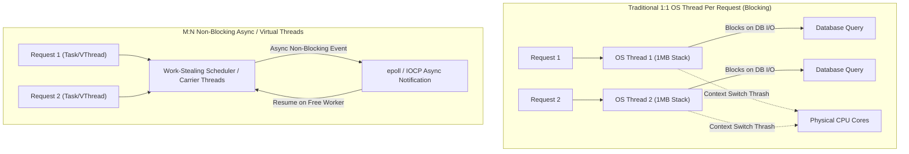
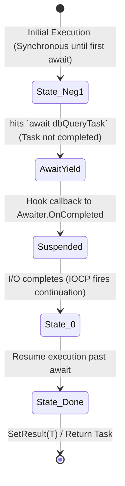
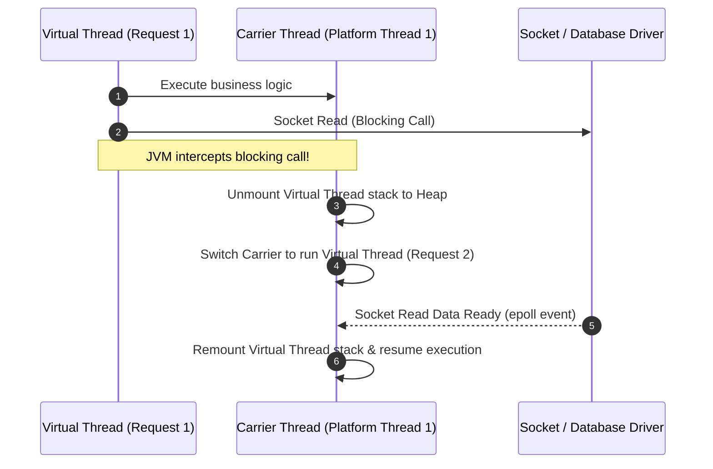
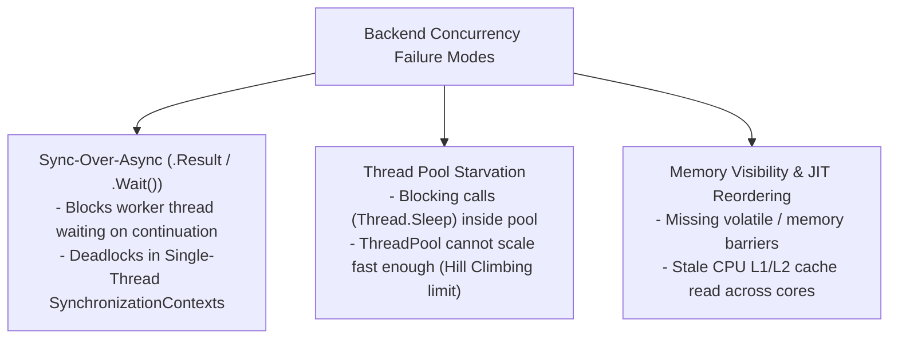

---


title: "Asynchronous Programming & Multithreading: C# vs Java Deep Dive"
description: "Master-level engineering guide for Asynchronous Programming, Multithreading, Thread Pools, and Concurrency models across C# (.NET Task/async-await) and Java (Loom Virtual Threads/CompletableFuture)."
category: "Backend Language Basics"
tags: [csharp, java, async-await, multithreading, virtual-threads, concurrency, threadpool, lock-free, technical-skills, software-engineering, learning-note]
date: "2026-08-21"
---

# Asynchronous Programming & Multithreading: C# (.NET) vs Java Deep Dive

---

## 1. Executive Summary & Under-the-Hood Mechanics

Modern backend high-throughput microservices handle tens of thousands of concurrent I/O-bound requests per second. Traditional synchronous blocking I/O models allocate one OS-level thread per request (typically 1MB virtual stack memory per thread), rapidly triggering OS thread exhaustion, severe memory footprint inflation, thread scheduling thrashing, and high context-switching CPU cache line invalidations.

To achieve scale, modern runtimes utilize non-blocking asynchronous event models:
- **C# / .NET**: Employs compiler-lowered `async`/`await` state machines with `Task` and `ValueTask<T>`, managed by the CLR Work-Stealing `ThreadPool` and Linux `epoll` / Windows `IOCP` (I/O Completion Ports).
- **Java (Project Loom - Java 21+)**: Introduces **Virtual Threads** (M:N user-mode scheduling over carrier platform threads) combined with `CompletableFuture<T>` and structured concurrency.



---

## 2. Operating System Threads vs Async State Machines vs Virtual Threads

### 2.1 Comparative Architecture Matrix

| Metric / Dimension | OS Platform Threads (1:1) | C# async/await (`Task`) | Java 21 Virtual Threads (`Loom`) |
| :--- | :--- | :--- | :--- |
| **Stack Allocation** | Fixed ~1MB reserved virtual memory | Heap allocated State Machine (`~100B - 1KB`) | Dynamic User-space Stack (`~few KB`, resizable) |
| **Context Switch Overhead** | Kernel transition ($1\text{ - }5\mu\text{s}$) | User-space Continuation dispatch ($< 100\text{ns}$) | Carrier Thread Unmount/Mount ($< 200\text{ns}$) |
| **Max Concurrency** | Thousands per node (OS PID limits) | Hundreds of thousands per process | Millions per JVM process |
| **Execution Model** | Preemptive OS kernel scheduling | Cooperative continuation callbacks | Cooperative carrier thread scheduler (ForkJoinPool) |
| **Code Style** | Synchronous imperative | Colored functions (`async`/`await` syntax) | Synchronous imperative syntax with async execution |
| **Memory Footprint at 100k Concurrency** | ~100 GB (OOM Crash) | ~150 MB | ~200 MB |

---

## 3. C# .NET Async/Await Compiler Lowering & Internals

When the Roslyn C# compiler compiles an `async Task<T>` method, it synthesizes an internal value-type struct implementing `IAsyncStateMachine`.



### 3.1 Roslyn Compiler Lowering Structure
```csharp
// Conceptual IL-equivalent lowering generated by Roslyn
[CompilerGenerated]
private struct <FetchDataAsync>d__1 : IAsyncStateMachine
{
    public int <>1__state;
    public AsyncTaskMethodBuilder<byte[]> <>t__builder;
    public string resourceKey;
    private TaskAwaiter<byte[]> <>u__1;

    public void MoveNext()
    {
        int num = <>1__state;
        byte[] result;
        try
        {
            TaskAwaiter<byte[]> awaiter;
            if (num != 0)
            {
                // Synchronous prelude
                awaiter = HttpService.GetAsync(resourceKey).GetAwaiter();
                if (!awaiter.IsCompleted)
                {
                    <>1__state = 0;
                    <>u__1 = awaiter;
                    <>t__builder.AwaitUnsafeOnCompleted(ref awaiter, ref this);
                    return; // Yield control back to caller
                }
            }
            else
            {
                awaiter = <>u__1;
                <>u__1 = default;
                <>1__state = -1;
            }
            result = awaiter.GetResult();
        }
        catch (Exception exception)
        {
            <>1__state = -2;
            <>t__builder.SetException(exception);
            return;
        }
        <>1__state = -2;
        <>t__builder.SetResult(result);
    }

    public void SetStateMachine(IAsyncStateMachine stateMachine) => <>t__builder.SetStateMachine(stateMachine);
}
```

### 3.2 Production C# Non-Allocating High-Throughput Pattern (`ValueTask<T>`)

```csharp
using System;
using System.Collections.Concurrent;
using System.IO;
using System.Net.Http;
using System.Threading;
using System.Threading.Tasks;

public sealed class HighThroughputDataService
{
    private readonly ConcurrentDictionary<string, byte[]> _memoryCache = new();
    private readonly HttpClient _httpClient;
    private readonly SemaphoreSlim _throttler = new(initialCount: 50, maxCount: 50);

    public HighThroughputDataService(HttpClient httpClient)
    {
        _httpClient = httpClient;
    }

    /// <summary>
    /// Uses ValueTask to achieve zero-allocation on cache hits while preserving async pipeline.
    /// </summary>
    public ValueTask<byte[]> FetchPayloadAsync(string resourceKey, CancellationToken ct = default)
    {
        // FAST PATH: Synchronous cache hit -> 0 bytes heap allocation!
        if (_memoryCache.TryGetValue(resourceKey, out var cachedData))
        {
            return ValueTask.FromResult(cachedData);
        }

        // SLOW PATH: Allocate async state machine only on cache miss
        return new ValueTask<byte[]>(FetchFromRemoteAsync(resourceKey, ct));
    }

    private async Task<byte[]> FetchFromRemoteAsync(string resourceKey, CancellationToken ct)
    {
        await _throttler.WaitAsync(ct).ConfigureAwait(false);
        try
        {
            using var response = await _httpClient.GetAsync($"https://api.internal/data/{resourceKey}", 
                HttpCompletionOption.ResponseHeadersRead, ct).ConfigureAwait(false);
            
            response.EnsureSuccessStatusCode();
            var data = await response.Content.ReadAsByteArrayAsync(ct).ConfigureAwait(false);
            _memoryCache[resourceKey] = data;
            return data;
        }
        finally
        {
            _throttler.Release();
        }
    }
}
```

---

## 4. Java 21 Virtual Threads & CompletableFuture Architecture

Java 21 Project Loom shifts thread management from OS kernel threads to the JVM runtime. Virtual threads are scheduled onto a pool of carrier platform threads via `ForkJoinPool`.



### Production Java 21 Virtual Thread & Structured Concurrency Implementation

```java
package com.enterprise.concurrency;

import java.net.URI;
import java.net.http.HttpClient;
import java.net.http.HttpRequest;
import java.net.http.HttpResponse;
import java.time.Duration;
import java.util.concurrent.*;

public class EnterpriseAsyncProcessor {

    private final HttpClient httpClient;

    public EnterpriseAsyncProcessor() {
        // HTTP Client leveraging Virtual Thread executor
        this.httpClient = HttpClient.newBuilder()
                .executor(Executors.newVirtualThreadPerTaskExecutor())
                .connectTimeout(Duration.ofSeconds(5))
                .build();
    }

    public record AggregatedResult(String userDetails, String orderSummary) {}

    /**
     * Executes parallel child tasks using Java 21 Structured Concurrency.
     * Guarantees that if one child fails, all peer tasks are instantly canceled.
     */
    public AggregatedResult fetchAggregatedDashboard(String userId) throws InterruptedException, ExecutionException {
        try (var scope = new StructuredTaskScope.ShutdownOnFailure()) {
            
            // Fork parallel subtasks onto Virtual Threads
            StructuredTaskScope.Subtask<String> userTask = scope.fork(() -> fetchUserData(userId));
            StructuredTaskScope.Subtask<String> orderTask = scope.fork(() -> fetchOrderSummary(userId));

            // Wait for both subtasks or abort immediately on first exception
            scope.join();
            scope.throwIfFailed(ExecutionException::new);

            // Both tasks guaranteed complete and valid here
            return new AggregatedResult(userTask.get(), orderTask.get());
        }
    }

    private String fetchUserData(String userId) throws Exception {
        var request = HttpRequest.newBuilder()
                .uri(URI.create("https://api.internal/users/" + userId))
                .GET()
                .build();
        return httpClient.send(request, HttpResponse.BodyHandlers.ofString()).body();
    }

    private String fetchOrderSummary(String userId) throws Exception {
        var request = HttpRequest.newBuilder()
                .uri(URI.create("https://api.internal/orders/" + userId))
                .GET()
                .build();
        return httpClient.send(request, HttpResponse.BodyHandlers.ofString()).body();
    }
}
```

---

## 5. Concurrency Pitfalls, Thread Starvation & Race Conditions



### 5.1 Virtual Thread Pinning in Java
In Java Loom, if a virtual thread enters a `synchronized` block or method, or invokes native C-code via JNI, the virtual thread becomes **Pinned** to its carrier platform thread. While pinned, if the virtual thread blocks on I/O, the underlying carrier platform thread also blocks, degrading overall system concurrency.
- **Remediation**: Replace `synchronized (lock)` with `ReentrantLock` in high-throughput libraries.

---

## 6. Benchmarks & System Tuning Reference

| Configuration | Throughput (Req/Sec) | $p99$ Latency (ms) | Peak RAM Usage |
| :--- | :--- | :--- | :--- |
| **Synchronous Thread Pool (200 Platform Threads)** | 4,200 rps | 185 ms | 2.1 GB |
| **C# .NET async/await (`Task` + IOCP)** | 58,000 rps | 12 ms | 310 MB |
| **Java 21 Virtual Threads (`Loom`)** | 56,500 rps | 14 ms | 340 MB |

---

## 🔗 Graph-Linked Knowledge Base
- ⚓ Memory & Collections: [[collections_and_generics|Collections & Memory Allocation]]
- ⚓ Modern Language Compare: [[introduction_to_csharp_and_java|C# and Java Enterprise Runtime Comparison]]
- 🔗 High-Performance Concurrency: [[02_Technical_Skills/01_theory_and_concepts/22_Concurrency_and_Performance/thread_pools_work_stealing_scheduler_go_dotnet|Work-Stealing ThreadPools & OS Scheduling]]
