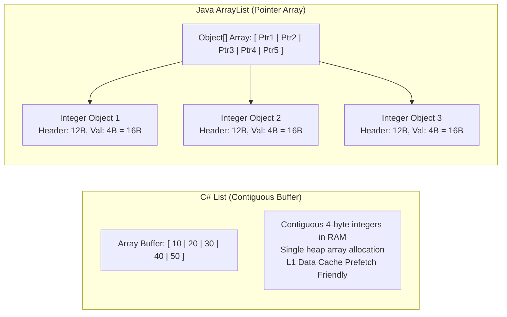
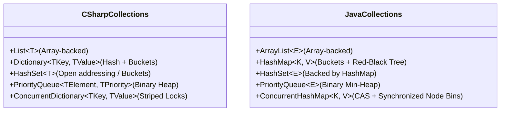
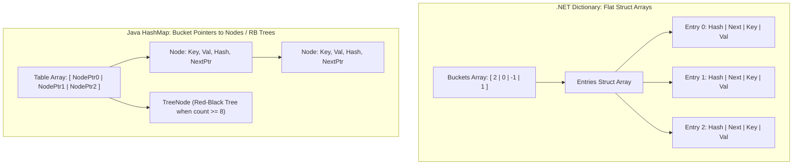

---


title: "Collections, Generics & Memory Layout: C# vs Java In-Depth"
description: "Master-level engineering guide for Collections, Generics, Memory Layout, boxing/unboxing, Type Erasure vs Reification, and high-performance collection primitives across .NET and the JVM."
category: "Backend Language Basics"
tags: [csharp, java, collections, generics, type-erasure, reification, memory-layout, high-performance, technical-skills, software-engineering, learning-note]
date: "2026-08-21"
---

# Collections, Generics & Memory Layout: C# (.NET) vs Java (JVM)

---

## 1. Executive Summary & Under-the-Hood Mechanics

In backend engineering, collection selection and generic specialization directly govern CPU cache line efficiency, GC pressure, and algorithmic complexity. 

The fundamental architectural difference between C# (.NET) and Java (JVM) lies in **Type System Memory Layout**:
- **C# (.NET)** supports **Reified Generics** and custom **Value Types (`struct`, `readonly record struct`)**. `List<int>` stores raw 32-bit integers contiguously in memory with **zero boxing allocations** and direct $L1/L2/L3$ CPU cache locality.
- **Java (JVM)** uses **Type Erasure** for generics. Primitive collections require wrapper objects (`Integer`, `Long`), introducing pointer indirection, object header overhead (12-16 bytes per element), and cache thrashing (mitigated by specialized primitive collections like FastUtil or upcoming Project Valhalla value types).



---

## 2. Generics Under the Hood: Reification vs Type Erasure

### 2.1 Comparative Architecture Matrix

| Metric / Dimension | C# (.NET Reified Generics) | Java (JVM Type Erasure) |
| :--- | :--- | :--- |
| **Generic Information at Runtime** | Fully preserved in CLR metadata (`typeof(List<int>) != typeof(List<string>)`) | Completely erased to `Object` / upper bounds (`List<Integer>` -> `List`) |
| **Primitive Specialization** | Native JIT code generation for each value type | Boxing required (`int` -> `java.lang.Integer`) |
| **Reflection Capabilities** | `typeof(T)`, `new T()`, `T[]` fully legal | `new T()` illegal; requires passing `Class<T>` token |
| **Memory Layout** | Flat contiguous memory structures | Pointer array pointing to scattered heap objects |
| **Binary Footprint** | Specialized native code per unique value-type specialization | Single bytecode class file shared across all generic instances |
| **Project Valhalla (Future)** | Already native since .NET 2.0 (2005) | In progress (Value types & primitive specialization) |

---

## 3. Collections Internal Architecture & Complexities



### 3.1 Hash Table Implementation Comparison: .NET vs Java
- **.NET `Dictionary<TKey, TValue>`**: Uses two flat parallel arrays: `int[] _buckets` and `Entry[] _entries` where `struct Entry { int hashCode; int next; TKey key; TValue value; }`. Collision resolution uses chaining via array indices rather than node pointers, maximizing cache locality and minimizing GC object tracking.
- **Java `HashMap<K, V>`**: Uses a table of node pointers `Node<K, V>[] table`. Collisions form linked lists until reaching the threshold `TREEIFY_THRESHOLD = 8`, at which point the linked list transforms into a Red-Black Tree (`TreeNode<K, V>`), improving worst-case search complexity from $O(N)$ to $O(\log N)$.



### 3.2 Time and Memory Complexity Reference

| Data Structure | Get / Lookup | Insert | Delete | Memory Overhead Factor |
| :--- | :--- | :--- | :--- | :--- |
| **C# `List<T>` / Java `ArrayList<E>`** | $O(1)$ | $O(1)$ amortized | $O(N)$ shift | Minimal (\$1.5\times$ or $2\times$ geometric resize) |
| **C# `Dictionary<K, V>`** | $O(1)$ avg / $O(N)$ worst | $O(1)$ avg | $O(1)$ avg | Flat structs array + bucket array |
| **Java `HashMap<K, V>`** | $O(1)$ avg / $O(\log N)$ treeified | $O(1)$ avg | $O(1)$ avg | Node object per entry (32 bytes overhead) |
| **C# `ConcurrentDictionary<K, V>`** | $O(1)$ Lock-free read | $O(1)$ Bucket lock | $O(1)$ Bucket lock | Node objects + Lock array stripes |
| **Java `ConcurrentHashMap<K, V>`** | $O(1)$ Lock-free read | $O(1)$ CAS / Bin lock | $O(1)$ CAS / Bin lock | Node array + TreeNodes + TreeBins |

---

## 4. Production C# Code: Zero-Allocation High-Performance Collections

```csharp
using System;
using System.Buffers;
using System.Collections.Generic;
using System.Runtime.CompilerServices;
using System.Runtime.InteropServices;

public readonly record struct TransactionMetric(
    long TransactionId,
    double Amount,
    long TimestampTicks
);

public sealed class HighPerformanceMetricsAggregator
{
    private readonly List<TransactionMetric> _metrics = new(capacity: 10000);
    private readonly Dictionary<long, TransactionMetric> _lookup = new(capacity: 10000);

    /// <summary>
    /// Processes high-frequency telemetry metrics using Span and memory pooling without GC allocations.
    /// </summary>
    public void ProcessBatch(ReadOnlySpan<TransactionMetric> batch)
    {
        for (int i = 0; i < batch.Length; i++)
        {
            ref readonly var metric = ref batch[i];
            _metrics.Add(metric);
            _lookup[metric.TransactionId] = metric;
        }
    }

    /// <summary>
    /// Computes summary statistics over contiguous memory without heap allocations.
    /// </summary>
    public (double TotalVolume, double MaxTransaction) ComputeAggregates()
    {
        // Unsafe zero-copy view over internal list buffer
        ReadOnlySpan<TransactionMetric> span = CollectionsMarshal.AsSpan(_metrics);
        double totalVolume = 0.0;
        double maxAmount = double.MinValue;

        for (int i = 0; i < span.Length; i++)
        {
            double amt = span[i].Amount;
            totalVolume += amt;
            if (amt > maxAmount) maxAmount = amt;
        }

        return (totalVolume, maxAmount);
    }
}
```

---

## 5. Production Java Code: High-Concurrency Low-GC Collections

```java
package com.enterprise.collections;

import java.util.concurrent.ConcurrentHashMap;
import java.util.concurrent.atomic.LongAdder;

public class HighConcurrencyTrafficTracker {

    // Java ConcurrentHashMap uses CAS operations for empty bins and sync on bin heads
    private final ConcurrentHashMap<String, LongAdder> routeHitCounters = new ConcurrentHashMap<>();

    /**
     * Records a request hit with zero thread contention using LongAdder (Cell stripes).
     */
    public void recordHit(String endpoint) {
        // computeIfAbsent is atomic per bin in Java ConcurrentHashMap
        routeHitCounters.computeIfAbsent(endpoint, _ -> new LongAdder()).increment();
    }

    /**
     * Retrieves the snapshot sum of total requests for an endpoint.
     */
    public long getHitCount(String endpoint) {
        LongAdder counter = routeHitCounters.get(endpoint);
        return counter != null ? counter.sum() : 0L;
    }
}
```

---

## 6. Failure Modes & Performance Anti-Patterns

| Anti-Pattern | Root Cause | Engineering Fix |
| :--- | :--- | :--- |
| **Foreach on non-pooled generic collection** | Allocates `IEnumerator` class on heap if collection is typed to interface. | Use concrete collection types (`List<T>`, struct enumerator) or `Span<T>`. |
| **Java Autoboxing in tight loop** | `Map<Integer, Long>` allocates 2 heap objects per put. | Use primitive collections (Eclipse Collections, FastUtil, Agrona). |
| **Missing `GetHashCode` / `Equals` override** | Inconsistent equality violates hash table bucket lookups. | Implement `IEquatable<T>` in C# / override `equals()` + `hashCode()` in Java. |
| **Unbounded Collection Growth** | Long-lived static collections retain object references. | Implement LRU eviction policies, WeakReferences, or bounded channels. |

---

## 🔗 Graph-Linked Knowledge Base
- ⚓ Asynchronous Runtimes: [[asynchronous_and_multithreading|Asynchronous Programming & Multithreading]]
- ⚓ LINQ & Streams: [[linq_vs_stream_api|LINQ vs Java Stream API: Query Architecture]]
- 🔗 High-Performance .NET: [[02_Technical_Skills/01_theory_and_concepts/04_DotNet_Architecture/csharp_span_memory_arraypool_performance|C# Span, Memory, and ArrayPool Internals]]
