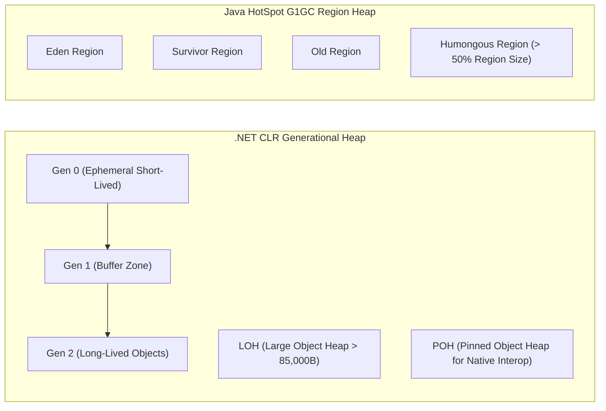

---


title: "C# (.NET) vs Java (JVM): Enterprise Backend Architectural Comparison"
description: "Master-level engineering guide comparing the C# (.NET CLR) and Java (JVM HotSpot) enterprise runtime ecosystems, covering memory models, JIT compilation, Native AOT, Garbage Collectors, and microservices architecture."
category: "Backend Language Basics"
tags: [csharp, java, dotnet, clr, jvm, hotspot, jit, native-aot, garbage-collection, enterprise, technical-skills, software-engineering, learning-note]
date: "2026-08-21"
---

# C# (.NET CLR) vs Java (JVM HotSpot): Enterprise Architecture Deep Dive

---

## 1. Executive Summary & Runtime Architecture

The two dominant runtime ecosystems powering global enterprise backends, distributed microservices, and financial transaction platforms are **.NET (Common Language Runtime - CLR)** and **Java (Java Virtual Machine - JVM HotSpot)**.

While both execute intermediate bytecode (`CIL/MSIL` for .NET, `Java Bytecode` for JVM) through a JIT (Just-In-Time) compiler with automatic garbage collection, their underlying architectural philosophies diverge significantly in memory layout, type system reification, native interop, and compilation pipelines.

```mermaid
flowchart TD
    subgraph DotNetRuntime[".NET 8/9 Common Language Runtime (CLR)"]
        CS["C# Source Code"] --> Roslyn["Roslyn Compiler (csc)"]
        Roslyn --> CIL["Common Intermediate Language (CIL/MSIL)"]
        CIL --> RyuJIT["RyuJIT (Tiered JIT Compiler / Dynamic PGO)"]
        CIL --> NAOT[".NET Native AOT Compiler"]
        RyuJIT --> ASM1["Optimized Native Machine Code (x86_64 / ARM64)"]
        NAOT --> ASM1
    end

    subgraph JavaRuntime["Java 21 JVM HotSpot Runtime"]
        Java["Java Source Code"] --> Javac["Java Compiler (javac)"]
        Javac --> Bytecode["Java Bytecode (.class)"]
        Bytecode --> Interpreter["HotSpot Interpreter"]
        Interpreter --> C1["C1 Client Compiler (Quick JIT)"]
        C1 --> C2["C2 / Graal JIT (Tiered Compilation / Profile Feedback)"]
        C2 --> ASM2["Optimized Native Machine Code"]
    end
```



---

## 2. In-Depth Technical Comparison Matrix

| Architectural Dimension | C# (.NET 8/9 CLR) | Java (Java 21+ HotSpot JVM) |
| :--- | :--- | :--- |
| **Type System** | Unified type system (`System.Object`), Value Types (`struct`), Reference Types (`class`), Ref Structs | Primitive Types (`int`, `boolean`) vs Reference Types (`Object`), Records |
| **Generics Implementation** | **Reified Generics** (Preserved at runtime; zero-cost primitive specialization) | **Type Erasure** (Erased to `Object`/bounds at compile time) |
| **Memory Allocation Primitives** | `stackalloc`, `Span<T>`, `Memory<T>`, `Unsafe`, Native Memory pointers | Managed Heap, `Unsafe` (deprecating), Foreign Function & Memory API (Panama) |
| **Compilation Modes** | Tiered JIT with Dynamic PGO, Native AOT (Ahead-of-Time compilation) | Tiered JIT (Interpreter $	o$ C1 $	o$ C2), GraalVM Native Image |
| **Garbage Collectors** | Workstation & Server GC (Generational Ephemeral Gen0/1/2 + LOH + POH) | G1GC (Default), ZGC (Sub-millisecond pause), Shenandoah, ParallelGC |
| **Concurrency Primitives** | `async`/`await`, `Task`, `ValueTask`, Channels, ThreadPool Work-Stealing | Platform Threads, Virtual Threads (`Loom`), `CompletableFuture` |
| **Microservice Cold-Start** | Instant (~10ms with Native AOT) | Fast with GraalVM AOT; Moderate with standard JIT warm-up |
| **Interoperability** | Native P/Invoke, `DllImport`, LibraryImport source generator | Java Native Interface (JNI), Foreign Function & Memory API (FFM) |

---

## 3. Compilation Pipeline & Tiered JIT Optimization

### 3.1 RyuJIT vs HotSpot C1/C2 Execution Pipeline
- **.NET RyuJIT**:
  - **Tier 0**: Compiles MSIL to native code quickly without aggressive optimizations (method-level fast start).
  - **Dynamic PGO (Profile-Guided Optimization)**: Instruments running code to collect type distributions and branch probabilities.
  - **Tier 1**: Recompiles hot methods with loop unrolling, vectorization (AVX-512), devirtualization, and aggressive inlining.
- **Java HotSpot**:
  - **Interpreter**: Directly interprets bytecode while counting invocation and loop backedge counters.
  - **C1 Compiler (Client)**: Three levels of compilation with basic optimizations and profiling hooks.
  - **C2 Compiler (Server)**: Advanced SSA-based compiler performing Global Value Numbering (GVN), Escape Analysis, Loop Vectorization, and Scalar Replacement of Aggregates.

```mermaid
sequenceDiagram
    autonumber
    participant Code as Bytecode / CIL Method
    participant T0 as Tier 0 / Interpreter
    participant Prof as Runtime Profiler (PGO)
    participant Opt as Tier 1 / C2 Compiler

    Code->>T0: First Invocation
    T0->>T0: Execute immediately (No delay)
    loop Invocations > Threshold (e.g. 10,000 runs)
        T0->>Prof: Record Branch Frequency & Type Profiles
    end
    Prof->>Opt: Trigger Background Optimized Recompilation
    Opt->>Opt: Devirtualize Calls + Inline Hot Paths + Vectorize
    Opt-->>Code: On-Stack Replacement (OSR) with Machine Code
```

---

## 4. Garbage Collection Mechanics & Memory Segment Topologies



### Garbage Collection Invariants & Characteristics
- **.NET Server GC**: Allocates dedicated heap segments per logical CPU core with concurrent background GC threads. Large objects ($> 85,000\text{ bytes}$) bypass ephemeral generations directly to the Large Object Heap (LOH) to avoid expensive generation compaction copies.
- **Java ZGC (Generational ZGC)**: Uses colored pointers and load barriers to achieve concurrent compaction and marking. Guarantees maximum GC pause times under **$1\text{ millisecond}$** regardless of heap size (from 16MB up to 16 Terabytes).

---

## 5. Enterprise Microservices Blueprint

### 5.1 C# Minimal API (.NET 8/9 High Performance)
```csharp
using System.Text.Json.Serialization;

var builder = WebApplication.CreateSlimBuilder(args);

// Native AOT JSON Serialization Context
builder.Services.ConfigureHttpJsonOptions(options =>
{
    options.SerializerOptions.TypeInfoResolverChain.Insert(0, AppJsonSerializerContext.Default);
});

builder.Services.AddSingleton<IOrderService, OrderService>();

var app = builder.Build();

app.MapGet("/api/v1/orders/{id:guid}", async (Guid id, IOrderService service, CancellationToken ct) =>
{
    var order = await service.GetOrderByIdAsync(id, ct);
    return order is not null ? Results.Ok(order) : Results.NotFound();
});

app.Run();

[JsonSerializable(typeof(OrderDto))]
internal partial class AppJsonSerializerContext : JsonSerializerContext { }

public record OrderDto(Guid Id, string CustomerId, decimal Amount, string Status);
public interface IOrderService { Task<OrderDto?> GetOrderByIdAsync(Guid id, CancellationToken ct); }
public class OrderService : IOrderService 
{ 
    public Task<OrderDto?> GetOrderByIdAsync(Guid id, CancellationToken ct) => 
        Task.FromResult<OrderDto?>(new OrderDto(id, "CUST_99", 250.00m, "CONFIRMED")); 
}
```

### 5.2 Java Spring Boot 3 Controller (Java 21 Virtual Threads)
```java
package com.enterprise.orders;

import org.springframework.boot.SpringApplication;
import org.springframework.boot.autoconfigure.SpringBootApplication;
import org.springframework.http.ResponseEntity;
import org.springframework.web.bind.annotation.*;

import java.math.BigDecimal;
import java.util.Optional;
import java.util.UUID;

@SpringBootApplication
public class OrderServiceApplication {
    public static void main(String[] args) {
        SpringApplication.run(OrderServiceApplication.class, args);
    }
}

public record OrderDto(UUID id, String customerId, BigDecimal amount, String status) {}

@RestController
@RequestMapping("/api/v1/orders")
public class OrderController {

    @GetMapping("/{id}")
    public ResponseEntity<OrderDto> getOrderById(@PathVariable UUID id) {
        OrderDto order = new OrderDto(id, "CUST_99", new BigDecimal("250.00"), "CONFIRMED");
        return ResponseEntity.ok(order);
    }
}
```

---

## 6. Enterprise Framework Ecosystem Comparison

| Category | .NET Ecosystem | Java Ecosystem |
| :--- | :--- | :--- |
| **Web / REST Framework** | ASP.NET Core Minimal APIs / MVC | Spring Boot 3, Quarkus, Micronaut |
| **ORM / Data Access** | Entity Framework Core, Dapper | Hibernate ORM, Spring Data JPA, jOOQ |
| **Messaging / Eventing** | MassTransit, Wolverine, Confluent.Kafka | Spring Cloud Stream, Kafka-Clients |
| **Dependency Injection** | Built-in `Microsoft.Extensions.DependencyInjection` | Spring Core IoC, Google Guice, Dagger |
| **API Documentation** | Scalar, Swashbuckle, OpenAPI Generator | SpringDoc OpenAPI, Swagger UI |

---

## 🔗 Graph-Linked Knowledge Base
- ⚓ Concurrency: [[asynchronous_and_multithreading|Asynchronous Programming & Multithreading]]
- ⚓ Query Pipelines: [[linq_vs_stream_api|LINQ vs Java Stream API: Query Architecture]]
- 🔗 JVM Architecture: [[02_Technical_Skills/01_theory_and_concepts/06_Java_Engineering/jvm_architecture_memory_garbage_collection|JVM Architecture & Memory Management]]
- 🔗 .NET Architecture: [[02_Technical_Skills/01_theory_and_concepts/04_DotNet_Architecture/virtual_method_table_clr_internals|Virtual Method Tables & CLR Internals]]
