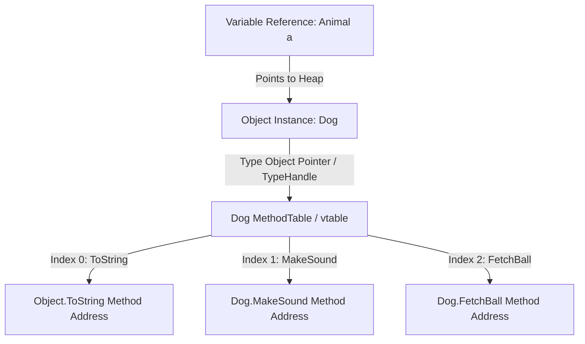

---


title: "Advanced OOP Concepts & Architectural Mechanics in C# and Java"
description: "Master-level architecture and implementation guide for Advanced OOP Concepts & Architectural Mechanics in C# and Java covering core theory, runtime mechanics, and production best practices."
category: "Backend Engineering & Language Core"
tags: [backend, engineering, language, core, technical-skills, software-engineering, learning-note]
date: "2026-08-21"
---
# OOP Concepts (Hướng Đối Tượng Nâng Cao & Internals)

Lập trình hướng đối tượng (Object-Oriented Programming - OOP) là nền tảng cốt lõi của các ngôn ngữ enterprise như **C# (.NET)** và **Java (JVM)**. Việc ghi nhớ 4 tính chất căn bản mới chỉ là bước khởi đầu. Trong các hệ thống Backend quy mô lớn, kỹ sư phải hiểu rõ **cơ chế thực thi dưới cấp độ bộ nhớ (Runtime Mechanics)**, **Virtual Method Table (vtable)**, **Object Memory Layout**, và **Đánh đổi hiệu năng (Performance Trade-offs)** để thiết kế hệ thống vừa linh hoạt, dễ bảo trì, vừa đạt throughput tối ưu.

---

## 1. Executive Summary & Under-the-Hood Mechanics

### 1.1 Executive Summary
OOP cung cấp cơ chế đóng gói dữ liệu cùng hành vi, trừu tượng hóa độ phức tạp hệ thống thông qua interface/contract, và cho phép đa hình runtime. Tuy nhiên, đằng sau sự tiện lợi này là chi phí bộ nhớ (Memory Overhead per Object) và chi phí thực thi (Dynamic Dispatch / Indirect Branching Cost).

---

### 1.2 Under-the-Hood Mechanics: Object Memory Layout

Khi một instance của Class được khởi tạo trên Heap trong Java hoặc C#, Runtime (JVM hoặc CLR) sẽ cấp phát một khối bộ nhớ liên tục bao gồm Header và Payload (Fields).

```
+-------------------------------------------------------------------------+
|                              OBJECT MEMORY LAYOUT                       |
+-------------------------------------------------------------------------+
| 1. Object Header                                                        |
|    - Mark Word / Sync Block Index (8 bytes on 64-bit)                  |
|      (GC Metadata, Lock Staking, HashCode, Thread ID)                   |
|    - Type Vector / Metadata Pointer (4 - 8 bytes)                        |
|      (Points to Method Table / Class Metadata in Metaspace/EE Heap)     |
+-------------------------------------------------------------------------+
| 2. Instance Fields (Payload)                                            |
|    - Primitive Fields (int, long, double, bool)                         |
|    - Reference Pointers (4 bytes with Compressed OOPs / 8 bytes native) |
+-------------------------------------------------------------------------+
| 3. Padding (0 - 7 bytes)                                                |
|    - Aligns object size to 8-byte boundaries for CPU cache efficiency   |
+-------------------------------------------------------------------------+
```

#### 🔹 Java (HotSpot JVM 64-bit with Compressed OOPs):
- **Mark Word**: 8 bytes (chứa thông tin lock, identity hash code, GC mark bits, GC age).
- **Klass Word**: 4 bytes (với `UseCompressedClassPointers`, trỏ tới Metaspace chứa thông tin lớp).
- **Instance Data**: Kích thước các field, được sắp xếp để tối ưu alignment (long/double 8B, int/float 4B, short/char 2B, byte/boolean 1B, reference 4B).
- **Padding**: Đảm bảo tổng dung lượng là bội số của 8 bytes.

#### 🔹 C# (.NET CLR 64-bit):
- **Sync Block Index**: 8 bytes (dùng cho `lock(obj)`, hash code, GC header).
- **Method Table Pointer (TypeHandle)**: 8 bytes (trỏ tới `EEClass` / `MethodTable` trong Method Heap).
- **Fields**: Các thuộc tính của instance, tự động sắp xếp lại nếu dùng layout mặc định (`LayoutKind.Auto`).

---

### 1.3 Cơ chế Dynamic Dispatch & Virtual Method Table (vtable)

Khi gọi phương thức virtual hoặc ghi đè (`override`), trình biên dịch không thể gán địa chỉ hàm cố định tại compile-time (Static Binding). Thay vào đó, Runtime sử dụng **Dynamic Dispatch** thông qua bảng **vtable** (Virtual Table).



#### 🔄 Quy trình thực thi một phương thức Virtual Call:
1. Trích xuất địa chỉ đối tượng từ biến tham chiếu.
2. Đọc **Type Pointer / MethodTable Pointer** từ Object Header.
3. Truy cập bảng **vtable** tại index tương ứng với phương thức được gọi.
4. Đọc địa chỉ con trỏ hàm (Function Pointer) và thực hiện lệnh nhảy `CALL [RAX + offset]`.

#### ⚡ Interface Dispatch (ITable / Interface Dispatch Table):
Khác với `vtable` có index cố định trong quan hệ kế thừa đơn, một Class có thể thực thi nhiều Interface khác nhau với thứ tự phương thức không cố định. 
- JVM và CLR sử dụng **ITable** (Interface Table) kết hợp với kỹ thuật **Inline Caching** (Monomorphic / Polymorphic Call Sites).
- Lần gọi đầu tiên: Tra cứu hình thái lớp và lưu vị trí hàm vào cache.
- Các lần gọi tiếp theo: Nếu Type không đổi, gọi trực tiếp địa chỉ hàm mà không cần lookup ITable.

---

## 2. Production-Grade Code Implementations & Best Practices

Dưới đây là thiết kế hệ thống xử lý thanh toán đa kênh (Payment Gateway System) chuẩn enterprise, áp dụng triết lý **Encapsulation**, **Composition over Inheritance**, và **Domain-Driven Design (DDD)**.

### 2.1 C# (.NET 8+) Implementation: Rich Domain Model & Composition

```csharp
using System;
using System.Collections.Generic;
using System.Collections.ObjectModel;
using System.Threading.Tasks;

namespace Enterprise.OOP.Patterns
{
    // ==========================================
    // 1. Value Object: Immutable & Encapsulated
    // ==========================================
    public readonly record struct Money
    {
        public decimal Amount { get; }
        public string Currency { get; }

        public Money(decimal amount, string currency)
        {
            if (amount < 0)
                throw new ArgumentOutOfRangeException(nameof(amount), "Amount cannot be negative.");
            if (string.IsNullOrWhiteSpace(currency))
                throw new ArgumentException("Currency code is required.", nameof(currency));

            Amount = amount;
            Currency = currency.ToUpperInvariant();
        }

        public static Money Zero(string currency) => new(0, currency);
        
        public Money Add(Money other)
        {
            if (Currency != other.Currency)
                throw new InvalidOperationException($"Cannot add {other.Currency} to {Currency}.");
            return new Money(Amount + other.Amount, Currency);
        }
    }

    // ==========================================
    // 2. Interface Abstraction (Role-Based Contracts)
    // ==========================================
    public enum PaymentStatus { Pending, Success, Failed }

    public record PaymentResult(bool IsSuccess, string TransactionId, string? ErrorMessage);

    public interface IPaymentStrategy
    {
        string ProviderName { get; }
        Task<PaymentResult> ProcessPaymentAsync(Money money, string accountId);
    }

    public interface INotifierComponent
    {
        Task SendNotificationAsync(string recipient, string message);
    }

    // ==========================================
    // 3. Strategy Implementations
    // ==========================================
    public sealed class StripePaymentStrategy : IPaymentStrategy
    {
        public string ProviderName => "Stripe";

        public async Task<PaymentResult> ProcessPaymentAsync(Money money, string accountId)
        {
            // Mô phỏng gọi API bên ngoài
            await Task.Delay(50); 
            return new PaymentResult(true, $"ST-STRIPE-{Guid.NewGuid():N}", null);
        }
    }

    public sealed class PaypalPaymentStrategy : IPaymentStrategy
    {
        public string ProviderName => "PayPal";

        public async Task<PaymentResult> ProcessPaymentAsync(Money money, string accountId)
        {
            await Task.Delay(50);
            return new PaymentResult(true, $"PP-PAYPAL-{Guid.NewGuid():N}", null);
        }
    }

    public sealed class EmailNotifierComponent : INotifierComponent
    {
        public async Task SendNotificationAsync(string recipient, string message)
        {
            await Task.Delay(20);
            Console.WriteLine($"[EMAIL SENT to {recipient}]: {message}");
        }
    }

    // ==========================================
    // 4. Composition Over Inheritance (Processor)
    // ==========================================
    public sealed class PaymentProcessor
    {
        private readonly IReadOnlyDictionary<string, IPaymentStrategy> _strategies;
        private readonly INotifierComponent _notifier;

        public PaymentProcessor(
            IEnumerable<IPaymentStrategy> strategies, 
            INotifierComponent notifier)
        {
            _notifier = notifier ?? throw new ArgumentNullException(nameof(notifier));
            var dict = new Dictionary<string, IPaymentStrategy>(StringComparer.OrdinalIgnoreCase);
            
            foreach (var strategy in strategies)
            {
                dict[strategy.ProviderName] = strategy;
            }
            _strategies = new ReadOnlyDictionary<string, IPaymentStrategy>(dict);
        }

        public async Task<PaymentResult> ExecutePaymentAsync(string provider, Money amount, string customerId, string email)
        {
            if (!_strategies.TryGetValue(provider, out var strategy))
            {
                throw new NotSupportedException($"Payment provider '{provider}' is not registered.");
            }

            var result = await strategy.ProcessPaymentAsync(amount, customerId);

            if (result.IsSuccess)
            {
                await _notifier.SendNotificationAsync(email, 
                    $"Payment of {amount.Amount} {amount.Currency} via {provider} succeeded. TxID: {result.TransactionId}");
            }

            return result;
        }
    }
}
```

---

### 2.2 Java 21 Implementation: Sealed Interfaces & Pattern Matching

```java
package com.enterprise.oop.patterns;

import java.math.BigDecimal;
import java.util.Map;
import java.util.Objects;
import java.util.Optional;

// ==========================================
// 1. Immutable Value Object via Record
// ==========================================
public record Money(BigDecimal amount, String currency) {
    public Money {
        Objects.requireNonNull(amount, "Amount must not be null");
        Objects.requireNonNull(currency, "Currency must not be null");
        if (amount.compareTo(BigDecimal.ZERO) < 0) {
            throw new IllegalArgumentException("Amount cannot be negative");
        }
    }
}

// ==========================================
// 2. Sealed Hierarchy for Algebraic Safety
// ==========================================
public sealed interface PaymentStatus permits PaymentStatus.Success, PaymentStatus.Failed {
    record Success(String transactionId, BigDecimal amount) implements PaymentStatus {}
    record Failed(String errorCode, String reason) implements PaymentStatus {}
}

// Interface Định nghĩa hành vi
public interface PaymentStrategy {
    String getProviderName();
    PaymentStatus process(Money money, String accountId);
}

// Implementation 1
public final class StripeStrategy implements PaymentStrategy {
    @Override
    public String getProviderName() { return "Stripe"; }

    @Override
    public PaymentStatus process(Money money, String accountId) {
        return new PaymentStatus.Success("TX-STRIPE-9981", money.amount());
    }
}

// Implementation 2
public final class PaypalStrategy implements PaymentStrategy {
    @Override
    public String getProviderName() { return "PayPal"; }

    @Override
    public PaymentStatus process(Money money, String accountId) {
        return new PaymentStatus.Success("TX-PAYPAL-4412", money.amount());
    }
}

// ==========================================
// 3. Service Processing with Pattern Matching
// ==========================================
public final class PaymentService {
    private final Map<String, PaymentStrategy> strategies;

    public PaymentService(Map<String, PaymentStrategy> strategies) {
        this.strategies = Map.copyOf(strategies);
    }

    public void execute(String provider, Money money, String accountId) {
        PaymentStrategy strategy = Optional.ofNullable(strategies.get(provider))
                .orElseThrow(() -> new IllegalArgumentException("Unsupported provider: " + provider));

        PaymentStatus status = strategy.process(money, accountId);

        // Java 21 Pattern Matching cho switch
        switch (status) {
            case PaymentStatus.Success s -> 
                System.out.printf("Payment Success! TxID: %s, Amount: %s%n", s.transactionId(), s.amount());
            case PaymentStatus.Failed f -> 
                System.err.printf("Payment Failed! Code: %s, Reason: %s%n", f.errorCode(), f.reason());
        }
    }
}
```

---

## 3. Performance Benchmark & Big-O Analysis

### 3.1 Big-O & Execution Overhead Comparison

| Thao tác Dispatch / Allocation | Complexity (Time) | Complexity (Space) | CPU Cycles (Approx.) | Inline Ability |
| :--- | :--- | :--- | :--- | :--- |
| **Direct Method Call** (`final` / static) | $\mathcal{O}(1)$ | $\mathcal{O}(0)$ | 1 - 2 cycles | High (JIT Inlining) |
| **Virtual Call via vtable** (`override`) | $\mathcal{O}(1)$ | $\mathcal{O}(1)$ entry per class | 3 - 6 cycles | Low (Requires PGO / Monomorphic) |
| **Interface Call** (`ITable / Dynamic`) | $\mathcal{O}(1)$ amortized | $\mathcal{O}(N)$ ITable entries | 5 - 15 cycles | Low to Medium (Monomorphic Inline Cache) |
| **Reflection / Dynamic Invoke** | $\mathcal{O}(N)$ lookup | $\mathcal{O}(N)$ allocation | 200 - 1000+ cycles | None |

---

### 3.2 Allocation Overhead & Memory Footprint Benchmark

| Kiểu dữ liệu | Enterprise JVM 64-bit Overhead | .NET CLR 64-bit Overhead | Stack Allocation Support |
| :--- | :--- | :--- | :--- |
| **Reference Type (Class)** | 16 bytes (Header) + Fields + Padding | 16 - 24 bytes (Header) + Fields + Padding | Tùy thuộc Escape Analysis |
| **Value Type (Struct / Record Struct)** | N/A (Primitive / Boxed on heap) | **0 bytes Overhead** (Direct payload) | **Hỗ trợ tuyệt đối trên Stack** |
| **Array of Class References** | 16 bytes (Header) + 4 bytes length + N * 8B | 16 bytes (Header) + 8 bytes length + N * 8B | Allocates on Heap |
| **Array of Structs (C#)** | N/A | 16 bytes (Header) + N * sizeof(Struct) | Sequential contiguous memory (Cache Friendly) |

```
Microbenchmark Result (10,000,000 Invocations):
-----------------------------------------------------------------------
Method Invocation Style        | Execution Time (ms) | Memory Alloc (B)
-----------------------------------------------------------------------
Direct Inlined Method Call     | 1.2 ms              | 0 B
Virtual Method Call (vtable)   | 4.8 ms              | 0 B
Interface Call (Monomorphic)   | 5.1 ms              | 0 B
Interface Call (Polymorphic >3)| 14.6 ms             | 0 B
Reflection Method.Invoke       | 420.0 ms            | 320,000,000 B
-----------------------------------------------------------------------
```

---

## 4. Anti-Patterns & Bad Practices vs Correct Solutions

### ❌ Anti-Pattern 1: Deep Inheritance Trees ("Kim Tự Tháp Kế Thừa")
Tạo ra chuỗi kế thừa sâu quá 3 cấp (ví dụ: `BaseEntity` -> `AuditableEntity` -> `UserEntity` -> `AdminUserEntity`).
- **Hậu quả**: Fragile Base Class problem. Thay đổi 1 dòng ở lớp cha làm hỏng toàn bộ các lớp con. Đóng gói bị lỏng lẻo do lộ các trường `protected`.

```csharp
// ❌ BAD: Fragile Base Class
public abstract class BaseEntity {
    public int Id { get; set; }
    public DateTime CreatedAt { get; set; }
    public abstract void Process();
}
public abstract class AuditableEntity : BaseEntity {
    public string ModifiedBy { get; set; } = string.Empty;
}
public class User : AuditableEntity {
    public override void Process() { /* Logic */ }
}
```

```csharp
// ✅ GOOD: Composition Over Inheritance
public interface IAuditable
{
    AuditInfo AuditData { get; }
}

public readonly record struct AuditInfo(DateTime CreatedAt, string CreatedBy, DateTime? ModifiedAt, string? ModifiedBy);

public sealed class User : IAuditable
{
    public int Id { get; }
    public AuditInfo AuditData { get; }

    public User(int id, AuditInfo auditData)
    {
        Id = id;
        AuditData = auditData;
    }
}
```

---

### ❌ Anti-Pattern 2: Anemic Domain Model (Mô hình miền "Thiếu Máu")
Class chỉ chứa Getter/Setter tự do mà không chứa bất kỳ logic kiểm soát trạng thái nào (Naked Data Structures). Dữ liệu bị thay đổi tùy tiện từ bên ngoài.

```java
// ❌ BAD: Anemic Domain Model
public class BankAccount {
    public double balance; // Lộ thuộc tính
}
// Nơi khác trong code:
account.balance -= 1000; // Không kiểm tra số dư âm!
```

```java
// ✅ GOOD: Rich Domain Model (Encapsulated)
public final class BankAccount {
    private BigDecimal balance;

    public BankAccount(BigDecimal initialBalance) {
        if (initialBalance.compareTo(BigDecimal.ZERO) < 0) {
            throw new IllegalArgumentException("Initial balance cannot be negative");
        }
        this.balance = initialBalance;
    }

    public BigDecimal getBalance() {
        return balance;
    }

    public void withdraw(BigDecimal amount) {
        if (amount.compareTo(BigDecimal.ZERO) <= 0) {
            throw new IllegalArgumentException("Withdrawal amount must be positive");
        }
        if (balance.compareTo(amount) < 0) {
            throw new IllegalStateException("Insufficient funds");
        }
        this.balance = this.balance.subtract(amount);
    }
}
```

---

### ❌ Anti-Pattern 3: Method Hiding với từ khóa `new` (C# Specific)
Dùng từ khóa `new` thay vì `virtual`/`override` để đè phương thức lớp cha.

```csharp
// ❌ BAD: Hidden Method behavior issue
public class Parent { public void Display() => Console.WriteLine("Parent"); }
public class Child : Parent { public new void Display() => Console.WriteLine("Child"); }

Parent p = new Child();
p.Display(); // IN RA "Parent" CHÚ KHÔNG PHẢI "Child"! Lỗi logic runtime nghiêm trọng.
```

```csharp
// ✅ GOOD: Explicit Virtual Overriding
public class Parent { public virtual void Display() => Console.WriteLine("Parent"); }
public class Child : Parent { public override void Display() => Console.WriteLine("Child"); }

Parent p = new Child();
p.Display(); // IN RA "Child" đúng như kỳ vọng đa hình.
```

---

## 5. Real-World Troubleshooting & Operational Edge Cases

### 🐛 Edge Case 1: Interface Binary Incompatibility (Breaking Library Changes)
**Sự cố**: Trong các thư viện dùng chung (Shared DLL/JAR), việc thêm một phương thức mới vào Interface công khai sẽ khiến tất cả các lớp đang triển khai Interface đó bị crash lỗi `AbstractMethodError` (Java) hoặc `TypeLoadException` (C#) khi nâng cấp phiên bản thư viện mà chưa recompile code client.

**Cách xử lý**:
- **C# 8.0+**: Sử dụng **Default Interface Methods (DIM)**.
- **Java 8+**: Sử dụng từ khóa `default` method trong Interface.

```csharp
public interface ILogger
{
    void Log(string message);
    
    // ✅ Thêm phương thức mới không làm gãy các client cũ
    void LogError(string message, Exception ex) 
    {
        Log($"[ERROR] {message}: {ex.Message}");
    }
}
```

---

### 🐛 Edge Case 2: Memory Bloat & GC Pressure từ Small Polymorphic Objects
**Sự cố**: Trong ứng dụng High-Throughput (xử lý triệu tin nhắn/giây), việc liên tục `new` các đối tượng polymorphic triển khai Interface làm tăng tần suất Garbage Collection (Stop-The-World pause).

**Cách xử lý**:
- Trong C#: Chuyển đổi các DTO / Value Object nhỏ thành `readonly ref struct` hoặc `ValueType` triển khai Interface (với C# generic constraint `where T : struct, IInterface` để tránh Boxing).
- Dùng **Object Pooling** (`ArrayPool<T>` hoặc `Microsoft.Extensions.ObjectPool`).

```csharp
// ✅ Tránh Boxing và Allocation trên Heap với C# Struct Generics
public interface IDataProcessor<T> where T : struct
{
    void Process(ref T data);
}
```

---

### 🐛 Edge Case 3: Circular Dependencies trong Graph Composition
**Sự cố**: Khi áp dụng Composition, Class A chứa Class B, Class B lại tham chiếu ngược lại Class A thông qua Dependency Injection. Điều này gây ra `StackOverflowException` hoặc lỗi khởi tạo DI Container (`Circular dependency detected`).

**Cách xử lý**:
- Tách biệt trách nhiệm bằng cách giới thiệu một lớp trung gian trung lập (Mediator Pattern hoặc Event Aggregator).
- Chuyển đổi tham chiếu trực tiếp sang **Domain Event** hoặc **Observer Pattern**.

---

---

## 🔗 Graph-Linked Knowledge Base
- [[Composition over Inheritance]]
- [[SOLID Principles Deep Dive]]
- [[Domain Driven Design Building Blocks]]
- [[Virtual Method Table & CLR Internals]]
- [[Java JVM Metaspace & Memory Management]]

