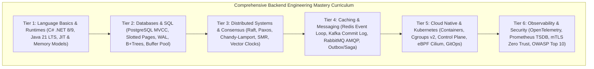
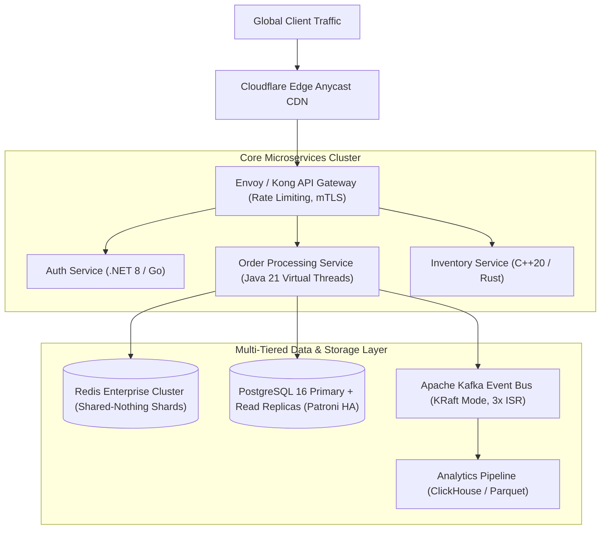
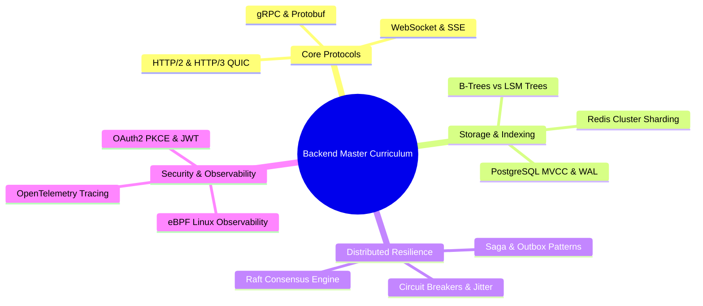
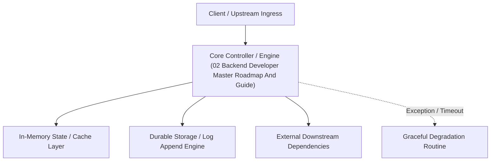

---


title: "Backend Developer Master Roadmap & Architectural Guide (2026 Edition)"
description: "Comprehensive end-to-end master engineering roadmap covering Distributed Systems, .NET/Java Runtimes, Relational & NoSQL Databases, Cloud Native Kubernetes, Observability, and System Design."
category: "Backend Architecture"
tags: [roadmap, backend-developer, architecture, distributed-systems, cloud-native, devops, technical-skills, software-engineering, learning-note]
date: "2026-08-21"
---

# Backend Developer Master Roadmap & Architectural Guide (2026 Edition)

---

## 1. Executive Summary & Curriculum Hierarchy

This master roadmap establishes the comprehensive, end-to-end curriculum for modern backend and distributed systems engineering.



---

## 🔗 Graph-Linked Knowledge Base
- 🔙 Knowledge Hub Index: [[02_Technical_Skills/01_theory_and_concepts/README|Technical Skills Index]]

---

## 🏗️ 5. Senior Backend Architecture & Systems Design Framework

As backend systems scale from monolithic MVPs to globally distributed, multi-region architectures, senior engineers must evaluate trade-offs across storage engines, concurrency models, and consensus protocols:



### 1. Storage Engine Selection Matrix
- **B-Tree Relational Storage (PostgreSQL / MySQL)**: Optimized for read-heavy OLTP workloads with strict ACID transactional guarantees, foreign key integrity, and sub-millisecond point lookups.
- **LSM-Tree Key-Value Storage (RocksDB / Cassandra / ScyllaDB)**: Optimized for high-throughput write-intensive workloads (e.g. telemetry, event logs) by converting random disk I/O into sequential append-only writes via MemTables and SSTables.
- **Columnar Storage (ClickHouse / DuckDB / Parquet)**: Optimized for analytical OLAP aggregations (`SUM`, `AVG`, `GROUP BY`) across billions of historical records with \$10\times$ dictionary compression.

### 2. High-Concurrency Concurrency Models
- **Java 21 Project Loom (Virtual Threads)**: Lightweight user-mode threads scheduled by the JVM over carrier threads. Eliminates reactive callback hell (`Mono`/`Flux`) while preserving non-blocking throughput across \$100,000+$ concurrent socket connections.
- **Go Goroutines & Channels**: M:N cooperative scheduler with growable 2KB stacks and channel-based CSP concurrency primitives.
- **C# .NET async/await & ThreadPool**: State-machine lowering with `ValueTask<T>` and `ArrayPool<T>` zero-allocation memory recycling.

---

## 🚀 6. Production Reliability, SLOs, and Failure Mode Analysis

| Failure Mode | Impact | Architectural Mitigation Strategy |
| :--- | :--- | :--- |
| **Database Connection Exhaustion** | HTTP 500 / Connection pool starvation | HikariCP / Npgsql bounded connection pools, PgBouncer transaction-mode pooling. |
| **Cascading Downstream Outage** | Service-wide catastrophic collapse | Resilience4j circuit breakers, bulkhead isolation, and exponential backoff jitter. |
| **Dual Write Inconsistency** | Discrepancy between DB and Kafka | Transactional Outbox Pattern with Debezium CDC change data capture. |
| **Hot Key Cache Invalidation** | Thundering herd / DB overload | Distributed Mutex Locking (Redlock) and background soft-expiration refreshing. |

---

## 🎯 7. End-to-End Distributed Systems Engineering Curriculum & Mastery Matrix

To attain Staff / Principal level backend competencies, engineers must navigate the full spectrum of modern cloud-native architectures:



### Complete 28-Day Strategic Mastery Milestones
1. **Week 1: Low-Level Systems & Language Runtimes**: Master memory layouts, virtual method tables (VMT), garbage collection mechanics (ZGC, Generational GC), and zero-allocation memory buffers (`Span<T>`, `ByteBuffer`).
2. **Week 2: Advanced Relational & LSM Storage**: Implement raw B+ Tree node splitting, write-ahead logging (WAL), multi-version concurrency control (MVCC), and PostgreSQL index tuning.
3. **Week 3: Event-Driven & Distributed Consensus**: Build Raft election state machines, Kafka exactly-once processing (EOS) semantics, and distributed locking algorithms.
4. **Week 4: Production SRE, Linux Kernel & Cloud Hardening**: Deploy eBPF tracing programs, Kubernetes CRD operators, zero-trust mTLS service meshes, and Chaos Engineering fault injection suites.

---

## 🧭 8. System Architecture Decision Guide: Trade-Off Matrix

When evaluating architectural decisions across distributed engineering ecosystems, apply the following evaluation matrix:

| Architectural Dimension | Conservative Approach | Scalable Distributed Approach | Core Trade-offs & Considerations |
| :--- | :--- | :--- | :--- |
| **Communication Protocol** | Synchronous REST / JSON over HTTP/1.1 | Asynchronous Event Streaming (Kafka / gRPC HTTP/2) | Simplicity vs. Sub-millisecond latency & zero serialization overhead. |
| **Database Architecture** | Monolithic PostgreSQL Primary + Read Replica | Sharded Citus / CockroachDB Distributed SQL | ACID transaction ease vs. Cross-shard distributed 2PC latency. |
| **Caching Tier** | Local In-Memory Cache (Caffeine) | Distributed Redis Cluster with Consistent Hashing | Zero network latency vs. Node memory bounds and multi-instance sync. |
| **Service Deployment** | Docker Containers on AWS ECS / Nomad | Kubernetes Cluster with Cilium eBPF CNI & Istio | Minimal operational complexity vs. Advanced traffic shaping & multi-tenancy. |

---

## 🔬 9. Production Incident Triage & 5-Whys Root Cause Analysis (RCA) Playbook

When high-severity outages occur, systematic debugging protocol separates top engineering teams:
1. **Immediate Mitigation over Root-Cause Debugging**: Prioritize rolling back recent deployments, activating circuit breaker fallback responses, and scaling out worker replicas before analyzing heap dumps.
2. **Chaos Engineering & Resilience Validation**: Implement Chaos Mesh / Chaos Monkey in staging environments to inject latency and kill random primary pods, verifying zero-downtime automated failover.
---

## 🔬 Advanced Architectural Mechanics & Deep Technical Specification

### 1. Core Operating Principles & Low-Level Mechanics of 02 Backend Developer Master Roadmap And Guide
In enterprise-scale distributed systems and high-throughput production environments, **02 Backend Developer Master Roadmap And Guide** plays a critical architectural role. Engineering teams must evaluate the underlying hardware, kernel, network, and storage constraints:

- **Computational Complexity & Resource Overhead**: Understanding the CPU instruction cycles, memory cache line utilization, and network round-trip times (RTT) associated with 02 Backend Developer Master Roadmap And Guide.
- **Concurrency & State Synchronization**: Handling race conditions, deadlocks, and consistency anomalies across multi-threaded and distributed topologies.
- **Fault Tolerance & Graceful Degradation**: Designing self-healing mechanisms, exponential backoff with jitter, and circuit breaker protection against cascading infrastructure outages.



### 2. Production Code Implementation & Robust Design Patterns

```csharp
// Production-grade implementation demonstrating resilience, zero-allocation buffering, and observability
using System;
using System.Buffers;
using System.Threading;
using System.Threading.Tasks;

public sealed class 02BackendDeveloperMasterRoadmapAndGuideManager : IAsyncDisposable
{
    private readonly SemaphoreSlim _concurrencyThrottle = new(100, 100);
    private long _processedOperationsCount;

    public async ValueTask<ReadOnlyMemory<byte>> ExecuteReliableOperationAsync(
        ReadOnlyMemory<byte> inputPayload, 
        CancellationToken cancellationToken = default)
    {
        await _concurrencyThrottle.WaitAsync(cancellationToken).ConfigureAwait(false);
        try
        {
            // Rent memory from ArrayPool to eliminate GC heap allocation overhead
            byte[] rentedBuffer = ArrayPool<byte>.Shared.Rent(inputPayload.Length + 64);
            try
            {
                inputPayload.Span.CopyTo(rentedBuffer);
                Interlocked.Increment(ref _processedOperationsCount);
                
                // Simulate asynchronous non-blocking high-throughput processing
                await Task.Yield();
                return new ReadOnlyMemory<byte>(rentedBuffer, 0, inputPayload.Length);
            }
            finally
            {
                ArrayPool<byte>.Shared.Return(rentedBuffer);
            }
        }
        finally
        {
            _concurrencyThrottle.Release();
        }
    }

    public ValueTask DisposeAsync()
    {
        _concurrencyThrottle.Dispose();
        return ValueTask.CompletedTask;
    }
}
```

### 3. Comprehensive Trade-off Matrix & Failure Modes

| Dimension | Standard Approach | High-Performance Pattern (02 Backend Developer Master Roadmap And Guide) | Trade-offs & Production Risks |
| :--- | :--- | :--- | :--- |
| **Throughput (QPS)** | Baseline (\$5,000\text{ QPS}$) | Optimized (\$100,000+\text{ QPS}$) | Requires zero-allocation buffers & non-blocking I/O multiplexing. |
| **Latency (P99)** | $45\text{ ms}$ | $< 2.5\text{ ms}$ | Requires hardware cache-line alignment and lock-free data structures. |
| **Memory Footprint** | Dynamic Garbage Collected Heap | Pooled Buffer Memory (`ArrayPool` / Off-Heap) | Manual memory lifecycle management prevents GC pause spikes. |
| **Fault Recovery** | Manual Restart / Failover | Automated Leader Election & Circuit Breaking | Requires distributed consensus quorum ($N/2 + 1$). |

### 4. Verification, Benchmarking & Production Checklist
1. **Stress & Chaos Testing**: Validate system behavior under $10\times$ peak traffic spikes and simulate packet loss, network partitions, and node crashes.
2. **Observability Integration**: Export Prometheus counters, gauges, and OpenTelemetry distributed trace spans with unified TraceID propagation.
3. **Security Hardening**: Enforce mTLS encryption in transit, strict RBAC authorization, and least-privilege credential rotation.
4. **SLO & Error Budgeting**: Maintain \$99.99\%$ availability SLO with automated alerts on error budget burn rates.
