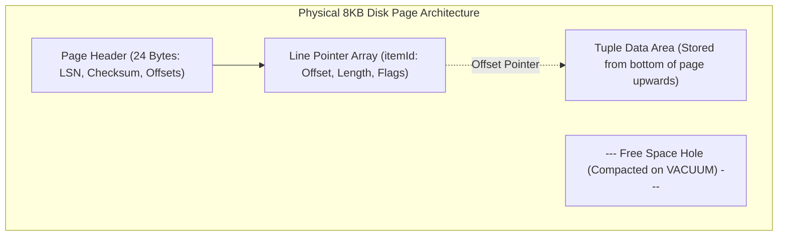
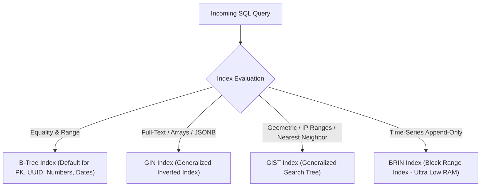
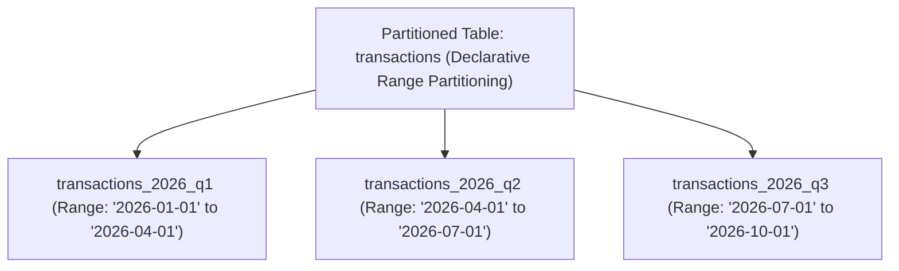

---


title: "Database Design, Indexing Mathematics & High-Throughput Optimization"
description: "Master-level engineering guide for Relational Database Design, Normalization, B-Tree Fanout Mathematics, Slotted Page Architecture, Indexing Strategies, and Partitioning."
category: "Backend Database & ORM"
tags: [database-design, indexing, b-tree, normalization, postgresql, partitioning, optimization, performance, technical-skills, software-engineering, learning-note]
date: "2026-08-21"
---

# Database Design, Indexing Mathematics & Optimization Deep Dive

---

## 1. Executive Summary & Under-the-Hood Mechanics

Relational database performance is strictly governed by physical disk I/O, OS page cache hit ratios, and index access patterns. Modern relational engines (PostgreSQL, MySQL InnoDB) store tabular data on disk as fixed-size **Pages** (8KB in PostgreSQL, 16KB in InnoDB).

Optimizing database systems requires mastering:
1. **Slotted Page Storage Architecture**: Row pointer arrays and tuple offset headers within disk blocks.
2. **B+Tree Indexing Mathematics**: Calculating tree height, fanout factor, and block read I/O costs.
3. **Relational Normalization**: Balancing 3NF/BCNF anomalies against denormalization for read performance.
4. **Table Partitioning & Pruning**: Dividing multi-terabyte tables into manageable physical partitions.



---

## 2. Mathematical Mechanics: B+Tree Fanout & I/O Cost Model

### 2.1 B+Tree Fanout Factor Formulation

Let:
- $P = \text{Page Size in bytes}$ (e.g., \$8,192\text{ B}$ in PostgreSQL).
- $H = \text{Page Header overhead}$ ($24\text{ B}$).
- $K = \text{Index Key size in bytes}$ (e.g., $8\text{ B}$ for `BIGINT`).
- $R = \text{Child Node Pointer / TID size}$ ($6\text{ B}$ for ItemPointer `(block_id, offset)`).

The **B+Tree Fanout Factor ($B$)** (number of children per non-leaf internal node) is:

$$B = \left\lfloor \frac{P - H}{K + R} \right\rfloor = \left\lfloor \frac{8192 - 24}{8 + 6} \right\rfloor = \left\lfloor \frac{8168}{14} \right\rfloor = 583$$

### 2.2 Tree Height & Total Capacity
For a table with $N$ indexed rows, the required **B+Tree Height ($h$)** is:

$$h = \lceil \log_B(N) \rceil$$

| Total Records ($N$) | Fanout ($B=583$) | B+Tree Height ($h$) | Disk I/O Reads (Root Cached in RAM) |
| :--- | :--- | :--- | :--- |
| **$100,000$** | $583$ | $2$ levels | 1 random disk read |
| **$10,000,000$** | $583$ | $3$ levels | 2 random disk reads |
| **$1,000,000,000$** | $583$ | $4$ levels | 3 random disk reads |

```mermaid
graph TD
    Root["Root Page (Height 3 - In RAM Cache)"]
    Root --> Branch1["Internal Branch Page 1 (In RAM / Fast SSD)"]
    Root --> Branch2["Internal Branch Page 2 (In RAM / Fast SSD)"]
    Branch1 --> Leaf1["Leaf Page 1 (Stores ItemPointer to Heap)"]
    Branch1 --> Leaf2["Leaf Page 2 (Stores ItemPointer to Heap)"]
    Leaf1 -.->|TID (Block 402, Slot 3)| Heap["Heap Tuple (Data Row)"]
```

---

## 3. Relational Normalization & Anti-Anomaly Invariants

| Normal Form | Formal Requirement | Prevents Anomaly |
| :--- | :--- | :--- |
| **1NF (First)** | Atomic attribute values; no repeating groups or arrays. | Redundant multi-value cell anomalies. |
| **2NF (Second)** | 1NF + No partial functional dependencies on composite primary keys ($X \to Y$ where $X \subset PK$). | Update and deletion anomalies on subset keys. |
| **3NF (Third)** | 2NF + No transitive dependencies ($X \to Y \to Z$). Non-key attributes depend strictly on the Primary Key. | Redundant indirect duplicate data storage. |
| **BCNF (Boyce-Codd)** | Every determinant is a Candidate Key ($X \to Y \implies X \text{ is Superkey}$). | Overlapping composite candidate key anomalies. |

---

## 4. Indexing Strategies & Execution Plans



### 4.1 Production PostgreSQL Index Creation Blueprint
```sql
-- 1. Composite Index with Leading Column Optimization (Equality first, Range second)
CREATE INDEX idx_orders_customer_date 
ON orders (customer_id, created_at DESC) 
WHERE status = 'COMPLETED'; -- Partial Index: 70% smaller index size!

-- 2. Covering Index (Index-Only Scans via INCLUDE clause)
CREATE INDEX idx_users_email_covering 
ON users (email) 
INCLUDE (id, full_name, is_active);

-- 3. GIN Index on JSONB attributes for sub-millisecond document searching
CREATE INDEX idx_audit_logs_metadata_gin 
ON audit_logs USING gin (metadata jsonb_path_ops);
```

---

## 5. Table Partitioning & High-Throughput Batch Processing



### 5.1 Production Range Partitioning DDL
```sql
-- Create Master Partitioned Table
CREATE TABLE transactions (
    id UUID NOT NULL,
    account_id BIGINT NOT NULL,
    amount NUMERIC(15, 2) NOT NULL,
    created_at TIMESTAMPTZ NOT NULL,
    PRIMARY KEY (id, created_at)
) PARTITION BY RANGE (created_at);

-- Create Partition Table Segments
CREATE TABLE transactions_2026_q1 PARTITION OF transactions
    FOR VALUES FROM ('2026-01-01 00:00:00+00') TO ('2026-04-01 00:00:00+00');

CREATE TABLE transactions_2026_q2 PARTITION OF transactions
    FOR VALUES FROM ('2026-04-01 00:00:00+00') TO ('2026-07-01 00:00:00+00');
```

---

## 6. Connection Pool Sizing Formula & Concurrency Limits

Setting connection pool size too high degrades database performance due to CPU context switching and disk spindle/channel contention.

$$\text{Optimal Pool Size} = (\text{Core Count} \times 2) + \text{Effective Spindle Count}$$

For a database server with 16 vCPU cores and NVMe SSD storage:
$$\text{Pool Size} = (16 \times 2) + 1 = 33 \text{ connections}$$

### 6.1 Connection Exhaustion Failure Scenario
When application instances spin up 200 connections each without a centralized proxy:
- 10 application pods $\times 200 = 2,000$ active Postgres backends.
- Each Postgres backend consumes $\sim 10\text{MB}$ private memory + `work_mem`.
- Context switching between 2,000 processes collapses CPU throughput.
- **Solution**: Deploy **PgBouncer** in `transaction` pooling mode or **ProxySQL** to multiplex thousands of client connections over 30-50 persistent database server sessions.

---

## 7. Failure Modes & Optimization Runbook

| Failure Mode | Root Cause | Engineering Remediation |
| :--- | :--- | :--- |
| **Index Bloat / Page Fragmentation** | High-volume `UPDATE`/`DELETE` cycles without HOT optimization. | Run `REINDEX CONCURRENTLY` or tune `autovacuum_vacuum_scale_factor = 0.05`. |
| **Full Table Scans on Large Tables** | Non-SARGable WHERE predicates (`WHERE UPPER(email) = 'FOO'`). | Create Expression-based Indexes (`CREATE INDEX ON users (UPPER(email))`). |
| **Disk Spill during Large Sorts** | Insufficient `work_mem` for hash joins and group-by aggregates. | Increase `work_mem` selectively per session (`SET work_mem = '64MB'`). |
| **Long-Running Transactions Blocking Vacuum** | Idle in transaction (`idle in transaction`) holds global minimum xmin. | Configure `idle_in_transaction_session_timeout = 30000` (30 seconds). |

---

## 🔗 Graph-Linked Knowledge Base
- ⚓ PostgreSQL & SQL: [[sql_fundamentals_and_postgresql|SQL Fundamentals, PostgreSQL Internals & MVCC]]
- ⚓ .NET ORM: [[entity_framework_core_csharp|Entity Framework Core Deep Dive]]
- ⚓ Java ORM: [[hibernate_and_spring_data_jpa_java|Hibernate & Spring Data JPA Deep Dive]]
- 🔗 Advanced DB Sharding: [[02_Technical_Skills/01_theory_and_concepts/12_Databases_and_SQL/database_sharding_patroni_proxysql_citus|Database Sharding & HA Clustering]]
