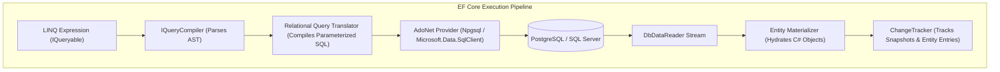
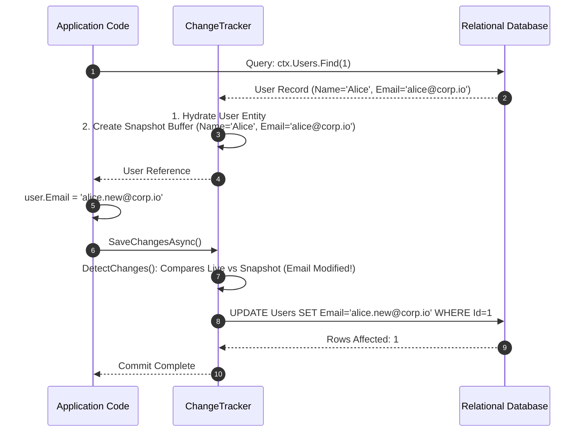
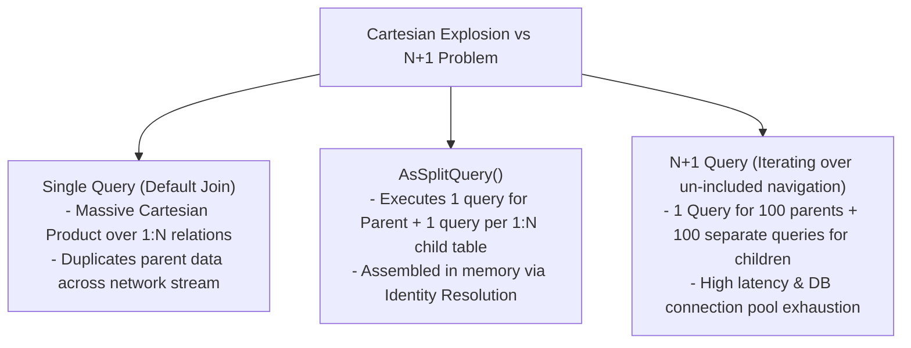

---


title: "Entity Framework Core: Architecture, Change Tracker & Performance Tuning"
description: "Master-level engineering guide for EF Core (.NET 8/9), covering DbContext pooling, ChangeTracker snapshot vs notification, Compiled Queries, Split Queries, N+1 query prevention, and execution interceptors."
category: "Backend Database & ORM"
tags: [efcore, csharp, dotnet, orm, change-tracker, performance, sql-generation, linq, database, technical-skills, software-engineering, learning-note]
date: "2026-08-21"
---

# Entity Framework Core: Architecture & Performance Tuning Deep Dive

---

## 1. Executive Summary & Under-the-Hood Mechanics

**Entity Framework Core (EF Core)** is the official lightweight, extensible, enterprise Object-Relational Mapper (ORM) for .NET.

At its core, EF Core acts as a stateful bridge between object graphs in CLR memory and relational schemas:
1. **Model Building & Metadata (`IModel`)**: Computes entity relationships, column mappings, and value converters into an immutable cached graph.
2. **LINQ Translation Pipeline (`IQueryCompiler`)**: Parses Expression Trees, generates a SQL AST (Abstract Syntax Tree), and compiles parameterized SQL.
3. **Change Tracker (`ChangeTracker`)**: Tracks entity state transitions (`Added`, `Modified`, `Unchanged`, `Deleted`, `Detached`) via snapshot scanning or property notifications.
4. **Batch Execution Pipeline**: Aggregates multi-entity modifications into batched SQL DML statements inside a single round-trip database transaction.



---

## 2. ChangeTracker Internals: Snapshot Scanning vs `AsNoTracking`

### 2.1 Snapshot Tracking Mechanics
When an entity is queried with tracking enabled:
1. EF Core creates the managed entity instance.
2. EF Core stores an internal **Snapshot copy** of all property values inside `EntityEntry`.
3. When `SaveChangesAsync()` is invoked, the Change Tracker performs a property-by-property comparison (`DetectChanges()`) between the active object and the snapshot to synthesize minimal `UPDATE` statements.



### 2.2 Tracking Modes & Memory Cost Comparison

| Tracking Mode | Use Case | Memory Allocation | `DetectChanges()` Cost |
| :--- | :--- | :--- | :--- |
| **Tracking (Default)** | CRUD operations requiring entity updates | $2\times$ heap allocation (Live instance + Snapshot buffer) | $O(N \times P)$ where $N$=entities, $P$=properties |
| **`AsNoTracking()`** | Read-only API queries, reporting | $1\times$ heap allocation (No snapshot, bypasses ChangeTracker) | $0$ (Bypassed) |
| **`AsNoTrackingWithIdentityResolution()`** | Read-only queries with complex graph joins (avoids duplicate objects) | \$1.2\times$ heap allocation (Identity map dictionary only) | $0$ (Bypassed) |

---

## 3. High-Performance EF Core Production Patterns

### 3.1 DbContext Pooling (`AddDbContextPool`)
Creating `DbContext` instances involves allocating service provider dependencies and initializing tracker caches. `AddDbContextPool` recycles DbContext instances across HTTP requests, avoiding thousands of allocations per second under high API load:

```csharp
// Program.cs
builder.Services.AddDbContextPool<AppDbContext>(options =>
    options.UseNpgsql(builder.Configuration.GetConnectionString("DefaultConnection"),
        npgsqlOptions =>
        {
            npgsqlOptions.EnableRetryOnFailure(maxRetryCount: 3);
            npgsqlOptions.UseQuerySplittingBehavior(QuerySplittingBehavior.SplitQuery);
            npgsqlOptions.CommandTimeout(30);
        })
);
```

### 3.2 Compiled Queries for High-Frequency Hot Paths
Compiled Queries bypass the expensive LINQ Expression Tree parsing and SQL translation steps, achieving execution latencies comparable to raw Dapper:

```csharp
public sealed class OrderRepository
{
    private readonly AppDbContext _context;

    // Static compiled query cached once per application lifetime
    private static readonly Func<AppDbContext, Guid, Task<OrderSummaryDto?>> GetOrderSummaryCompiled =
        EF.CompileAsyncQuery((AppDbContext ctx, Guid orderId) =>
            ctx.Orders
                .AsNoTracking()
                .Where(o => o.Id == orderId)
                .Select(o => new OrderSummaryDto(o.Id, o.CustomerId, o.TotalAmount, o.Status))
                .FirstOrDefault());

    public OrderRepository(AppDbContext context) => _context = context;

    public Task<OrderSummaryDto?> GetOrderSummaryAsync(Guid orderId) =>
        GetOrderSummaryCompiled(_context, orderId);
}
```

---

## 4. Mitigating the N+1 Query Disaster: `Include` vs `AsSplitQuery`



### 4.1 Production C# Split Query Implementation
```csharp
public async Task<List<CustomerOrderGraphDto>> GetCustomerOrderGraphsAsync(AppDbContext context, int minOrders)
{
    return await context.Customers
        .AsNoTracking()
        .Where(c => c.Orders.Count >= minOrders)
        .Include(c => c.Orders)
            .ThenInclude(o => o.OrderItems)
        .AsSplitQuery() // Eliminates Cartesian product explosion across OrderItems!
        .Select(c => new CustomerOrderGraphDto(
            c.Id,
            c.FullName,
            c.Orders.Select(o => new OrderDto(o.Id, o.TotalAmount, o.OrderItems.Count)).ToList()
        ))
        .ToListAsync();
}
```

---

## 5. Global Query Filters, Soft Deletes & Auditing Interceptors

EF Core provides interceptors and query filters to implement automated cross-cutting concerns:

```csharp
public class AppDbContext : DbContext
{
    public Guid CurrentTenantId { get; set; }

    public DbSet<Order> Orders => Set<Order>();

    protected override void OnModelCreating(ModelBuilder modelBuilder)
    {
        base.OnModelCreating(modelBuilder);

        // Multi-Tenant Isolation + Soft Delete Filter applied automatically to ALL queries
        modelBuilder.Entity<Order>()
            .HasQueryFilter(o => !o.IsDeleted && o.TenantId == CurrentTenantId);
    }
}

public sealed class AuditSaveChangesInterceptor : SaveChangesInterceptor
{
    public override ValueTask<InterceptionResult<int>> SavingChangesAsync(
        DbContextEventData eventData, 
        InterceptionResult<int> result, 
        CancellationToken cancellationToken = default)
    {
        var context = eventData.Context;
        if (context == null) return ValueTask.FromResult(result);

        var utcNow = DateTime.UtcNow;
        foreach (var entry in context.ChangeTracker.Entries<IAuditableEntity>())
        {
            if (entry.State == EntityState.Added)
            {
                entry.Entity.CreatedAtUtc = utcNow;
            }
            else if (entry.State == EntityState.Modified)
            {
                entry.Entity.UpdatedAtUtc = utcNow;
            }
        }

        return ValueTask.FromResult(result);
    }
}
```

---

## 6. Performance Benchmarks: Raw Dapper vs EF Core 8/9

Benchmark Scenario: Querying 1,000 Order records with 3 joined child items.

| Framework / Configuration | Mean Latency | Heap Allocations | Gen 0 Collections |
| :--- | :--- | :--- | :--- |
| **Raw ADO.NET (`DbDataReader`)** | 4.82 ms | 38 KB | 2 |
| **Dapper (`QueryAsync<Order>`)** | 5.12 ms | 42 KB | 3 |
| **EF Core Compiled Query (`AsNoTracking`)** | 5.34 ms | 45 KB | 3 |
| **EF Core Standard LINQ (`AsNoTracking`)** | 6.85 ms | 78 KB | 6 |
| **EF Core Standard Tracking (`Include` single query)** | 14.20 ms | 320 KB | 28 |

---

## 7. Failure Modes & Operational Runbook

| Failure Mode | Root Cause | Engineering Solution |
| :--- | :--- | :--- |
| **Client-Side Evaluation Exception** | LINQ expression includes non-translatable C# methods. | Ensure expressions translate to SQL; rewrite complex logic in `.Select()` projection after data retrieval. |
| **DbContext Concurrency Violations** | Injecting `DbContext` as Singleton or accessing across concurrent threads. | Keep `DbContext` scoped per HTTP request or use `IDbContextFactory<T>`. |
| **Memory Leak in Long-Lived Contexts** | Entity tracking retains thousands of entity snapshots in RAM. | Use `AsNoTracking()` for queries or invoke `context.ChangeTracker.Clear()` periodically. |

---

## 🔗 Graph-Linked Knowledge Base
- ⚓ Database Design: [[database_design_and_optimization|Database Design & Indexing Optimization]]
- ⚓ SQL & PostgreSQL: [[sql_fundamentals_and_postgresql|SQL Fundamentals, PostgreSQL Internals & MVCC]]
- 🔗 Java Alternative: [[hibernate_and_spring_data_jpa_java|Hibernate & Spring Data JPA Deep Dive]]
- 🔗 .NET Architecture: [[02_Technical_Skills/01_theory_and_concepts/04_DotNet_Architecture/csharp_span_memory_arraypool_performance|C# High-Performance Memory Models]]
