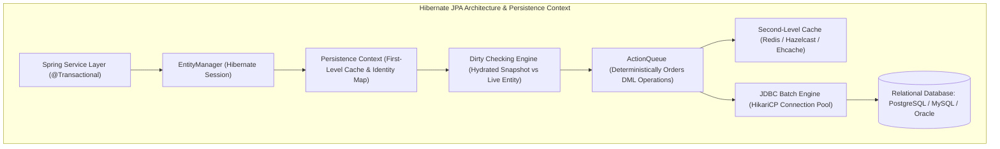
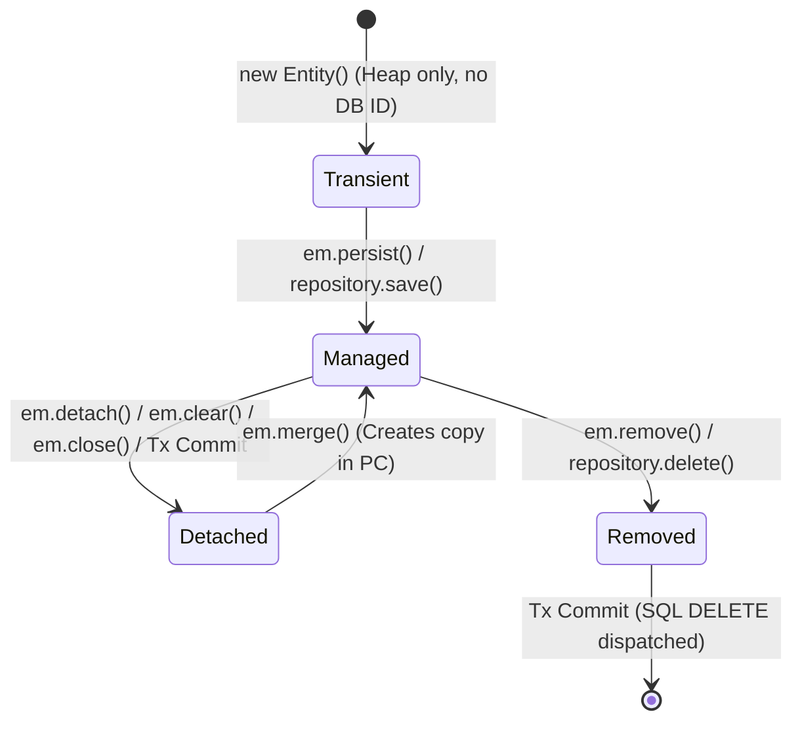
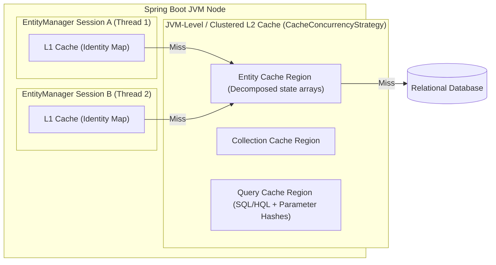
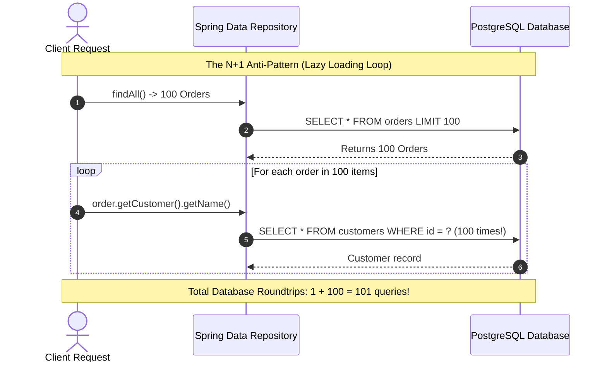
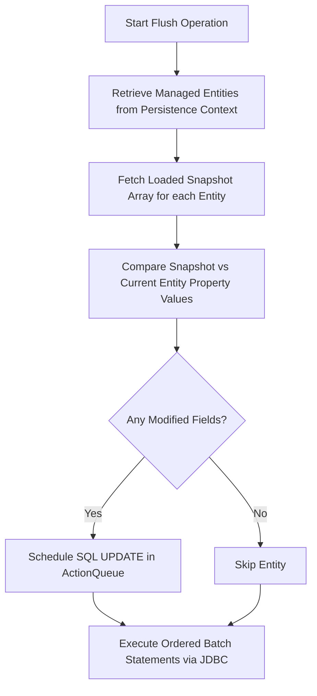
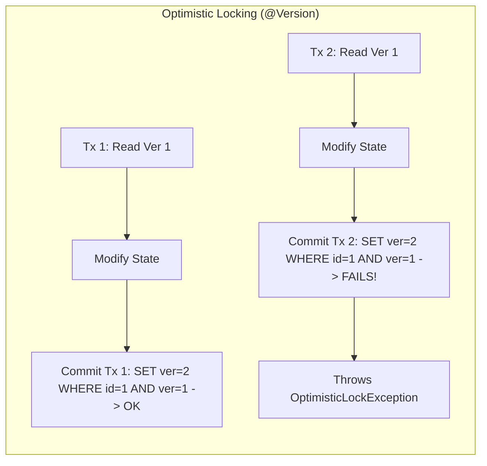

---


title: "Hibernate ORM & Spring Data JPA: Persistence Context, Caching & Performance"
description: "Master-level engineering guide for Hibernate ORM and Spring Data JPA, covering EntityManager, Persistence Context lifecycle, First/Second-Level Caches, N+1 query mitigation, Dirty Checking, Concurrency Locking, and DTO Projections."
category: "Backend Database & ORM"
tags: [hibernate, jpa, spring-data-jpa, java, persistence-context, caching, performance, dirty-checking, database, concurrency, locking, technical-skills, software-engineering, learning-note]
date: "2026-08-21"
---

# Hibernate ORM & Spring Data JPA: Architecture & Performance Deep Dive

---

## 1. Executive Summary & Under-the-Hood Mechanics

**Hibernate ORM** is the enterprise standard implementation of the Jakarta Persistence API (JPA) in Java, powering the persistence layer of enterprise Spring Boot applications. While Spring Data JPA provides declarative abstraction via repositories, understanding Hibernate's core internal mechanics is essential for preventing catastrophic latency spikes, memory bloat, and database deadlocks.



### 1.1 Core Engine Components

1. **SessionFactory / EntityManagerFactory**:
   - An immutable, thread-safe, heavy singleton initialized at application startup.
   - Parses entity mapping annotations/XML, builds metamodels, compiles HQL/JPQL abstract syntax trees (AST), and manages the optional Second-Level (L2) cache and Connection Pool.
2. **Session / EntityManager**:
   - A single-threaded, lightweight, non-thread-safe stateful unit of work.
   - Represents a logical transaction boundary bound to the thread via `ThreadLocal` or transaction synchronization manager.
3. **Persistence Context (`L1 Cache` & Identity Map)**:
   - Maintains a unique object reference for each database primary key within a single session.
   - Prevents duplicate entity instances and ensures identity equality (`entity1 == entity2`).
4. **ActionQueue & Deterministic Flushing**:
   - Queues and re-orders pending DML statements upon flush to minimize lock contention and prevent database deadlocks:
     $$\text{Inserts} \longrightarrow \text{Updates} \longrightarrow \text{CollectionRemovals} \longrightarrow \text{CollectionUpdates} \longrightarrow \text{CollectionInserts} \longrightarrow \text{Deletes}$$

---

## 2. Entity Lifecycle & State Transitions

An entity instance exists in one of four strictly defined states within the Persistence Context lifecycle:



### 2.1 State Matrix & Operational Invariants

| Entity State | Present in Persistence Context? | Has Database Identifier? | Tracked by Dirty Checking? | Permitted Operations |
| :--- | :--- | :--- | :--- | :--- |
| **Transient** | No | No (usually null) | No | `persist()`, `save()` |
| **Managed** | **Yes** | **Yes** | **Yes** | `find()`, `remove()`, `refresh()`, Setter modifications |
| **Detached** | No | Yes | No | `merge()`, `delete()` (after re-attaching) |
| **Removed** | Yes (Scheduled for deletion) | Yes | Yes | `persist()` (undoes removal) |

> [!IMPORTANT]
> `em.merge(detachedEntity)` does **not** make `detachedEntity` managed. Instead, it queries the database (or loads from L1 cache) to fetch a managed instance, copies state from `detachedEntity` onto that managed instance, and returns the managed reference. Continuing to modify `detachedEntity` after calling `merge()` will have no effect on the database.

---

## 3. First-Level vs Second-Level Cache Architecture



### 3.1 First-Level Cache (L1) Mechanics
- **Scope**: Strictly bound to the active `EntityManager` / Transaction.
- **Overhead**: Always active; cannot be disabled. Stores entity references as well as **Hydrated Snapshots** (original field values used for dirty check diffing).
- **Clearing**: To avoid OutOfMemory (OOM) errors during bulk processing, invoke `em.flush()` followed by `em.clear()` or use stateless sessions (`StatelessSession`).

### 3.2 Second-Level Cache (L2) & Concurrency Strategies
The L2 cache is process-wide or distributed (e.g., Redis, Hazelcast, Ehcache 3). It stores decomposed entity field state (disassembled property arrays), not actual Java object graphs.

```java
@Entity
@Table(name = "product_catalogs")
@Cacheable
@org.hibernate.annotations.Cache(
    usage = org.hibernate.annotations.CacheConcurrencyStrategy.READ_WRITE,
    region = "productCatalogRegion"
)
public class ProductCatalog {
    @Id
    @GeneratedValue(strategy = GenerationType.SEQUENCE, generator = "prod_seq")
    @SequenceGenerator(name = "prod_seq", sequenceName = "seq_product_catalog", allocationSize = 50)
    private Long id;

    @Column(nullable = false)
    private String sku;

    @Column(nullable = false)
    private BigDecimal basePrice;
    
    @Version
    private Long version;
}
```

#### Cache Concurrency Strategies:
- `READ_ONLY`: Immutable data. No locking overhead.
- `NONSTRICT_READ_WRITE`: Weak consistency, eventual sync. Suitable for data updated infrequently where stale reads are tolerated.
- `READ_WRITE`: Strict read-committed isolation using soft locks during transaction commit.
- `TRANSACTIONAL`: JTA-backed distributed transactions (X/Open XA).

---

## 4. Mitigating the N+1 Query Problem

The **N+1 Problem** occurs when an application executes 1 query to fetch $N$ parent records, followed by $N$ separate queries to fetch associated child entities when lazy loading triggers.



### 4.1 Production Solutions: `@EntityGraph`, `JOIN FETCH`, and DTO Projections

```java
package com.enterprise.ecommerce.repository;

import com.enterprise.ecommerce.dto.OrderSummaryProjection;
import com.enterprise.ecommerce.entity.CustomerOrder;
import org.springframework.data.jpa.repository.EntityGraph;
import org.springframework.data.jpa.repository.JpaRepository;
import org.springframework.data.jpa.repository.Query;
import org.springframework.data.repository.query.Param;
import org.springframework.stereotype.Repository;

import java.util.List;
import java.util.Optional;
import java.util.UUID;

@Repository
public interface OrderRepository extends JpaRepository<CustomerOrder, UUID> {

    // Solution 1: Dynamic @EntityGraph (Eagerly loads Customer and OrderLines in a single LEFT JOIN)
    @EntityGraph(attributePaths = {"customer", "orderLines", "orderLines.product"})
    Optional<CustomerOrder> findWithDetailsById(UUID id);

    // Solution 2: Explicit JPQL JOIN FETCH with distinct keyword to eliminate Cartesian product duplicates
    @Query("SELECT DISTINCT o FROM CustomerOrder o " +
           "JOIN FETCH o.customer c " +
           "JOIN FETCH o.orderLines ol " +
           "WHERE o.status = :status")
    List<CustomerOrder> findAllByStatusWithItems(@Param("status") String status);

    // Solution 3: High-Performance Read-Only DTO Constructor Projection (Zero Entity Overhead)
    @Query("SELECT new com.enterprise.ecommerce.dto.OrderSummaryDTO(" +
           "o.id, o.orderNumber, c.email, o.totalAmount, o.createdAt) " +
           "FROM CustomerOrder o JOIN o.customer c " +
           "WHERE o.status = :status")
    List<OrderSummaryDTO> findSummariesByStatus(@Param("status") String status);

    // Solution 4: Spring Data Interface-based Closed Projection
    List<OrderSummaryProjection> findByCustomerId(UUID customerId);
}
```

---

## 5. JDBC Batching & Identifier Generation Strategies

Without proper configuration, Hibernate executes individual JDBC round-trips for every `INSERT` or `UPDATE` operation.

### 5.1 Production `application.yml` Batch Configuration

```yaml
spring:
  jpa:
    properties:
      hibernate:
        jdbc:
          batch_size: 50
          order_inserts: true
          order_updates: true
          batch_versioned_data: true
        order_by:
          default_null_ordering: last
        criteria:
          literal_handling_mode: inline
    open-in-view: false # CRITICAL: Prevent connection leakage to HTTP view layer
```

### 5.2 Identifier Pitfall: `IDENTITY` vs `SEQUENCE` / `TSID`

> [!WARNING]
> If entity IDs use `GenerationType.IDENTITY` (e.g. MySQL `AUTO_INCREMENT` or PostgreSQL `SERIAL`), Hibernate **silently disables JDBC batching** because it must immediately execute each `INSERT` statement to obtain the generated database ID.

```java
// Anti-Pattern (Disables batching):
// @GeneratedValue(strategy = GenerationType.IDENTITY)

// Production Pattern: Optimized Sequence Allocation
@Id
@GeneratedValue(strategy = GenerationType.SEQUENCE, generator = "order_seq_gen")
@SequenceGenerator(
    name = "order_seq_gen",
    sequenceName = "seq_customer_orders",
    allocationSize = 50 // Hibernate allocates 50 IDs per DB sequence call
)
private Long id;
```

---

## 6. Dirty Checking Internals & Read-Only Optimization

During a transaction commit or prior to executing a JPQL query that targets modified tables, Hibernate invokes `Flush`:



### 6.1 Read-Only Query Tuning
Marking transactions as read-only dramatically improves throughput and cuts heap allocations in half:

```java
@Service
@Transactional(readOnly = true)
public class ProductQueryService {

    private final ProductRepository productRepository;

    public ProductQueryService(ProductRepository productRepository) {
        this.productRepository = productRepository;
    }

    public List<ProductDTO> searchProducts(String category) {
        // Sets FlushMode.MANUAL in Hibernate Session.
        // Disables Hydrated Snapshot memory storage and dirty-checking scan.
        return productRepository.findByCategory(category);
    }
}
```

---

## 7. Concurrency Control: Optimistic vs. Pessimistic Locking



### 7.1 Optimistic Locking with Spring Retry
```java
@Entity
public class Account {
    @Id
    private UUID id;
    private BigDecimal balance;
    
    @Version
    private Long version;
}

@Service
public class PaymentService {

    @Retryable(
        retryFor = { ObjectOptimisticLockingFailureException.class },
        maxAttempts = 3,
        backoff = @Backoff(delay = 100, multiplier = 2)
    )
    @Transactional
    public void debitAccount(UUID accountId, BigDecimal amount) {
        Account account = accountRepository.findById(accountId)
            .orElseThrow(() -> new EntityNotFoundException("Account not found"));
        account.setBalance(account.getBalance().subtract(amount));
        accountRepository.save(account);
    }
}
```

### 7.2 Pessimistic Locking for High-Contention Queues
```java
@Repository
public interface TaskQueueRepository extends JpaRepository<TaskQueue, UUID> {

    @Lock(LockModeType.PESSIMISTIC_WRITE)
    @QueryHints({@QueryHint(name = "jakarta.persistence.lock.timeout", value = "5000")})
    @Query("SELECT t FROM TaskQueue t WHERE t.status = 'PENDING' ORDER BY t.priority DESC")
    List<TaskQueue> fetchNextBatchForExecution(Pageable pageable);
}
```

---

## 8. Failure Modes, Troubleshooting & Operational Matrix

| Failure Scenario | Root Cause | Production Remediation |
| :--- | :--- | :--- |
| **`LazyInitializationException`** | Attempting to access an uninitialized lazy proxy after `EntityManager` has closed (e.g. in the presentation or serialization layer). | Disable `OpenSessionInViewFilter` (`open-in-view: false`). Use `@EntityGraph`, `JOIN FETCH`, or DTO projections in the service layer. |
| **`MultipleBagFetchException`** | Attempting to fetch two or more `List<T>` (bags) simultaneously using `JOIN FETCH`, resulting in a Cartesian product. | Change collections from `List<T>` to `java.util.Set<T>`, or split the fetch into two separate sequential queries within the same transaction. |
| **Silent Batching Failure** | Using `GenerationType.IDENTITY` or mixing inheritance strategies without table-per-class. | Migrate to `GenerationType.SEQUENCE` with `allocationSize = 50` or client-side `TSID`/`UUIDv7`. |
| **Memory Exhaustion (OOM) on Large Queries** | Loading thousands of managed entities into the `Persistence Context` causes massive snapshot arrays. | Use `StatelessSession`, Stream with pagination, or project directly into DTOs (`SELECT new MyDto(...)`). |
| **Transaction Rollback on Checked Exception** | `@Transactional` defaults to rolling back only on `RuntimeException` and `Error`. | Explicitly configure `@Transactional(rollbackFor = Exception.class)`. |

---

## 9. Best Practices Checklist

1. [x] **Always disable OSIV (`spring.jpa.open-in-view=false`)** to prevent lazy loading queries from saturating connection pools during HTTP response serialization.
2. [x] **Enforce `@Transactional(readOnly = true)`** on all query services to bypass snapshot generation and dirty-checking scans.
3. [x] **Default to `FetchType.LAZY`** on all `@OneToOne`, `@ManyToOne`, `@OneToMany`, and `@ManyToMany` associations. Never use `FetchType.EAGER`.
4. [x] **Use DTO Projections** for read-intensive dashboards and API endpoints to eliminate entity lifecycle overhead.
5. [x] **Configure explicit JDBC Batching** (`batch_size: 50`, `order_inserts: true`, `order_updates: true`) in conjunction with sequence-based or client-generated ID strategies.

---

## 🔗 Graph-Linked Knowledge Base
- ⚓ Database Design: [[database_design_and_optimization|Database Design & Indexing Optimization]]
- ⚓ SQL & PostgreSQL: [[sql_fundamentals_and_postgresql|SQL Fundamentals, PostgreSQL Internals & MVCC]]
- 🔗 C# Alternative: [[entity_framework_core_csharp|Entity Framework Core Deep Dive]]
- 🔗 Java Core: [[02_Technical_Skills/01_theory_and_concepts/06_Java_Engineering/hibernate_orm_spring_data_jpa_performance|Hibernate ORM & Spring Data JPA Performance Tuning]]
