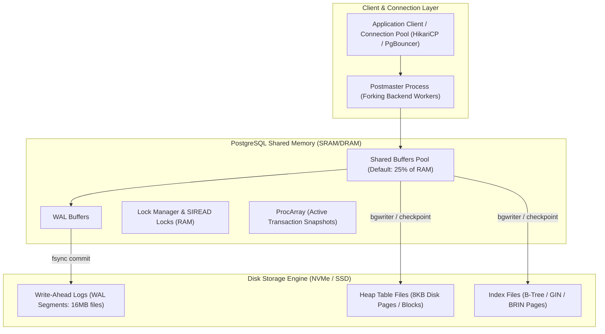
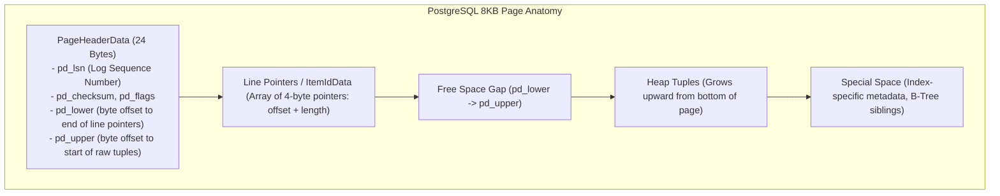
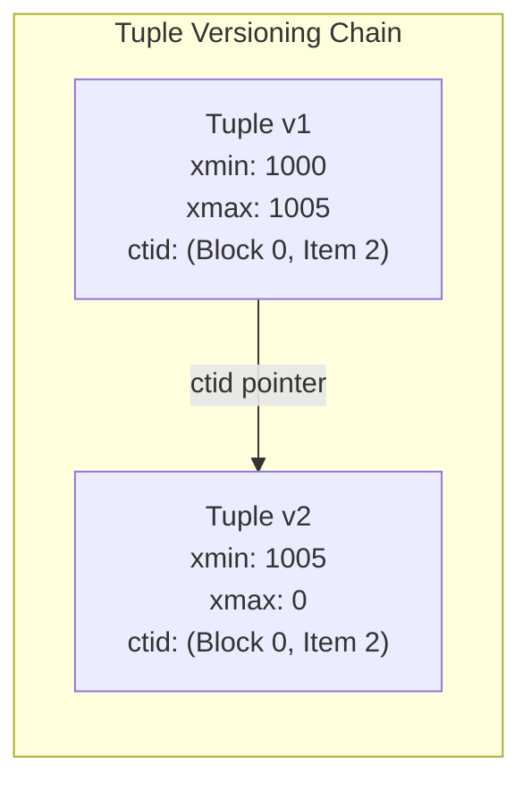
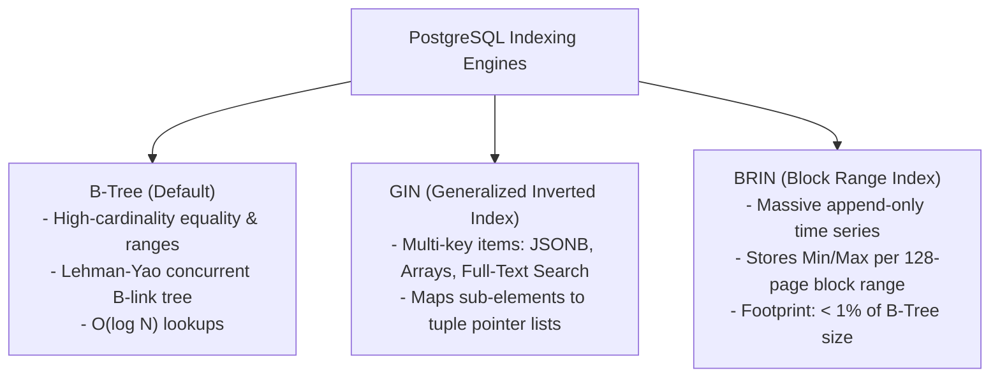

---


title: "SQL Fundamentals, PostgreSQL Internals & MVCC Architecture"
description: "Master-level engineering guide for SQL query mastery, PostgreSQL Multi-Version Concurrency Control (MVCC), Tuple Headers, Page Layout, WAL Checkpointing, Indexing Internals (B-Tree, GIN, BRIN), VACUUM tuning, and EXPLAIN ANALYZE."
category: "Backend Database & ORM"
tags: [sql, postgresql, mvcc, vacuum, wal, indexing, transaction-isolation, explain-analyze, window-functions, performance, technical-skills, software-engineering, learning-note]
date: "2026-08-21"
---

# SQL Fundamentals, PostgreSQL Internals & MVCC Architecture

---

## 1. Executive Summary & Under-the-Hood Mechanics

**PostgreSQL** is an enterprise-grade, open-source object-relational database management system (ORDBMS). At its core, PostgreSQL delivers high-throughput concurrent transaction processing while maintaining strict ACID guarantees via **Multi-Version Concurrency Control (MVCC)**, Write-Ahead Logging (WAL), and a buffer pool manager.



### Core Architectural Invariants
1. **Readers Never Block Writers, Writers Never Block Readers**: A reading query never takes locks that prevent modifications by concurrent transactions, and modifying transactions never block concurrent readers.
2. **Out-of-Place Updates**: An `UPDATE` does not overwrite the disk bytes in place; it inserts a **brand-new tuple version** on the page heap and marks the predecessor tuple as expired via its header metadata.
3. **WAL (Write-Ahead Logging) & Durability**: Any modification to a data page in `shared_buffers` must be recorded in the WAL buffers and flushed to disk (`fsync`) before the corresponding page can be flushed to the table heap on disk.

---

## 2. PostgreSQL 8KB Page Layout & Heap Tuple Header

PostgreSQL organizes table data and indexes into fixed **8KB Pages** (blocks):



### 2.1 Heap Tuple Header Layout (23 Bytes)

Each raw row tuple contains a compact 23-byte header preceding user column data:

| Field Name | Size | Functionality |
| :--- | :--- | :--- |
| `t_xmin` | 4 Bytes (32-bit TxID) | Transaction ID of the inserting transaction. |
| `t_xmax` | 4 Bytes (32-bit TxID) | Transaction ID of the deleting or updating transaction (0 if active/live). |
| `t_cid` | 4 Bytes | Command Identifier (order of SQL statement within the transaction). |
| `t_ctid` | 6 Bytes | ItemPointer `(block_id, offset)` pointing to self or newer version of this tuple. |
| `t_infomask` | 2 Bytes | Bit flags (`HEAP_XMIN_COMMITTED`, `HEAP_XMIN_INVALID`, `HEAP_XMAX_COMMITTED`, `HEAP_HOT_UPDATED`). |
| `t_infomask2`| 2 Bytes | Number of attributes + HOT flags (`HEAP_KEYS_UPDATED`, `HEAP_ONLY_TUPLE`). |
| `t_hoff` | 1 Byte | Byte offset from tuple start to user data payload (includes NULL bitmap). |



---

## 3. Snapshot Visibility Mathematics & Isolation Levels

When a query or transaction begins, PostgreSQL constructs a **Snapshot** from the shared memory `ProcArray`:
$$\text{Snapshot} = (xmin, xmax, \{xip_1, xip_2, \dots, xip_k\})$$
- $xmin$: Earliest transaction ID that was still active (uncommitted). All transactions $< xmin$ are committed and visible.
- $xmax$: First unassigned transaction ID. All transactions $\ge xmax$ are strictly in the future and invisible.
- $\{xip\}$: List of all active, in-progress transaction IDs between $xmin$ and $xmax$.

### 3.1 Snapshot Visibility Rule Set

For a tuple with header $(t\_xmin, t\_xmax)$:
1. **If $t\_xmin$ is not committed**:
   - If $t\_xmin == \text{CurrentTxID} \implies$ **Visible** (own uncommitted write).
   - Else $\implies$ **Invisible**.
2. **If $t\_xmin \ge S.xmax$ or $t\_xmin \in S.xip$**:
   - $\implies$ **Invisible** (inserted after snapshot or currently in flight).
3. **If $t\_xmax$ is set and committed**:
   - If $t\_xmax < S.xmax$ and $t\_xmax \notin S.xip \implies$ **Invisible** (deleted/updated before snapshot).
4. **Otherwise**:
   - $\implies$ **Visible!**

---

### 3.2 ANSI Isolation Levels in PostgreSQL

| Isolation Level | Dirty Read | Non-Repeatable Read | Phantom Read | Serialization Anomaly (Write Skew) |
| :--- | :--- | :--- | :--- | :--- |
| **Read Committed** (Default) | Prevented | **Possible** | **Possible** | **Possible** |
| **Repeatable Read** | Prevented | Prevented | Prevented | **Possible** |
| **Serializable (SSI)** | Prevented | Prevented | Prevented | Prevented |

- **Read Committed**: Every single SQL statement receives a **fresh snapshot**.
- **Repeatable Read**: The entire transaction shares the **first snapshot** taken at statement 1. Updates on rows modified concurrently fail with `ERROR: could not serialize access due to concurrent update`.
- **Serializable (SSI)**: Implements true mathematical serializability using in-memory `SIREAD` predicate locks without blocking reads or writes; conflicts abort with serialization failures.

---

## 4. Advanced SQL: Window Functions, CTEs & Recursive Graph Traversal

### 4.1 Recursive Hierarchical Org Chart & Cycle Detection

```sql
WITH RECURSIVE EmployeeHierarchy AS (
    -- Anchor Member: Root executives (no manager)
    SELECT 
        employee_id,
        manager_id,
        full_name,
        department,
        1 AS depth,
        ARRAY[employee_id] AS path,
        FALSE AS is_cycle
    FROM employees
    WHERE manager_id IS NULL

    UNION ALL

    -- Recursive Member: Subordinates
    SELECT 
        e.employee_id,
        e.manager_id,
        e.full_name,
        e.department,
        eh.depth + 1,
        eh.path || e.employee_id,
        e.employee_id = ANY(eh.path)
    FROM employees e
    JOIN EmployeeHierarchy eh ON e.manager_id = eh.employee_id
    WHERE NOT eh.is_cycle AND eh.depth < 20
)
SELECT 
    employee_id,
    REPEAT('  ', depth - 1) || full_name AS org_tree,
    depth,
    path
FROM EmployeeHierarchy
ORDER BY path;
```

### 4.2 High-Performance Analytics with Window Functions

```sql
SELECT 
    customer_id,
    order_id,
    order_date,
    total_amount,
    -- Running total per customer
    SUM(total_amount) OVER (
        PARTITION BY customer_id 
        ORDER BY order_date ASC 
        ROWS BETWEEN UNBOUNDED PRECEDING AND CURRENT ROW
    ) AS running_customer_spend,
    -- Moving 7-day average spend
    AVG(total_amount) OVER (
        PARTITION BY customer_id 
        ORDER BY order_date ASC 
        RANGE BETWEEN INTERVAL '7 days' PRECEDING AND CURRENT ROW
    ) AS moving_7d_avg,
    -- Dense ranking of top purchases within the region
    DENSE_RANK() OVER (
        PARTITION BY region_id 
        ORDER BY total_amount DESC
    ) AS rank_in_region,
    -- Previous order gap in days
    order_date - LAG(order_date, 1) OVER (
        PARTITION BY customer_id 
        ORDER BY order_date ASC
    ) AS days_since_last_order
FROM customer_orders
WHERE status = 'COMPLETED';
```

---

## 5. PostgreSQL Indexing Engines: B-Tree, GIN, and BRIN



### 5.1 Index Strategy Selection Guide

```sql
-- 1. High-Performance B-Tree with Covering Index (Index-Only Scan)
CREATE INDEX idx_orders_customer_covering 
ON customer_orders (customer_id, order_date DESC) 
INCLUDE (total_amount, status);

-- 2. GIN Index on JSONB document attributes
CREATE INDEX idx_user_metadata_gin 
ON user_profiles USING gin (metadata jsonb_path_ops);

-- Query using JSON path operator (Accelerated by GIN)
SELECT * FROM user_profiles 
WHERE metadata @> '{"preferences": {"theme": "dark", "notifications": true}}';

-- 3. BRIN Index for multi-billion row append-only audit log
CREATE INDEX idx_audit_log_created_brin 
ON audit_events USING brin (created_at) 
WITH (pages_per_range = 128);
```

---

## 6. EXPLAIN ANALYZE Mastery & Query Execution Internals

When analyzing execution plans with `EXPLAIN (ANALYZE, BUFFERS, FORMAT TEXT)`:

```
Hash Join  (cost=34.50..780.20 rows=512 width=84) (actual time=1.230..4.560 rows=500 loops=1)
  Hash Cond: (o.customer_id = c.id)
  Buffers: shared hit=452 read=12 dirtied=3
  ->  Seq Scan on orders o  (cost=0.00..650.00 rows=500 width=48) (actual time=0.040..2.100 rows=500 loops=1)
        Filter: (status = 'PENDING'::text)
        Rows Removed by Filter: 15000
  ->  Hash  (cost=22.00..22.00 rows=1000 width=36) (actual time=0.810..0.810 rows=1000 loops=1)
        Buckets: 1024  Batches: 1  Memory Usage: 72kB
        ->  Index Scan using idx_customers_active on customers c  (cost=0.28..22.00 rows=1000 width=36)
```

### Critical Plan Diagnostics
1. **`shared hit` vs `read`**: `hit` reads from PostgreSQL `shared_buffers` RAM; `read` triggers OS filesystem kernel cache or physical NVMe I/O read.
2. **`Rows Removed by Filter`**: High count indicates an unindexed or non-selective predicate requiring costly heap fetching and CPU evaluation.
3. **`Sort Method: external merge Disk`**: Query exceeded `work_mem`. The sort spilled to disk temp files. Remedy:
   ```sql
   SET work_mem = '64MB';
   ```
4. **`Bitmap Heap Scan` + `Bitmap Index Scan`**: Used when an index returns multiple matching tuples scattered across pages; builds a memory bitmap to visit each 8KB disk page only once sequentially.

---

## 7. Heap-Only Tuples (HOT) & Autovacuum Tuning

### 7.1 Heap-Only Tuples (HOT) Optimization
When an `UPDATE` does not modify indexed columns and the current 8KB page has sufficient free space:
1. PostgreSQL creates the new tuple version **on the same 8KB page**.
2. Avoids creating new entries in all table indexes.
3. Index pointers continue pointing to the original tuple, which chains directly to the new tuple via `t_ctid`.

To maximize HOT updates, configure a lower `fillfactor`:
```sql
ALTER TABLE customer_orders SET (fillfactor = 80);
VACUUM FULL customer_orders; -- Rebuilds table with 20% free space per page
```

### 7.2 Production `postgresql.conf` Autovacuum Configuration

```ini
# Prevent Transaction ID Wraparound & Dead Tuple Table Bloat
autovacuum = on
autovacuum_max_workers = 4
autovacuum_naptime = 15s
autovacuum_vacuum_cost_limit = 2000
autovacuum_vacuum_cost_delay = 2ms
autovacuum_vacuum_scale_factor = 0.05       # Trigger vacuum when 5% of table is dead
autovacuum_analyze_scale_factor = 0.02      # Trigger analyze when 2% of table changes
vacuum_freeze_min_age = 50000000
autovacuum_freeze_max_age = 200000000      # Force aggressive freeze before 200M Tx
```

---

## 8. Diagnostic SQL Runbook for Production Incidents

```sql
-- 1. Identify Long-Running Blocking Queries and Locks
SELECT 
    blocked_locks.pid AS blocked_pid,
    blocked_activity.usename AS blocked_user,
    blocking_locks.pid AS blocking_pid,
    blocking_activity.usename AS blocking_user,
    blocked_activity.query AS blocked_statement,
    blocking_activity.query AS blocking_statement,
    NOW() - blocked_activity.query_start AS duration
FROM pg_catalog.pg_locks blocked_locks
JOIN pg_catalog.pg_stat_activity blocked_activity ON blocked_activity.pid = blocked_locks.pid
JOIN pg_catalog.pg_locks blocking_locks 
    ON blocking_locks.locktype = blocked_locks.locktype
    AND blocking_locks.database IS NOT DISTINCT FROM blocked_locks.database
    AND blocking_locks.relation IS NOT DISTINCT FROM blocked_locks.relation
    AND blocking_locks.page IS NOT DISTINCT FROM blocked_locks.page
    AND blocking_locks.tuple IS NOT DISTINCT FROM blocked_locks.tuple
    AND blocking_locks.virtualxid IS NOT DISTINCT FROM blocked_locks.virtualxid
    AND blocking_locks.transactionid IS NOT DISTINCT FROM blocked_locks.transactionid
    AND blocking_locks.classid IS NOT DISTINCT FROM blocked_locks.classid
    AND blocking_locks.objid IS NOT DISTINCT FROM blocked_locks.objid
    AND blocking_locks.objsubid IS NOT DISTINCT FROM blocked_locks.objsubid
    AND blocking_locks.pid != blocked_locks.pid
JOIN pg_catalog.pg_stat_activity blocking_activity ON blocking_activity.pid = blocking_locks.pid
WHERE NOT blocked_locks.granted;

-- 2. Detect Table Bloat and Dead Tuples
SELECT 
    schemaname,
    relname AS table_name,
    n_live_tup AS live_tuples,
    n_dead_tup AS dead_tuples,
    ROUND(100.0 * n_dead_tup / NULLIF(n_live_tup + n_dead_tup, 0), 2) AS dead_tuple_ratio,
    last_vacuum,
    last_autovacuum
FROM pg_stat_user_tables
WHERE n_dead_tup > 10000
ORDER BY dead_tuples DESC;
```

---

## 🔗 Graph-Linked Knowledge Base
- ⚓ Database Optimization: [[database_design_and_optimization|Database Design, Indexing Mathematics & Optimization]]
- ⚓ EF Core: [[entity_framework_core_csharp|Entity Framework Core Deep Dive]]
- ⚓ Hibernate: [[hibernate_and_spring_data_jpa_java|Hibernate & Spring Data JPA Deep Dive]]
- 🔗 High-Availability & Sharding: [[02_Technical_Skills/01_theory_and_concepts/12_Databases_and_SQL/database_sharding_patroni_proxysql_citus|Database Sharding & HA Clustering]]
