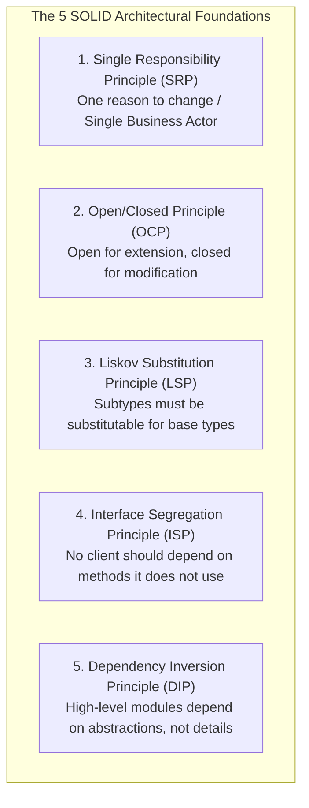
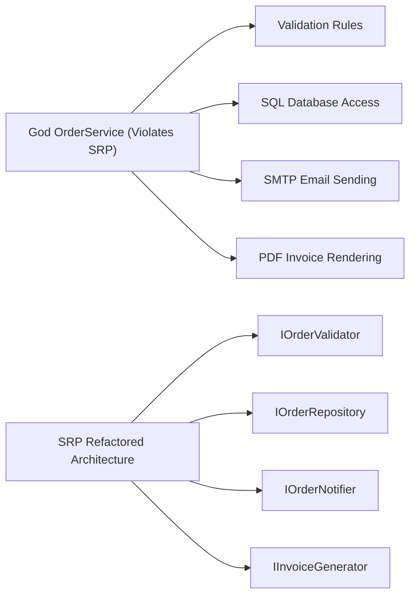
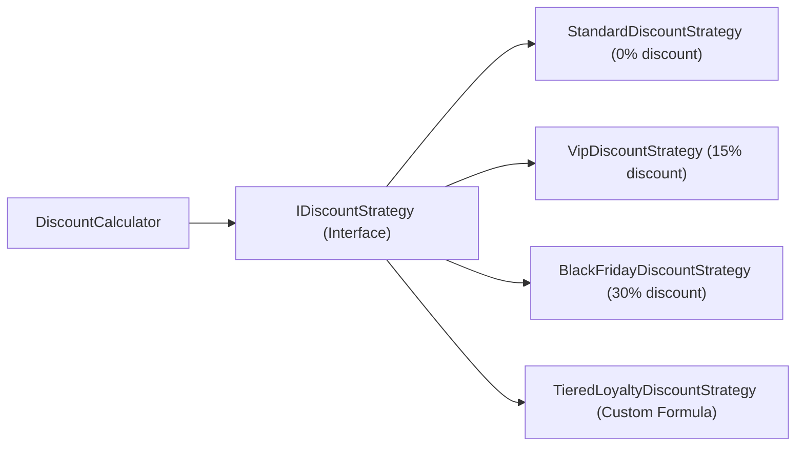
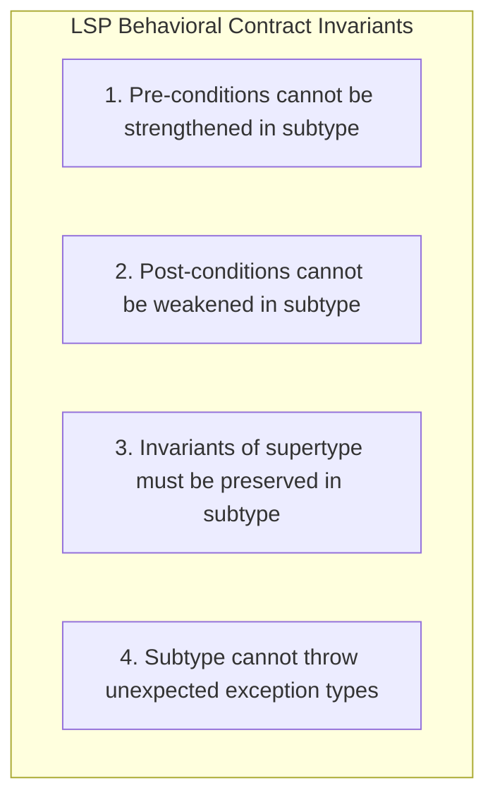
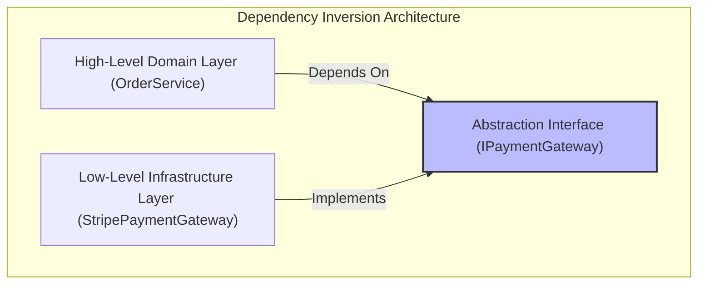

---


title: "SOLID Principles Deep Dive & Enterprise Architecture in C#"
description: "Master-level engineering guide for SOLID principles in C# (.NET 8/9), covering SRP, OCP, LSP, ISP, DIP with compiler-level mechanics, design patterns, covariant/contravariant types, and anti-patterns."
category: "DotNet Architecture"
tags: [csharp, dotnet, solid, srp, ocp, lsp, isp, dip, design-patterns, clean-code, architecture, enterpise, technical-skills, software-engineering, learning-note]
date: "2026-08-21"
---

# SOLID Principles Deep Dive & Enterprise Architecture in C#

---

## 1. Executive Summary & Under-the-Hood Mechanics

The **SOLID Principles** (formulated by Robert C. Martin and Barbara Liskov) represent five foundational software engineering axioms for creating maintainable, extensible, testable, and loosely coupled enterprise software architectures.

In modern .NET backend engineering, applying SOLID correctly minimizes code churn, prevents regression cascades, enables clean dependency injection graphs, and maximizes unit test coverage.



---

## 2. In-Depth Analysis of the 5 Principles

### 2.1 Single Responsibility Principle (SRP)
> *"A class should have one, and only one, reason to change."*

SRP is about **cohesion** and **actors**. An order class should not handle payment processing, database persistence, and PDF invoice generation simultaneously. When a single class handles multiple concerns, modifying persistence logic risks introducing bugs into invoicing or business rule validation.



```csharp
// VIOLATION: God Object with multiple reasons to change
public class GodOrderService
{
    public void ProcessOrder(Order order)
    {
        // 1. Validation logic (Changes when business rules change)
        if (order.TotalAmount <= 0) throw new ArgumentException("Invalid amount");

        // 2. SQL Persistence logic (Changes when DB schema changes)
        using var conn = new SqlConnection("Server=...;");
        conn.Execute("INSERT INTO Orders VALUES (@Id, @Amount)", order);

        // 3. SMTP Email logic (Changes when email provider changes)
        using var smtp = new SmtpClient("smtp.mail.com");
        smtp.Send(new MailMessage("sales@corp.com", order.Email, "Receipt", "Thank you!"));
    }
}

// REFACTORED: Cohesive Single Responsibility components
public interface IOrderValidator { bool Validate(Order order); }
public interface IOrderRepository { Task SaveAsync(Order order, CancellationToken ct = default); }
public interface IOrderNotifier { Task NotifyAsync(Order order, CancellationToken ct = default); }

public sealed class OrderProcessor
{
    private readonly IOrderValidator _validator;
    private readonly IOrderRepository _repository;
    private readonly IOrderNotifier _notifier;

    public OrderProcessor(IOrderValidator validator, IOrderRepository repository, IOrderNotifier notifier)
    {
        _validator = validator ?? throw new ArgumentNullException(nameof(validator));
        _repository = repository ?? throw new ArgumentNullException(nameof(repository));
        _notifier = notifier ?? throw new ArgumentNullException(nameof(notifier));
    }

    public async Task ProcessAsync(Order order, CancellationToken ct = default)
    {
        if (!_validator.Validate(order))
        {
            throw new InvalidOperationException($"Order validation failed for ID: {order.Id}");
        }

        await _repository.SaveAsync(order, ct);
        await _notifier.NotifyAsync(order, ct);
    }
}
```

---

### 2.2 Open/Closed Principle (OCP)
> *"Software entities (classes, modules, functions) should be open for extension, but closed for modification."*

Achieved via polymorphism, Strategy pattern, and Dependency Injection without modifying existing tested source code:



```csharp
public interface IDiscountStrategy
{
    bool IsApplicable(CustomerContext customer);
    decimal ApplyDiscount(decimal totalAmount);
}

public sealed class VipDiscountStrategy : IDiscountStrategy
{
    public bool IsApplicable(CustomerContext customer) => customer.Tier == CustomerTier.Vip;
    public decimal ApplyDiscount(decimal totalAmount) => totalAmount * 0.85m;
}

public sealed class BlackFridayDiscountStrategy : IDiscountStrategy
{
    public bool IsApplicable(CustomerContext customer) => customer.IsBlackFridayPromotion;
    public decimal ApplyDiscount(decimal totalAmount) => totalAmount * 0.70m;
}

public sealed class DiscountCalculator
{
    private readonly IEnumerable<IDiscountStrategy> _strategies;

    public DiscountCalculator(IEnumerable<IDiscountStrategy> strategies)
    {
        _strategies = strategies;
    }

    public decimal CalculateFinalPrice(CustomerContext customer, decimal rawTotal)
    {
        foreach (var strategy in _strategies)
        {
            if (strategy.IsApplicable(customer))
            {
                return strategy.ApplyDiscount(rawTotal);
            }
        }
        return rawTotal;
    }
}
```

---

### 2.3 Liskov Substitution Principle (LSP)
> *"Objects of a superclass should be replaceable with objects of its subclasses without altering any of the desirable properties of the program."*

#### LSP Mathematical Invariant
Let $\phi(x)$ be a property provable about objects $x$ of type $T$. Then $\phi(y)$ should be true for objects $y$ of type $S$ where $S$ is a subtype of $T$:

$$orall x \in T, \phi(x) \implies orall y \in S, \phi(y) \quad \text{where } S \subseteq T$$



```csharp
// CLASSIC VIOLATION: Square inheriting from Rectangle
public class Rectangle
{
    public virtual int Width { get; set; }
    public virtual int Height { get; set; }
    public int Area => Width * Height;
}

public class Square : Rectangle
{
    public override int Width
    {
        set { base.Width = value; base.Height = value; }
    }
    public override int Height
    {
        set { base.Width = value; base.Height = value; }
    }
}

// CLIENT CODE EXPECTING RECTANGLE INVARIANT:
// Setting Width = 5 and Height = 4 MUST yield Area = 20.
// On Square, setting Height = 4 silently alters Width to 4, yielding Area = 16 (VIOLATION!).
```

---

### 2.4 Interface Segregation Principle (ISP)
> *"Clients should not be forced to depend upon interfaces that they do not use."*

```csharp
// VIOLATION: Fat Interface forcing consumers to implement unused methods
public interface IDocumentManager
{
    void Print(Document doc);
    void Scan(Document doc);
    void Fax(Document doc);
    void Staple(Document doc);
}

// REFACTORED: Fine-grained Role Interfaces
public interface IPrinter { void Print(Document doc); }
public interface IScanner { void Scan(Document doc); }
public interface IFaxMachine { void Fax(Document doc); }

public sealed class Photocopier : IPrinter, IScanner
{
    public void Print(Document doc) => Console.WriteLine("Printing document...");
    public void Scan(Document doc) => Console.WriteLine("Scanning document...");
}
```

---

### 2.5 Dependency Inversion Principle (DIP)
> *"High-level modules should not depend on low-level modules. Both should depend on abstractions. Abstractions should not depend on details. Details should depend on abstractions."*



```csharp
// Abstraction owned by Core Domain Layer
public interface IPaymentGateway
{
    Task<PaymentResult> ProcessPaymentAsync(decimal amount, CancellationToken ct = default);
}

// Low-level Infrastructure Adapter
public sealed class StripePaymentGateway : IPaymentGateway
{
    public async Task<PaymentResult> ProcessPaymentAsync(decimal amount, CancellationToken ct = default)
    {
        // Low-level Stripe SDK network call
        await Task.Delay(100, ct);
        return new PaymentResult(true, "ch_stripe_9921");
    }
}
```

---

## 3. Production ASP.NET Core Dependency Injection Configuration

```csharp
// Program.cs - Composition Root
var builder = WebApplication.CreateBuilder(args);

// Register Core Abstractions with appropriate lifetimes
builder.Services.AddScoped<IOrderValidator, OrderValidator>();
builder.Services.AddScoped<IOrderRepository, SqlOrderRepository>();
builder.Services.AddScoped<IPaymentGateway, StripePaymentGateway>();

// Register Open/Closed Strategy collection
builder.Services.AddTransient<IDiscountStrategy, VipDiscountStrategy>();
builder.Services.AddTransient<IDiscountStrategy, BlackFridayDiscountStrategy>();
builder.Services.AddScoped<DiscountCalculator>();

builder.Services.AddScoped<OrderProcessor>();

var app = builder.Build();
```

---

## 4. Architectural Failure Modes Matrix

| Principle | Violation Symptom | Engineering Solution |
| :--- | :--- | :--- |
| **SRP** | Giant files ($> 1,000$ lines), frequent merge conflicts across teams. | Split into single-purpose services and command handlers. |
| **OCP** | Massive `switch`/`case` statements modified on every new feature. | Refactor to Strategy pattern or factory delegates. |
| **LSP** | `NotSupportedException` thrown in derived methods. | Remove inheritance; replace with composition. |
| **ISP** | Empty or throwing interface method implementations. | Split fat interfaces into fine-grained role interfaces. |
| **DIP** | Direct `new Service()` calls inside business domain classes. | Inject abstractions via constructor DI. |

---

## 🔗 Graph-Linked Knowledge Base
- ⚓ Composition: [[composition_over_inheritance|Composition Over Inheritance]]
- ⚓ Domain Driven Design: [[domain_driven_design_building_blocks|Domain Driven Design Building Blocks]]
- 🔗 Design Patterns: [[02_Technical_Skills/01_theory_and_concepts/21_Design_Patterns_and_OOP/solid_principles|SOLID Principles Overview]]
