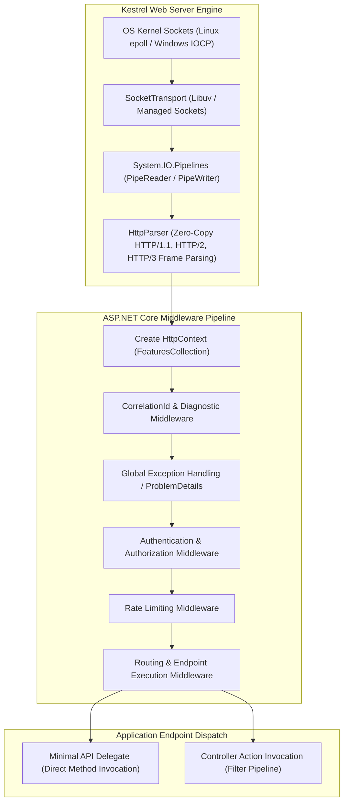
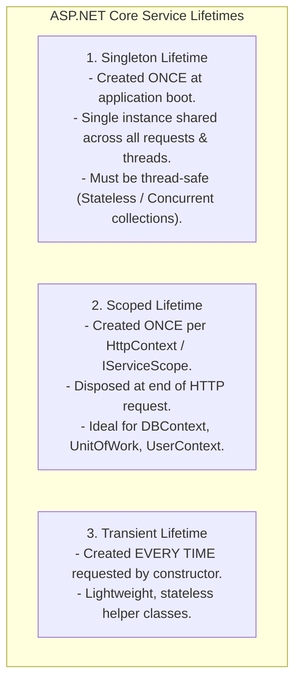
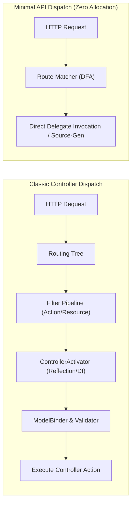
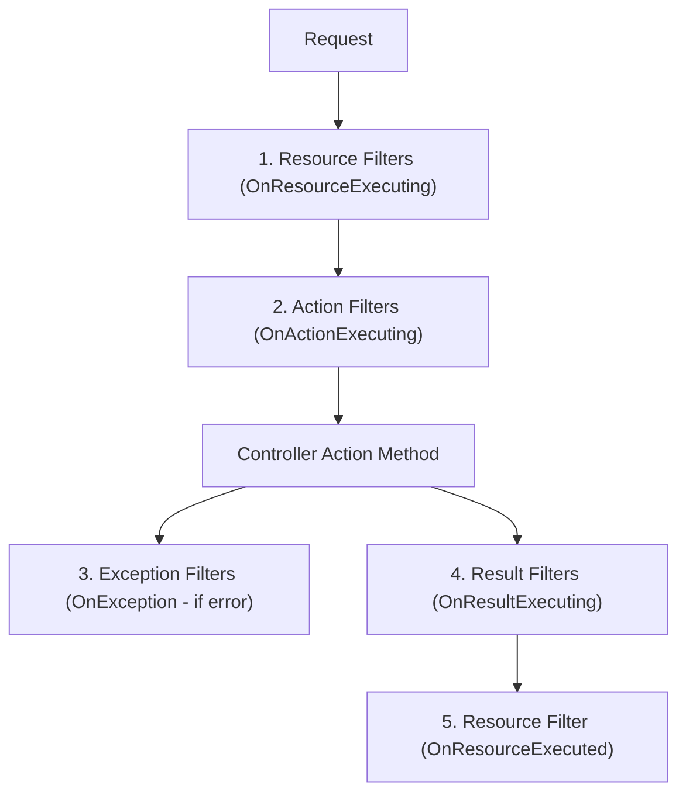

---


title: "ASP.NET Core Web API: High-Performance Architecture & Internals"
description: "Master-level engineering guide for ASP.NET Core Web API, covering Kestrel internals, Middleware pipeline mechanics, Dependency Injection lifecycle, Minimal APIs vs Controllers, Filter architecture, and High-Throughput HTTP handling."
category: "REST API Design & Web Frameworks"
tags: [csharp, dotnet, aspnet-core, web-api, kestrel, middleware, dependency-injection, minimal-apis, performance, architecture, technical-skills, software-engineering, learning-note]
date: "2026-08-21"
---

# ASP.NET Core Web API: High-Performance Architecture & Internals

---

## 1. Executive Summary & Runtime Architecture

**ASP.NET Core** is a cross-platform, high-throughput web framework built on top of the .NET CLR and the **Kestrel** edge web server. Operating consistently at the top of TechEmpower plaintext and JSON benchmarks, ASP.NET Core achieves low-latency request processing through asynchronous non-blocking I/O (`SocketTransport`), zero-allocation memory abstractions (`Span<T>`, `Memory<T>`, `ArrayPool<T>`, `PipeReader`/`PipeWriter`), and a composable **Middleware Pipeline**.



---

## 2. The Middleware Pipeline & `RequestDelegate` Internals

The ASP.NET Core HTTP request pipeline is structured as a bidirectional chain of function pointers known as `RequestDelegate`:
```csharp
public delegate Task RequestDelegate(HttpContext context);
```

Each middleware component receives the next `RequestDelegate` in the chain and decides whether to pass execution forward via `await next(context)` or **short-circuit** the pipeline by returning immediately without invoking downstream components.

```mermaid
sequenceDiagram
    autonumber
    actor Client as HTTP Client
    participant Kestrel as Kestrel / Socket Transport
    participant MW1 as Global Exception Middleware
    participant MW2 as Auth & Security Middleware
    participant End as Endpoint Execution (Controller / Minimal API)

    Client->>Kestrel: GET /api/v1/orders/100
    Kestrel->>MW1: Invoke(HttpContext)
    MW1->>MW2: await next(context)
    MW2->>End: await next(context)
    End-->>MW2: Returns Result / Response Payload
    MW2-->>MW1: Headers & Security Policy Applied
    MW1-->>Kestrel: Response Flushed to Sockets
    Kestrel-->>Client: 200 OK (JSON Response)
```

### 2.1 Production-Grade Middleware Implementation

```csharp
using System.Diagnostics;
using System.Text.Json;
using Microsoft.AspNetCore.Http;
using Microsoft.Extensions.Logging;

public class PerformanceCorrelationMiddleware
{
    private const string CorrelationHeader = "X-Correlation-Id";
    private readonly RequestDelegate _next;
    private readonly ILogger<PerformanceCorrelationMiddleware> _logger;

    public PerformanceCorrelationMiddleware(RequestDelegate next, ILogger<PerformanceCorrelationMiddleware> logger)
    {
        _next = next;
        _logger = logger;
    }

    public async Task InvokeAsync(HttpContext context)
    {
        // 1. Resolve or generate Trace Correlation ID
        if (!context.Request.Headers.TryGetValue(CorrelationHeader, out var correlationId) || 
            string.IsNullOrWhiteSpace(correlationId))
        {
            correlationId = Guid.NewGuid().ToString("N");
            context.Request.Headers[CorrelationHeader] = correlationId;
        }

        context.Response.Headers[CorrelationHeader] = correlationId;
        using var logScope = _logger.BeginScope(new Dictionary<string, object>
        {
            ["CorrelationId"] = correlationId.ToString()!,
            ["TraceId"] = Activity.Current?.TraceId.ToString() ?? context.TraceIdentifier
        });

        long startTimestamp = Stopwatch.GetTimestamp();

        try
        {
            await _next(context);
        }
        catch (Exception ex)
        {
            _logger.LogError(ex, "Unhandled exception processing request {Method} {Path}", 
                context.Request.Method, context.Request.Path);
            await HandleGlobalExceptionAsync(context, ex);
        }
        finally
        {
            TimeSpan elapsed = Stopwatch.GetElapsedTime(startTimestamp);
            _logger.LogInformation("HTTP {Method} {Path} responded {StatusCode} in {ElapsedMs:F2}ms",
                context.Request.Method, context.Request.Path, context.Response.StatusCode, elapsed.TotalMilliseconds);
        }
    }

    private static async Task HandleGlobalExceptionAsync(HttpContext context, Exception exception)
    {
        context.Response.ContentType = "application/problem+json";
        context.Response.StatusCode = StatusCodes.Status500InternalServerError;

        var problemDetails = new
        {
            Type = "https://datatracker.ietf.org/doc/html/rfc7807",
            Title = "Internal Server Error",
            Status = StatusCodes.Status500InternalServerError,
            Detail = "An unexpected error occurred processing your request.",
            Instance = context.Request.Path.Value,
            TraceId = Activity.Current?.Id ?? context.TraceIdentifier
        };

        await JsonSerializer.SerializeAsync(context.Response.Body, problemDetails);
    }
}
```

---

## 3. Dependency Injection (DI) Engine & Lifecycle Management

ASP.NET Core includes a built-in, lock-free, highly optimized Inversion of Control (IoC) container (`Microsoft.Extensions.DependencyInjection`).



### 3.1 The Captive Dependency Pitfall

> [!CAUTION]
> A **Captive Dependency** occurs when a service with a longer lifetime holds a dependency with a shorter lifetime. Specifically, injecting a **Scoped** service (e.g., `AppDbContext`) into a **Singleton** service captures the scoped instance forever. This causes memory leaks, concurrency race conditions, and stale data.

```csharp
// ANTI-PATTERN: Captive Dependency
public class OrderProcessingSingletonWorker // Registered as Singleton
{
    private readonly AppDbContext _dbContext; // Captures Scoped DbContext!

    public OrderProcessingSingletonWorker(AppDbContext dbContext)
    {
        _dbContext = dbContext; // DEADLY: Concurrency exceptions on concurrent calls!
    }
}

// PRODUCTION FIX: Explicit ServiceScopeFactory
public class OrderProcessingSingletonWorker
{
    private readonly IServiceScopeFactory _scopeFactory;

    public OrderProcessingSingletonWorker(IServiceScopeFactory scopeFactory)
    {
        _scopeFactory = scopeFactory;
    }

    public async Task ProcessOrdersAsync()
    {
        // Explicitly create a boundary scope for the unit of work
        using (var scope = _scopeFactory.CreateScope())
        {
            var dbContext = scope.ServiceProvider.GetRequiredService<AppDbContext>();
            await dbContext.Orders.Where(o => o.Pending).ExecuteUpdateAsync(...);
        } // DbContext is cleanly disposed here
    }
}
```

---

## 4. Minimal APIs vs. Controllers: Architecture & Performance

Starting with .NET 6+, **Minimal APIs** eliminate Controller routing reflection, model binding overhead, and filter pipelines, binding directly to ASP.NET Core's low-level routing tree (`EndpointDataSource`).



### 4.1 Production Minimal API Implementation (.NET 8+)

```csharp
using FluentValidation;
using Microsoft.AspNetCore.Http.HttpResults;

var builder = WebApplication.CreateBuilder(args);

// Register Services
builder.Services.AddScoped<IOrderService, OrderService>();
builder.Services.AddValidatorsFromAssemblyContaining<CreateOrderRequestValidator>();

var app = builder.Build();

// Route Group with Prefix and Filters
var ordersApi = app.MapGroup("/api/v1/orders")
    .RequireAuthorization()
    .WithTags("Orders");

ordersApi.MapPost("/", async Task<Results<Created<OrderResponse>, ValidationProblem>> (
    CreateOrderRequest request,
    IValidator<CreateOrderRequest> validator,
    IOrderService orderService,
    CancellationToken ct) =>
{
    var validationResult = await validator.ValidateAsync(request, ct);
    if (!validationResult.IsValid)
    {
        return TypedResults.ValidationProblem(validationResult.ToDictionary());
    }

    var createdOrder = await orderService.CreateOrderAsync(request, ct);
    return TypedResults.Created($"/api/v1/orders/{createdOrder.Id}", createdOrder);
})
.WithName("CreateOrder")
.Produces<OrderResponse>(StatusCodes.Status201Created)
.ProducesValidationProblem();

app.Run();
```

---

## 5. Filter Pipeline & Action Execution Lifecycle

For MVC Controllers, the execution pipeline passes through 5 distinct filter stages:



### 5.1 Custom Async Action Filter Example
```csharp
public class IdempotencyFilter : IAsyncActionFilter
{
    private readonly IDistributedCache _cache;

    public IdempotencyFilter(IDistributedCache cache)
    {
        _cache = cache;
    }

    public async Task OnActionExecutionAsync(ActionExecutingContext context, ActionExecutionDelegate next)
    {
        if (!context.HttpContext.Request.Headers.TryGetValue("X-Idempotency-Key", out var key))
        {
            await next();
            return;
        }

        string cacheKey = $"idempotency:{key}";
        byte[]? cachedResponse = await _cache.GetAsync(cacheKey);

        if (cachedResponse != null)
        {
            context.Result = new ContentResult
            {
                Content = Encoding.UTF8.GetString(cachedResponse),
                ContentType = "application/json",
                StatusCode = StatusCodes.Status200OK
            };
            return;
        }

        var executedContext = await next();

        if (executedContext.Result is ObjectResult objectResult && executedContext.HttpContext.Response.StatusCode == 200)
        {
            string payload = JsonSerializer.Serialize(objectResult.Value);
            await _cache.SetStringAsync(cacheKey, payload, new DistributedCacheEntryOptions
            {
                AbsoluteExpirationRelativeToNow = TimeSpan.FromMinutes(30)
            });
        }
    }
}
```

---

## 6. High-Throughput Optimization & Rate Limiting

### 6.1 Native Rate Limiting Configuration (.NET 8+)

```csharp
builder.Services.AddRateLimiter(options =>
{
    options.RejectionStatusCode = StatusCodes.Status429TooManyRequests;
    options.AddSlidingWindowLimiter("api-sliding", opt =>
    {
        opt.PermitLimit = 100;
        opt.Window = TimeSpan.FromSeconds(60);
        opt.SegmentsPerWindow = 6;
        opt.QueueLimit = 10;
        opt.QueueProcessingOrder = QueueProcessingOrder.OldestFirst;
    });
});
```

### 6.2 JSON Source Generation for Zero-Allocation Serialization

```csharp
[JsonSerializable(typeof(OrderResponse))]
[JsonSerializable(typeof(List<OrderResponse>))]
[JsonSerializable(typeof(CreateOrderRequest))]
internal partial class OrderJsonSerializerContext : JsonSerializerContext
{
}

// In Program.cs
builder.Services.ConfigureHttpJsonOptions(options =>
{
    options.SerializerOptions.TypeInfoResolverChain.Insert(0, OrderJsonSerializerContext.Default);
});
```

---

## 7. Operational Troubleshooting Matrix

| Symptom | Root Cause | Engineering Solution |
| :--- | :--- | :--- |
| **`InvalidOperationException`: Cannot resolve scoped service from root provider** | Injecting a `Scoped` service into a `Singleton` or resolving from root container. | Use `IServiceScopeFactory.CreateScope()` or change dependent lifecycle to Scoped. |
| **Thread Pool Starvation (High Latency Spikes)** | Blocking asynchronous calls with `.Result`, `.Wait()`, or `GetAwaiter().GetResult()`. | Enforce 100% async all the way down (`async`/`await`) and pass `CancellationToken`. |
| **High GC Gen 2 / LOH Allocations** | Buffering large JSON/file request bodies into byte arrays or strings. | Stream directly using `PipeReader`, `IAsyncEnumerable<T>`, or `System.IO.Stream`. |
| **Silent Connection Drop on HTTP/2** | Kestrel HTTP/2 `KeepAlivePingTimeout` triggered due to unhandled idle connections. | Configure explicit Kestrel keep-alive limits and client ping timeouts. |

---

## 🔗 Graph-Linked Knowledge Base
- ⚓ REST API Principles: [[rest_api_principles|REST API Architecture & Design Principles]]
- ⚓ Security & JWT: [[security_jwt_and_rbac|JWT Authentication & RBAC Authorization]]
- 🔗 DotNet Architecture: [[02_Technical_Skills/01_theory_and_concepts/04_DotNet_Architecture/csharp_span_memory_arraypool_performance|C# Span, Memory, and High-Performance Streams]]
