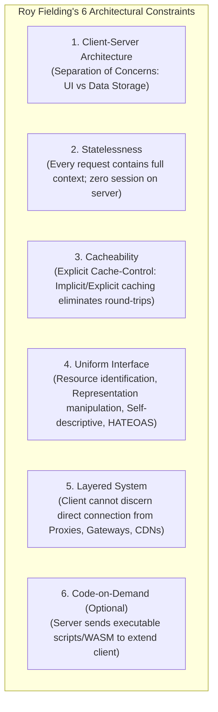
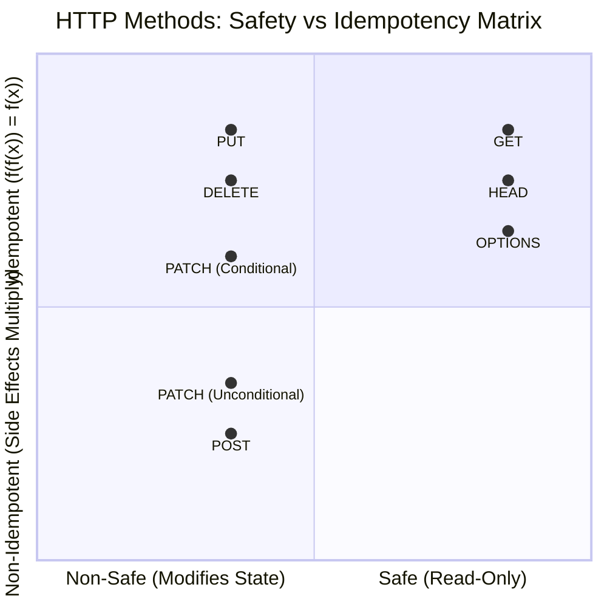
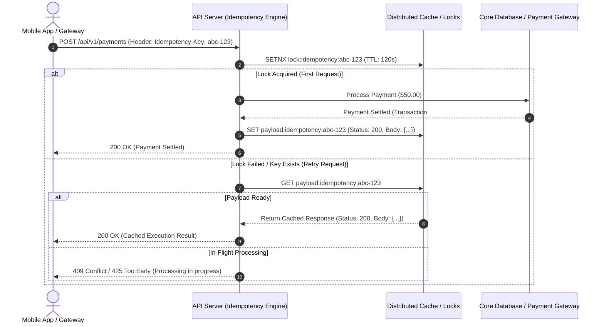
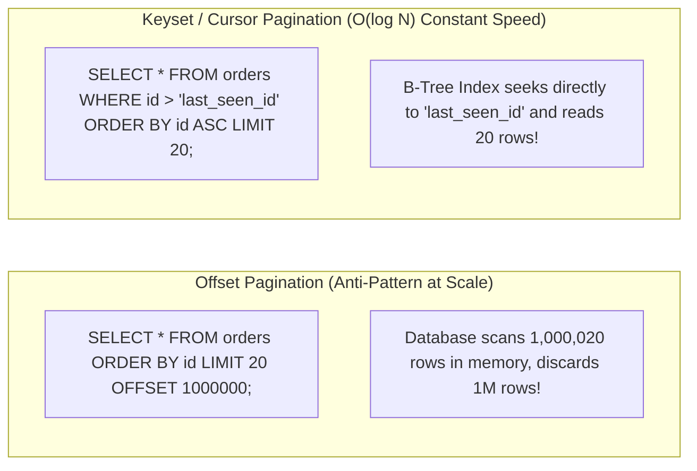
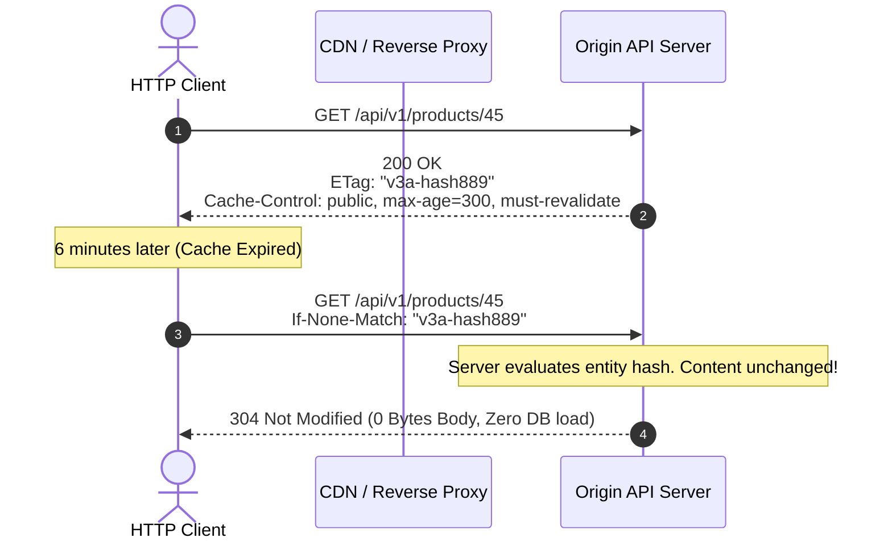

---


title: "REST API Principles: Architectural Constraints, RFC Semantics & High-Scale Design"
description: "Master-level engineering guide for REST API design, covering Roy Fielding's architectural constraints, HTTP semantics, RFC 9110/7807 standards, Idempotency keys, Keyset pagination, and Caching."
category: "REST API Design & Web Frameworks"
tags: [rest, api, architecture, http, rfc-9110, idempotency, caching, pagination, microservices, technical-skills, software-engineering, learning-note]
date: "2026-08-21"
---

# REST API Principles: Architectural Constraints, RFC Semantics & High-Scale Design

---

## 1. Executive Summary & Roy Fielding's Architectural Constraints

**Representational State Transfer (REST)** is an architectural style formulated by Roy Fielding in his 2000 doctoral dissertation. Rather than a rigid protocol or specification, REST defines a set of **six fundamental architectural constraints** that optimize distributed hypermedia systems for network performance, scalability, simplicity, modifiability, and visibility.



### 1.1 The Uniform Interface Sub-Constraints
The cornerstone of REST is the Uniform Interface, composed of 4 strict rules:
1. **Identification of Resources**: Resources are conceptual entities identified by stable URIs (e.g., `/api/v1/orders/100`), completely decoupled from underlying database representations.
2. **Manipulation of Resources through Representations**: Clients hold representations (JSON, Protobuf, XML) and modify server state by sending representations.
3. **Self-Descriptive Messages**: Each message contains sufficient metadata (Media Types, Status Codes, Caching headers) instructing the parser on how to process the payload.
4. **HATEOAS (Hypermedia As The Engine Of Application State)**: Clients transition state by discovering dynamic hyperlinks provided by the server inside resource payloads.

---

## 2. HTTP Methods Semantics: Safety, Idempotency & RFC 9110

HTTP methods are strictly defined by **RFC 9110** based on two mathematical properties: **Safety** and **Idempotency**.



### 2.1 Detailed Method Invariants

| HTTP Verb | Safe? | Idempotent? | Cacheable? | RFC 9110 Semantic Purpose |
| :--- | :--- | :--- | :--- | :--- |
| **`GET`** | **Yes** | **Yes** | **Yes** | Read-only transfer of a current resource representation. Must have no server-side side effects. |
| **`HEAD`** | **Yes** | **Yes** | **Yes** | Identical to `GET`, but server returns zero response body (used for checking `ETag`, `Content-Length`). |
| **`POST`** | No | No | Optional | Submits an entity for processing; creates a subordinate resource or executes an RPC command. |
| **`PUT`** | No | **Yes** | No | Replaces the entire target resource with the payload representation, or creates it at the exact URI. |
| **`PATCH`** | No | Conditional | No | Applies a partial set of modifications described by a patch document (RFC 6902 JSON Patch / RFC 7396 Merge Patch). |
| **`DELETE`** | No | **Yes** | No | Deletes the resource identified by the URI. Subsequent calls return `404 Not Found` or `204 No Content`. |
| **`OPTIONS`**| **Yes** | **Yes** | No | Queries supported communication options and CORS preflight headers (`Allow`, `Access-Control-Allow-Methods`). |

---

## 3. Production Idempotency Keys Architecture (IETF Standard)

Because network failures and timeouts cause automated client retries, non-idempotent operations (`POST /payments`, `POST /orders`) must implement **Idempotency Keys** to prevent duplicate execution (such as charging a credit card twice).



---

## 4. RFC 7807 Problem Details for HTTP APIs

Never return raw exception stack traces or generic `{ "error": "Something went wrong" }`. Production REST APIs must adhere to **RFC 7807 (`application/problem+json`)**:

```json
{
  "type": "https://api.enterprise.com/errors/insufficient-funds",
  "title": "Insufficient Funds",
  "status": 422,
  "detail": "Account balance of $120.00 is insufficient for the requested transfer of $500.00.",
  "instance": "/api/v1/accounts/acc_98712/transfers",
  "invalidParams": [
    {
      "name": "amount",
      "reason": "Exceeds available balance after overdraft protection."
    }
  ],
  "traceId": "00-4bf92f3577b34da6a3ce929d0e0e4736-00f067aa0ba902b7-01"
}
```

---

## 5. Pagination Strategies: Offset vs. Keyset (Cursor-Based)



### 5.1 Pagination Comparison Matrix

| Dimension | Offset Pagination (`?page=50&size=20`) | Keyset / Cursor Pagination (`?cursor=eyJpZCI6MTAwfQ==`) |
| :--- | :--- | :--- |
| **Performance ($N \gg 10^6$)** | Degrading $O(N)$ (Disk I/O scan & memory discard) | **Constant $O(\log N)$** (Direct B-Tree index seek) |
| **Data Drift Anomaly** | Suffers from duplicates / skipped items on new inserts | **Immune** to row insertions / deletions |
| **Random Page Jump** | Supported (`Go to page 45`) | Not supported (Linear forward/backward traversal only) |
| **Best Use Case** | Small administrative panels ($< 1,000$ records) | **High-volume APIs, Mobile infinite scroll, Event streams** |

---

## 6. HTTP Caching Architecture & Conditional Requests

HTTP caching eliminates redundant network round-trips via the standard `Cache-Control` and `ETag` mechanism:



### 6.1 `Cache-Control` Directives Cheat Sheet
- `no-store`: Do not cache anything in RAM or disk (used for sensitive PII/Banking data).
- `no-cache`: Cache may store the response, but **must revalidate with the origin** server (`If-None-Match`) before serving it.
- `public`: Any intermediary (CDN, proxy) can cache the response.
- `private`: Only the end-user's browser may cache the response.
- `s-maxage=3600`: Shared cache (CDN) TTL overrides client TTL.

---

## 7. API Versioning Strategies

| Strategy | Example | Pros | Cons |
| :--- | :--- | :--- | :--- |
| **URI Path** (Recommended) | `/api/v1/orders` | Simple, explicit, transparent in logs and API gateways. | URL pollution, strict version boundaries. |
| **Custom Header** | `X-API-Version: 2` | Clean URIs, easy client default fallback. | Hidden routing logic, breaks standard browser caching. |
| **Content Negotiation (Accept)** | `Accept: application/vnd.company.v2+json` | Pure RESTful, HATEOAS compliant. | Complex testing in Swagger/Postman, difficult CDN caching. |
| **Query Parameter** | `/api/orders?version=2` | Trivial to implement and override. | Inconsistent URI canonicalization. |

---

## 8. Failure Modes & Operational Runbook

| Failure Mode | Root Cause | Engineering Solution |
| :--- | :--- | :--- |
| **HTTP 429 Cascading Retries** | Aggressive client retry storm during partial downtime. | Return `429 Too Many Requests` with `Retry-After: 30` header and enforce client exponential backoff with jitter. |
| **Cartesian Product in Pagination** | Client requests `size=50000` causing database OutOfMemory. | Enforce strict max limits (e.g. `size = Math.Min(requestedSize, 100)`). |
| **Cache Stampede / Dog-piling** | High-traffic cached key expires simultaneously for 5,000 concurrent requests. | Implement **Probabilistic Early Expiration (XFetch)** or Distributed Mutex locking during cache refresh. |
| **Zombie Writes (Lost Updates)** | Two users overwrite the same resource concurrently via `PUT`. | Require `If-Match: "etag_val"` on all `PUT`/`PATCH` requests, returning `412 Precondition Failed` on mismatch. |

---

## 🔗 Graph-Linked Knowledge Base
- ⚓ ASP.NET Core API: [[aspnet_core_web_api|ASP.NET Core Web API Internals]]
- ⚓ Spring Boot API: [[spring_boot_web_api|Spring Boot Web API Architecture]]
- ⚓ Security & RBAC: [[security_jwt_and_rbac|JWT Authentication & RBAC Authorization]]
- 🔗 Caching Internals: [[02_Technical_Skills/01_theory_and_concepts/07_Backend_Caching_and_Redis/caching_fundamentals|Distributed Caching Fundamentals]]
