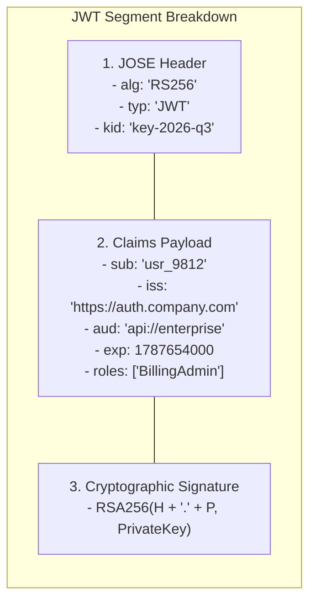
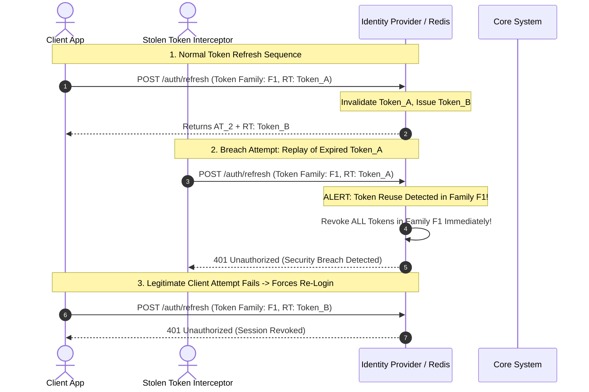
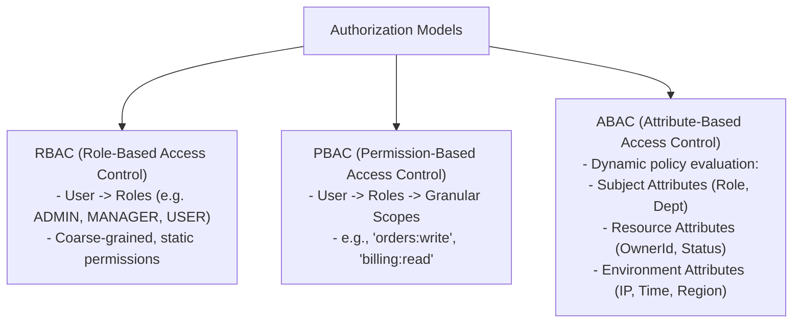
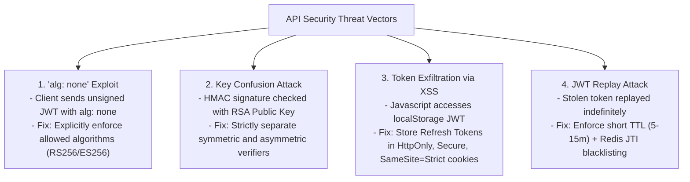

---


title: "JWT Authentication, Refresh Token Rotation & RBAC/ABAC Architecture"
description: "Master-level engineering guide for API security, covering RFC 7519 JWT internals, JWKS key rotation, Refresh Token Rotation (RTR), RBAC vs ABAC policy engines, and Spring Security / ASP.NET Core integrations."
category: "REST API Design & Web Frameworks"
tags: [security, jwt, rbac, abac, oauth2, oidc, refresh-token, spring-security, dotnet, appsec, technical-skills, software-engineering, learning-note]
date: "2026-08-21"
---

# JWT Authentication, Refresh Token Rotation & RBAC/ABAC Architecture

---

## 1. Executive Summary & Identity Architecture

In distributed microservice architectures, monolithic in-memory sessions (e.g. `HttpSession`) create synchronization bottlenecks and stateful dependencies that impair horizontal auto-scaling. **JSON Web Tokens (JWT / RFC 7519)** combined with **OAuth 2.1 / OpenID Connect (OIDC)** provide a stateless, cryptographically verifiable identity mechanism across independent services.

```mermaid
flowchart TD
    subgraph Client["Client Application"]
        SPA["Single Page App / Mobile Client"]
    end

    subgraph AuthServer["Identity & Access Management (IdP)"]
        Keycloak["OIDC / OAuth 2.1 Provider (Keycloak / Auth0 / Entra ID)"]
        PrivateKeys["Private RSA/ECDSA Signing Keys (HSM / KMS)"]
        JWKS[".well-known/jwks.json (Public Key Set)"]
    end

    subgraph Microservices["Backend Microservices Mesh"]
        Gateway["API Gateway / Envoy"]
        ServiceA["Order Microservice (Spring Boot)"]
        ServiceB["Billing Microservice (.NET Core)"]
    end

    SPA -->|1. Authenticate (PKCE Flow)| Keycloak
    Keycloak -->|2. Sign with Private Key| PrivateKeys
    Keycloak -->>|3. Issue Short-Lived JWT + Refresh Token| SPA
    SPA -->|4. Request with Bearer JWT| Gateway
    Gateway -->|Verify JWT via JWKS| JWKS
    Gateway -->|5. Forward with Claims Header| ServiceA
    ServiceA -->|Internal Service-to-Service JWT| ServiceB
```

---

## 2. JWT (RFC 7519) Anatomy & Cryptographic Signing

A JSON Web Token consists of three base64url-encoded segments delimited by periods (`.`):
$$\text{JWT} = \text{Base64Url}(\text{Header}) \,.\, \text{Base64Url}(\text{Payload}) \,.\, \text{Base64Url}(\text{Signature})$$



### 2.1 Standard Registered Claims Invariants
- `sub` (Subject): The unique, immutable identifier of the principal/user.
- `iss` (Issuer): The URI identifying the identity provider that issued the token.
- `aud` (Audience): The intended recipient services of the token (must be validated by API servers).
- `exp` (Expiration Time): Unix epoch timestamp after which the token is invalid.
- `nbf` (Not Before): Unix timestamp before which the token must not be accepted.
- `iat` (Issued At): Timestamp of issuance.
- `jti` (JWT ID): Unique nonce identifier used to prevent replay attacks and facilitate blacklisting.

### 2.2 Signing Algorithms Comparison

| Algorithm | Cryptographic Type | Key Management | Performance | Production Best Practice |
| :--- | :--- | :--- | :--- | :--- |
| **HS256** (HMAC-SHA256) | Symmetric Secret | Shared secret string shared across all verifying services. | Extremely Fast | **Risk of leak**: Compromising 1 microservice exposes the signing secret. |
| **RS256** (RSA PKCS#1 v1.5) | Asymmetric Keypair | Private key on IdP; public keys exposed via JWKS. | High Verification Cost | **Enterprise Standard**: Decoupled verification without secret leakage. |
| **ES256** (ECDSA P-256) | Elliptic Curve | Smaller keys (256-bit vs 2048-bit RSA) with equal cryptographic strength. | Fast Verification & Small Payload | **Modern Standard for High-Throughput APIs**. |

---

## 3. Refresh Token Rotation (RTR) & Breach Detection

To mitigate the risk of stolen access tokens while maintaining a seamless user experience, use **Short-Lived Access Tokens (10–15 mins)** paired with **Single-Use Refresh Tokens** managed via **Refresh Token Rotation (RTR)**.



---

## 4. Authorization Paradigms: RBAC vs. ABAC vs. PBAC



### 4.1 Comparison Matrix

| Model | Granularity | Dynamic Context Aware? | Complexity | Standard Implementation |
| :--- | :--- | :--- | :--- | :--- |
| **RBAC** | Coarse | No | Low | `@PreAuthorize("hasRole('ADMIN')")` |
| **PBAC / Claims** | Medium | No | Medium | `[Authorize(Policy = "CanRefundOrders")]` |
| **ABAC / Policy** | High | **Yes** (Evaluates request payload, time, resource owner) | High | Open Policy Agent (OPA) / Custom ASP.NET Policy Handlers |

---

## 5. Production Code Implementations

### 5.1 ASP.NET Core Custom Resource-Based Authorization Handler

```csharp
using Microsoft.AspNetCore.Authorization;
using System.Security.Claims;

public record OrderResource(Guid Id, string OwnerId, decimal Amount, bool IsLocked);

public class SameOwnerOrAdminRequirement : IAuthorizationRequirement { }

public class OrderAuthorizationHandler : AuthorizationHandler<SameOwnerOrAdminRequirement, OrderResource>
{
    protected override Task HandleRequirementAsync(
        AuthorizationHandlerContext context,
        SameOwnerOrAdminRequirement requirement,
        OrderResource resource)
    {
        // 1. Admin bypass
        if (context.User.IsInRole("Admin"))
        {
            context.Succeed(requirement);
            return Task.CompletedTask;
        }

        // 2. Resource owner verification
        var userId = context.User.FindFirst(ClaimTypes.NameIdentifier)?.Value;
        if (userId != null && resource.OwnerId == userId && !resource.IsLocked)
        {
            context.Succeed(requirement);
        }

        return Task.CompletedTask;
    }
}
```

### 5.2 Spring Security 6 JWT Security Filter Chain Configuration

```java
package com.enterprise.security.config;

import org.springframework.context.annotation.Bean;
import org.springframework.context.annotation.Configuration;
import org.springframework.core.convert.converter.Converter;
import org.springframework.security.authentication.AbstractAuthenticationToken;
import org.springframework.security.config.annotation.method.configuration.EnableMethodSecurity;
import org.springframework.security.config.annotation.web.builders.HttpSecurity;
import org.springframework.security.config.annotation.web.configuration.EnableWebSecurity;
import org.springframework.security.config.http.SessionCreationPolicy;
import org.springframework.security.core.GrantedAuthority;
import org.springframework.security.core.authority.SimpleGrantedAuthority;
import org.springframework.security.oauth2.jwt.Jwt;
import org.springframework.security.oauth2.server.resource.authentication.JwtAuthenticationToken;
import org.springframework.security.web.SecurityFilterChain;

import java.util.Collection;
import java.util.List;
import java.util.stream.Collectors;

@Configuration
@EnableWebSecurity
@EnableMethodSecurity(prePostEnabled = true)
public class SecurityConfig {

    @Bean
    public SecurityFilterChain securityFilterChain(HttpSecurity http) throws Exception {
        http
            .csrf(csrf -> csrf.disable())
            .sessionManagement(session -> session.sessionCreationPolicy(SessionCreationPolicy.STATELESS))
            .authorizeHttpRequests(auth -> auth
                .requestMatchers("/api/v1/auth/**", "/.well-known/**", "/actuator/health").permitAll()
                .requestMatchers("/api/v1/admin/**").hasRole("ADMIN")
                .anyRequest().authenticated()
            )
            .oauth2ResourceServer(oauth2 -> oauth2
                .jwt(jwt -> jwt.jwtAuthenticationConverter(customJwtConverter()))
            );

        return http.build();
    }

    private Converter<Jwt, ? extends AbstractAuthenticationToken> customJwtConverter() {
        return jwt -> {
            List<String> roles = jwt.getClaimAsStringList("roles");
            Collection<GrantedAuthority> authorities = roles == null ? List.of() :
                roles.stream()
                     .map(role -> new SimpleGrantedAuthority("ROLE_" + role))
                     .collect(Collectors.toList());

            return new JwtAuthenticationToken(jwt, authorities, jwt.getClaimAsString("sub"));
        };
    }
}
```

---

## 6. Threat Modeling & Vulnerability Mitigation



---

## 7. Operational Troubleshooting Runbook

| Security Incident | Root Cause | Engineering Remediation |
| :--- | :--- | :--- |
| **`401 Unauthorized` on Valid Token** | Clock skew between Identity Provider and API Server. | Configure JWT validator clock skew tolerance: `ClockSkew = TimeSpan.FromMinutes(2)`. |
| **JWKS Key Rotation Outage** | IdP rotated signing key; API server cached old keys and failed verification. | Implement automatic JWKS caching with stale-while-revalidate and TTL $\le 10\text{ minutes}$. |
| **Leaked Refresh Token** | Token intercepted from insecure client storage. | RTR automatic family invalidation immediately halts attacker and alerts user to re-authenticate. |

---

## 🔗 Graph-Linked Knowledge Base
- ⚓ REST API Principles: [[rest_api_principles|REST API Architecture & Design Principles]]
- ⚓ ASP.NET Core Web API: [[aspnet_core_web_api|ASP.NET Core Web API Internals]]
- ⚓ Spring Boot Web API: [[spring_boot_web_api|Spring Boot Web API Architecture]]
- 🔗 Cryptography & Vault: [[02_Technical_Skills/01_theory_and_concepts/24_Security_and_Hardening/applied_cryptography_pki_tls_aes_rsa|Applied Cryptography, PKI & TLS]]
