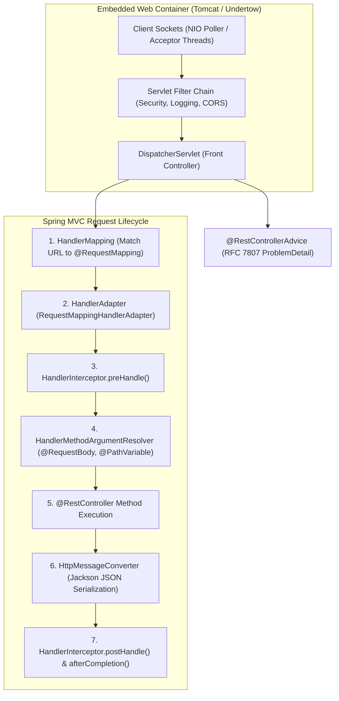
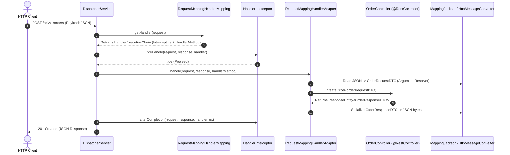
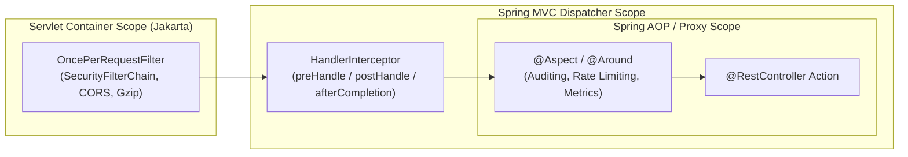
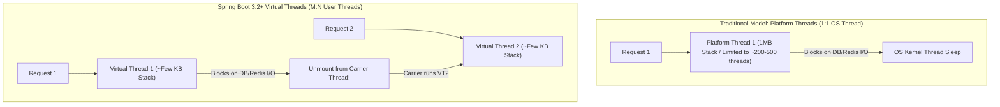

---


title: "Spring Boot Web API: DispatcherServlet Pipeline, Async Processing & Architecture"
description: "Master-level engineering guide for Spring Boot 3 Web API, covering DispatcherServlet request lifecycle, HandlerMapping/Adapter internals, Servlet Filters vs Interceptors, RFC 7807 ProblemDetail error handling, Virtual Threads, and Async Streaming."
category: "REST API Design & Web Frameworks"
tags: [java, spring-boot, spring-mvc, dispatcherservlet, rest-api, exception-handling, virtual-threads, async, performance, technical-skills, software-engineering, learning-note]
date: "2026-08-21"
---

# Spring Boot Web API: DispatcherServlet Pipeline, Async Processing & Architecture

---

## 1. Executive Summary & Runtime Architecture

**Spring Boot Web API** (built on Spring MVC and the Jakarta Servlet standard) is the premier enterprise framework for Java-based web services. Operating on an embedded servlet container (Apache Tomcat, Eclipse Jetty, or Undertow), Spring Boot handles concurrent client connections through an asynchronous non-blocking NIO connector pool and dispatches HTTP requests via the **Front Controller pattern** implemented by `DispatcherServlet`.



---

## 2. The `DispatcherServlet` Request Dispatch Pipeline

Every HTTP request routed to Spring MVC passes through `DispatcherServlet.doDispatch(HttpServletRequest, HttpServletResponse)`:



---

## 3. Filters vs. Interceptors vs. AOP Aspects

Understanding the boundary between Servlet-level components and Spring ApplicationContext components is vital for clean architecture:



### 3.1 Comparison Matrix

| Component | Execution Boundary | Access to Spring Context? | Target / Purpose |
| :--- | :--- | :--- | :--- |
| **Servlet `Filter`** | Outside `DispatcherServlet` | Yes (if registered as `@Component`) | Request header manipulation, authentication filter chains, raw body stream inspection. |
| **`HandlerInterceptor`** | Inside `DispatcherServlet` | **Yes** (Full Bean access) | Pre-controller authorization checks, handler execution timing, locale resolution. |
| **Spring `AOP Aspect`** | Around target method invocations | **Yes** | Cross-cutting business concerns, transactional boundaries (`@Transactional`), method performance monitoring. |

---

## 4. Modern RFC 7807 Error Handling (`ProblemDetail`)

Spring Boot 3 / Spring Framework 6 introduces built-in native support for **RFC 7807 Problem Details** via `ProblemDetail` and `ResponseEntityExceptionHandler`:

```java
package com.enterprise.web.exception;

import org.springframework.http.HttpStatus;
import org.springframework.http.HttpStatusCode;
import org.springframework.http.ProblemDetail;
import org.springframework.http.ResponseEntity;
import org.springframework.validation.FieldError;
import org.springframework.web.bind.MethodArgumentNotValidException;
import org.springframework.web.bind.annotation.ExceptionHandler;
import org.springframework.web.bind.annotation.RestControllerAdvice;
import org.springframework.web.context.request.WebRequest;
import org.springframework.web.servlet.mvc.method.annotation.ResponseEntityExceptionHandler;

import java.net.URI;
import java.time.Instant;
import java.util.Map;
import java.util.stream.Collectors;

@RestControllerAdvice
public class GlobalApiExceptionHandler extends ResponseEntityExceptionHandler {

    @ExceptionHandler(ResourceNotFoundException.class)
    public ProblemDetail handleNotFoundException(ResourceNotFoundException ex) {
        ProblemDetail problem = ProblemDetail.forStatusAndDetail(HttpStatus.NOT_FOUND, ex.getMessage());
        problem.setTitle("Resource Not Found");
        problem.setType(URI.create("https://api.enterprise.com/errors/not-found"));
        problem.setProperty("timestamp", Instant.now());
        return problem;
    }

    @Override
    protected ResponseEntity<Object> handleMethodArgumentNotValid(
            MethodArgumentNotValidException ex,
            org.springframework.http.HttpHeaders headers,
            HttpStatusCode status,
            WebRequest request) {

        ProblemDetail problem = ProblemDetail.forStatusAndDetail(
            HttpStatus.BAD_REQUEST, 
            "Validation failed for one or more fields."
        );
        problem.setTitle("Invalid Request Payload");
        problem.setType(URI.create("https://api.enterprise.com/errors/validation-failed"));

        Map<String, String> invalidParams = ex.getBindingResult().getFieldErrors().stream()
            .collect(Collectors.toMap(
                FieldError::getField,
                fe -> fe.getDefaultMessage() != null ? fe.getDefaultMessage() : "Invalid value",
                (first, second) -> first
            ));

        problem.setProperty("invalidFields", invalidParams);
        problem.setProperty("timestamp", Instant.now());

        return ResponseEntity.status(status).body(problem);
    }
}
```

---

## 5. High-Throughput & Java 21 Virtual Threads

With Java 21 and Spring Boot 3.2+, web APIs achieve extreme concurrent throughput without transitioning to complex reactive programming (WebFlux) by enabling **Project Loom Virtual Threads**:

```yaml
# application.yml
spring:
  threads:
    virtual:
      enabled: true # Tomcat allocates 1 lightweight virtual thread per incoming HTTP request!
```



### 5.1 Real-Time Streaming via `SseEmitter`

```java
package com.enterprise.web.controller;

import org.springframework.http.MediaType;
import org.springframework.web.bind.annotation.GetMapping;
import org.springframework.web.bind.annotation.RequestMapping;
import org.springframework.web.bind.annotation.RestController;
import org.springframework.web.servlet.mvc.method.annotation.SseEmitter;

import java.io.IOException;
import java.util.concurrent.ExecutorService;
import java.util.concurrent.Executors;

@RestController
@RequestMapping("/api/v1/stream")
public class LiveTelemetryController {

    private final ExecutorService executor = Executors.newVirtualThreadPerTaskExecutor();

    @GetMapping(value = "/metrics", produces = MediaType.TEXT_EVENT_STREAM_VALUE)
    public SseEmitter streamMetrics() {
        SseEmitter emitter = new SseEmitter(60_000L); // 60s timeout

        executor.submit(() -> {
            try {
                for (int i = 0; i < 20; i++) {
                    emitter.send(SseEmitter.event()
                        .name("telemetry-event")
                        .data(Map.of("cpu", Math.random() * 100, "mem", Math.random() * 16384)));
                    Thread.sleep(1000);
                }
                emitter.complete();
            } catch (Exception ex) {
                emitter.completeWithError(ex);
            }
        });

        return emitter;
    }
}
```

---

## 6. Dependency Injection & Bean Lifecycle Best Practices

```java
// ANTI-PATTERN: Field Injection (Hard to test, violates immutability)
@RestController
public class BadOrderController {
    @Autowired
    private OrderService orderService; // Bad practice!
}

// PRODUCTION PATTERN: Constructor Injection with Record / Final fields
@RestController
@RequestMapping("/api/v1/orders")
public class OrderController {

    private final OrderService orderService;
    private final OrderValidator orderValidator;

    // Fully immutable, easily mockable in unit tests without Spring context
    public OrderController(OrderService orderService, OrderValidator orderValidator) {
        this.orderService = Objects.requireNonNull(orderService);
        this.orderValidator = Objects.requireNonNull(orderValidator);
    }
}
```

---

## 7. Operational Troubleshooting Matrix

| Symptom | Root Cause | Engineering Solution |
| :--- | :--- | :--- |
| **`HttpMediaTypeNotSupportedException`** | Client omitted `Content-Type: application/json` header in `POST`/`PUT` requests. | Configure client headers or add lenient fallback converters. |
| **`HttpMessageNotReadableException`** | Malformed JSON syntax or enum serialization mismatch. | Add `@JsonCreator` annotations on enums and customize `Jackson2ObjectMapperBuilder`. |
| **`AsyncRequestTimeoutException`** | Long-running asynchronous execution exceeded `spring.mvc.async.request-timeout`. | Increase async timeout or implement background job queuing with polling / WebSockets. |
| **High Latency under IO Spikes** | Platform thread pool exhaustion (`server.tomcat.threads.max=200` saturated). | Enable Virtual Threads (`spring.threads.virtual.enabled=true`) or increase Tomcat max threads and connection queue. |

---

## 🔗 Graph-Linked Knowledge Base
- ⚓ REST API Principles: [[rest_api_principles|REST API Architecture & Design Principles]]
- ⚓ ASP.NET Core API: [[aspnet_core_web_api|ASP.NET Core Web API Internals]]
- ⚓ Security & JWT: [[security_jwt_and_rbac|JWT Authentication & RBAC Authorization]]
- 🔗 Java Core: [[02_Technical_Skills/01_theory_and_concepts/06_Java_Engineering/spring_boot_3_core_ioc_dependency_injection|Spring Boot 3 Core & IoC Internals]]
