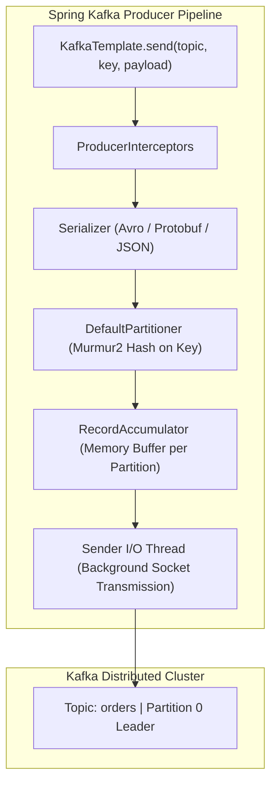
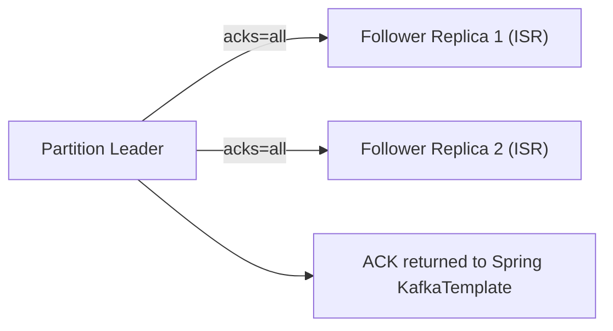
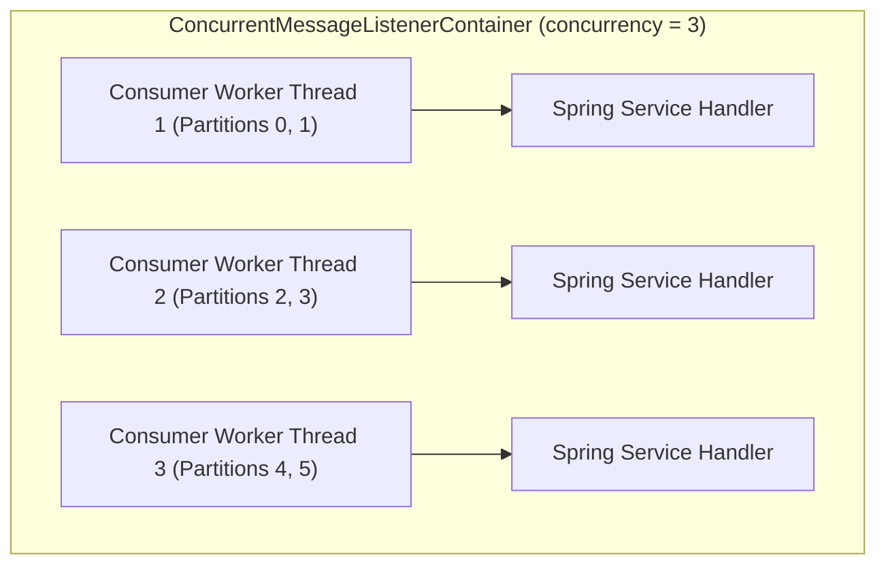
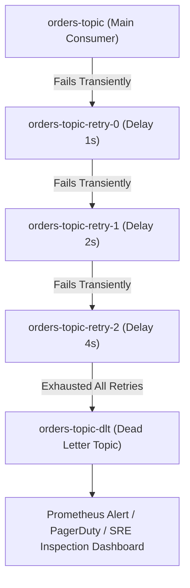

---


title: "Apache Kafka Integration with Spring Kafka: High-Throughput Event Streaming"
description: "Master-level engineering guide for Apache Kafka with Spring Boot 3 / Spring Kafka, covering Producer/Consumer threading models, partition rebalances, exactly-once semantics, Dead Letter Topics (DLT), and batching."
category: "Java Engineering"
tags: [java, spring-boot, kafka, spring-kafka, event-driven, messaging, microservices, dlt, high-throughput, technical-skills, software-engineering, learning-note]
date: "2026-08-21"
---

# Apache Kafka Integration with Spring Kafka: Architecture & High-Throughput Engineering

---

## 1. Executive Summary & Under-the-Hood Mechanics

**Apache Kafka** is a distributed, horizontally scalable, append-only commit log storage architecture designed for real-time stream processing, event sourcing, and high-volume message passing. **Spring for Apache Kafka (`spring-kafka`)** bridges the Spring programming model with the low-level Java `KafkaProducer` and `KafkaConsumer` clients.

Operating Kafka at scale requires mastering:
1. **Producer Buffering & Batching (`RecordAccumulator`)**: Coalescing individual record sends into compressed memory batches (`snappy`, `lz4`, `zstd`) per topic partition.
2. **Consumer Threading & Partition Assignment**: Single-threaded consumer loops, cooperative sticky partition rebalances, and concurrent listener containers (`ConcurrentMessageListenerContainer`).
3. **Delivery Semantics & Idempotence**: Enabling `enable.idempotence=true` and transaction coordinator commits to achieve **Exactly-Once Semantics (EOS)**.
4. **Resilience & Dead Letter Topic (DLT) Topologies**: Non-blocking retry topics with exponential backoff and poison pill isolation.



---

## 2. Producer Internal Architecture & Acks Invariants

### 2.1 The RecordAccumulator Memory Pool
The `KafkaProducer` never sends records over the network immediately. Instead, records are appended into `ProducerBatch` memory blocks inside the `RecordAccumulator`.

$$\text{Batch Ready Condition} \iff (\text{Batch Size} \ge \text{batch.size}) \lor (\text{Time Elapsed} \ge \text{linger.ms})$$

### 2.2 Producer Acknowledgement (`acks`) Tradeoffs

| `acks` Level | Safety Guarantee | Latency Profile | Data Loss Risk |
| :--- | :--- | :--- | :--- |
| **`acks=0`** | None (Fire-and-forget) | Lowest ($< 1\text{ms}$) | High (Packet drops, broker crashes lost silently) |
| **`acks=1`** | Leader broker written to local log | Medium (\$2 - 5\text{ms}$) | Medium (Leader crashes before ISR replication) |
| **`acks=all` (`-1`)** | **All In-Sync Replicas (ISR) write to log** | Higher (\$5 - 15\text{ms}$) | **Zero Data Loss** (Guaranteed by quorum ISR commit) |



---

## 3. Consumer Threading Models & Cooperative Rebalancing

In Spring Kafka, each `@KafkaListener` method is driven by a `KafkaMessageListenerContainer` or `ConcurrentMessageListenerContainer`.



### 3.1 Cooperative Sticky Assignor
Legacy eager rebalancing revoked all partition assignments across the entire consumer group during membership changes (causing "stop-the-world" consumer pauses). Modern Kafka uses the **Cooperative Sticky Assignor**:
- Unaffected consumers continue processing their existing assigned partitions uninterrupted.
- Only the specific reallocated partitions are paused and reassigned.

---

## 4. Production Spring Boot 3 Kafka Implementation Blueprint

### 4.1 Producer Configuration & Transactional Template
```java
package com.enterprise.kafka.config;

import org.apache.kafka.clients.producer.ProducerConfig;
import org.apache.kafka.common.serialization.StringSerializer;
import org.springframework.context.annotation.Bean;
import org.springframework.context.annotation.Configuration;
import org.springframework.kafka.core.DefaultKafkaProducerFactory;
import org.springframework.kafka.core.KafkaTemplate;
import org.springframework.kafka.core.ProducerFactory;
import org.springframework.kafka.support.serializer.JsonSerializer;

import java.util.HashMap;
import java.util.Map;

@Configuration
public class KafkaProducerConfiguration {

    @Bean
    public ProducerFactory<String, Object> producerFactory() {
        Map<String, Object> props = new HashMap<>();
        props.put(ProducerConfig.BOOTSTRAP_SERVERS_CONFIG, "kafka-broker-1:9092,kafka-broker-2:9092");
        props.put(ProducerConfig.KEY_SERIALIZER_CLASS_CONFIG, StringSerializer.class);
        props.put(ProducerConfig.VALUE_SERIALIZER_CLASS_CONFIG, JsonSerializer.class);
        
        // Resilience & High-Throughput Settings
        props.put(ProducerConfig.ACKS_CONFIG, "all");
        props.put(ProducerConfig.ENABLE_IDEMPOTENCE_CONFIG, "true");
        props.put(ProducerConfig.RETRIES_CONFIG, Integer.MAX_VALUE);
        props.put(ProducerConfig.MAX_IN_FLIGHT_REQUESTS_PER_CONNECTION, 5);
        props.put(ProducerConfig.BATCH_SIZE_CONFIG, 64 * 1024); // 64 KB
        props.put(ProducerConfig.LINGER_MS_CONFIG, 20); // 20 ms batch window
        props.put(ProducerConfig.COMPRESSION_TYPE_CONFIG, "lz4");

        return new DefaultKafkaProducerFactory<>(props);
    }

    @Bean
    public KafkaTemplate<String, Object> kafkaTemplate(ProducerFactory<String, Object> pf) {
        return new KafkaTemplate<>(pf);
    }
}
```

### 4.2 Consumer with Dead Letter Topic (DLT) & Backoff
```java
package com.enterprise.kafka.consumer;

import org.slf4j.Logger;
import org.slf4j.LoggerFactory;
import org.springframework.kafka.annotation.DltHandler;
import org.springframework.kafka.annotation.KafkaListener;
import org.springframework.kafka.annotation.RetryableTopic;
import org.springframework.kafka.retrytopic.DltStrategy;
import org.springframework.kafka.retrytopic.TopicSuffixingStrategy;
import org.springframework.kafka.support.KafkaHeaders;
import org.springframework.messaging.handler.annotation.Header;
import org.springframework.messaging.handler.annotation.Payload;
import org.springframework.retry.annotation.Backoff;
import org.springframework.stereotype.Service;

import java.util.UUID;

public record OrderEvent(UUID orderId, String customerId, double amount, String status) {}

@Service
public class OrderEventConsumer {

    private static final Logger log = LoggerFactory.getLogger(OrderEventConsumer.class);

    @RetryableTopic(
            attempts = "4",
            backoff = @Backoff(delay = 1000, multiplier = 2.0, maxDelay = 10000),
            topicSuffixingStrategy = TopicSuffixingStrategy.SUFFIX_WITH_INDEX_VALUE,
            dltStrategy = DltStrategy.FAIL_ON_ERROR,
            include = {TransientNetworkException.class}
    )
    @KafkaListener(topics = "orders-topic", groupId = "order-fulfillment-group", concurrency = "3")
    public void consumeOrderEvent(
            @Payload OrderEvent event,
            @Header(KafkaHeaders.RECEIVED_TOPIC) String topic,
            @Header(KafkaHeaders.RECEIVED_PARTITION) int partition,
            @Header(KafkaHeaders.OFFSET) long offset) {

        log.info("Processing order: {} from topic: {}, partition: {}, offset: {}",
                event.orderId(), topic, partition, offset);

        if (event.amount() < 0) {
            throw new IllegalArgumentException("Poison pill detected: negative amount!");
        }

        // Business fulfillment logic
    }

    @DltHandler
    public void handleDeadLetter(
            @Payload OrderEvent event,
            @Header(KafkaHeaders.ORIGINAL_OFFSET) byte[] originalOffset,
            @Header(KafkaHeaders.EXCEPTION_MESSAGE) String exceptionMessage) {

        log.error("POISON PILL ROUTED TO DLT: Order {} failed permanently. Reason: {}",
                event.orderId(), exceptionMessage);
    }
}

class TransientNetworkException extends RuntimeException {
    public TransientNetworkException(String msg) { super(msg); }
}
```

---

## 5. Non-Blocking Retry Topic Topology



---

## 6. Critical Operational Failure Modes & Mitigation

| Failure Scenario | Root Cause | Engineering Solution |
| :--- | :--- | :--- |
| **CommitFailedException** | Consumer takes longer than `max.poll.interval.ms` (default 5 min) to process batch. | Reduce `max.poll.records`, optimize DB I/O, or offload processing to worker thread pool. |
| **Poison Pill Infinite Replay** | Deserialization failure crashes consumer loop before listener invocation. | Configure `ErrorHandlingDeserializer` wrapping target JSON/Avro deserializer. |
| **Silent Message Dropping** | Producer default `acks=1` loses un-replicated records on broker crash. | Set `acks=all`, `min.insync.replicas=2`, `replication.factor=3`. |
| **Partition Hotspotting** | Poor key distribution (e.g. all events share identical key) routes all traffic to 1 partition. | Add random salt to key or implement custom uniform Murmur3 hash partitioner. |

---

## 7. Prometheus Operational Telemetry Metrics

```prometheus
# Consumer Lag per Partition (Critical SLA Metric)
sum(kafka_consumergroup_lag{topic="orders-topic"}) by (consumergroup, partition) > 1000

# Producer Request Latency (p99)
histogram_quantile(0.99, rate(kafka_producer_request_latency_ms_bucket[5m])) < 25

# Failed Message Delivery Rate
rate(kafka_producer_record_error_total[5m]) > 0
```

---

## 🔗 Graph-Linked Knowledge Base
- ⚓ Distributed Messaging: [[02_Technical_Skills/01_theory_and_concepts/14_Messaging_and_Event_Driven/kafka_rabbitmq_event_streaming_architecture|Kafka vs RabbitMQ Architecture]]
- ⚓ Outbox & SMR: [[02_Technical_Skills/01_theory_and_concepts/14_Messaging_and_Event_Driven/event_driven_patterns_outbox_saga_cqrs|Event-Driven Patterns: Outbox, Saga, CQRS]]
- 🔗 Caching: [[distributed_caching_spring_cache_redis|Distributed Caching with Spring Cache & Redis]]
