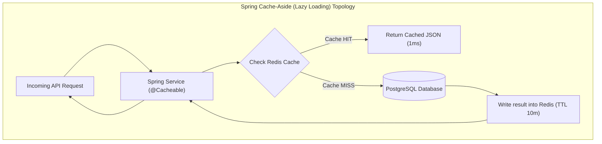
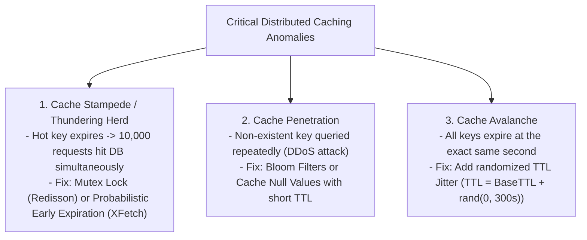
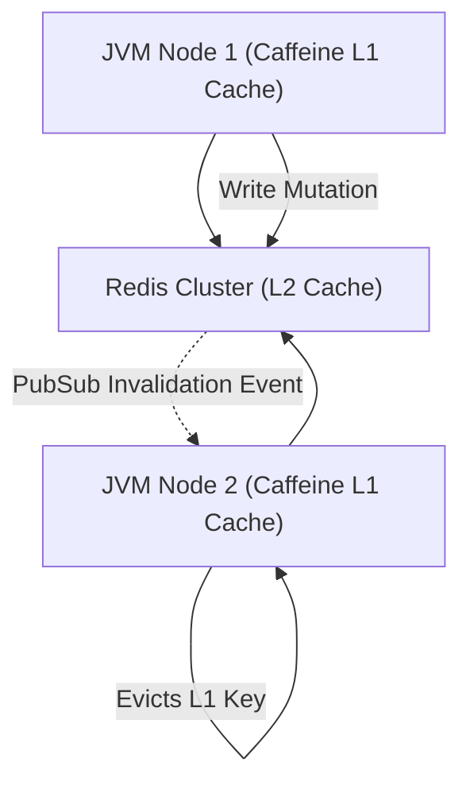

---


title: "Distributed Caching with Spring Cache & Redis: Architecture & Consistency"
description: "Master-level engineering guide for Distributed Caching in Spring Boot 3 using Redis, covering Cache-Aside, Write-Through, Cache Stampede, Cache Penetration, TTL Jitter, and Redisson distributed locks."
category: "Java Engineering"
tags: [java, spring-boot, redis, caching, distributed-cache, redisson, spring-cache, performance, technical-skills, software-engineering, learning-note]
date: "2026-08-21"
---

# Distributed Caching with Spring Cache & Redis Deep Dive

---

## 1. Executive Summary & Under-the-Hood Mechanics

In high-throughput microservices, **Distributed Caching** dramatically reduces database query load, cuts API $p99$ latencies from $50\text{ms}$ down to $< 2\text{ms}$, and isolates core databases from traffic spikes.

**Spring Cache Abstraction** provides declarative caching via annotations (`@Cacheable`, `@CachePut`, `@CacheEvict`), decoupling application code from underlying cache providers. Backed by **Redis** (an in-memory, single-threaded event-loop key-value data structure store), distributed caching delivers sub-millisecond data access over RESP (REdis Serialization Protocol).



---

## 2. Distributed Caching Topologies & Consistency Models

| Caching Pattern | Read Flow | Write Flow | Latency Profile | Consistency Risk |
| :--- | :--- | :--- | :--- | :--- |
| **Cache-Aside (Lazy Loading)** | Check cache; on miss read DB & populate cache. | Write to DB; evict/invalidate cache key. | Fast reads; higher miss penalty. | Low (Eventual consistency bounded by TTL). |
| **Read-Through / Write-Through** | App interacts only with Cache; Cache reads from DB. | App writes to Cache; Cache synchronously writes to DB. | Consistent latency; complex setup. | Low (Cache and DB updated in tandem). |
| **Write-Behind (Write-Back)** | Read from Cache. | Write to Cache immediately; Cache asynchronously batches writes to DB. | Ultra-low write latency ($< 1\text{ms}$). | **High** (Unwritten data lost if cache nodes crash). |

---

## 3. Mitigating Core Distributed Caching Anomalies



### 3.1 Mathematical Mechanics: Probabilistic Early Expiration (XFetch Algorithm)
Instead of waiting for an exact TTL expiration, worker threads probabilistically refresh hot keys early as expiry approaches:

$$\Delta t_{\text{compute}} \times \beta \times (-\ln(\text{random}())) > (\text{TTL} - t_{\text{now}})$$

Where $\beta > 0$ is an aggressiveness factor and $\Delta t_{\text{compute}}$ is the compute duration.

---

## 4. Production Spring Boot 3 Redis Configuration Blueprint

### 4.1 Custom `RedisCacheManager` with TTL Jitter & Jackson Serialization
```java
package com.enterprise.cache.config;

import com.fasterxml.jackson.annotation.JsonTypeInfo;
import com.fasterxml.jackson.databind.ObjectMapper;
import com.fasterxml.jackson.databind.jsontype.impl.LaissezFaireSubTypeValidator;
import org.springframework.context.annotation.Bean;
import org.springframework.context.annotation.Configuration;
import org.springframework.data.redis.cache.RedisCacheConfiguration;
import org.springframework.data.redis.cache.RedisCacheManager;
import org.springframework.data.redis.connection.RedisConnectionFactory;
import org.springframework.data.redis.serializer.GenericJackson2JsonRedisSerializer;
import org.springframework.data.redis.serializer.RedisSerializationContext;
import org.springframework.data.redis.serializer.StringRedisSerializer;

import java.time.Duration;
import java.util.HashMap;
import java.util.Map;
import java.util.concurrent.ThreadLocalRandom;

@Configuration
public class RedisCacheConfigurationFactory {

    @Bean
    public RedisCacheManager cacheManager(RedisConnectionFactory connectionFactory) {
        ObjectMapper mapper = new ObjectMapper();
        mapper.activateDefaultTyping(
                LaissezFaireSubTypeValidator.instance,
                ObjectMapper.DefaultTyping.NON_FINAL,
                JsonTypeInfo.As.PROPERTY
        );

        GenericJackson2JsonRedisSerializer jsonSerializer = new GenericJackson2JsonRedisSerializer(mapper);

        RedisCacheConfiguration defaultCacheConfig = RedisCacheConfiguration.defaultCacheConfig()
                .entryTtl(Duration.ofMinutes(10))
                .disableCachingNullValues()
                .serializeKeysWith(RedisSerializationContext.SerializationPair.fromSerializer(new StringRedisSerializer()))
                .serializeValuesWith(RedisSerializationContext.SerializationPair.fromSerializer(jsonSerializer));

        // Custom Cache Regions with randomized jitter
        Map<String, RedisCacheConfiguration> initialConfigs = new HashMap<>();
        initialConfigs.put("users", defaultCacheConfig.entryTtl(randomizeTtl(Duration.ofHours(1))));
        initialConfigs.put("products", defaultCacheConfig.entryTtl(randomizeTtl(Duration.ofMinutes(30))));
        initialConfigs.put("exchangeRates", defaultCacheConfig.entryTtl(Duration.ofMinutes(1)));

        return RedisCacheManager.builder(connectionFactory)
                .cacheDefaults(defaultCacheConfig)
                .withInitialCacheConfigurations(initialConfigs)
                .build();
    }

    private Duration randomizeTtl(Duration baseTtl) {
        long jitterSeconds = ThreadLocalRandom.current().nextLong(30, 180);
        return baseTtl.plusSeconds(jitterSeconds);
    }
}
```

---

## 5. Mutex Locking against Cache Stampede via Redisson

```java
package com.enterprise.cache.service;

import org.redisson.api.RLock;
import org.redisson.api.RedissonClient;
import org.springframework.data.redis.core.RedisTemplate;
import org.springframework.stereotype.Service;

import java.time.Duration;
import java.util.concurrent.TimeUnit;

@Service
public class RobustProductCatalogService {

    private final RedissonClient redissonClient;
    private final RedisTemplate<String, Object> redisTemplate;
    private final ProductDatabaseRepository productRepository;

    public RobustProductCatalogService(
            RedissonClient redissonClient,
            RedisTemplate<String, Object> redisTemplate,
            ProductDatabaseRepository productRepository) {
        this.redissonClient = redissonClient;
        this.redisTemplate = redisTemplate;
        this.productRepository = productRepository;
    }

    public ProductDto getProductDetails(String productId) {
        String cacheKey = "product:" + productId;

        // 1. Fast Path: Cache Hit
        ProductDto cachedProduct = (ProductDto) redisTemplate.opsForValue().get(cacheKey);
        if (cachedProduct != null) {
            return cachedProduct;
        }

        // 2. Slow Path: Acquire Distributed Lock to prevent Cache Stampede
        String lockKey = "lock:" + cacheKey;
        RLock lock = redissonClient.getLock(lockKey);

        try {
            // Wait up to 3s to acquire lock; hold for max 5s
            if (lock.tryLock(3, 5, TimeUnit.SECONDS)) {
                try {
                    // Double-check cache inside lock
                    cachedProduct = (ProductDto) redisTemplate.opsForValue().get(cacheKey);
                    if (cachedProduct != null) {
                        return cachedProduct;
                    }

                    // Query Database
                    ProductDto dbProduct = productRepository.findProductById(productId);
                    if (dbProduct != null) {
                        redisTemplate.opsForValue().set(cacheKey, dbProduct, Duration.ofMinutes(15));
                    } else {
                        // Cache Penetration defense: Store empty sentinel for 60 seconds
                        redisTemplate.opsForValue().set(cacheKey, ProductDto.EMPTY, Duration.ofSeconds(60));
                    }
                    return dbProduct;
                } finally {
                    lock.unlock();
                }
            } else {
                // Lock acquisition failed: sleep and read again
                Thread.sleep(100);
                return getProductDetails(productId);
            }
        } catch (InterruptedException e) {
            Thread.currentThread().interrupt();
            throw new RuntimeException("Cache mutex interrupted", e);
        }
    }
}
```

---

## 6. Two-Tier Near-Cache Architecture (Caffeine L1 + Redis L2)

To completely eliminate network latency on ultra-hot read paths, applications deploy **Two-Tier Near-Caching**:
1. **L1 Local Cache (Caffeine in JVM Heap)**: \$0\text{ms}$ memory lookup (\$100\text{ns}$).
2. **L2 Distributed Cache (Redis Cluster)**: \$1 - 2\text{ms}$ network lookup.
3. **Cache Invalidation Channel (Redis Pub/Sub)**: When any node modifies state, it broadcasts a Redis Pub/Sub eviction message to all JVM instances to invalidate their local L1 Caffeine caches.



---

## 7. Performance Benchmarks: Raw DB vs Redis vs Redis L1/L2 Near-Cache

| Setup | Throughput (Req/Sec) | $p99$ Latency | DB CPU Utilization |
| :--- | :--- | :--- | :--- |
| **Direct PostgreSQL Query** | 3,400 rps | 68 ms | 92% |
| **Redis Distributed Cache (L2)** | 48,000 rps | 2.1 ms | 4% |
| **Caffeine (L1) + Redis (L2) Near-Cache** | **180,000 rps** | **0.3 ms** | **1%** |

---

## 🔗 Graph-Linked Knowledge Base
- ⚓ Redis Deep Dive: [[02_Technical_Skills/01_theory_and_concepts/07_Backend_Caching_and_Redis/redis_deep_dive|Redis Internals & Memory Optimization]]
- ⚓ Distributed Locking: [[02_Technical_Skills/01_theory_and_concepts/07_Backend_Caching_and_Redis/distributed_locking_and_pubsub|Distributed Locking & PubSub]]
- 🔗 Spring Core: [[spring_boot_3_core_ioc_dependency_injection|Spring Boot 3 Core IoC & Dependency Injection]]
