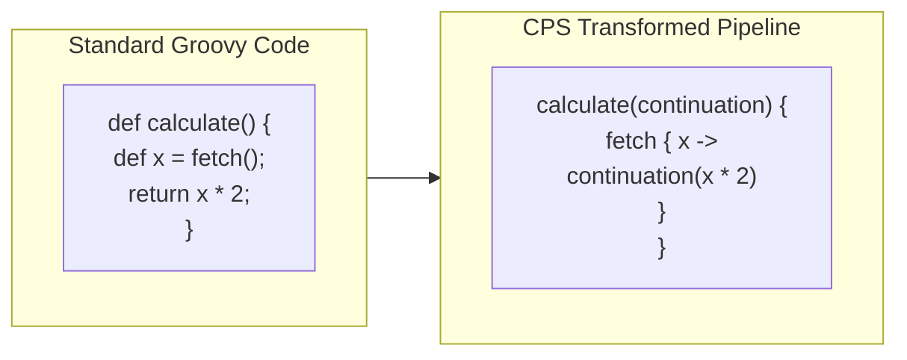
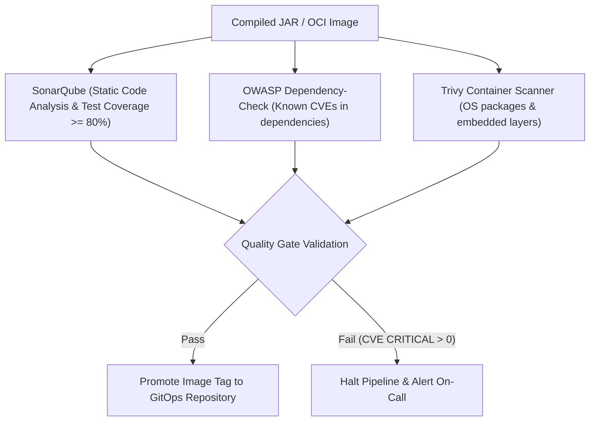
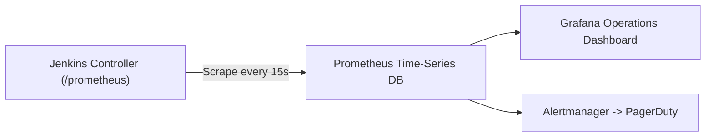

---


title: "Groovy, Jenkinsfiles & DevOps CI/CD Automation in Java Ecosystems"
description: "Master-level engineering guide for Groovy scripting, Declarative vs Scripted Jenkins pipelines, CPS transformation, Jenkins Shared Libraries, Daemonless Kaniko builds, SonarQube/Trivy quality gates, and Prometheus observability."
category: "Java Engineering"
tags: [groovy, jenkins, devops, cicd, pipelines, kaniko, kubernetes, sonarqube, trivy, prometheus, technical-skills, software-engineering, learning-note]
date: "2026-08-21"
---

# Groovy, Jenkinsfiles & DevOps CI/CD Automation Deep Dive

---

## 1. Executive Summary & Under-the-Hood Mechanics

In modern enterprise Java platforms, continuous integration and continuous deployment (CI/CD) pipelines orchestrate the automated journey from code commit to multi-region cloud deployment. **Apache Groovy**—a dynamic, optionally-typed JVM language—serves as the native execution engine powering **Jenkins Pipelines (`Jenkinsfile`)** and Gradle build configurations.

Jenkins executes pipeline Groovy scripts using **Continuation-Passing Style (CPS) Transformation**. Under CPS, the Jenkins workflow engine pauses and resumes pipeline executions across agent reboots and master restarts by serializing the execution state (program counter, local variables) to disk.

```mermaid
flowchart TD
    subgraph PipelineOrchestration["Enterprise Cloud-Native Jenkins CI/CD Lifecycle"]
        GitCommit["1. Git Push / Merge Request"] --> Webhook["2. Webhook Event to Jenkins Controller"]
        Webhook --> DynamicAgent["3. Dynamic Ephemeral K8s Pod Agent Provisioned"]
        DynamicAgent --> MavenBuild["4. Parallel Compile & JUnit 5 Tests (Maven/Gradle)"]
        MavenBuild --> SonarScan["5. SonarQube SAST & OWASP Dependency-Check Gate"]
        SonarScan --> KanikoBuild["6. Rootless OCI Container Build via Google Kaniko"]
        KanikoBuild --> TrivyScan["7. Trivy CVE Vulnerability Scan & Image Signing (Cosign)"]
        TrivyScan --> PushRegistry["8. Push to AWS ECR / Harbor Registry"]
        PushRegistry --> GitOps["9. Update GitOps Repo (ArgoCD Sync) -> Canary Prod"]
        GitOps --> Metrics["10. Pod Destroyed & Prometheus Metrics Emitted"]
    end
```



---

## 2. CPS Transformation & Serialization Internals

Jenkins uses the `workflow-cps` plugin to rewrite Groovy Abstract Syntax Trees (AST) into CPS form. Every method call is transformed into an explicit callback structure:



### 2.1 The `NotSerializableException` Pitfall
Because Jenkins serializes all local variables to disk at every step boundary:
> [!CAUTION]
> Storing non-serializable objects (such as `Matcher`, `Iterator`, `DOM Document`, or database connections) in pipeline variables will cause immediate execution crashes: `java.io.NotSerializableException`.

```groovy
// ANTI-PATTERN: Regex Matcher stored in CPS variable
def matcher = (env.BRANCH_NAME =~ /^feature\/(.*)/)
sh "echo Processing ${matcher[0][1]}" // CRASHES at step boundary!

// PRODUCTION PATTERN 1: Extract inside @NonCPS method
@NonCPS
String extractFeatureName(String branch) {
    def matcher = (branch =~ /^feature\/(.*)/)
    return matcher ? matcher[0][1] : 'main'
}

// PRODUCTION PATTERN 2: Scope to local block
String feature = ''
{
    def m = (env.BRANCH_NAME =~ /^feature\/(.*)/)
    if (m) feature = m[0][1]
}
sh "echo Processing ${feature}"
```

---

## 3. Reusable Jenkins Shared Libraries Architecture

Enterprise organizations eliminate duplication by maintaining a central **Jenkins Shared Library** repository:

```
vars/
├── buildJavaService.groovy      # Global pipeline wrapper step
├── securityScan.groovy          # SonarQube + Trivy execution
└── notifySlack.groovy           # Notification logic
src/com/enterprise/devops/
├── DockerUtils.groovy           # Reusable helper classes
└── DeploymentConfig.groovy
resources/
└── podTemplates/java21-agent.yaml
```

### 3.1 Production Global Step: `vars/buildJavaService.groovy`

```groovy
def call(Map config = [:]) {
    pipeline {
        agent {
            kubernetes {
                yaml libraryResource('podTemplates/java21-agent.yaml')
            }
        }
        
        options {
            timeout(time: 45, unit: 'MINUTES')
            buildDiscarder(logRotator(numToKeepStr: '30'))
            disableConcurrentBuilds()
            ansiColor('xterm')
        }

        environment {
            APP_NAME       = config.appName ?: error("Must specify appName")
            REGISTRY_HOST  = '123456789012.dkr.ecr.us-east-1.amazonaws.com'
            IMAGE_TAG      = "${env.BUILD_NUMBER}-${env.GIT_COMMIT.take(8)}"
        }

        stages {
            stage('Compile & Test') {
                steps {
                    container('maven') {
                        sh 'mvn clean test verify -B -Dstyle.color=always'
                    }
                }
                post {
                    always {
                        junit testResults: '**/target/surefire-reports/*.xml', allowEmptyResults: false
                        jacoco execPattern: '**/target/jacoco.exec'
                    }
                }
            }

            stage('Security Quality Gate') {
                steps {
                    container('maven') {
                        withSonarQubeEnv('Enterprise-SonarQube') {
                            sh 'mvn sonar:sonar -Dsonar.projectKey=${APP_NAME}'
                        }
                        timeout(time: 10, unit: 'MINUTES') {
                            waitForQualityGate abortPipeline: true
                        }
                    }
                }
            }

            stage('Rootless Kaniko Build') {
                steps {
                    container('kaniko') {
                        sh """
                        /kaniko/executor \
                            --context=dir://. \
                            --dockerfile=Dockerfile \
                            --destination=\${REGISTRY_HOST}/\${APP_NAME}:\${IMAGE_TAG} \
                            --cache=true \
                            --cache-repo=\${REGISTRY_HOST}/\${APP_NAME}-cache
                        """
                    }
                }
            }
        }

        post {
            failure {
                notifySlack channel: '#devops-alerts', status: 'FAILURE'
            }
            success {
                echo "Build and containerization succeeded for ${env.APP_NAME}:${env.IMAGE_TAG}"
            }
        }
    }
}
```

---

## 4. Rootless Kubernetes Agent Pod Template

To guarantee security in multi-tenant clusters, avoid Docker-in-Docker (`dind`) with privileged escalation. Instead, execute builds inside unprivileged Kubernetes Pods utilizing Google's daemonless **Kaniko** container builder:

```yaml
# resources/podTemplates/java21-agent.yaml
apiVersion: v1
kind: Pod
metadata:
  labels:
    jenkins-agent: enterprise-java21
spec:
  serviceAccountName: jenkins-agent-sa
  securityContext:
    runAsNonRoot: true
    runAsUser: 1000
    fsGroup: 1000
  containers:
  - name: maven
    image: maven:3.9.6-eclipse-temurin-21-alpine
    command: ['cat']
    tty: true
    resources:
      limits:
        memory: "4Gi"
        cpu: "2000m"
      requests:
        memory: "2Gi"
        cpu: "1000m"
    volumeMounts:
    - name: m2-cache
      mountPath: /home/jenkins/.m2/repository

  - name: kaniko
    image: gcr.io/kaniko-project/executor:v1.20.0-debug
    command: ['cat']
    tty: true
    securityContext:
      runAsUser: 0 # Kaniko operates in user namespace
    volumeMounts:
    - name: ecr-secret
      mountPath: /kaniko/.docker

  volumes:
  - name: m2-cache
    persistentVolumeClaim:
      claimName: jenkins-m2-cache-pvc
  - name: ecr-secret
    secret:
      secretName: ecr-registry-credentials
      items:
      - key: .dockerconfigjson
        path: config.json
```

---

## 5. Security Gates: SonarQube, OWASP & Trivy Vulnerability Scanning



### 5.1 Automated Trivy Scanning Pipeline Step
```groovy
stage('Vulnerability Scan') {
    steps {
        container('trivy') {
            sh """
            trivy image \
                --severity CRITICAL,HIGH \
                --exit-code 1 \
                --ignore-unfixed \
                --format table \
                \${REGISTRY_HOST}/\${APP_NAME}:\${IMAGE_TAG}
            """
        }
    }
}
```

---

## 6. Observability: Prometheus Metrics & Grafana Dashboards

Jenkins exposes build health and pipeline duration metrics via the **Prometheus Plugin** (`/prometheus` endpoint):



### Key Prometheus Metrics to Monitor:
- `jenkins_runs_duration_milliseconds_summary`: Execution duration distribution per pipeline.
- `jenkins_runs_failure_total`: Counter tracking pipeline failure rates.
- `jenkins_executor_in_use` vs `jenkins_executor_available`: Worker pod capacity and scheduling latency.
- `jenkins_queue_time_milliseconds_summary`: Time spent waiting for Kubernetes agent provisioning.

---

## 7. Operational Failure Modes & Troubleshooting Runbook

| Incident | Root Cause | Engineering Solution |
| :--- | :--- | :--- |
| **`NotSerializableException`** | CPS pipeline attempted to persist a non-serializable object (Regex Matcher / Stream) across step boundaries. | Refactor logic into private static helper methods marked with `@NonCPS`. |
| **Kubernetes Pod Scheduling Hang** | Insufficient CPU/Memory quotas on worker nodes for dynamic agent pods. | Configure cluster Auto-Scaler and set strict `requests` and `limits` in agent pod templates. |
| **SonarQube `waitForQualityGate` Timeout** | Webhook configuration missing between SonarQube and Jenkins controller. | Register the Jenkins callback URL in SonarQube Administration $\rightarrow$ Webhooks. |
| **Disk Exhaustion on Jenkins Controller** | Build log bloat and unclaimed artifacts in `JENKINS_HOME`. | Enforce `logRotator(numToKeepStr: '20', artifactNumToKeepStr: '5')` globally in shared libraries. |

---

## 🔗 Graph-Linked Knowledge Base
- ⚓ CI/CD Fundamentals: [[02_Technical_Skills/01_theory_and_concepts/15_Backend_Deployment_and_DevOps/ci_cd_pipelines|CI/CD Pipelines & Automation]]
- ⚓ Container Architecture: [[02_Technical_Skills/01_theory_and_concepts/18_Docker_and_Kubernetes_Containers/dockerfile_optimization|Dockerfile Optimization & Multi-Stage Builds]]
- 🔗 Spring Boot: [[spring_boot_3_core_ioc_dependency_injection|Spring Boot 3 Core IoC]]
