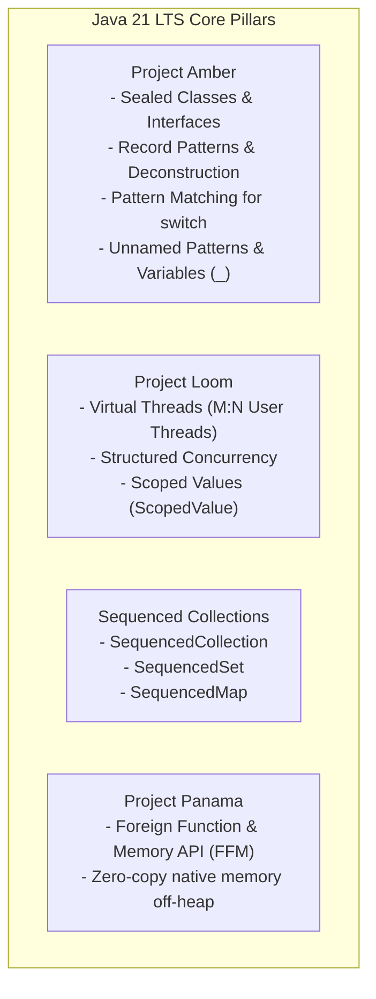
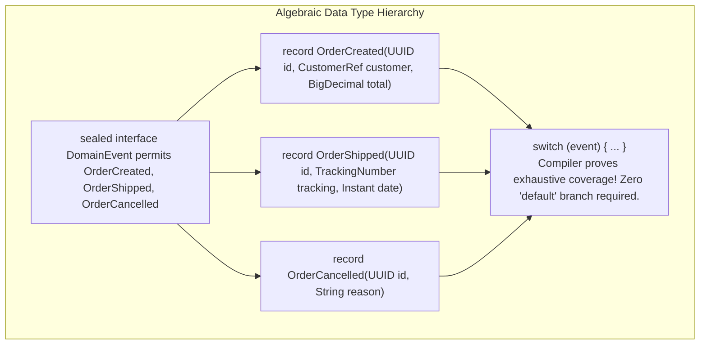
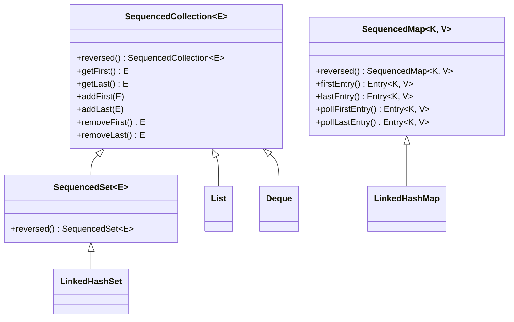
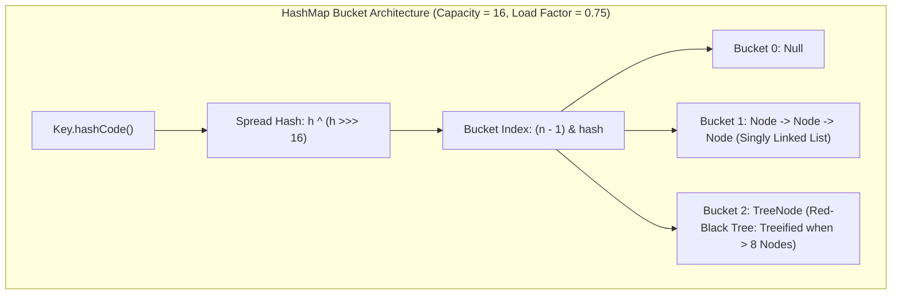
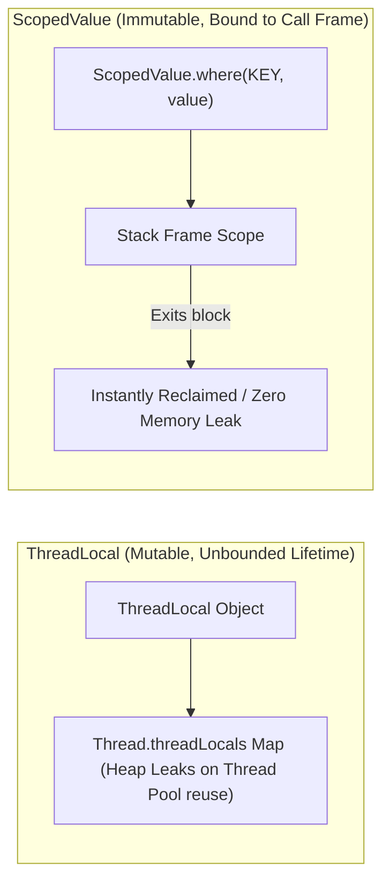

---


title: "Java 21 Core Syntax, Modern OOP & Collections Deep Dive"
description: "Master-level engineering guide for modern Java 21 LTS features, Pattern Matching for Switch, Record Deconstruction, Sealed Type Hierarchies, Sequenced Collections, HashMap internals, and Scoped Values."
category: "Java Engineering"
tags: [java, java-21, oop, pattern-matching, records, sealed-classes, sequenced-collections, collections, hashmap, performance, technical-skills, software-engineering, learning-note]
date: "2026-08-21"
---

# Java 21 Core Syntax, Modern OOP & Collections Deep Dive

---

## 1. Executive Summary & Under-the-Hood Mechanics

**Java 21** (Long Term Support) represents one of the most substantial architectural evolutions in the history of the Java Virtual Machine. Integrating multi-year OpenJDK initiatives—including **Project Amber** (Productivity and Language Ergonomics), **Project Loom** (High-Throughput Concurrency), and **Project Panama** (Foreign Memory Interop)—Java 21 transforms Java from a verbose imperative language into a high-performance modern language supporting expressive Algebraic Data Types (ADTs) and immutable data modeling.



---

## 2. Sealed Types & Record Pattern Matching (Algebraic Data Types)

Java 21 enables mathematically exhaustive **Algebraic Data Types (Sum and Product Types)** by combining `sealed` hierarchies (Sum Types) with `record` components (Product Types).



### 2.1 Production Domain Event Deconstruction Pattern

```java
package com.enterprise.domain.event;

import java.math.BigDecimal;
import java.time.Instant;
import java.util.UUID;

// Sealed Sum Type: Explicitly permits exactly 3 subclasses
public sealed interface OrderEvent permits OrderEvent.Created, OrderEvent.Shipped, OrderEvent.Cancelled {

    record Customer(UUID id, String email, String countryCode) {}
    record TrackingInfo(String carrier, String trackingCode, Instant estimatedDelivery) {}

    // Product Types
    record Created(UUID orderId, Customer customer, BigDecimal amount) implements OrderEvent {}
    record Shipped(UUID orderId, TrackingInfo tracking) implements OrderEvent {}
    record Cancelled(UUID orderId, String cancellationReason, int errorCode) implements OrderEvent {}
}

public class OrderEventRouter {

    /**
     * Deep nested record deconstruction and guarded pattern matching.
     */
    public String handleEvent(OrderEvent event) {
        return switch (event) {
            // Nested deconstruction with guard condition
            case OrderEvent.Created(UUID id, OrderEvent.Customer(var _, var email, "US"), BigDecimal amt) 
                when amt.compareTo(new BigDecimal("5000")) > 0 ->
                    "ALERT: Large Domestic US Order " + id + " ($" + amt + ") by " + email;

            case OrderEvent.Created(UUID id, OrderEvent.Customer(var _, var email, var country), BigDecimal amt) ->
                "Standard Order " + id + " from " + country + " (" + email + ") Amount: $" + amt;

            // Deconstruction of tracking nested record
            case OrderEvent.Shipped(UUID id, OrderEvent.TrackingInfo(var carrier, var code, var _)) ->
                "Dispatched Order " + id + " via " + carrier + " (Tracking: " + code + ")";

            // Unnamed variable discard pattern (_)
            case OrderEvent.Cancelled(UUID id, var reason, _) ->
                "Order " + id + " was cancelled due to: " + reason;
        };
    }
}
```

---

## 3. Sequenced Collections Architecture

Prior to Java 21, the Java Collections Framework lacked a unified contract for collections with a defined encounter order. Operations like retrieving the first or last element required differing APIs across collection types:



### 3.1 Sequenced Operations in Practice

```java
import java.util.*;

public class SequencedCollectionsDemo {
    public static void processAuditTrail() {
        SequencedMap<String, String> auditLog = new LinkedHashMap<>();
        auditLog.put("08:00", "System Boot");
        auditLog.put("08:05", "User Login: Alice");
        auditLog.put("08:12", "Order Placed: #9901");

        // Uniform first & last access
        Map.Entry<String, String> firstEvent = auditLog.firstEntry(); // ("08:00", "System Boot")
        Map.Entry<String, String> latestEvent = auditLog.lastEntry();  // ("08:12", "Order Placed: #9901")

        // Zero-copy reverse view
        SequencedMap<String, String> reverseChronological = auditLog.reversed();
        System.out.println("Most recent event timestamp: " + reverseChronological.firstEntry().getKey());
    }
}
```

---

## 4. Modern Collections Internals: `HashMap` & `ConcurrentHashMap`

Understanding the underlying binary structure of Java collections prevents catastrophic performance cliffs under high load.



### 4.1 `HashMap` Critical Thresholds
1. **Bitwise Masking**: `(n - 1) & hash` replaces expensive modulo `%` operations. Table capacity is always forced to powers of 2.
2. **Treeification Threshold (`TREEIFY_THRESHOLD = 8`)**: When collisions in a single bucket exceed 8 elements and total table capacity $\ge 64$, the bucket morphs from a singly linked list ($O(N)$ lookup) into a **Red-Black Balanced Binary Search Tree** ($O(\log N)$ lookup).
3. **Untreeify Threshold (`UNTREEIFY_THRESHOLD = 6`)**: During resizing, if bucket elements drop to 6 or fewer, the tree converts back to a linked list.

### 4.2 `ConcurrentHashMap` Concurrency Model
- Eliminates segment-level locks (from Java 7).
- Uses **Lock-Free Compare-And-Swap (CAS)** for inserting the first node into empty buckets.
- Employs **Synchronized Bucket Head Locking** for mutating colliding buckets, ensuring contention is isolated strictly to individual hash buckets.

---

## 5. Scoped Values (`ScopedValue<T>`) vs. `ThreadLocal<T>`

In high-concurrency environments with millions of Virtual Threads, `ThreadLocal` creates severe memory bloat and retention leaks. Java 21 introduces **`ScopedValue<T>`** for lightweight, immutable contextual data sharing:



### 5.1 Production `ScopedValue` Usage

```java
import java.util.UUID;

public class SecurityContextHolder {

    public static final ScopedValue<UUID> CURRENT_USER_ID = ScopedValue.newInstance();
    public static final ScopedValue<String> CORRELATION_ID = ScopedValue.newInstance();

    public static void executeInUserContext(UUID userId, String correlationId, Runnable task) {
        // Scoped value binding is strictly bounded to the execution block
        ScopedValue.where(CURRENT_USER_ID, userId)
                   .where(CORRELATION_ID, correlationId)
                   .run(task);
        // Once run completes, values are completely unbound
    }

    public static void processOrder() {
        if (CURRENT_USER_ID.isBound()) {
            UUID user = CURRENT_USER_ID.get();
            System.out.println("Processing order for user: " + user);
        }
    }
}
```

---

## 6. Modern Java 21 Idioms vs Legacy Anti-Patterns

| Legacy Anti-Pattern | Modern Java 21 Idiom | Rationale / Engineering Benefit |
| :--- | :--- | :--- |
| **JavaBeans DTO with getters/setters** | Immutable `record` | Thread-safe, concise, automatic `equals`/`hashCode`/`toString`. |
| **Open abstract class trees** | `sealed interface` + `permits` | Exhaustive compile-time checks, domain boundary encapsulation. |
| **Explicit casting after `instanceof`** | Pattern Matching `if (obj instanceof String s)` | Eliminates `ClassCastException` risk and boilerplate code. |
| **Unbounded `ThreadLocal` in thread pools** | `ScopedValue<T>` | Eliminates memory leaks and enables Virtual Thread scaling. |
| **`Arrays.asList()` / `Collections.unmodifiableList()`** | `List.of()`, `Set.of()`, `Map.of()` | True JVM-optimized immutable collections with zero array copy. |

---

## 7. Operational Failure Modes & Troubleshooting

| Incident | Root Cause | Engineering Solution |
| :--- | :--- | :--- |
| **`MatchException` at Runtime** | A sealed interface added a new permitted subclass, but switch statements were not recompiled. | Enforce full clean build and CI checks on domain contract changes. |
| **`ConcurrentModificationException`** | Mutating a collection while iterating through standard `Iterator` or enhanced for-loop. | Use `collection.removeIf(...)`, `ConcurrentHashMap`, or create a defensive copy (`List.copyOf(...)`). |
| **`HashMap` Infinite Loop / High CPU** | Non-thread-safe `HashMap` accessed concurrently by multiple threads, corrupting bucket linked lists. | Replace with `ConcurrentHashMap` or synchronize access. |

---

## 🔗 Graph-Linked Knowledge Base
- ⚓ Virtual Threads: [[java_concurrency_multithreading_virtual_threads|Java Concurrency & Virtual Threads]]
- ⚓ Stream API: [[java_stream_api_functional_programming|Java Stream API & Functional Programming]]
- 🔗 JVM Internals: [[jvm_architecture_memory_garbage_collection|JVM Architecture & Garbage Collection]]
