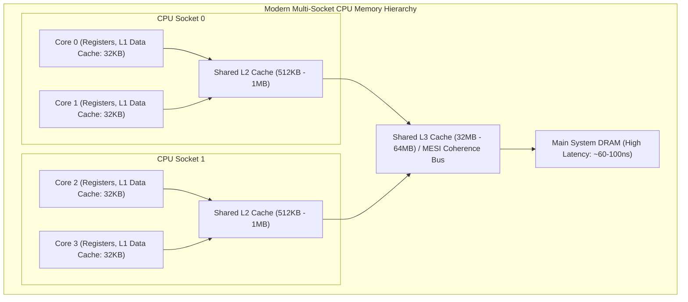
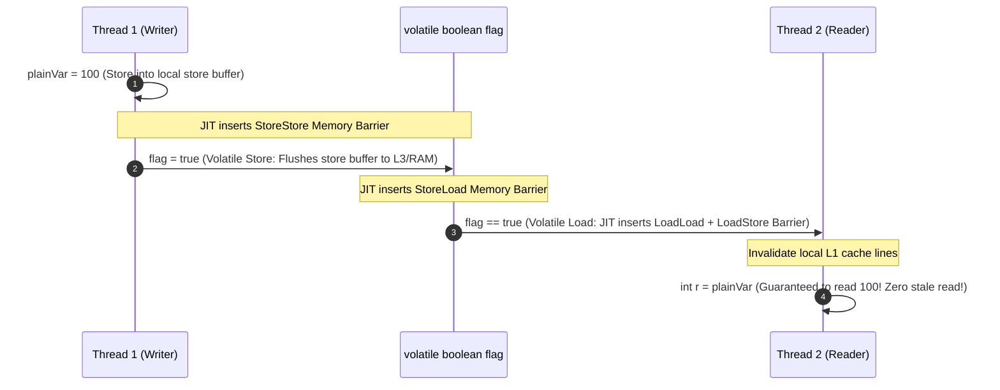
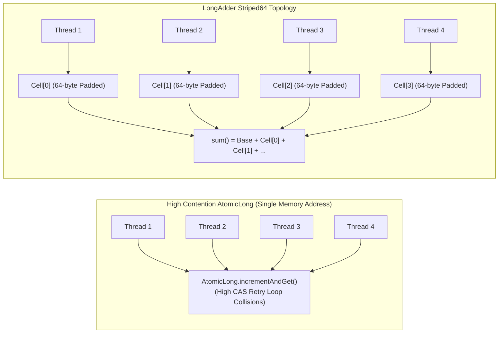
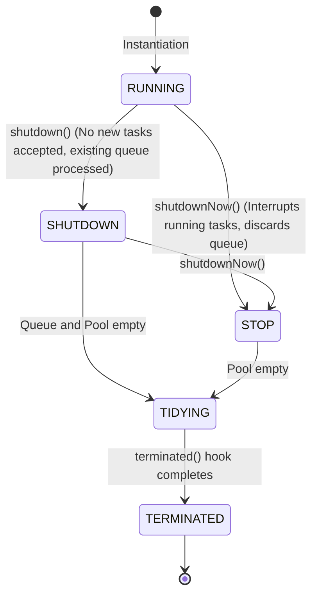
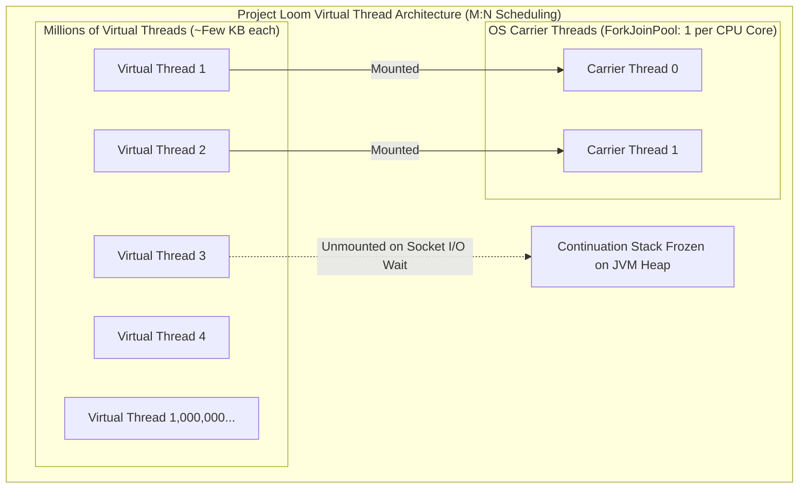

---


title: "Java Concurrency, Multithreading & Virtual Threads (Project Loom)"
description: "Master-level engineering guide for Java concurrency, memory models (JMM), synchronized, volatile, CAS operations, ThreadPoolExecutor, ForkJoinPool work-stealing, and Java 21 Virtual Threads (Project Loom)."
category: "Java Engineering"
tags: [java, concurrency, virtual-threads, project-loom, multithreading, jmm, cas, forkjoinpool, performance, technical-skills, software-engineering, learning-note]
date: "2026-08-21"
---

# Java Concurrency, Multithreading & Virtual Threads Deep Dive

---

## 1. Executive Summary & Hardware Memory Hierarchy

Java concurrency is built upon one of the software industry's most mathematically rigorous foundations: the **Java Memory Model (JMM - JSR 133)**. Concurrency engineering has evolved across three major eras:
1. **The Classic Era (Java 1.0 - 1.4)**: Heavy OS-level monitor primitives (`synchronized`, `wait()`, `notify()`).
2. **The High-Performance Utilities Era (Java 5 - 17)**: Doug Lea's `java.util.concurrent` (JUC) framework, Lock-free Compare-And-Swap (CAS), AbstractQueuedSynchronizer (AQS), and `ForkJoinPool`.
3. **The Loom Era (Java 21 LTS+)**: **Virtual Threads** and Structured Concurrency, decoupling concurrent throughput from operating system thread limits.



---

## 2. Java Memory Model (JMM) & Happens-Before Rules

To maximize throughput, CPUs and JIT compilers aggressively execute instructions out-of-order and buffer memory writes in store buffers. The JMM defines the formal contract governing when writes by one thread become visible to reads by another thread through **Happens-Before Relations**:



### 2.1 The Four Core Happens-Before Rules
1. **Program Order Rule**: Each action in a single thread happens-before every action in that thread that comes later in program order.
2. **Monitor Lock Rule**: An unlock operation on a monitor (`synchronized` block exit) happens-before every subsequent lock on that exact same monitor.
3. **Volatile Variable Rule**: A write to a `volatile` variable happens-before every subsequent read of that same `volatile` variable.
4. **Transitivity Rule**: If action $A$ happens-before $B$, and $B$ happens-before $C$, then $A$ happens-before $C$.

---

## 3. Lock-Free Hardware Primitives: CAS, VarHandle & Striped64

Traditional OS thread synchronization blocks threads and triggers expensive kernel context switches (\$1,000 - 3,000\text{ ns}$). Lock-free concurrency utilizes single-cycle CPU atomic instructions:

$$\text{CAS}(V, \text{Expected}, \text{New}): \text{if } (*V == \text{Expected}) \{ *V = \text{New}; \text{return true}; \} \text{else} \{ \text{return false}; \}$$



### 3.1 Eliminating False Sharing with `@Contended`
CPUs transfer memory in **64-byte Cache Lines**. When two independent variables share the same 64-byte line, modifications to variable $A$ invalidate variable $B$ across all CPU cores (False Sharing). Java solves this via `Striped64` and the `@jdk.internal.vm.annotation.Contended` annotation, padding variables to 128 bytes.

---

## 4. `ThreadPoolExecutor` Architecture & State Machine

`ThreadPoolExecutor` encodes its internal operational state and active worker count inside a single 32-bit `AtomicInteger ctl`:
- **High 3 bits**: Thread pool state (`RUNNING`, `SHUTDOWN`, `STOP`, `TIDYING`, `TERMINATED`).
- **Low 29 bits**: Worker thread count (supporting up to $2^{29} - 1 \approx 500\text{ million}$ threads).



### 4.1 Work Queue Dispatch Logic
When a task is submitted to `ThreadPoolExecutor`:
1. If `workerCount < corePoolSize` $\implies$ Allocate new Worker thread.
2. Else if `workQueue.offer(task)` succeeds $\implies$ Enqueue task.
3. Else if `workerCount < maximumPoolSize` $\implies$ Allocate ephemeral Worker thread.
4. Else $\implies$ Trigger `RejectedExecutionHandler` (`AbortPolicy`, `CallerRunsPolicy`, `DiscardOldestPolicy`).

---

## 5. Java 21 Virtual Threads (Project Loom) Internals

Prior to Java 21, every Java `Thread` was a **Platform Thread** mapped 1:1 to an Operating System thread (POSIX pthread or Windows thread) with a fixed $1\text{MB}$ memory stack.

**Virtual Threads** are lightweight user-mode threads managed entirely by the JVM runtime and multiplexed over a small pool of OS **Carrier Threads** (`ForkJoinPool`):



### 5.1 Continuation Unmounting on Blocking I/O
When a Virtual Thread executes a blocking operation (e.g. `Socket.read()`, `Thread.sleep()`, JDBC query):
1. The JVM intercepts the blocking call inside the standard library.
2. The Virtual Thread's call stack frames are frozen and copied to the JVM heap.
3. The Virtual Thread **unmounts** from the underlying Carrier Thread.
4. The Carrier Thread immediately picks up and runs another runnable Virtual Thread.
5. When the OS I/O event arrives (via Linux `epoll` or Windows IOCP), the JVM schedules the Virtual Thread onto an available Carrier Thread, restoring its stack frames to continue execution.

---

## 6. Structured Concurrency & Task Scopes

Structured Concurrency treats multiple concurrent tasks running across threads as a single atomic unit of work, guaranteeing no orphaned thread leaks:

```java
package com.enterprise.concurrency;

import java.math.BigDecimal;
import java.time.Duration;
import java.time.Instant;
import java.util.concurrent.*;

public class EnterpriseOrderAggregator {

    public record CustomerProfile(String customerId, String email, int loyaltyTier) {}
    public record CreditScore(String customerId, int score, BigDecimal approvedLimit) {}
    public record AggregatedOrderContext(CustomerProfile profile, CreditScore credit) {}

    /**
     * Executes parallel microservice requests on Virtual Threads using Structured Concurrency.
     */
    public AggregatedOrderContext aggregateUserData(String customerId) 
            throws InterruptedException, ExecutionException, TimeoutException {

        // StructuredTaskScope ensures all child forks complete or cancel before exiting
        try (var scope = new StructuredTaskScope.ShutdownOnFailure()) {
            
            // Fork parallel subtasks onto lightweight virtual threads
            StructuredTaskScope.Subtask<CustomerProfile> profileTask = 
                scope.fork(() -> fetchCustomerProfile(customerId));

            StructuredTaskScope.Subtask<CreditScore> creditTask = 
                scope.fork(() -> fetchCreditScore(customerId));

            // Join with a strict 2.5-second timeout deadline
            scope.joinUntil(Instant.now().plus(Duration.ofMillis(2500)));

            // If either task threw an exception, cancel all tasks and throw immediately
            scope.throwIfFailed(ExecutionException::new);

            return new AggregatedOrderContext(profileTask.get(), creditTask.get());
        }
    }

    private CustomerProfile fetchCustomerProfile(String id) throws Exception {
        Thread.sleep(120); // Non-blocking virtual thread sleep
        return new CustomerProfile(id, "alex@enterprise.com", 2);
    }

    private CreditScore fetchCreditScore(String id) throws Exception {
        Thread.sleep(180); // Non-blocking virtual thread sleep
        return new CreditScore(id, 790, new BigDecimal("25000.00"));
    }
}
```

---

## 7. The Virtual Thread Pinning Problem & Mitigation

> [!CAUTION]
> A Virtual Thread becomes **Pinned** to its Carrier Thread when it enters a blocking operation inside:
> 1. A `synchronized` block or method.
> 2. A native JNI invocation or foreign function frame.
>
> When pinned, the Carrier Thread cannot unmount and blocks entirely, degrading the application's overall throughput back to that of platform thread pools.

```java
// ANTI-PATTERN: Virtual Thread Pinning
public class LegacyCacheService {
    private final Map<String, String> cache = new HashMap<>();

    public synchronized String getOrFetch(String key) { // PINNED during I/O!
        if (!cache.containsKey(key)) {
            cache.put(key, queryRemoteDatabase(key)); // BLOCKS carrier thread!
        }
        return cache.get(key);
    }
}

// PRODUCTION PATTERN: ReentrantLock
public class ModernCacheService {
    private final Map<String, String> cache = new HashMap<>();
    private final ReentrantLock lock = new ReentrantLock();

    public String getOrFetch(String key) {
        lock.lock(); // Virtual-thread friendly! Does NOT pin carrier thread.
        try {
            if (!cache.containsKey(key)) {
                cache.put(key, queryRemoteDatabase(key));
            }
            return cache.get(key);
        } finally {
            lock.unlock();
        }
    }
}
```

### Diagnostic JVM Flag for Pinning Detection:
```bash
java -Djdk.tracePinnedThreads=full -jar application.jar
```

---

## 8. Operational Failure Modes & Troubleshooting

| Incident | Root Cause | Engineering Remediation |
| :--- | :--- | :--- |
| **Carrier Thread Exhaustion** | Virtual threads executing blocking calls inside `synchronized` blocks (pinning). | Detect with `-Djdk.tracePinnedThreads=full`; replace `synchronized` with `ReentrantLock`. |
| **Deadlock via Unordered Lock Acquisition** | Thread 1 takes Lock A then B; Thread 2 takes Lock B then A. | Enforce global lock ordering or use `lock.tryLock(timeout)`. |
| **Thread Starvation via Unbounded Pool** | Creating new Platform Threads without upper bounds, causing `java.lang.OutOfMemoryError: unable to create native thread`. | Migrate blocking I/O tasks to Java 21 Virtual Threads. |

---

## 🔗 Graph-Linked Knowledge Base
- ⚓ Modern Java: [[java_21_core_syntax_oop_collections|Java 21 Syntax, OOP & Collections]]
- ⚓ JVM Internals: [[jvm_architecture_memory_garbage_collection|JVM Architecture & Memory Management]]
- 🔗 Concurrency Engineering: [[02_Technical_Skills/01_theory_and_concepts/22_Concurrency_and_Performance/thread_pools_work_stealing_scheduler_go_dotnet|Work-Stealing Schedulers]]
