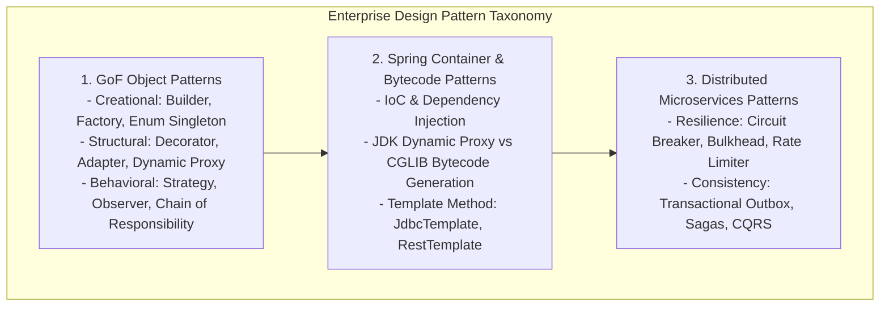
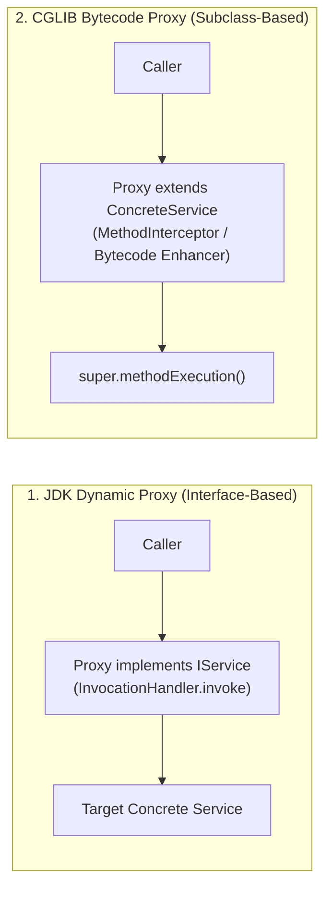
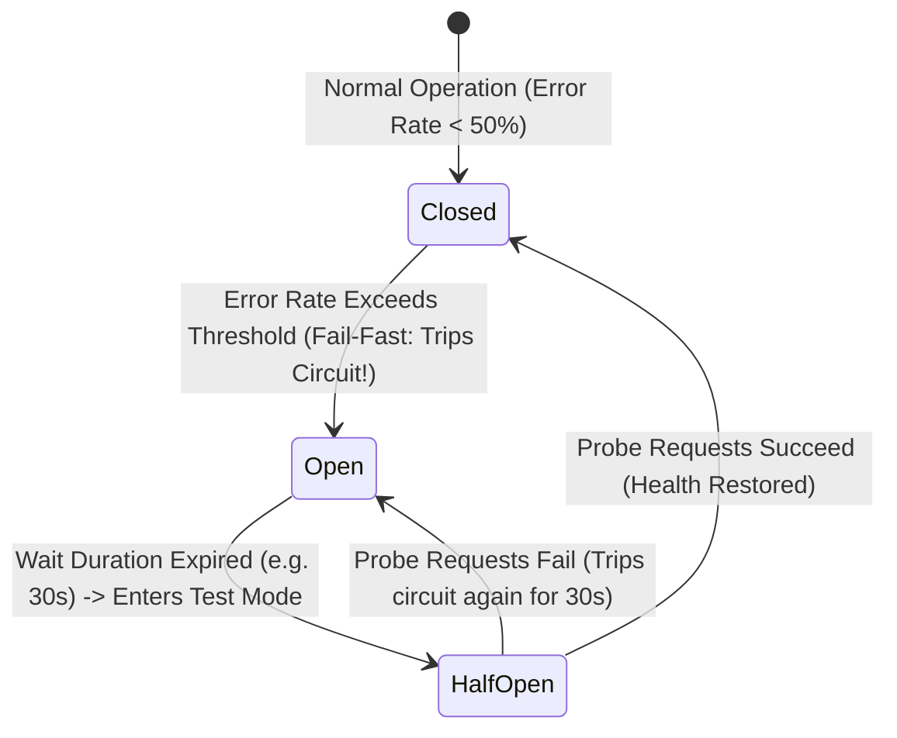
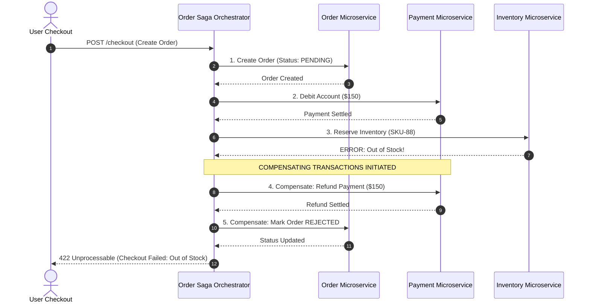
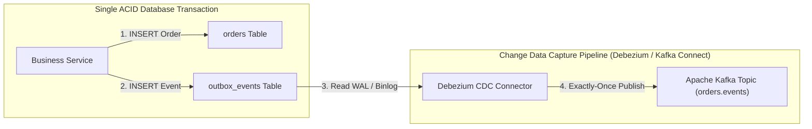

---


title: "Java Design Patterns & Enterprise Microservices Architecture"
description: "Master-level engineering guide for GoF Design Patterns, Enterprise Integration Patterns (EIP), Spring Proxy/CGLIB mechanics, Resilience4j Circuit Breaker/Bulkhead, Transactional Outbox, and Distributed Sagas."
category: "Java Engineering"
tags: [java, design-patterns, enterprise-architecture, microservices, saga, circuit-breaker, outbox, resilience4j, spring, technical-skills, software-engineering, learning-note]
date: "2026-08-21"
---

# Java Design Patterns & Enterprise Microservices Architecture Deep Dive

---

## 1. Executive Summary & Enterprise Pattern Taxonomy

In enterprise distributed software systems, software design patterns establish standardized, battle-tested solutions to recurring architectural and algorithmic problems. Rather than theoretical academic constructs, modern Java design patterns operate across three distinct operational abstraction tiers:

1. **Object-Level GoF Patterns**: Micro-level code design focusing on decoupling, encapsulation, and polymorphism (Strategy, Builder, Decorator, Adapter).
2. **Framework & Container Patterns**: Mid-level patterns leveraging Java reflection and bytecode instrumentation (Inversion of Control, Dynamic Proxies, Template Methods).
3. **Cloud-Native Distributed Systems Patterns**: Macro-level architectural patterns governing distributed data consistency, partial failure resilience, and inter-service communication (Circuit Breakers, Transactional Outbox, Sagas, CQRS).



---

## 2. Structural Patterns & Spring Proxy Mechanics (JDK vs CGLIB)

Spring Framework heavily relies on the **Proxy Pattern** to implement cross-cutting concerns (such as `@Transactional`, `@Cacheable`, and `@Async`).



### 2.1 The Self-Invocation Anti-Pattern
Because Spring wraps beans inside Proxies:
> [!WARNING]
> Calling a `@Transactional` or `@Async` method from **within the same class** (`this.methodB()`) bypasses the proxy entirely! No transaction is started and no interceptor runs.

```java
@Service
public class OrderService {

    // ANTI-PATTERN: Self-invocation bypasses Spring proxy!
    public void processOrder(Order order) {
        validateOrder(order);
        this.saveTransactional(order); // @Transactional IS IGNORED!
    }

    @Transactional
    public void saveTransactional(Order order) {
        orderRepository.save(order);
    }
}

// PRODUCTION SOLUTION: Extract to separate bean or use ObjectProvider/Self-Injection
@Service
public class OrderService {
    private final OrderRepository orderRepository;
    private final OrderPersistenceService persistenceService;

    public OrderService(OrderRepository repo, OrderPersistenceService persistenceService) {
        this.orderRepository = repo;
        this.persistenceService = persistenceService;
    }

    public void processOrder(Order order) {
        validateOrder(order);
        persistenceService.saveTransactional(order); // Proxy intercepts call cleanly
    }
}
```

---

## 3. The Behavioral Strategy Pattern via Spring IoC

In enterprise architectures, the **Strategy Pattern** enables switching business algorithms at runtime based on tenant configuration, payment provider, or dynamic rules:

```java
package com.enterprise.payment.strategy;

import org.springframework.stereotype.Component;
import org.springframework.stereotype.Service;

import java.math.BigDecimal;
import java.util.List;
import java.util.Map;
import java.util.function.Function;
import java.util.stream.Collectors;

public enum PaymentMethodType { CREDIT_CARD, PAYPAL, APPLE_PAY, CRYPTO }

public interface PaymentStrategy {
    PaymentMethodType getSupportedType();
    PaymentResult executePayment(BigDecimal amount, String accountRef);
}

@Component
public class PayPalPaymentStrategy implements PaymentStrategy {
    @Override
    public PaymentMethodType getSupportedType() { return PaymentMethodType.PAYPAL; }
    
    @Override
    public PaymentResult executePayment(BigDecimal amount, String accountRef) {
        // PayPal SDK integration
        return new PaymentResult(true, "PAYPAL-TX-9988");
    }
}

@Service
public class PaymentExecutionService {

    private final Map<PaymentMethodType, PaymentStrategy> strategyMap;

    // Spring auto-injects all beans implementing PaymentStrategy into the list
    public PaymentExecutionService(List<PaymentStrategy> strategies) {
        this.strategyMap = strategies.stream()
            .collect(Collectors.toMap(PaymentStrategy::getSupportedType, Function.identity()));
    }

    public PaymentResult processPayment(PaymentMethodType type, BigDecimal amount, String ref) {
        PaymentStrategy strategy = strategyMap.get(type);
        if (strategy == null) {
            throw new IllegalArgumentException("Unsupported payment provider: " + type);
        }
        return strategy.executePayment(amount, ref);
    }
}
```

---

## 4. Cloud Resilience: Resilience4j Circuit Breaker & Bulkhead

In a distributed microservice topology, cascading failures occur when an upstream service blocks waiting for a degraded downstream dependency.



### 4.1 Production Resilience4j Configuration (`application.yml`)

```yaml
resilience4j:
  circuitbreaker:
    instances:
      inventoryService:
        sliding-window-type: COUNT_BASED
        sliding-window-size: 50
        minimum-number-of-calls: 10
        failure-rate-threshold: 50.0
        wait-duration-in-open-state: 30000ms
        permitted-number-of-calls-in-half-open-state: 10
        automatic-transition-from-open-to-half-open-enabled: true
  bulkhead:
    instances:
      inventoryService:
        max-concurrent-calls: 20
        max-wait-duration: 500ms
```

### 4.2 Circuit Breaker & Bulkhead Java Implementation

```java
package com.enterprise.inventory.client;

import io.github.resilience4j.bulkhead.annotation.Bulkhead;
import io.github.resilience4j.circuitbreaker.annotation.CircuitBreaker;
import io.github.resilience4j.retry.annotation.Retry;
import org.slf4j.Logger;
import org.slf4j.LoggerFactory;
import org.springframework.stereotype.Service;
import org.springframework.web.client.RestClient;

import java.util.UUID;

@Service
public class InventoryServiceClient {

    private static final Logger log = LoggerFactory.getLogger(InventoryServiceClient.class);
    private final RestClient restClient;

    public InventoryServiceClient(RestClient.Builder builder) {
        this.restClient = builder.baseUrl("https://inventory.internal.enterprise.com").build();
    }

    @CircuitBreaker(name = "inventoryService", fallbackMethod = "fallbackInventoryReservation")
    @Bulkhead(name = "inventoryService")
    @Retry(name = "inventoryService")
    public boolean reserveStock(UUID productId, int quantity) {
        return restClient.post()
            .uri("/api/v1/stock/reserve")
            .body(new StockReserveRequest(productId, quantity))
            .retrieve()
            .body(Boolean.class);
    }

    // Fallback signature must match original method + Throwable argument
    public boolean fallbackInventoryReservation(UUID productId, int quantity, Throwable ex) {
        log.warn("Inventory service circuit OPEN or saturated. Queuing reservation in fallback buffer. Error: {}", ex.getMessage());
        // Return soft fallback or buffer in Outbox for asynchronous reconciliation
        return false;
    }
}
```

---

## 5. Distributed Saga Pattern: Orchestration vs Choreography



---

## 6. The Transactional Outbox Pattern

To achieve atomicity between database mutations and Kafka message emissions without two-phase commit (XA) transactions, use the **Transactional Outbox Pattern**:



---

## 7. Operational Troubleshooting & Best Practices Matrix

| Pattern | Common Failure Mode | Production Remediation |
| :--- | :--- | :--- |
| **Spring Proxy** | Self-invocation causes `@Transactional` / `@Async` to fail silently. | Delegate through a dedicated helper service or inject `ApplicationContext`. |
| **Circuit Breaker** | Circuit oscillates rapidly between Open and Closed under bursty traffic. | Increase `sliding-window-size` ($\ge 50$) and tune `minimum-number-of-calls`. |
| **Distributed Saga** | Compensation action fails midway (e.g. Refund API fails). | Enforce idempotency on compensating APIs and retry via Dead Letter Queues (DLQ). |
| **Transactional Outbox** | Outbox table grows unbounded, causing database bloat. | Implement an automated background partition truncation or cleanup job. |

---

## 🔗 Graph-Linked Knowledge Base
- ⚓ Design Patterns Index: [[02_Technical_Skills/01_theory_and_concepts/21_Design_Patterns_and_OOP/structural_patterns|Structural Design Patterns]]
- ⚓ Saga & Outbox: [[02_Technical_Skills/01_theory_and_concepts/14_Messaging_and_Event_Driven/event_driven_patterns_outbox_saga_cqrs|Event-Driven Patterns: Outbox, Saga, CQRS]]
- 🔗 Spring Microservices: [[spring_microservices_webflux_resilience4j|Spring Microservices & Resilience4j]]
