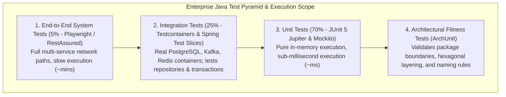
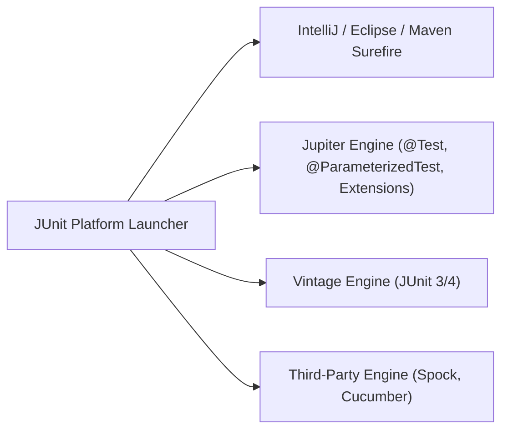
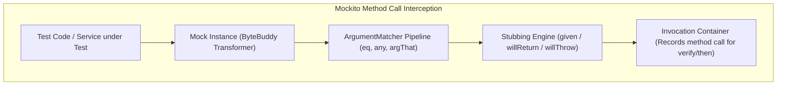
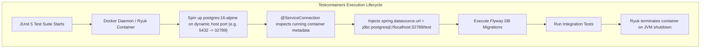

---


title: "Java Testing Mastery: JUnit 5, Mockito & Testcontainers Architecture"
description: "Master-level engineering guide for enterprise Java testing, covering JUnit 5 Jupiter engine & extensions, Mockito ByteBuddy internals, Spring Boot Test Slices, Testcontainers @ServiceConnection, and ArchUnit fitness rules."
category: "Java Engineering"
tags: [java, testing, junit5, mockito, testcontainers, spring-boot, integration-testing, archunit, awaitility, technical-skills, software-engineering, learning-note]
date: "2026-08-21"
---

# Java Testing Mastery: JUnit 5, Mockito & Testcontainers Architecture

---

## 1. Executive Summary & Testing Taxonomy

High-velocity enterprise Java engineering requires an automated, robust testing hierarchy that provides rapid local feedback while guaranteeing absolute fidelity in production deployments. 



---

## 2. JUnit 5 Architecture: Jupiter Engine & Lifecycle Extensions

JUnit 5 separates the testing runtime into three decoupled sub-systems:
$$\text{JUnit 5} = \text{JUnit Platform (Runner \& Launcher)} + \text{JUnit Jupiter (Programming Model)} + \text{JUnit Vintage (Legacy JUnit 4 Compatibility)}$$



### 2.1 Deep Parameterized Testing & Lifecycle Invariants

```java
package com.enterprise.banking.service;

import org.junit.jupiter.api.DisplayName;
import org.junit.jupiter.api.Nested;
import org.junit.jupiter.api.Test;
import org.junit.jupiter.params.ParameterizedTest;
import org.junit.jupiter.params.provider.CsvSource;
import org.junit.jupiter.params.provider.ValueSource;

import java.math.BigDecimal;

import static org.assertj.core.api.Assertions.assertThat;
import static org.assertj.core.api.Assertions.assertThatThrownBy;

class LoanInterestEngineTest {

    private final LoanInterestEngine engine = new LoanInterestEngine();

    @Nested
    @DisplayName("Tier-based Interest Calculation Tests")
    class TierInterestCalculations {

        @ParameterizedTest(name = "Customer tier {0} with credit score {1} receives interest rate {2}%")
        @CsvSource({
            "PRIME,     780,  4.50",
            "STANDARD,  680,  7.25",
            "SUBPRIME,  550, 12.00"
        })
        void shouldComputeAccurateInterestRate(String tier, int score, BigDecimal expectedRate) {
            BigDecimal rate = engine.calculateRate(CustomerTier.valueOf(tier), score);
            assertThat(rate).isEqualByComparingTo(expectedRate);
        }

        @ParameterizedTest
        @ValueSource(ints = { -10, 200, 950 })
        @DisplayName("Throw IllegalArgumentException when credit score is outside 300-850 range")
        void shouldRejectInvalidCreditScores(int invalidScore) {
            assertThatThrownBy(() -> engine.calculateRate(CustomerTier.STANDARD, invalidScore))
                .isInstanceOf(IllegalArgumentException.class)
                .hasMessageContaining("Score must be between 300 and 850");
        }
    }
}
```

---

## 3. Mockito 5 & ByteBuddy Instrumentation Internals

Modern Mockito (v5+) uses **ByteBuddy** with the `inline-mock-maker` by default, enabling mocking of `final` classes, `final` methods, and static methods without creating synthetic subclass proxies.



### 3.1 Static Mocking and BDD Mockito

```java
package com.enterprise.banking.service;

import org.junit.jupiter.api.Test;
import org.junit.jupiter.api.extension.ExtendWith;
import org.mockito.ArgumentCaptor;
import org.mockito.Captor;
import org.mockito.InjectMocks;
import org.mockito.Mock;
import org.mockito.MockedStatic;
import org.mockito.junit.jupiter.MockitoExtension;

import java.math.BigDecimal;
import java.time.Instant;
import java.util.Optional;
import java.util.UUID;

import static org.assertj.core.api.Assertions.assertThat;
import static org.mockito.ArgumentMatchers.any;
import static org.mockito.BDDMockito.given;
import static org.mockito.BDDMockito.then;
import static org.mockito.Mockito.mockStatic;
import static org.mockito.Mockito.times;

@ExtendWith(MockitoExtension.class)
class PaymentTransferServiceTest {

    @Mock
    private AccountRepository accountRepository;

    @Mock
    private PaymentNotificationClient notificationClient;

    @Captor
    private ArgumentCaptor<TransferAuditRecord> auditCaptor;

    @InjectMocks
    private PaymentTransferService transferService;

    @Test
    void shouldExecuteTransferAndAuditTimestamp() {
        // Arrange
        UUID sourceId = UUID.randomUUID();
        UUID targetId = UUID.randomUUID();
        Account src = new Account(sourceId, new BigDecimal("1000.00"));
        Account tgt = new Account(targetId, new BigDecimal("200.00"));

        given(accountRepository.findById(sourceId)).willReturn(Optional.of(src));
        given(accountRepository.findById(targetId)).willReturn(Optional.of(tgt));

        Instant fixedInstant = Instant.parse("2026-08-21T10:00:00Z");

        // Mock Static System Clock
        try (MockedStatic<Instant> mockedInstant = mockStatic(Instant.class)) {
            mockedInstant.when(Instant::now).thenReturn(fixedInstant);

            // Act
            TransferReceipt receipt = transferService.transfer(sourceId, targetId, new BigDecimal("300.00"));

            // Assert
            assertThat(receipt.isSuccess()).isTrue();
            assertThat(src.getBalance()).isEqualByComparingTo("700.00");
            assertThat(tgt.getBalance()).isEqualByComparingTo("500.00");

            then(accountRepository).should(times(2)).save(any(Account.class));
            then(notificationClient).should().logAudit(auditCaptor.capture());

            TransferAuditRecord captured = auditCaptor.getValue();
            assertThat(captured.timestamp()).isEqualTo(fixedInstant);
        }
    }
}
```

---

## 4. Testcontainers & Spring Boot 3.1+ `@ServiceConnection`

**Testcontainers** eliminates flaky embedded in-memory databases (like H2 or Fongo) by provisioning real containerized databases and message brokers inside ephemeral Docker containers.

In Spring Boot 3.1+, the `@ServiceConnection` annotation automatically extracts dynamic container ports and credentials, injecting them directly into Spring's `Environment` without boilerplate `@DynamicPropertySource` declarations.



### 4.1 Production Multi-Container Integration Test

```java
package com.enterprise.order.integration;

import com.enterprise.order.entity.Order;
import com.enterprise.order.repository.OrderRepository;
import org.junit.jupiter.api.BeforeEach;
import org.junit.jupiter.api.Test;
import org.springframework.beans.factory.annotation.Autowired;
import org.springframework.boot.test.context.SpringBootTest;
import org.springframework.boot.testcontainers.service.connection.ServiceConnection;
import org.testcontainers.containers.KafkaContainer;
import org.testcontainers.containers.PostgreSQLContainer;
import org.testcontainers.junit.jupiter.Container;
import org.testcontainers.junit.jupiter.Testcontainers;
import org.testcontainers.utility.DockerImageName;

import java.math.BigDecimal;
import java.util.Optional;
import java.util.UUID;

import static org.assertj.core.api.Assertions.assertThat;

@SpringBootTest(webEnvironment = SpringBootTest.WebEnvironment.RANDOM_PORT)
@Testcontainers
class OrderServiceIntegrationTest {

    @Container
    @ServiceConnection
    static PostgreSQLContainer<?> postgres = 
        new PostgreSQLContainer<>(DockerImageName.parse("postgres:16-alpine"));

    @Container
    @ServiceConnection
    static KafkaContainer kafka = 
        new KafkaContainer(DockerImageName.parse("confluentinc/cp-kafka:7.5.0"));

    @Autowired
    private OrderRepository orderRepository;

    @BeforeEach
    void setUp() {
        orderRepository.deleteAll();
    }

    @Test
    void shouldPersistOrderAndBroadcastKafkaEvent() {
        Order order = new Order(UUID.randomUUID(), "CUST_99", new BigDecimal("450.00"), "CREATED");
        Order saved = orderRepository.save(order);

        Optional<Order> fetched = orderRepository.findById(saved.getId());
        assertThat(fetched).isPresent();
        assertThat(fetched.get().getAmount()).isEqualByComparingTo("450.00");
    }
}
```

---

## 5. Architectural Fitness Testing with ArchUnit

To prevent architectural decay and enforce domain layering boundaries across engineering teams, use **ArchUnit**:

```java
package com.enterprise.architecture;

import com.tngtech.archunit.core.importer.ImportOption;
import com.tngtech.archunit.junit.AnalyzeClasses;
import com.tngtech.archunit.junit.ArchTest;
import com.tngtech.archunit.lang.ArchRule;

import static com.tngtech.archunit.lang.syntax.ArchRuleDefinition.classes;
import static com.tngtech.archunit.lang.syntax.ArchRuleDefinition.noClasses;

@AnalyzeClasses(packages = "com.enterprise", importOptions = ImportOption.DoNotIncludeTests.class)
public class HexagonalArchitectureFitnessTest {

    @ArchTest
    public static final ArchRule domainMustNotDependOnInfrastructure =
        noClasses().that().resideInAPackage("..domain..")
            .should().dependOnClassesThat().resideInAnyPackage("..infrastructure..", "..web..", "..repository..");

    @ArchTest
    public static final ArchRule servicesMustBeAnnotatedWithService =
        classes().that().haveSimpleNameEndingWith("Service")
            .and().resideInAPackage("..service..")
            .should().beAnnotatedWith(org.springframework.stereotype.Service.class);

    @ArchTest
    public static final ArchRule controllersMustNotDirectlyAccessRepositories =
        noClasses().that().resideInAPackage("..controller..")
            .should().dependOnClassesThat().resideInAPackage("..repository..");
}
```

---

## 6. Asynchronous Testing with Awaitility

When testing event-driven asynchronous consumers (Kafka listeners, RabbitMQ consumers, background worker threads), avoid non-deterministic `Thread.sleep()`. Instead, use **Awaitility**:

```java
import static java.util.concurrent.TimeUnit.SECONDS;
import static org.awaitility.Awaitility.await;

@Test
void shouldProcessAsyncKafkaEventWithinFiveSeconds() {
    kafkaTemplate.send("order-events", new OrderCreatedEvent(orderId));

    // Polling assertion with timeout
    await()
        .atMost(5, SECONDS)
        .pollInterval(100, java.util.concurrent.TimeUnit.MILLISECONDS)
        .untilAsserted(() -> {
            Optional<ProcessedOrder> order = repository.findById(orderId);
            assertThat(order).isPresent();
            assertThat(order.get().getStatus()).isEqualTo("PROCESSED");
        });
}
```

---

## 7. Testing Anti-Patterns & Operational Troubleshooting

| Anti-Pattern | Root Cause | Production Remediation |
| :--- | :--- | :--- |
| **Flaky Tests via `Thread.sleep`** | Arbitrary sleep times failing under heavy CI server load. | Replace with `Awaitility.await().untilAsserted(...)`. |
| **Slow Test Execution ($> 20\text{ mins}$)** | Restarting Spring ApplicationContext or Docker containers per test class. | Use Singleton Testcontainers and maintain clean slice context caching. |
| **Over-Mocking Domain Entities** | Mocking basic getters/setters or value objects instead of instantiating them. | Use real domain entities and records; mock only external boundary I/O clients. |
| **Leaking Test State Across Tests** | Shared static data or database state dirtying subsequent tests. | Use `@DirtiesContext` sparingly; prefer database cleanup in `@BeforeEach`. |

---

## 🔗 Graph-Linked Knowledge Base
- ⚓ Testing Strategy: [[02_Technical_Skills/01_theory_and_concepts/25_Observability_and_QA/software_testing_pyramid_unit_integration_e2e|Software Testing Pyramid & QA Strategy]]
- ⚓ CI/CD Automation: [[groovy_jenkinsfiles_devops_observability|Groovy, Jenkinsfiles & CI/CD]]
- 🔗 Spring Boot Core: [[spring_boot_3_core_ioc_dependency_injection|Spring Boot 3 Core IoC]]
