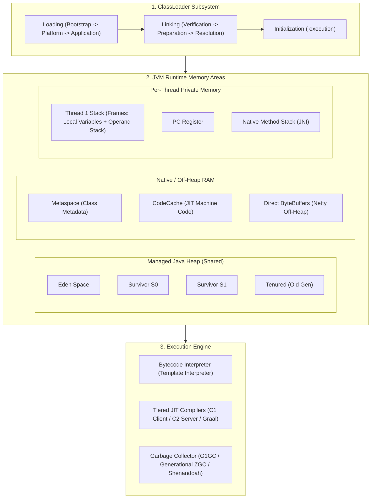
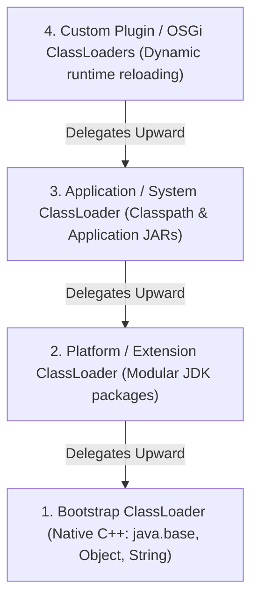
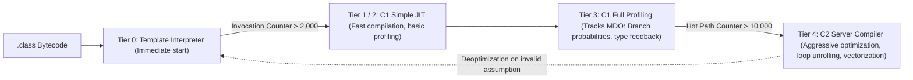
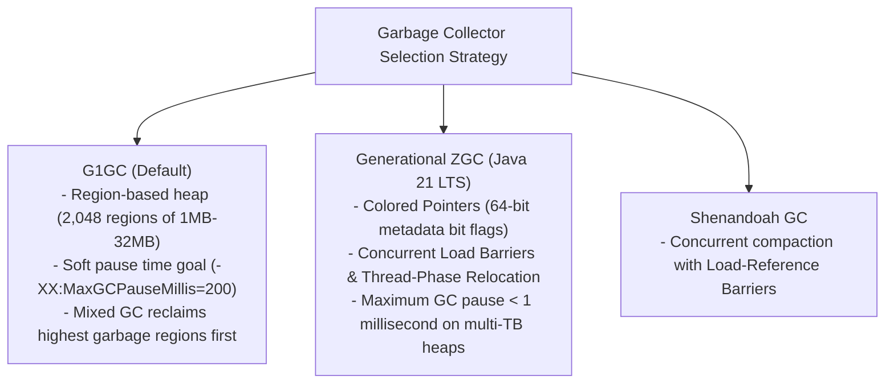
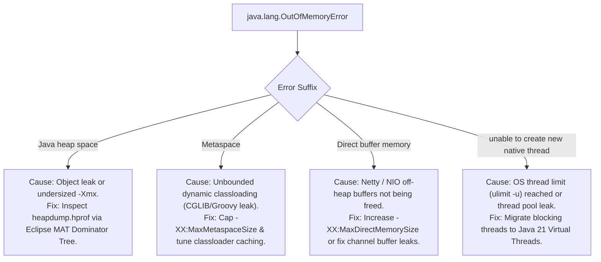

---


title: "JVM Architecture, Memory Layout & Garbage Collection Deep Dive"
description: "Master-level engineering guide for the Java Virtual Machine (HotSpot JVM), ClassLoader subsystem, Tiered JIT Compilation, Heap regions, Metaspace, and Garbage Collectors (G1GC, Generational ZGC, Shenandoah)."
category: "Java Engineering"
tags: [java, jvm, garbage-collection, g1gc, zgc, memory-management, classloader, metaspace, jit, performance, technical-skills, software-engineering, learning-note]
date: "2026-08-21"
---

# JVM Architecture, Memory Layout & Garbage Collection Deep Dive

---

## 1. Executive Summary & HotSpot Runtime Architecture

The **Java Virtual Machine (HotSpot JVM)** is an enterprise-grade execution platform that translates Java bytecode (`.class` files) into native CPU machine instructions. HotSpot combines adaptive **Tiered JIT Compilation (C1 / C2 Compilers)** with automated, non-blocking **Garbage Collection (GC)** algorithms to achieve near-C++ bare-metal execution performance while maintaining memory safety.



---

## 2. ClassLoader Subsystem & Class Initialization Lifecycle

The ClassLoader subsystem follows a strict **Delegation Parent Model** to prevent core Java class spoofing and ensure runtime class isolation:



### 2.1 The Three-Stage Linking Process
1. **Verification**: Verifies that the loaded bytecode adheres to JVM specification rules (checks type safety, stack overflow/underflow boundaries, and valid opcode sequences).
2. **Preparation**: Allocates native memory for static fields and initializes them to their **default zero values** (e.g. `null`, `0`, `false`), not user-assigned values.
3. **Resolution**: Translates symbolic references in the runtime constant pool into direct physical memory pointers.
4. **Initialization (`<clinit>`)**: Executes static initializers and assigns user-defined static field values in thread-safe order.

---

## 3. Tiered JIT Compilation Engine (C1, C2 & Escape Analysis)

Modern HotSpot JVM uses **Tiered Compilation** to eliminate cold-start warmup latency while maximizing peak steady-state throughput:



### 3.1 Advanced JIT Optimizations: Escape Analysis & Scalar Replacement
When C2 compiles a hot method, it performs **Escape Analysis**:
- **Global Escape**: Object reference is returned or stored in a static/heap field. Allocated on Heap.
- **Arg Escape**: Object passed as argument but does not outlive method.
- **No Escape**: Object is created and discarded entirely within the method stack frame.
- **Scalar Replacement**: The JVM eliminates the heap allocation entirely, breaking the object down into its primitive fields and storing them directly in **CPU registers**.

---

## 4. Managed Heap Topology & Generational Hypothesis

The Java heap is partitioned based on the **Weak Generational Hypothesis**:
$$\text{Survival Probability } P(\text{survive}(t)) \propto \frac{1}{t}$$
*Over $98\%$ of allocated objects in backend web applications become unreachable almost immediately after instantiation.*

```mermaid
flowchart LR
    Alloc["new Object()"] --> Eden["Eden Space (Young Gen)"]
    Eden -->|Minor GC / Evacuation| S0["Survivor S0"]
    S0 -->|Minor GC| S1["Survivor S1 (Age Increment: 1, 2, 3...)"]
    S1 -->|Tenuring Threshold (-XX:MaxTenuringThreshold=15)| Tenured["Tenured Space (Old Gen)"]
```

---

## 5. Modern Garbage Collectors: G1GC vs. Generational ZGC



### 5.1 Deep Dive: Generational ZGC Colored Pointers

Generational ZGC encodes reference metadata directly into the top bits of standard 64-bit object reference pointers:

```
64-Bit Pointer Representation in Generational ZGC:
+-------------------+-----------------+------------------------------------------+
| Unused (16 bits)  | Metadata 4-Bits | Virtual Memory Physical Offset (44 bits) |
+-------------------+-----------------+------------------------------------------+
                      Bit 45: Marked0
                      Bit 44: Marked1
                      Bit 43: Remapped (Valid object memory address)
                      Bit 42: Finalizable
```

When an application thread reads an object reference (`obj.field`), a single-instruction **Load Barrier** checks the metadata bits. If the object was relocated by a concurrent GC thread, the barrier self-heals the pointer to the new address in 2 CPU cycles without stopping application threads!

---

## 6. Comprehensive Garbage Collector Comparison Matrix

| Feature / Metric | Parallel GC | G1GC (Default) | Generational ZGC | Shenandoah GC |
| :--- | :--- | :--- | :--- | :--- |
| **Supported Heap Size** | $512\text{ MB} - 32\text{ GB}$ | $2\text{ GB} - 64\text{ GB}$ | **$16\text{ GB} - 16\text{ TB}$** | $4\text{ GB} - 100\text{ GB}$ |
| **Average GC Pause Time** | \$100 - 1,000\text{ ms}$ | \$10 - 200\text{ ms}$ | **$< 1\text{ ms}$** | \$5 - 20\text{ ms}$ |
| **Throughput Efficiency** | **Maximum (99%)** | High (95-97%) | Good (90-95%) | Good (90-94%) |
| **Heap Compaction** | Stop-The-World (STW) | STW per Region | **100% Concurrent** | **100% Concurrent** |
| **Best Production Use Case** | Offline Batch / ETL jobs | Enterprise Spring Boot APIs | Ultra-low latency Trading & Microservices | Low-latency Web Services |

---

## 7. Production Containerized JVM Tuning Configuration

When running Java inside Docker/Kubernetes containers, JVM flags must enforce container cgroup limits and prevent sudden OOMKills:

```ini
# Production Container Flags (For 8GB RAM / 4 vCPU Pod)
-XX:+UseContainerSupport
-XX:MaxRAMPercentage=75.0               # Allocates 6GB to Java Heap, leaves 2GB for Metaspace/OS
-XX:+AlwaysPreTouch                    # Pre-faults heap pages into physical RAM on startup
-XX:+UseNUMA                           # Optimizes allocations across multi-socket CPU nodes

# Garbage Collector: Generational ZGC (Java 21+)
-XX:+UseZGC
-XX:+ZGenerational

# Alternative G1GC Configuration:
# -XX:+UseG1GC
# -XX:MaxGCPauseMillis=100
# -XX:InitiatingHeapOccupancyPercent=45
# -XX:G1ReservePercent=15

# Native Memory & Metaspace Limits
-XX:MetaspaceSize=256m
-XX:MaxMetaspaceSize=512m
-XX:ReservedCodeCacheSize=256m

# Automated Heap Dump on Fatal OOM Crash
-XX:+HeapDumpOnOutOfMemoryError
-XX:HeapDumpPath=/var/log/jvm/heapdump.hprof

# Unified JVM GC Logging Configuration
-Xlog:gc*,gc+phases=debug:file=/var/log/jvm/gc.log:time,uptime,pid,level,tags:filecount=5,filesize=50m
```

---

## 8. Diagnostic Runbook: Diagnosing OutOfMemoryErrors



---

## 🔗 Graph-Linked Knowledge Base
- ⚓ Metaspace Architecture: [[jvm_metaspace_native_memory_architecture|JVM Metaspace & Native Memory Architecture]]
- ⚓ Performance Profiling: [[jvm_performance_tuning_profiling_jfr|JVM Performance Tuning & JFR Profiling]]
- 🔗 Concurrency: [[java_concurrency_multithreading_virtual_threads|Java Concurrency & Virtual Threads]]
