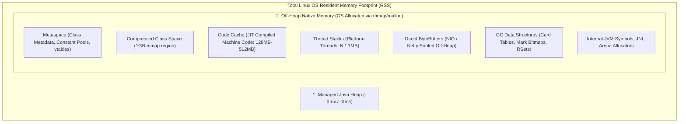
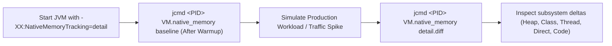
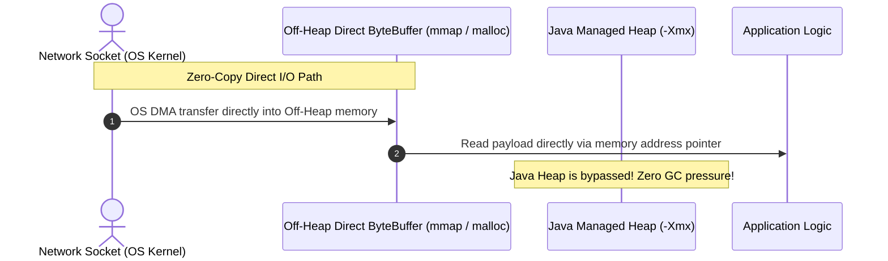

---


title: "JVM Metaspace & Off-Heap Native Memory Architecture"
description: "Master-level engineering guide for JVM native memory, Metaspace ChunkManager arenas, Compressed Class Pointers, Native Memory Tracking (NMT), Netty Direct ByteBuffers, and Kubernetes container OOMKill sizing."
category: "Java Engineering"
tags: [java, jvm, metaspace, off-heap, native-memory, nmt, direct-bytebuffer, netty, memory-leaks, performance, technical-skills, software-engineering, learning-note]
date: "2026-08-21"
---

# JVM Metaspace & Off-Heap Native Memory Architecture

---

## 1. Executive Summary & Linux Process Memory Breakdown

In enterprise cloud-native microservices running on Kubernetes, configuring only the Java Heap (`-Xmx`) is insufficient. A common operational failure is the sudden termination of a pod by the Linux kernel with **Exit Code 137 (OOMKilled)** even when Java Heap usage remains low ($< 50\%$).

The total **Resident Set Size (RSS)** of a JVM process is composed of multiple independent native memory pools allocated directly via the OS `mmap` / `malloc` system calls:

$$\text{Total JVM RSS} = \text{Heap (-Xmx)} + \text{Metaspace} + \text{Code Cache} + (\text{Threads} \times \text{Stack Size}) + \text{Direct Buffers} + \text{GC Metadata} + \text{glibc Overhead}$$



---

## 2. Metaspace Internals: Arenas, Chunks & Class Unloading

Starting with Java 8, the legacy on-heap Permanent Generation (PermGen) was replaced by **Metaspace**, which allocates memory directly from OS native RAM via dynamic **Arenas**.

```mermaid
flowchart TD
    subgraph MetaspaceAllocator["HotSpot Metaspace Allocation Hierarchy"]
        OS_RAM["OS Native Virtual Memory (mmap)"] --> ChunkManager["Global Metaspace ChunkManager"]
        ChunkManager -->|Allocates Chunk (4KB to 4MB)| Arena["ClassLoader MetaspaceArena"]
        Arena --> CL1["ApplicationClassLoader Data"]
        Arena --> CL2["Dynamic Spring/CGLIB ClassLoader Data"]
    end
```

### 2.1 Compressed Class Pointers (`UseCompressedClassPointers`)
On 64-bit platforms, HotSpot partitions Metaspace into two structures:
1. **Compressed Class Space**: A single contiguous $1\text{GB}$ virtual address space storing fixed-size `Klass` structures. The JVM accesses these via 32-bit compressed pointers shifted by 3 bits.
2. **Non-Class Metaspace**: Dynamic native memory containing method bytecode arrays, constant pools, annotations, and vtable slots.

### 2.2 Strict Invariants for Metaspace Class Unloading
A class stored in Metaspace can **only** be garbage collected and un-loaded when **all three** of the following conditions are simultaneously met:
1. Zero instances of that class exist on the Java heap.
2. The `java.lang.Class` reflection object is unreachable.
3. The **`ClassLoader`** that defined the class is completely unreachable and collected by GC.

> [!WARNING]
> Dynamic proxy generators (CGLIB, ByteBuddy, Groovy runtime, Nashorn) that create a new `ClassLoader` per invocation without proper caching cause permanent, unbounded Metaspace leaks!

---

## 3. Native Memory Tracking (NMT) Mastery

Native Memory Tracking (NMT) is HotSpot's internal telemetry subsystem for tracking all native off-heap memory allocations across internal JVM subsystems.



### 3.1 NMT Diagnostic Commands
```bash
# 1. Start application with NMT enabled
java -XX:NativeMemoryTracking=detail -jar microservice.jar

# 2. Capture baseline after Spring context startup
jcmd $(pgrep -f microservice) VM.native_memory baseline

# 3. Generate comparative memory diff during high-traffic load
jcmd $(pgrep -f microservice) VM.native_memory detail.diff
```

### 3.2 Interpreting NMT Output
```text
Total: reserved=8640MB +240MB, committed=6280MB +180MB
-                 Java Heap (reserved=4096MB, committed=4096MB)
-                    Class (reserved=1080MB +12MB, committed=280MB +8MB)
-                   Thread (reserved=524MB +20MB, committed=524MB +20MB) (524 threads)
-               Code Cache (reserved=256MB, committed=145MB +15MB)
-                       GC (reserved=380MB, committed=380MB)
-           Internal / NMT (reserved=120MB +5MB, committed=120MB +5MB)
-                 Direct Buffer (reserved=1200MB +140MB, committed=1200MB +140MB)
```

---

## 4. Off-Heap Memory: Direct ByteBuffers & Netty `ByteBuf`

For high-throughput network applications (Spring WebFlux, Netty, gRPC), copying network buffers between native OS sockets and the Java heap introduces substantial CPU and memory bandwidth overhead. **`ByteBuffer.allocateDirect()`** allocates memory directly from OS native RAM (via C `malloc`), enabling zero-copy I/O with the network interface card (NIC).



### 4.1 Deallocation Mechanics: Cleaners vs. Netty Pooled Allocators
Direct ByteBuffers rely on `java.lang.ref.Cleaner` (Phantom References) to free native memory when the wrapping Java object is collected by the GC.
- **The Danger**: If the Java heap is large and allocations occur mostly off-heap, GC may not run frequently enough to reclaim unreachable `DirectByteBuffer` objects, resulting in OS native memory exhaustion!
- **Production Solution**: Use Netty's reference-counted pooled buffers (`PooledByteBufAllocator`) and configure explicit max direct limits:
  ```ini
  -XX:MaxDirectMemorySize=2g
  ```

---

## 5. Linux `glibc` Malloc Arena Fragmentation

On multi-core Linux servers, the default GNU C Library (`glibc`) memory allocator allocates multiple memory arenas to reduce thread contention:
$$\text{Max Arenas} = \text{CPU Cores} \times 8$$

On a 32-core server, `glibc` instantiates up to 256 separate native heap arenas. When JVM threads allocate and release small off-heap memory blocks, this causes severe virtual memory fragmentation and massive RSS growth.

### 5.1 Mitigation via Environment Configuration
```bash
# Restrict glibc to 2-4 memory arenas to eliminate native fragmentation
export MALLOC_ARENA_MAX=2

# Alternative: Replace glibc with jemalloc for superior fragmentation control
export LD_PRELOAD=/usr/lib/x86_64-linux-gnu/libjemalloc.so
```

---

## 6. Container Sizing Mathematics for Kubernetes

To prevent Kubernetes OOMKills (`Exit Code 137`), compute the container memory limit using this production sizing formula:

$$\text{Pod Memory Limit} = \text{Heap} + \text{Metaspace} + \text{CodeCache} + (\text{Threads} \times \text{Xss}) + \text{DirectMemory} + \text{OS Buffer (25\%)}$$

### 6.1 Sizing Calculation Example (Production Microservice)
- Heap (`-Xmx`): $4\text{ GB}$
- Metaspace (`-XX:MaxMetaspaceSize`): $512\text{ MB}$
- Code Cache (`-XX:ReservedCodeCacheSize`): $256\text{ MB}$
- 300 Platform Threads (`300 \times 1\text{MB}`): $300\text{ MB}$
- Direct Memory (`-XX:MaxDirectMemorySize`): $1\text{ GB}$
- Subtotal = \$4.0 + 0.5 + 0.25 + 0.3 + 1.0 = 6.05\text{ GB}$
- **Required Kubernetes Resource Limit** ($+25\%$ OS margin): $\mathbf{8\text{ GB}}$

---

## 7. Operational Troubleshooting Runbook

| Incident | Root Cause | Engineering Solution |
| :--- | :--- | :--- |
| **`OutOfMemoryError: Metaspace`** | Dynamic class generation leak (e.g. un-cached CGLIB/Groovy scripts). | Cap `-XX:MaxMetaspaceSize=512m` and inspect classes via `jcmd <pid> GC.class_stats`. |
| **`OutOfMemoryError: Direct buffer memory`** | Netty/NIO direct memory allocations exceeding `-XX:MaxDirectMemorySize`. | Pool direct buffers with Netty `ByteBuf` and explicitly invoke `ReferenceCounted.release()`. |
| **Kubernetes OOMKilled (Exit 137)** | Process RSS exceeded container cgroup memory limit due to unconstrained thread counts or native glibc fragmentation. | Set `MALLOC_ARENA_MAX=2`, migrate blocking threads to Virtual Threads, and align pod memory limits. |

---

## 🔗 Graph-Linked Knowledge Base
- ⚓ JVM Architecture: [[jvm_architecture_memory_garbage_collection|JVM Architecture & Garbage Collection]]
- ⚓ Performance Profiling: [[jvm_performance_tuning_profiling_jfr|JVM Performance Tuning & JFR Profiling]]
- 🔗 Docker Sizing: [[02_Technical_Skills/01_theory_and_concepts/18_Docker_and_Kubernetes_Containers/container_fundamentals|Container Resource Limits & Fundamentals]]
