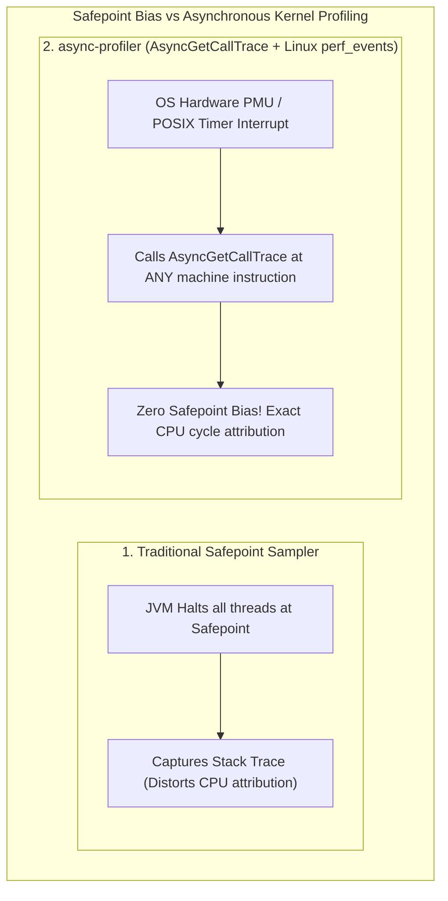
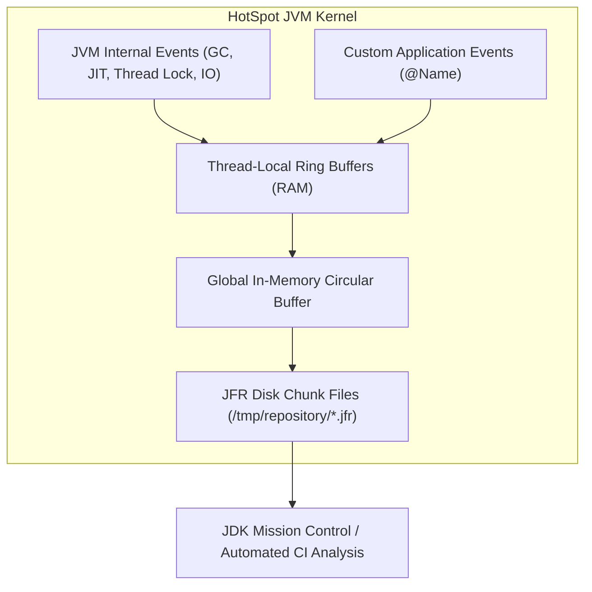
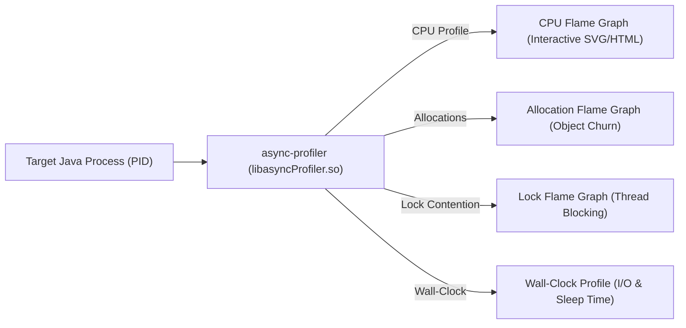
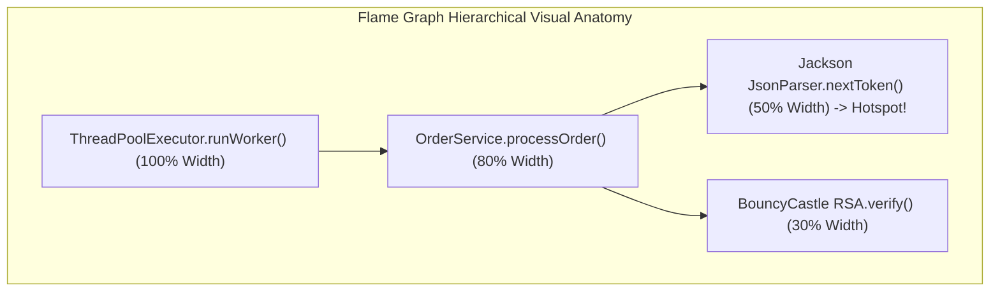
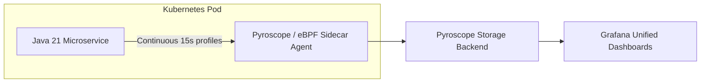

---


title: "JVM Performance Tuning & Profiling: JFR, async-profiler & Flame Graphs"
description: "Master-level engineering guide for JVM performance profiling, JDK Flight Recorder (JFR) architecture, async-profiler internals, Safepoint Bias elimination, CPU/Allocation Flame Graphs, and JIT compilation tuning."
category: "Java Engineering"
tags: [java, jvm, jfr, async-profiler, flame-graphs, performance-tuning, profiling, safepoints, jit, pyroscope, technical-skills, software-engineering, learning-note]
date: "2026-08-21"
---

# JVM Performance Tuning & Profiling: JFR & Flame Graphs Deep Dive

---

## 1. Executive Summary & The Safepoint Bias Dilemma

Diagnosing subtle performance regressions, CPU latency spikes, and object allocation hotspots in enterprise Java microservices requires profiling tools that maintain fidelity without degrading production throughput.

Traditional Java sampling profilers (such as VisualVM or standard thread dump samplers) rely on JVM **Safepoint Polls** (`Thread.getAllStackTraces()`). This introduces severe **Safepoint Bias**:
1. The JVM can only halt threads at predefined safepoint locations (e.g. method returns, loop back-edges in uncounted loops, or allocations).
2. Counted `for` loops (e.g., `for (int i=0; i<N; i++)`) are JIT-compiled without safepoint checks.
3. Consequently, sampling profilers falsely attribute high CPU time to the first instruction *after* a hot loop rather than the loop itself, leading engineers to optimize the wrong code blocks.



---

## 2. JDK Flight Recorder (JFR) Architecture & Production Telemetry

**JDK Flight Recorder (JFR)** is a high-performance event-tracing framework embedded directly into the HotSpot JVM kernel. By operating with less than **$1\%$ CPU overhead**, JFR is designed to run continuously in production environments.



### 2.1 Custom Production JFR Event Implementation

```java
package com.enterprise.telemetry;

import jdk.jfr.*;

@Name("com.enterprise.order.PaymentProcessed")
@Label("Payment Processed Event")
@Category({"Enterprise", "Payment"})
@Description("Measures latency and external gateway response characteristics for checkout payments")
@StackTrace(true)
public class PaymentProcessedEvent extends Event {

    @Label("Customer ID")
    private final String customerId;

    @Label("Payment Provider")
    private final String provider;

    @Label("Amount USD")
    private final double amount;

    @Label("Success Flag")
    private boolean success;

    public PaymentProcessedEvent(String customerId, String provider, double amount) {
        this.customerId = customerId;
        this.provider = provider;
        this.amount = amount;
    }

    public void setSuccess(boolean success) {
        this.success = success;
    }

    // Usage:
    // PaymentProcessedEvent event = new PaymentProcessedEvent("cust_12", "STRIPE", 450.00);
    // event.begin();
    // try { process(); event.setSuccess(true); }
    // finally { event.commit(); }
}
```

### 2.2 Continuous Production JFR Recording Configuration

```bash
# 1. Start continuous rolling recording (keeps last 6 hours or 2GB)
jcmd <PID> JFR.start \
    name=prod-continuous \
    settings=profile.jfc \
    disk=true \
    maxage=6h \
    maxsize=2g

# 2. Dump recording during a latency incident
jcmd <PID> JFR.dump \
    name=prod-continuous \
    filename=/var/log/jvm/incident-dump.jfr

# 3. Check recording status
jcmd <PID> JFR.check
```

---

## 3. High-Precision Profiling with `async-profiler`

`async-profiler` leverages Linux hardware Performance Monitoring Units (PMU) via `perf_events` and the JVM's private `AsyncGetCallTrace` API to collect accurate CPU, memory allocation, and lock contention profiles.



### 3.1 Production Profiling Commands

```bash
# 1. Profile CPU cycles for 60 seconds (Generates interactive Flame Graph HTML)
./asprof -d 60 -e cpu -f /tmp/cpu-flamegraph.html <PID>

# 2. Profile Memory Allocations (Identifies TLAB allocation churn hotspots)
./asprof -d 60 -e alloc -f /tmp/alloc-flamegraph.html <PID>

# 3. Profile Lock Contention (Pinpoints synchronized/ReentrantLock contention)
./asprof -d 60 -e lock -f /tmp/lock-flamegraph.html <PID>

# 4. Profile Wall-Clock Time (Vital for Virtual Threads & blocking I/O latency)
./asprof -d 60 -e wall -t -f /tmp/wall-flamegraph.html <PID>
```

---

## 4. Flame Graph Mastery: Reading & Differential Analysis

A **Flame Graph** (invented by Brendan Gregg) visualizes sampled stack traces:
- **X-Axis**: Represents the alphabetical population of the sample set (width is proportional to CPU/memory consumption).
- **Y-Axis**: Represents stack depth (bottom = entry point / root; top = leaf function currently executing on CPU).



### 4.1 Differential Flame Graphs (Regression Analysis)
When debugging a performance regression between Release A and Release B:
- **Red Frames**: Methods consuming more CPU in the new release (regressions).
- **Blue Frames**: Methods consuming less CPU (improvements).

```bash
# Generate differential flame graph
./asprof -d 60 -f /tmp/baseline.collapsed <PID_RELEASE_A>
./asprof -d 60 -f /tmp/candidate.collapsed <PID_RELEASE_B>
./asprof --diff /tmp/baseline.collapsed /tmp/candidate.collapsed -f /tmp/diff-flamegraph.html
```

---

## 5. JIT Compilation Diagnostics & Inlining Optimization

HotSpot C2 compiler optimizes code by inlining small methods directly into the caller's stack frame, eliminating call instruction overhead and enabling downstream vectorization.

```mermaid
flowchart TD
    Call["Method Invocation"] --> CheckSize{"Bytecode Size Check"}
    CheckSize -->|&le; 35 Bytes (-XX:MaxInlineSize)| AutoInline["Automatically Inlined Everywhere"]
    CheckSize -->|&le; 325 Bytes (-XX:FreqInlineSize)| HotCheck{"Is Method Hot? (Invocations > 10,000)"}
    HotCheck -->|Yes| InlineC2["Inlined by C2 Server Compiler"]
    HotCheck -->|No| NoInline["Remains Out-of-Line Call (Disables SIMD)"]
```

### 5.1 Diagnosing JIT Inlining Decisions
```bash
java -XX:+UnlockDiagnosticVMOptions \
     -XX:+PrintInlining \
     -XX:+PrintCompilation \
     -jar microservice.jar > jit_compilation.log
```

---

## 6. Continuous Cloud Profiling with Pyroscope & Parca

In modern Kubernetes clusters, on-demand profiling is automated using continuous profiling agents (e.g. **Grafana Pyroscope** / **Parca**):



---

## 7. Operational Troubleshooting Matrix

| Performance Symptom | Root Cause Identified via Profiler | Engineering Solution |
| :--- | :--- | :--- |
| **High CPU under low load** | Inefficient regex pattern matching or spin-lock retry loop in hot path. | Pre-compile `Pattern.compile()` statically; replace spin-locks with proper event signaling. |
| **High GC Pause Frequency** | Extreme heap allocation churn (`alloc` flame graph shows temporary String / byte[] creation). | Reuse byte buffers (`ArrayPool`), switch to primitive streams, or use Jackson streaming parsers. |
| **Latency Spikes without CPU Usage** | Thread lock contention or blocking I/O calls (`lock` and `wall` flame graphs show blocked carrier threads). | Replace blocking synchronization with `ReentrantLock` or migrate to Virtual Threads. |

---

## 🔗 Graph-Linked Knowledge Base
- ⚓ JVM Architecture: [[jvm_architecture_memory_garbage_collection|JVM Architecture & Garbage Collection]]
- ⚓ Metaspace Internals: [[jvm_metaspace_native_memory_architecture|JVM Metaspace & Native Memory Architecture]]
- 🔗 Concurrency: [[java_concurrency_multithreading_virtual_threads|Java Concurrency & Virtual Threads]]
