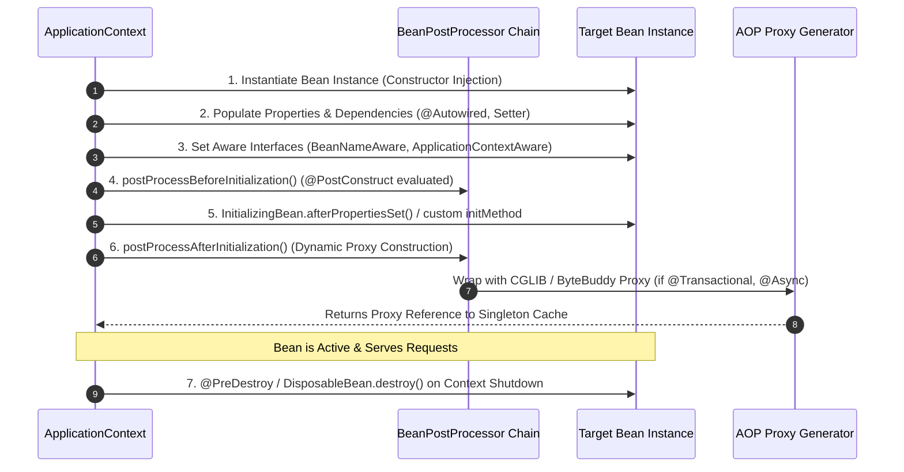
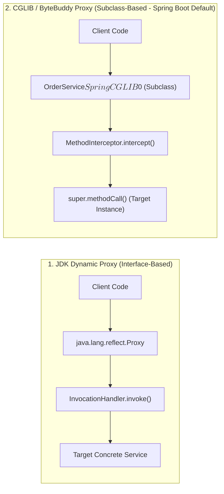
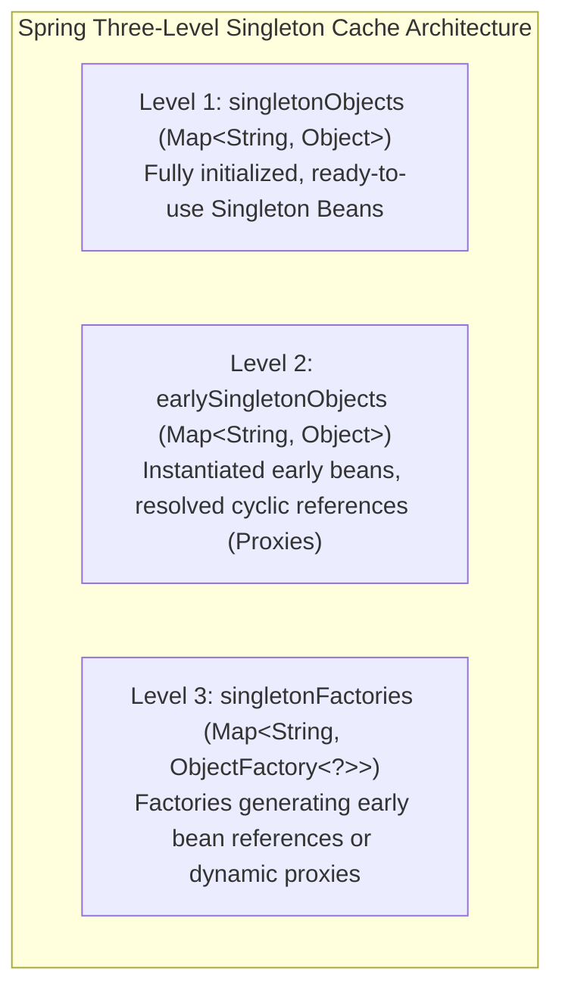
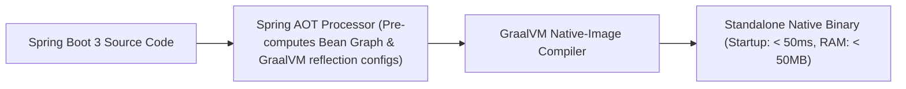

---


title: "Spring Boot 3 Core: Inversion of Control (IoC) & Dependency Injection"
description: "Master-level engineering guide for Spring Framework 6 and Spring Boot 3 Core, covering BeanFactory, ApplicationContext lifecycle, Bean scopes, Circular Dependencies Three-Level Cache, Proxying, AOP, and GraalVM AOT."
category: "Java Engineering"
tags: [spring-boot, java, ioc, dependency-injection, aop, bean-lifecycle, proxies, cglib, aot, performance, technical-skills, software-engineering, learning-note]
date: "2026-08-21"
---

# Spring Boot 3 Core: Inversion of Control & Dependency Injection Deep Dive

---

## 1. Executive Summary & Container Architecture

The **Spring Inversion of Control (IoC) Container** is the core architectural engine of enterprise Java applications. Rather than components manually constructing dependencies via the `new` operator, the IoC container acts as an assembler that decouples component instantiation, configuration, and dependency wiring from business domain logic.

```mermaid
flowchart TD
    subgraph SpringIoCEngine["Spring ApplicationContext Architecture & Initialization"]
        Config["Configuration Sources (@Configuration, @Component, YAML)"] --> Scanner["ClassPathBeanDefinitionScanner"]
        Scanner --> MetaRegistry["BeanDefinitionRegistry (Metamodel of Bean Definitions)"]
        MetaRegistry --> BFPP["BeanFactoryPostProcessors (Customizes Bean Metadata, PropertySources)"]
        BFPP --> Instantiate["Instantiate Singletons (Constructor Injection via Reflection)"]
        Instantiate --> BPP["BeanPostProcessors (AutowiredAnnotationBPP, AOP Proxy Builders)"]
        BPP --> LiveCache["DefaultSingletonBeanRegistry (1st Level Singleton Cache)"]
        LiveCache --> ContextReady["ApplicationContext Ready for Incoming Traffic"]
    end
```



### 1.1 Core Interfaces: `BeanFactory` vs. `ApplicationContext`
- **`BeanFactory`**: The foundational low-level IoC interface providing basic bean lifecycle management, lazy instantiation, and dependency lookup (`getBean()`).
- **`ApplicationContext`**: The enterprise-grade superset extending `BeanFactory` with:
  - Automated `BeanPostProcessor` and `BeanFactoryPostProcessor` registration.
  - Event publishing and listener subscriptions (`ApplicationEventPublisher`).
  - Environment abstraction and active profiles (`Environment`, `@Profile`).
  - Internationalization and message resolution (`MessageSource`).

---

## 2. The Complete 12-Step Spring Bean Lifecycle Pipeline

Every managed bean passes through a strictly deterministic lifecycle managed by `AbstractAutowireCapableBeanFactory`:



---

## 3. Dynamic Proxies & Spring AOP Internals (JDK vs CGLIB)

Spring AOP implements cross-cutting concerns (declarative transactions `@Transactional`, caching `@Cacheable`, security `@PreAuthorize`) through dynamic proxies that intercept method calls.



### 3.1 Self-Invocation Anti-Pattern
Because Spring intercepts calls via the generated proxy:
> [!CAUTION]
> Invoking a `@Transactional` or `@Async` method internally within the same class (`this.methodB()`) bypasses the proxy entirely, causing the transaction or asynchronous dispatch to fail silently!

```java
// ANTI-PATTERN: Internal self-invocation bypasses Spring proxy
@Service
public class OrderService {

    public void processOrder(Order order) {
        validate(order);
        // Self-invocation: Bypasses CGLIB Proxy! @Transactional is IGNORED!
        this.saveTransactional(order);
    }

    @Transactional
    public void saveTransactional(Order order) {
        orderRepository.save(order);
    }
}

// PRODUCTION FIX: Delegate to separate collaborator bean
@Service
public class OrderService {
    private final OrderRepository orderRepository;
    private final OrderPersistenceService persistenceService;

    public OrderService(OrderRepository repo, OrderPersistenceService persistenceService) {
        this.orderRepository = repo;
        this.persistenceService = persistenceService;
    }

    public void processOrder(Order order) {
        validate(order);
        persistenceService.saveTransactional(order); // Intercepted cleanly by proxy!
    }
}
```

---

## 4. Circular Dependencies & Spring's Three-Level Cache

A circular dependency occurs when `ServiceA` depends on `ServiceB`, and `ServiceB` simultaneously depends on `ServiceA`. In Spring Boot 3.0+, circular dependencies are disabled by default (`spring.main.allow-circular-references=false`).

When enabled for singleton beans, Spring resolves circularity using its **Three-Level Cache (`DefaultSingletonBeanRegistry`)**:



### 4.1 Step-by-Step Resolution Walkthrough
1. Container begins creating `ServiceA`. Instantiates raw `ServiceA` and puts an `ObjectFactory` into **Level 3 Cache (`singletonFactories`)**.
2. Container populates dependencies for `ServiceA` $\implies$ requires `ServiceB`.
3. Container begins creating `ServiceB`. Instantiates raw `ServiceB` and registers factory in Level 3.
4. Container populates dependencies for `ServiceB` $\implies$ requires `ServiceA`.
5. Container queries cache: `ServiceA` is not in Level 1 or 2, but found in Level 3 (`singletonFactories`).
6. Factory generates an early reference/proxy of `ServiceA`, places it in **Level 2 Cache (`earlySingletonObjects`)**, and removes it from Level 3.
7. `ServiceB` successfully injects early `ServiceA` reference and completes initialization $\implies$ moved to **Level 1 Cache (`singletonObjects`)**.
8. `ServiceA` receives completed `ServiceB` and finishes initialization $\implies$ moved to **Level 1 Cache**.

> [!WARNING]
> The Three-Level Cache can **only** resolve circular dependencies when beans use **Setter or Field Injection**. Circular dependencies with **Constructor Injection** will immediately fail with `BeanCurrentlyInCreationException` because the raw instance cannot be instantiated without its parameters.

---

## 5. Bean Scopes & The Prototype-in-Singleton Pitfall

| Scope | Lifetime & Context | Use Case |
| :--- | :--- | :--- |
| **`singleton`** (Default) | Single instance per Spring `ApplicationContext`. | Stateless services, repositories, configurations. |
| **`prototype`** | New instance created on **every injection/lookup**. | Stateful builders, non-thread-safe parsers. |
| **`request`** | 1 instance per HTTP request lifecycle. | User request context, audit telemetry. |
| **`session`** | 1 instance per HTTP Session. | User cart, web authentication context. |

### 5.1 The Prototype-in-Singleton Problem & `@Lookup`
When a `@Scope("prototype")` bean is injected into a `@Scope("singleton")` bean, it is injected **only once** during singleton construction. Subsequent calls to the singleton reuse the identical prototype instance!

```java
// ANTI-PATTERN: Prototype injected into Singleton
@Service // Singleton
public class ReportGenerator {
    @Autowired
    private TokenParser parser; // Prototype bean is injected ONCE and reused forever!
}

// PRODUCTION FIX: @Lookup Method Injection
@Service
public abstract class ReportGenerator {

    @Lookup // Spring CGLIB overrides this method at runtime to return a FRESH prototype bean
    public abstract TokenParser getTokenParser();

    public void generateReport() {
        TokenParser parser = getTokenParser(); // New instance generated per call!
        parser.parse();
    }
}
```

---

## 6. Spring Boot 3 AOT & GraalVM Native Image Support

Spring Boot 3 introduces native **Ahead-of-Time (AOT)** compilation support. During build time (`mvn -Pnative native:compile`), Spring AOT inspects the application and generates static code (`BeanRegistrationAotProcessor`), eliminating runtime reflection, dynamic classloading, and proxy bytecode generation.



---

## 7. Operational Troubleshooting Matrix

| Incident | Root Cause | Engineering Remediation |
| :--- | :--- | :--- |
| **`BeanCurrentlyInCreationException`** | Circular dependency between constructor-injected beans. | Refactor domain boundaries to eliminate cycle, use domain events, or inject `ObjectProvider<T>`. |
| **`NoUniqueBeanDefinitionException`** | Multiple beans implement the same interface without disambiguation. | Use `@Qualifier("beanName")`, `@Primary`, or inject a `Map<String, IService>` strategy registry. |
| **Silent Transaction Bypass** | Calling `@Transactional` method internally within the same class. | Delegate to a dedicated collaborator service or self-inject the bean via Spring. |

---

## 🔗 Graph-Linked Knowledge Base
- ⚓ Web Framework: [[spring_mvc_rest_api_validation_security|Spring MVC & REST API Security]]
- ⚓ Microservices: [[spring_microservices_webflux_resilience4j|Spring Cloud Microservices & WebFlux]]
- 🔗 Java OOP: [[java_21_core_syntax_oop_collections|Java 21 Modern Syntax & OOP]]
